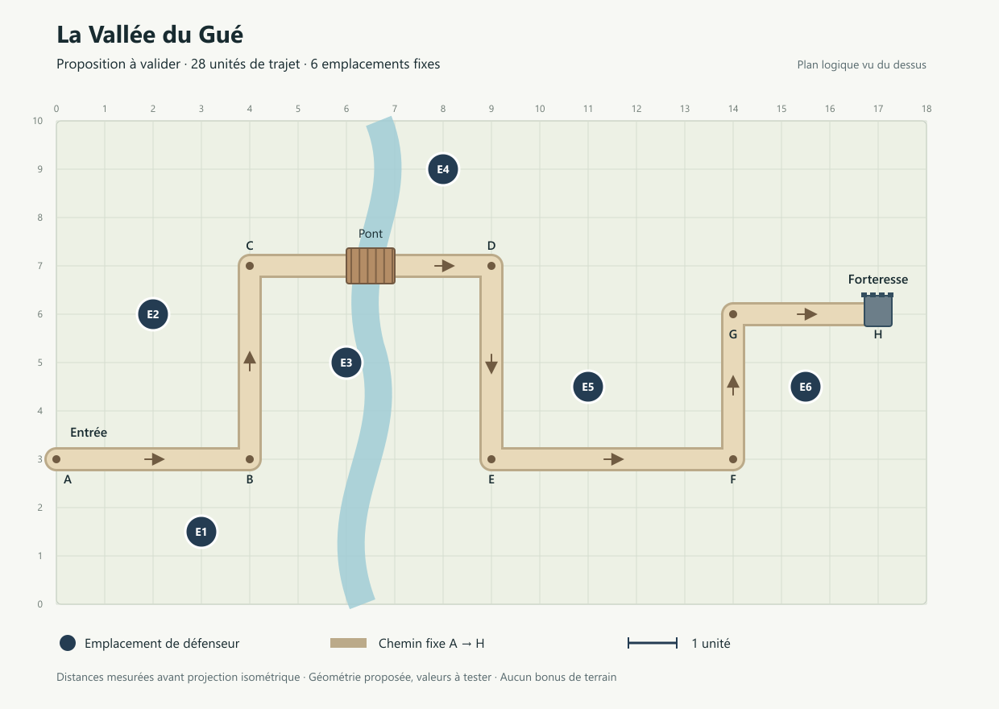

# For the Fortress!

Game Design Document — Version 0.66 — 17 novembre 2026

Document de référence pour concevoir et développer For the Fortress!, destiné au porteur du projet et aux personnes qui participeront à sa réalisation. Cette version consolide le combat, la campagne de 200 missions, entièrement jouable (vingt chapitres, dix biomes), la progression persistante par faction, les affixes de combat et le prototype Windows 0.206. Un atelier distinct permet de tester deux entrées convergentes. La démarche du loup est approuvée pour le prototype ; son orientation corrigée et le premier cycle du sanglier restent à examiner. La Gardienne, les rencontres et les réglages économiques restent à l’essai. La boutique, le mode infini, les difficultés avancées et les cartes à plusieurs forteresses restent à développer.

**Lecture :** les sections 1 à 46 décrivent le socle de combat et sa réalisation ; les sections 47 à 51 organisent le périmètre, les décisions et leur suivi ; les sections 52 à 56 détaillent la campagne, les talents, la sauvegarde et l’état vérifié ; la section 57 rassemble la boutique et ses alternatives ; la section 58 prépare les succès ; la section 59 décrit le chapitre 2 et la Gardienne à l’essai ; la section 60 présente les animations et les souverains ; la section 61 décrit l’atelier des routes convergentes et sa règle de ciblage ; les sections 62 à 66 consolident, depuis la version 0.18 (mises à jour à chaque version), la campagne de 200 missions et ses chapitres, les biomes et leurs affixes, la courbe de difficulté et les récompenses, l’équilibrage des talents et des cartes, le cadre de travail et le journal des versions 0.110 à 0.206. **Pour retrouver une décision passée : le registre de la section 48 (identifiants DEC, CAMP et MAJ), puis la section 62 pour la campagne et la section 63 pour les affixes.** Les calculs du socle portent sur les six défenseurs de départ, sans talents persistants sauf indication contraire. Les spécialisations de niveau 4 et les arbres persistants sont deux systèmes distincts.

**Version documentaire 0.66 ; jeu de référence 0.229.** Une fonctionnalité réalisée n’implique pas l’approbation définitive de ses réglages. Les statistiques, prix, cartes et effets proposés restent H lorsqu’ils n’ont pas été validés comme valeurs définitives. Les documents datés restent des sources historiques ; les règles consolidées prévalent en cas de contradiction.

Nom de travail — disponibilité juridique à confirmer.

## Sommaire

1. [1 Vision et cadre de conception](#s1)
2. [2 Boucle de jeu et carte du prototype](#s2)
3. [3 Factions races et classes](#s3)
4. [4 Statistiques niveaux et spécialisations](#s4)
5. [5 Combat des défenseurs Alliance](#s5)
6. [6 Combat des défenseurs de la Horde](#s6)
7. [7 Économie et calculs de référence](#s7)
8. [8 Bonus roguelite et synergies](#s8)
9. [9 Ennemis et boss du prototype](#s9)
10. [10 Composition des dix vagues](#s10)
11. [11 Calendrier et budget des vagues](#s11)
12. [12 Progression et dégâts par niveau](#s12)
13. [13 Coûts et lecture de la progression](#s13)
14. [14 Choix des spécialisations](#s14)
15. [15 Spécialisations Alliance](#s15)
16. [16 Rebonds et explosifs spécialisés](#s16)
17. [17 Spécialisations du chaman](#s17)
18. [18 Géométrie de La Vallée du Gué](#s18)
19. [19 Emplacements et couvertures](#s19)
20. [20 Plan et temps de traversée](#s20)
21. [21 Premier tir et ciblage](#s21)
22. [22 Impacts et malédictions](#s22)
23. [23 Ordre de résolution du combat](#s23)
24. [24 Cas de référence du combat](#s24)
25. [25 Bonus de combat et couverture](#s25)
26. [26 Bonus de niveau survie et économie](#s26)
27. [27 Tirage et cumul des bonus](#s27)
28. [28 Paramètres et prix avec bonus](#s28)
29. [29 Calculs et essais des bonus](#s29)
30. [30 Cadre et diversité raciale des synergies](#s30)
31. [31 Synergies de proximité](#s31)
32. [32 Synergies de spécialisations et budget](#s32)
33. [33 Cumul et recalcul des synergies](#s33)
34. [34 Calculs et essais des synergies](#s34)
35. [35 Recrutement des exemplaires](#s35)
36. [36 Copies synergies et nouvelle construction](#s36)
37. [37 Vente et remboursements](#s37)
38. [38 Compositions et budgets des copies](#s38)
39. [39 Vérifications du recrutement et des ventes](#s39)
40. [40 Présentation interface et validation du prototype](#s40)
41. [41 Parcours et panneaux du prototype](#s41)
42. [42 Phases et contrats de réalisation](#s42)
43. [43 Lots de réalisation du prototype](#s43)
44. [44 Critères de conformité du prototype](#s44)
45. [45 Mesures et essais de jeu du prototype](#s45)
46. [46 Socle technique de réalisation](#s46)
47. [47 Périmètre commercial et feuille de route](#s47)
48. [48 Registre des décisions](#s48)
49. [49 Questions ouvertes et suivi](#s49)
50. [50 Sources et historique du GDD](#s50)
51. [51 Maintenance du GDD](#s51)
52. [52 Campagne et récompenses de mission](#s52)
53. [53 Talents persistants et courbe XP](#s53)
54. [54 Sauvegarde et continuité de progression](#s54)
55. [55 Catalogue des talents du prototype](#s55)
56. [56 État vérifié et prochaines décisions](#s56)
57. [57 Boutique et unités alternatives](#s57)
58. [58 Succès et récompenses de campagne](#s58)
59. [59 Chapitre deux et Gardienne des berges](#s59)
60. [60 Présentation et animations du prototype](#s60)
61. [61 Atelier des routes convergentes](#s61)
62. [62 Campagne de 200 missions et courbe de difficulté](#s62)
63. [63 Biomes, nouveautés et affixes de combat](#s63)
64. [64 Équilibrage des talents et mesure des cartes](#s64)
65. [65 Cadre de travail, outils et production](#s65)
66. [66 Journal des versions 0.110 à 0.216](#s66)

## 1 Vision et cadre de conception

For the Fortress! est un Tower Defense roguelite solo dans un univers médiéval-fantasy coloré. Le joueur choisit une faction, compose sa défense sur des emplacements fixes et protège sa forteresse contre des vagues d’ennemis. La promesse est de proposer des règles simples à comprendre et de nombreuses combinaisons stratégiques.

### Fiche du projet
| Élément | Référence | Statut |
| --- | --- | --- |
| Nom de travail | For the Fortress! | V — nom de travail ; disponibilité juridique à confirmer |
| Genre et mode | Tower Defense roguelite fantasy, solo | V |
| Plateforme prioritaire | PC, Steam | C — orientation prioritaire |
| Moteur du premier essai | Godot avec GDScript | Choix initial de réalisation ; révisable |
| Modèle économique | Premium | C — intention commerciale |
| Prix envisagé | 7,99 € | H — prix de travail |
| Durée d’une partie prototype | 8 à 12 minutes | C — cible à mesurer |

### Les quatre piliers validés
- Deux factions réellement différentes par leur style de jeu, leurs défenseurs et leurs synergies, au-delà de leur apparence.
- Un Tower Defense lisible : chemins fixes, emplacements prédéfinis et attaques automatiques.
- Des décisions de composition, d’achat, d’amélioration, de spécialisation et de sélection de bonus.
- Une rejouabilité fondée sur les compositions et les améliorations aléatoires.

### Statuts utilisés dans tout le GDD
| Code | Signification | Conséquence |
| --- | --- | --- |
| V | Décision validée dans le socle fourni | À conserver jusqu’à une décision explicite de modification |
| H | Hypothèse de valeur ou d’équilibrage | À tester ; ne constitue pas un réglage final |
| C | Cible ou intention de périmètre | Guide de travail ; ne constitue pas un engagement de production |
| O | Question ouverte | Règle ou valeur à décider avant son implémentation définitive |
| P | Proposition ajoutée pour organiser le travail | À examiner ; aucune nouvelle fonctionnalité approuvée |

Les calculs dérivés sont signalés comme tels. Ils illustrent les valeurs de référence et n’ajoutent pas de règle de jeu. Les nombres de la version commerciale restent des objectifs envisagés.

## 2 Boucle de jeu et carte du prototype

### Déroulement validé
1. Choisir sa faction et sa carte.
2. Construire et améliorer les défenseurs entre les vagues.
3. Lancer une vague et résister aux ennemis.
4. Récupérer de l’or et adapter sa stratégie.
5. Après certaines vagues, choisir une amélioration roguelite.
6. Recommencer jusqu’à la victoire ou à la destruction de la forteresse.

### Actions selon la phase
| Action | Entre les vagues | Pendant les combats |
| --- | --- | --- |
| Construire ou acheter un défenseur | Autorisé — V | Non autorisé — V |
| Améliorer un défenseur | Autorisé — V | Non autorisé — V |
| Vendre un défenseur | Autorisé — V | Non autorisé — V |
| Observer et inspecter les unités | Disponible ; ergonomie finale O | Autorisé — V |
| Accélérer le déroulement | Sans objet | Autorisé — V ; ×1 / ×2 pour les essais (H) |
| Choisir un bonus roguelite | Après les vagues prévues — V | Pas de choix en combat dans le socle |

### La Vallée du Gué
La carte initiale est une scène médiévale-fantasy en vue isométrique. Elle comporte une route sinueuse, un pont, six emplacements de construction et une forteresse. Les ennemis suivent des chemins fixes et les défenseurs attaquent automatiquement depuis leurs emplacements.

| Paramètre du prototype | Valeur de référence | Statut |
| --- | --- | --- |
| Tracés et missions | 10 tracés et 20 missions dans le même biome ; section 52 | V pour l’extension de l’essai ; H pour les géométries |
| Emplacements de construction | 6 | C |
| Vagues | 10 | C |
| Or initial de combat | 150 or, distinct des PO persistantes | H — valeur de départ à tester |
| Points de vie de la forteresse | 20 PV | H — valeur de départ à tester |
| Choix roguelite | Après les vagues 3, 6 et 9 | V — calendrier du prototype |

### Conditions de fin à préciser
La destruction de la forteresse met fin à la partie — V. Les dégâts d’arrivée sont définis par ennemi en section 9, avec des valeurs H ; les arrivées simultanées sont résolues selon la section 23. La victoire survient lorsque la vague 10 est entièrement résolue et que la forteresse survit — V. Les règles de résolution figurent en section 10.

Le tracé de 28 unités et les six positions sont approuvés pour les essais, avec dimensions H. Les conventions et mesures figurent en sections 18 à 20 ; les portées initiales restent en sections 5 et 6. Aucun placement libre n’est ajouté.

## 3 Factions races et classes

### Identité des factions
| Faction provisoire | Races validées | Orientation validée |
| --- | --- | --- |
| Alliance des Royaumes | Humains, Elfes, Nains | Défense, précision, magie et ingénierie |
| Horde des Cendres | Orcs, Trolls, Morts-vivants, Gobelins | Offensive, poisons, malédictions et explosifs |

Les deux factions sont jouables — V. Leurs noms sont provisoires. Les comportements retenus pour le prototype sont détaillés en sections 5 et 6. Les autres axes, dont le poison, restent à spécifier.

### Roster du prototype
| Identifiant | Faction | Race | Classe ou rôle nommé |
| --- | --- | --- | --- |
| ALL_ELF_ARCHER | Alliance | Elfe | Archer |
| ALL_DWA_CROSSBOW | Alliance | Nain | Arbalétrier |
| ALL_HUM_MAGE | Alliance | Humain | Mage |
| HOR_TRO_AXE | Horde | Troll | Lanceur de haches |
| HOR_GOB_SAPPER | Horde | Gobelin | Sapeur |
| HOR_ORC_SHAMAN | Horde | Orc | Chaman |

Les six défenseurs sont issus du socle validé. Les identifiants ci-dessus sont une convention documentaire proposée — P — pour suivre les fiches dans Git et les futures données de jeu. Ils ne constituent pas une décision d’architecture.

### Limites du contenu défini
Les Morts-vivants appartiennent à la Horde, mais aucun défenseur mort-vivant n’est nommé dans le prototype. Aucun rôle supplémentaire ne doit être créé pour compléter artificiellement la liste. Le druide est cité uniquement dans un exemple de synergie ; sa présence dans le jeu et son appartenance de faction ne sont pas validées.

La version commerciale envisage huit défenseurs par faction, chacun doté de deux spécialisations — C. Quatre alternatives sont déjà jouables en section 57. Le reste du catalogue commercial, les races, classes et branches supplémentaires restent à définir. Le recrutement est limité au roster de la faction choisie pour le prototype — V.

### Fiche évolutive de défenseur
Chaque fiche pourra réunir : identifiant, nom, faction, race, classe, coût d’achat, statistiques par niveau, ciblage, spécialisation A, spécialisation B, interactions de synergie, statut des valeurs et source de validation. Tout champ non documenté conserve la valeur « À définir » ; cette absence ne signifie jamais zéro.

## 4 Statistiques niveaux et spécialisations

### Statistiques initiales des défenseurs
Toutes les valeurs de ce tableau sont des hypothèses initiales non équilibrées — H. Le coût est exprimé en pièces d’or. Le DPS représente des dégâts par seconde ; il ne suffit pas à définir les dégâts d’une attaque ou sa cadence.

| Défenseur | Achat en or | DPS de base | Statut |
| --- | --- | --- | --- |
| Archer elfe | 50 | 8 | H |
| Arbalétrier nain | 75 | 9,6 | H |
| Mage humain | 100 | 10,8 | H |
| Lanceur de haches troll | 50 | 8 | H |
| Sapeur gobelin | 75 | 9,6 | H |
| Chaman orc | 100 | 10,8 | H |

Les factions partagent les mêmes trois couples coût/DPS pour le prototype. Cette symétrie numérique n’annule pas l’objectif validé de différenciation. Les comportements initiaux sont précisés en sections 5 et 6 ; leur équilibre reste à tester.

### Progression avec l’or
Chaque défenseur peut être amélioré jusqu’au niveau 4 — V. Le niveau 4 débloque un choix entre deux branches de spécialisation — V. Les coûts d’amélioration restent provisoires — H.

| Passage | Coût supplémentaire en or | Investissement cumulé hors achat |
| --- | --- | --- |
| Niveau 1 vers niveau 2 | 50 | 50 |
| Niveau 2 vers niveau 3 | 100 | 150 |
| Niveau 3 vers niveau 4 | 150 | 300 |

La lecture séquentielle des trois coûts correspond aux trois améliorations jusqu’au niveau 4. La progression approuvée augmente uniquement les dégâts : × 1,5 au N2, × 2,25 au N3 et × 3,25 au N4, relativement au N1 — valeurs H. Cadence, portée, rayons, plafonds de victimes et horaires des effets restent inchangés — V. Les tableaux complets figurent en sections 12 et 13. Les valeurs finales spécialisées sont détaillées en sections 15 à 17 ; elles restent H.

### Références et paramètres encore ouverts
| Domaine | État actuel et questions restantes |
| --- | --- |
| Attaque | Comportements et niveaux définis en sections 5, 6 et 12 ; équilibrage H |
| Résolution des dégâts | Types et résistances futures ; cumul des bonus et synergies défini |
| Spécialisations | Noms définitifs, interface et équilibre des branches |
| Niveaux | Bonus et synergies définis en sections 27 et 33 |

Le choix de spécialisation est inclus dans le coût du passage au N4. Les effets approuvés sont détaillés en sections 14 à 17. Les dégâts secondaires du mage constituent une décision explicite documentée en section 5 ; critiques, soins, invocations et contrôle restent non définis.

## 5 Combat des défenseurs Alliance

### Portée de la validation
Les rôles, les comportements et les règles communes ci-dessous ont été approuvés pour le prototype dans l’échange suivant le GDD v0.2 — V. Les nombres sont retenus comme réglages initiaux à tester — H. Cette approbation ne les transforme pas en équilibre final et ne définit pas les spécialisations.

### Statistiques au niveau 1
Valeurs sans bonus ni synergie. Les coûts et DPS prolongent les hypothèses du socle. Les dégâts, intervalles et portées sont les nouveaux réglages initiaux approuvés pour les essais.

| Paramètre | Archer elfe | Arbalétrier nain | Mage humain |
| --- | --- | --- | --- |
| Coût en or — H | 50 | 75 | 100 |
| Dégâts principaux par attaque — H | 8 | 24 | 27 |
| Intervalle entre attaques — H | 1 seconde | 2,5 secondes | 2,5 secondes |
| DPS sur une cible — H | 8 | 9,6 | 10,8 |
| Portée en unités de carte — H | 4 | 5 | 3,5 |

Les distances n’imposent pas de grille de placement. L’échelle commune utilise le plan logique de La Vallée du Gué, en sections 18 à 20 ; ses dimensions restent H. DPS = dégâts par attaque ÷ intervalle entre attaques ; il s’agit d’un débit théorique en régime continu, sans déplacement de cible ni temps perdu.

### Rôles et comportements validés
L’archer elfe est une défense économique à cadence régulière. Il tire sur une seule cible, sans effet secondaire au niveau 1. Sa faiblesse est l’absence de dégâts de zone et des dégâts modestes par tir.

L’arbalétrier nain est un tireur lent à longue portée. Il touche une seule cible ; les dégâts dépassant les PV restants sont perdus. Le premier essai ne lui attribue ni perforation ni bonus contre les armures. Sa faible cadence rend un tir gaspillé plus pénalisant.

Le mage humain est spécialisé contre les groupes, avec une portée plus courte. Sa cible principale reçoit 27 dégâts. Jusqu’à deux autres ennemis situés à moins d’une unité du point d’impact reçoivent chacun 40 % des dégâts principaux, soit 10,8 dégâts. Chaque ennemi reçoit au maximum une application par attaque. Le rayon, le plafond et le coefficient sont des réglages H ; le principe de cette attaque est V.

Le DPS total théorique du mage atteint (27 + 10,8 + 10,8) ÷ 2,5 = 19,44 lorsque trois ennemis sont constamment regroupés. Cette valeur dérivée ne remplace pas son DPS de 10,8 sur une cible.

### Règles communes validées pour le premier essai
- Cibler automatiquement l’ennemi à portée le plus avancé sur le chemin vers la forteresse.
- Commencer une attaque uniquement avec une cible valide à portée ; recalculer sa priorité avant chaque tir selon la section 21.
- Tester sans réduction de dégâts liée aux résistances, sans bonus raciaux et sans spécialisations, afin de comparer les niveaux 1.

Les victimes secondaires les plus proches du point d’impact sont prioritaires — V. Le premier tir, les égalités et les impacts instantanés sont précisés en sections 21 à 23. Les tests de combat couvrent les cibles isolées et regroupées ; leurs résultats ne remplacent pas l’évaluation humaine de l’équilibre.

## 6 Combat des défenseurs de la Horde

### Portée de la validation
Les comportements sont approuvés pour le prototype — V. Les nombres restent des réglages initiaux — H. Les fiches décrivent le niveau 1 sans bonus ni spécialisation, avec les coûts et DPS du socle.

### Statistiques initiales
| Paramètre | Lanceur de haches troll | Sapeur gobelin | Chaman orc |
| --- | --- | --- | --- |
| Coût en or — H | 50 | 75 | 100 |
| Dégâts principaux par attaque — H | 16 | 24 | 12 immédiats et malédiction |
| Intervalle entre attaques — H | 2 secondes | 2,5 secondes | 2 secondes |
| DPS théorique sur une cible — H | 8 | 9,6 | 10,8, malédiction comprise |
| Portée en unités de carte — H | 3,5 | 3 | 4,5 |

L’unité de distance est commune aux factions et suit le plan logique de la carte, avec dimensions H. Les DPS supposent des attaques continues et des cibles survivant assez longtemps.

### Lanceur de haches troll
Une attaque inflige 16 dégâts à la cible principale, puis la hache peut rebondir sur un autre ennemi situé à moins d’une unité de celle-ci. Le rebond inflige 8 dégâts, soit 50 % du premier impact. Une attaque touche au maximum deux ennemis distincts ; elle ne revient pas blesser la cible principale. Sans seconde cible admissible, aucun rebond n’a lieu.

Le DPS théorique sur deux ennemis atteint (16 + 8) ÷ 2 = 12. Le troll traite les petits groupes ; face à l’archer, il perd en portée et en régularité. Le comportement de rebond est V ; ses valeurs restent H.

### Sapeur gobelin
Un explosif inflige 24 dégâts à la cible principale et 9,6 dégâts à chacune de ses victimes secondaires, soit 40 %. Jusqu’à trois ennemis secondaires situés à moins d’une unité du point d’impact peuvent être touchés. Chaque ennemi reçoit au maximum une application par explosion.

Avec quatre ennemis constamment regroupés, le DPS total théorique atteint (24 + 3 × 9,6) ÷ 2,5 = 21,12. La courte portée limite ses emplacements efficaces et son temps d’attaque. Sa supériorité possible sur le mage contre les groupes denses est un risque d’équilibrage à tester, pas un résultat acquis.

### Chaman orc
Toutes les deux secondes, une attaque inflige 12 dégâts immédiats et applique une malédiction. Celle-ci inflige 4,8 dégâts après une seconde puis 4,8 après deux secondes. Le total d’une attaque complète est de 21,6 dégâts, soit 10,8 DPS théoriques en régime continu. Une partie des dégâts peut arriver trop tard contre une cible fragile ou proche de la forteresse.

Les malédictions d’un même chaman ne se cumulent pas sur une cible ; une nouvelle application renouvelle l’effet. Au même instant, le dernier dégât périodique précède le renouvellement. Les effets de chamans différents fonctionnent indépendamment. La malédiction ne ralentit pas et ne réduit pas les résistances.

### Ciblage et comparaison des factions
La cible principale reste l’ennemi à portée le plus avancé. Pour les rebonds et explosions, priorité aux victimes secondaires les plus proches du point d’impact — V ; égalités départagées selon la section 21. Comparer les deux factions sur la même carte avant de conclure à leur équilibre.

## 7 Économie et calculs de référence

### Règles et paramètres
L’or finance les achats et les améliorations — V. Pour le premier essai, chaque élimination rapporte immédiatement une récompense unique, selon le tableau de la section 9. Les montants sont H. Le capital initial de référence est de 150 or — H. Aucun revenu passif de combat n’est validé. Les PO persistantes et l’XP sont distinctes de cet or et décrites en section 52.

### Récompenses validées pour le premier essai
- Créditer l’or immédiatement à la mort d’un ennemi, une seule fois, y compris après des dégâts de malédiction.
- Appliquer les mêmes récompenses aux deux factions.
- Lorsqu’un ennemi atteint la forteresse, appliquer ses dégâts puis le retirer de la partie, sans récompense.
- Ne pas attribuer de prime de fin de vague pendant ce premier essai.

Une unité peut être vendue uniquement entre les vagues contre 70 % de l’or total investi — V. Les synergies sont alors recalculées — V. Le remboursement est arrondi à l’entier inférieur, une seule fois par exemplaire vendu — V. R-10 et R-11 réduisent les dépenses futures selon la section 28 ; le remboursement utilise les montants réellement payés.

### Achat et améliorations cumulés
Le total au niveau 4 ci-dessous additionne l’achat et les trois coûts provisoires de 50, 100 et 150 or. Le choix de spécialisation est inclus dans l’amélioration vers le N4. Les remboursements appliquent 70 % puis l’arrondi inférieur par exemplaire.

| Défenseurs concernés | Investi N1 | Investi N4 | Vente N1 / N4 |
| --- | --- | --- | --- |
| Archer elfe ; Lanceur de haches troll | 50 | 350 | 35 / 245 |
| Arbalétrier nain ; Sapeur gobelin | 75 | 375 | 52 / 262 |
| Mage humain ; Chaman orc | 100 | 400 | 70 / 280 |

Formules dérivées : investissement = achat + améliorations payées ; remboursement = partie entière inférieure de (investissement × 0,70). La perte représente au moins 30 % de cet investissement. Ces calculs dépendent des hypothèses de coût et n’attestent pas leur équilibre.

### Exemples de budget initial
| Composition dans une seule faction | Dépense en or | Solde sur 150 or |
| --- | --- | --- |
| Deux défenseurs à 50 | 100 | 50 |
| Deux défenseurs à 75 | 150 | 0 |
| Un défenseur à 100 et un à 50 | 150 | 0 |
| Un défenseur à 75 et un à 50 | 125 | 25 |

Ces compositions respectent la limite de deux exemplaires par type (valeur H). Trois défenseurs à 50 or du même type sont interdits. Aucune composition n’est présentée comme stratégie optimale.

### Décisions d’équilibrage à prendre
Tester les gains par ennemi retenus en section 9 et la limite H de deux exemplaires par type. Les plafonds de revenus et un scénario de dépenses figurent en sections 10 et 11. Vérifier en jeu les choix entre élargir une défense et atteindre une spécialisation ; les gains réels dépendent des éliminations.

## 8 Bonus roguelite et synergies

### Améliorations pendant une partie
Après certaines vagues, le joueur choisit une amélioration parmi trois propositions aléatoires — V. Les bonus obtenus restent actifs jusqu’à la fin de la partie — V. Pour le prototype, les sélections ont lieu après les vagues 3, 6 et 9 — V, soit trois moments de choix.

Le prototype utilise douze bonus approuvés, détaillés en sections 25 à 29. Les valeurs restent H. La cible commerciale d’environ 60 bonus reste C. Les trois offres sont distinctes et les bonus déjà sélectionnés sont exclus ; pas de relance ni de rareté pour le prototype.

| Règle de génération | État |
| --- | --- |
| Trois propositions par choix | V |
| Tirage aléatoire | V |
| Poids égaux ; douze bonus éligibles aux deux factions ; aucune rareté | V |
| Trois offres distinctes ; bonus choisi exclu des tirages suivants | V |
| Pourcentages de dégâts additionnés selon les composantes ; voir section 27 | V |
| Catalogue de 12, 11 puis 10 entrées avant les trois tirages | Calcul dérivé |

### Les trois mécanismes de synergie
| Mécanisme validé | Intention | Règle du prototype |
| --- | --- | --- |
| Diversité de défenseurs d’une même race | Récompenser une composition raciale diversifiée | Deux types distincts par race ; +8 % H ; différé dans le prototype ; socle à six types de départ |
| Spécialisations | Créer des interactions entre choix de branches | Six associations N4 ; cumul par composante |
| Proximité entre certaines unités | Valoriser la disposition des défenseurs | Six associations ; centres à 5 unités H au maximum |

La diversité compte les types de défenseurs de base, pas les copies, niveaux ou branches. Le socle ne propose qu’un type par race ; le volet racial reste différé, y compris avec les alternatives actuelles. Les sections 30 à 34 précisent les synergies ; le recrutement est limité à deux exemplaires par type (H).

### Exemple non contractuel
Le socle illustre une interaction possible par un archer elfe placé près d’un druide qui pourrait recevoir des flèches empoisonnées. Cet exemple n’approuve ni le druide comme défenseur, ni une valeur de poison, ni une portée de voisinage. Il sert uniquement à expliquer le principe.

### Recalcul et progression persistante
Recalculer conditions et valeurs après construction, amélioration, choix de branche, vente et sélection d’un bonus, depuis les références sans cumul répété — V. La progression persistante est validée : XP, PO, points et arbres propres à chaque faction. Les règles actuelles figurent en sections 52 à 54. Les bonus de vagues et les unités déployées restent propres à la mission.

## 9 Ennemis et boss du prototype

### Périmètre et statut des valeurs
Le socle du premier chapitre retient sept archétypes ordinaires et un boss distinct — V. Leurs noms restent provisoires. Le chapitre 2 ajoute un neuvième profil, la tortue gardienne, à l’essai en section 59 — H. Les PV, vitesses, dégâts à la forteresse et récompenses sont des réglages initiaux — H. Ces huit profils du socle se distinguent par leur endurance, leur vitesse et leur nombre, sans résistances ni capacités spéciales supplémentaires. Cette limite ne s’étend pas à la capacité de transfert de dégâts du chapitre 2.

### Origine des attaquants
Les intitulés Grouillant, Pillard et suivants désignent les profils de combat utilisés dans les tableaux et les dix vagues du premier chapitre. En jeu, le loup, le sanglier et l’ours sont neutres et communs aux deux camps. Les autres identités proviennent de la faction adverse : jouer Horde fait affronter des attaquants Alliance, et inversement. Ces attaquants ne sont pas les défenseurs recrutables de l’autre faction. La répartition et les identités actuelles sont documentées dans `design/Catalogue_attaquants_v065.md` ; les noms et représentations restent évolutifs. Les descriptions de bonus, talents et inspection doivent respecter la faction jouée.

### Statistiques initiales
Les vitesses utilisent l’unité de carte commune aux portées des défenseurs, selon le plan logique approuvé, avec dimensions H. La récompense est exprimée en pièces d’or et créditée uniquement à l’élimination. Tous les nombres de ce tableau sont H.

| Ennemi provisoire | PV | Vitesse par seconde | Dégâts forteresse | Or |
| --- | --- | --- | --- | --- |
| Grouillant | 12 | 1,15 | 1 | 1 |
| Pillard | 40 | 1 | 1 | 3 |
| Sprinter | 24 | 1,65 | 1 | 3 |
| Brute | 120 | 0,70 | 2 | 7 |
| Maraudeur | 80 | 1,20 | 2 | 6 |
| Colosse | 240 | 0,50 | 3 | 14 |
| Élite | 360 | 0,75 | 4 | 20 |
| Boss Seigneur de siège | 600 | 0,45 | 20 | 40 |

### Rôle des sept archétypes ordinaires
Le grouillant teste les groupes denses. Ses 12 PV de référence lui permettent de survivre à une seule application secondaire du mage à 10,8 dégâts ou au rebond du troll à 8 dégâts. Le nombre et l’espacement initiaux des grouillants figurent en section 10 — H.

Le pillard est l’ennemi de référence pour comparer les défenseurs. Sans bonus, 40 PV nécessitent cinq impacts d’archer à 8 dégâts ou deux impacts d’arbalétrier à 24 dégâts. Ces calculs comptent les impacts et ne prédisent pas un temps d’élimination.

Le sprinter teste la couverture du chemin. Fragile et rapide, il peut être éliminé par un impact d’arbalétrier ; des arrivées rapprochées exposent la lenteur de cette arme. La brute est lente et endurante ; elle permet d’observer les dégâts soutenus et les malédictions.

Le maraudeur combine endurance et vitesse pour éprouver les défenses concentrées sur un seul emplacement. Le colosse occupe longtemps les défenseurs ; sa position sur le chemin peut détourner des tirs d’autres ennemis. L’élite, robuste et plus mobile que le colosse, prépare les dernières vagues sans capacité particulière.

### Seigneur de siège
Le boss est prévu à la vague 10 — V. Les essais initiaux lui attribuent 600 PV, une vitesse de 0,45 et 20 dégâts à la forteresse — H. Avec la forteresse initiale à 20 PV, son arrivée est fatale. Il rapporte 40 or s’il est éliminé ; cette récompense ne présume pas d’une utilisation après la dernière vague.

Le premier essai ne comporte ni phases ni invocations. Rebonds, explosions et malédictions s’appliquent normalement au boss. Ses éventuelles capacités ultérieures restent ouvertes ; la victoire est définie en section 10. Le prototype est jouable et testé ; ces réglages restent H. Les validations de fonctionnement ne prouvent pas un équilibre final ni une difficulté uniforme entre compositions.

## 10 Composition des dix vagues

Cette séquence est celle des missions 1 à 10. Les missions 11 à 20 utilisent la séquence distincte de la section 59. Les règles communes de lancement, de fin de vague et de choix de bonus restent applicables aux deux chapitres.

### Statut et lecture de la séquence
La séquence et les règles d’apparition sont approuvées pour le prototype — V. Quantités, intervalles et pause de groupe sont des réglages initiaux — H. Les récompenses utilisent les valeurs H de la section 9 ; leurs cumuls sont des calculs dérivés, pas des gains garantis.

### Règles d’apparition et de résolution
- Le temps repart à zéro au lancement de chaque vague ; son premier ennemi apparaît à t = 0.
- Les groupes apparaissent dans l’ordre des flèches. Chaque intervalle s’applique entre deux apparitions successives d’un même groupe, à vitesse de jeu normale.
- Le groupe suivant commence 4 secondes après la dernière apparition du précédent — H. Les ennemis précédents peuvent encore être présents sur le chemin.
- Un groupe de n ennemis espacés de Δ secondes émet pendant (n − 1) × Δ secondes. Un ennemi unique n’a aucun intervalle interne.
- La vague est terminée après sa dernière apparition, lorsque tous ses ennemis ont été éliminés ou ont atteint la forteresse. Si celle-ci survit, le joueur peut préparer puis lancer la suivante.
- Les choix roguelite restent après les vagues 3, 6 et 9. Après résolution complète de la vague 10, la forteresse survivante remporte la victoire ; sa destruction entraîne la défaite.

### Quantités intervalles et revenus
Les intervalles sont indiqués dans le même ordre que les groupes. Le cumul exclut les 150 or initiaux et ne déduit aucun achat ; tous les ennemis doivent être éliminés pour atteindre ce maximum. Aucun bonus économique non défini n’est inclus.

| Vague | Groupes dans l’ordre d’apparition | Intervalles internes | Or maximal | Cumul maximal |
| --- | --- | --- | --- | --- |
| 1 | 10 Pillards | 2,5 s | 30 | 30 |
| 2 | 10 Pillards → 8 Grouillants | 2 s / 0,65 s | 38 | 68 |
| 3 | 8 Pillards → 8 Sprinters | 1,8 s / 1,4 s | 48 | 116 |
| 4 | 4 Brutes → 16 Grouillants | 3 s / 0,5 s | 44 | 160 |
| 5 | 6 Maraudeurs → 4 Brutes → 8 Sprinters | 2 s / 3 s / 1,2 s | 88 | 248 |
| 6 | 2 Colosses → 6 Brutes → 12 Grouillants | 4 s / 2,2 s / 0,5 s | 82 | 330 |
| 7 | 1 Élite → 2 Colosses → 8 Maraudeurs | unique / 4 s / 1,6 s | 96 | 426 |
| 8 | 24 Grouillants → 12 Sprinters → 8 Maraudeurs | 0,35 s / 1 s / 1,2 s | 108 | 534 |
| 9 | 2 Élites → 2 Colosses → 4 Brutes → 6 Maraudeurs | 5 s / 4 s / 2,2 s / 1,4 s | 132 | 666 |
| 10 | 1 Seigneur de siège → 2 Élites → 8 Sprinters | unique / 5 s / 1 s | 104 | 770 |

### Progression recherchée
Les vagues 1 à 3 présentent le chemin, les groupes puis la vitesse. Les vagues 4 à 7 introduisent Brutes, Maraudeurs, Colosses et Élites. La vague 8 sollicite les dégâts de groupe ; la vague 9 augmente fortement la charge de PV. La vague 10 confronte la défense au boss, à deux Élites et à huit Sprinters. Les chevauchements réels sur le chemin et la difficulté restent à mesurer.

## 11 Calendrier et budget des vagues

Les calendriers, revenus et budgets de cette section concernent la séquence du premier chapitre. Le chapitre 2 conserve la méthode de calendrier, mais possède les groupes et revenus de la section 59.

### Charge et horaires calculés
Les horaires indiquent la dernière apparition depuis le lancement de chaque vague, avec les intervalles et séparations de la section 10. Les PV cumulés ne mesurent pas seuls la difficulté.

| Vague | Ennemis | PV cumulés | Dernière apparition | Budget brut après la vague |
| --- | --- | --- | --- | --- |
| 1 | 10 | 400 | 22,5 s | 180 or |
| 2 | 18 | 496 | 26,55 s | 218 or |
| 3 | 16 | 512 | 26,4 s | 266 or |
| 4 | 20 | 672 | 20,5 s | 310 or |
| 5 | 18 | 1152 | 35,4 s | 398 or |
| 6 | 20 | 1344 | 28,5 s | 480 or |
| 7 | 11 | 1480 | 23,2 s | 576 or |
| 8 | 44 | 1216 | 35,45 s | 684 or |
| 9 | 14 | 2160 | 34,6 s | 816 or |
| 10 | 11 | 1512 | 20 s | 920 or |

Le budget brut vaut 150 + récompenses cumulées, avant toute dépense. Le revenu réel additionne seulement les récompenses des ennemis éliminés. Deux Pillards atteignant la forteresse en vague 1 ramènent son revenu de 30 à 24 or.

### Scénario de dépenses calculé
Exemple pour les trois défenseurs distincts de chaque faction, sans bonus, vente ni doublon et avec toutes les éliminations. Les soldes incluent les vagues intermédiaires sans achat. Les prix restent H ; le scénario démontre seulement la capacité de financement.

| Moment | Achat ou amélioration | Dépense en or | Solde en or |
| --- | --- | --- | --- |
| Départ | Acheter les défenseurs à 50 et 75 or | 125 | 25 |
| Après vague 3 | Acheter le défenseur à 100 or | 100 | 41 |
| Après vague 4 | Défenseur à 50 or au niveau 2 | 50 | 35 |
| Après vague 5 | Ce même défenseur au niveau 3 | 100 | 23 |
| Après vague 7 | Ce même défenseur au niveau 4 | 150 | 51 |
| Après vague 8 | Les deux autres défenseurs au niveau 2 | 100 | 59 |
| Après vague 9 | Défenseur à 75 or au niveau 3 | 100 | 91 |
| Après vague 10 | Aucun achat supplémentaire prévu | 0 | 195 |

Le N4 est finançable avant la vague 8. Avant le boss, la composition N4 / N3 / N2 atteint 63,8 DPS théoriques hors spécialisation (section 13). Ce calcul ne garantit pas la victoire.

### Totaux et durée à éprouver
Total : 182 ennemis et 770 or de récompenses maximales. Avant le boss : 816 or bruts, capital inclus. Les 104 or de la dernière vague ne peuvent financer sa défense : les achats en combat sont interdits.

Les apparitions durent au total 4 min 33,1 s (273,1 s), hors fins de combat et préparations. La cible de 8 à 12 minutes reste à vérifier. Horaires détaillés : design/Proposition_dix_vagues.md.

## 12 Progression et dégâts par niveau

### Principe et multiplicateurs
Ces règles décrivent la progression de base, avant les dérogations des branches spécialisées.

Le principe de progression est validé — V ; les nombres sont des hypothèses H. Les dégâts N1 sont multipliés par 1 / 1,5 / 2,25 / 3,25 aux niveaux 1 / 2 / 3 / 4. Un multiplicateur s’applique au N1, jamais au niveau précédent. Il affecte les dégâts directs, secondaires et périodiques.

Cadence, portée, rayons, nombre de victimes secondaires, coefficients et horaires des effets restent inchangés. Les fractions sont conservées sans arrondi intermédiaire pour les statistiques de référence. Bonus, résistances et branches sont exclus de ces tableaux. Le N4 représente le socle avant spécialisation.

### DPS théorique sur une cible
Le chaman inclut les deux applications de malédiction, sur une cible survivante et attaquée en continu.

| Défenseur | N1 | N2 | N3 | N4 |
| --- | --- | --- | --- | --- |
| Archer elfe | 8 | 12 | 18 | 26 |
| Arbalétrier nain | 9,6 | 14,4 | 21,6 | 31,2 |
| Mage humain | 10,8 | 16,2 | 24,3 | 35,1 |
| Lanceur de haches troll | 8 | 12 | 18 | 26 |
| Sapeur gobelin | 9,6 | 14,4 | 21,6 | 31,2 |
| Chaman orc | 10,8 | 16,2 | 24,3 | 35,1 |

### Dégâts directs par attaque
Intervalles : archer 1 s ; arbalétrier, mage et sapeur 2,5 s ; troll et chaman 2 s.

| Défenseur | N1 | N2 | N3 | N4 |
| --- | --- | --- | --- | --- |
| Archer elfe | 8 | 12 | 18 | 26 |
| Arbalétrier nain | 24 | 36 | 54 | 78 |
| Mage humain | 27 | 40,5 | 60,75 | 87,75 |
| Lanceur de haches troll | 16 | 24 | 36 | 52 |
| Sapeur gobelin | 24 | 36 | 54 | 78 |
| Chaman orc | 12 | 18 | 27 | 39 |

### Dégâts secondaires et périodiques
Par victime secondaire pour mage, troll et sapeur ; par application à +1 s et +2 s pour le chaman.

| Défenseur | N1 | N2 | N3 | N4 |
| --- | --- | --- | --- | --- |
| Mage humain | 10,8 | 16,2 | 24,3 | 35,1 |
| Lanceur de haches troll | 8 | 12 | 18 | 26 |
| Sapeur gobelin | 9,6 | 14,4 | 21,6 | 31,2 |
| Chaman orc | 4,8 | 7,2 | 10,8 | 15,6 |

Le mage conserve au maximum deux victimes secondaires à 40 %, le troll un rebond à 50 % et le sapeur trois victimes secondaires à 40 %. Leur rayon ou distance reste d’une unité de carte. Les règles de renouvellement de malédiction restent celles de la section 6.

## 13 Coûts et lecture de la progression

### Plafonds théoriques de dégâts de groupe — H
Ces plafonds supposent des attaques continues, des cibles admissibles au maximum et assez de PV. Mage : trois victimes au total ; troll : deux ; sapeur : quatre. Ils ne prédisent pas les éliminations réelles.

| Défenseur | N1 | N2 | N3 | N4 |
| --- | --- | --- | --- | --- |
| Mage humain | 19,44 | 29,16 | 43,74 | 63,18 |
| Lanceur de haches troll | 12 | 18 | 27 | 39 |
| Sapeur gobelin | 21,12 | 31,68 | 47,52 | 68,64 |

### Investissement total par défenseur — H
Pièces d’or, achat et améliorations compris ; spécialisation incluse. Les trois passages coûtent 50, 100 et 150 or.

| Défenseur | N1 | N2 | N3 | N4 |
| --- | --- | --- | --- | --- |
| Archer elfe | 50 | 100 | 200 | 350 |
| Arbalétrier nain | 75 | 125 | 225 | 375 |
| Mage humain | 100 | 150 | 250 | 400 |
| Lanceur de haches troll | 50 | 100 | 200 | 350 |
| Sapeur gobelin | 75 | 125 | 225 | 375 |
| Chaman orc | 100 | 150 | 250 | 400 |

### Seuils de dégâts à vérifier
Sans résistance ni bonus et aux PV ennemis actuels :
- Archer N2 : 12 dégâts, soit un Grouillant en un impact ; N4 : 26 dégâts, soit un Sprinter.
- Troll N2 : 24 dégâts directs contre un Sprinter et 12 par rebond contre un Grouillant.
- Arbalétrier N3 : 54 dégâts directs, suffisants contre un Pillard à 40 PV.
- Mage N2 : 16,2 dégâts secondaires et sapeur N2 : 14,4 ; chacun suffit contre un Grouillant.
- Chaman N3 : 27 dégâts immédiats, suffisants contre un Sprinter sans attendre sa malédiction.

Ces seuils peuvent produire des sauts de difficulté, notamment sur la vague 8. Ces calculs restent des références sans talents ; les essais jouables et automatisés sont archivés séparément, sans validation définitive de l’équilibre.

### Achats et concentration de puissance
Pour l’archer, les améliorations coûtent 50 or pour +4 DPS, 100 or pour +6 et 150 or pour +8 et le choix de spécialisation. Le rendement marginal diminue ; les six emplacements et les branches doivent rendre la concentration de puissance intéressante. Deux exemplaires par type peuvent être déployés ; le seuil reste H.

Le scénario de la section 11 investit 350 + 225 + 150 = 725 or avant le boss, avec un solde maximal de 91 or. La fiche design/Proposition_progression_niveaux.md rassemble les calculs. Les branches sont détaillées en sections 14 à 17.

## 14 Choix des spécialisations

### Choix validé au niveau 4
Choisir une des deux branches pendant le passage N3 vers N4, entre les vagues — V. Le choix est inclus dans les 150 or provisoires de l’amélioration : aucun surcoût pour le prototype. Une seule branche par unité, fixée jusqu’à la vente. Une nouvelle unité repart au N1 ; le recrutement est limité à deux exemplaires par type (H).

Les deux branches du socle sont accessibles dès les essais, sans prérequis racial ajouté ; les branches des alternatives suivent leur déblocage en boutique. Terminer le choix avant de lancer la vague suivante. Aucun effet n’est rétroactif sur une attaque ou malédiction déjà appliquée. Le prototype présente les deux branches et leur coût avant confirmation.

Les noms sont provisoires. Les rôles et comportements des douze branches sont approuvés — V ; toutes les statistiques sont des hypothèses H. La fiche design/Proposition_specialisations.md conserve les détails et le plan d’essais.

### Lecture des valeurs spécialisées
Les sections 15 à 17 donnent les valeurs finales au N4 spécialisé, hors bonus et résistances. Ne pas appliquer à nouveau le multiplicateur × 3,25. Les branches dérogent uniquement aux paramètres explicitement remplacés ; les autres règles du GDD continuent de s’appliquer.

Le ciblage principal reste l’ennemi à portée le plus avancé et les victimes secondaires les plus proches restent prioritaires. Le DPS suppose des attaques continues et assez de PV ; les plafonds de groupe supposent toutes les victimes admissibles. Les douze bonus suivent les formules de la section 27 ; les résistances futures restent ouvertes ; les synergies suivent la section 33.

### Budget conservé et comparaisons
Le total investi au N4 reste 350, 375 ou 400 or. La vente à 70 %, arrondie vers le bas par exemplaire, rend 245, 262 ou 280 or.

Le scénario de la section 11 conserve 725 or investis et 91 or de solde maximal avant le boss. Seul le défenseur à 50 or y atteint le N4 ; les deux autres sont N3 et N2.

| Composition avant le boss | DPS sur une cible |
| --- | --- |
| Alliance : Veilleur N4 + Arbalétrier N3 + Mage N2 | 63,8 |
| Alliance : Tireur de volée N4 + Arbalétrier N3 + Mage N2 | 70,3 |
| Horde : Fendeur N4 + Sapeur N3 + Chaman N2 | 70,3 |
| Horde : Ricochets N4 + Sapeur N3 + Chaman N2 | 60,8 |

Dégâts secondaires exclus. Ces calculs ne garantissent pas la victoire. Tester les branches à 75 et 100 or avec d’autres allocations du même budget, sans leur attribuer gratuitement des niveaux supplémentaires.

## 15 Spécialisations Alliance

### Archer elfe portée ou cadence

N4 de base : 26 dégâts toutes les 1 s, portée 4, soit 26 DPS sur une cible.

| Branche | Dégâts par tir | Intervalle | Portée | DPS sur une cible |
| --- | --- | --- | --- | --- |
| A — Veilleur des remparts | 39 | 1,5 s | 5 | 26 |
| B — Tireur de volée | 19,5 | 0,6 s | 3,5 | 32,5 |

Veilleur : couvrir un segment plus long et frapper plus fort par impact. La cadence plus lente augmente les dégâts perdus sur les petites cibles. Le gain de portée peut accroître le temps de tir réel sans modifier le DPS continu.

Tireur de volée : attaques fréquentes et meilleur DPS continu, contre une portée réduite et un dégât par impact plus faible. Les tirs restent dirigés sur une seule cible ; « volée » ne signifie pas attaque de zone.

### Arbalétrier nain puissance ou couverture

N4 de base : 78 dégâts toutes les 2,5 s, portée 5, soit 31,2 DPS sur une cible.

| Branche | Dégâts par tir | Intervalle | Portée | DPS sur une cible |
| --- | --- | --- | --- | --- |
| A — Brise-siège | 117 | 3 s | 5 | 39 |
| B — Sentinelle des tours | 78 | 2,5 s | 6,5 | 31,2 |

Brise-siège : tirs puissants pour les ennemis endurants ; cadence plus lente, dégâts excédentaires perdus. À 117 dégâts, il n’élimine pas une Brute à 120 PV en un impact sans autre effet.

Sentinelle : étendre la couverture depuis un emplacement fixe, sans gain de dégâts ou de cadence. Son intérêt dépend fortement du tracé de la carte. Aucun changement de priorité vers les boss ou ennemis à forts PV n’est ajouté.

### Mage humain concentration ou dispersion

N4 de base : 87,75 dégâts principaux, deux victimes secondaires à 35,1 chacune, intervalle 2,5 s, portée 3,5, rayon 1. DPS : 35,1 sur une cible ; 63,18 au plafond de trois victimes.

| Branche | Dégâts principaux | Par victime secondaire | Maximum secondaire | Rayon |
| --- | --- | --- | --- | --- |
| A — Arcaniste de concentration | 110 | 22 (20 %) | 2 | 1 |
| B — Maître des déflagrations | 70 | 28 (40 %) | 4 | 1,3 |

Intervalle 2,5 s et portée 3,5 pour les deux branches.

Concentration : 44 DPS sur une cible et 61,6 au plafond de trois victimes. Renforce la cible principale ; réduit l’efficacité de zone.

Déflagrations : 28 DPS sur une cible et 72,8 au plafond de cinq victimes. Agrandit la zone et le nombre de victimes, au prix du dégât principal. Une même victime n’est touchée qu’une fois par explosion.

## 16 Rebonds et explosifs spécialisés

### Lanceur de haches troll impact ou chaîne

N4 de base : 52 dégâts principaux, un rebond à 26, intervalle 2 s, portée 3,5, distance de rebond 1. DPS : 26 sur une cible ; 39 sur deux.

| Branche | Dégâts principaux | Par rebond | Nombre maximal de rebonds | Distance par rebond |
| --- | --- | --- | --- | --- |
| A — Fendeur de crânes | 65 | 16,25 (25 %) | 1 | 1 |
| B — Maître des ricochets | 46 | 23 (50 %) | 3 | 1 |

Intervalle 2 s et portée 3,5 pour les deux branches.

Fendeur : 32,5 DPS sur une cible et 40,625 sur deux. Meilleur impact principal, mais rebond plus faible que celui du N4 de base.

Ricochets : 23 DPS sur une cible et 57,5 au plafond de quatre victimes. Les rebonds sont successifs : à chaque étape, chercher l’ennemi admissible le plus proche de la dernière victime, à une distance strictement inférieure à 1. Chaque rebond inflige 50 % du dégât principal initial, sans réduction supplémentaire d’étape en étape. Une attaque ne touche jamais deux fois le même ennemi ; elle s’arrête faute de cible. Les égalités de distance sont départagées par progression puis ordre d’apparition, selon la section 21.

### Sapeur gobelin charge concentrée ou large explosion

N4 de base : 78 dégâts principaux et trois victimes secondaires à 31,2, intervalle 2,5 s, portée 3, rayon 1. DPS : 31,2 sur une cible ; 68,64 sur quatre.

| Branche | Dégâts principaux | Par victime secondaire | Maximum secondaire | Rayon |
| --- | --- | --- | --- | --- |
| A — Expert en démolition | 104 | 26 (25 %) | 3 | 1 |
| B — Artificier des foules | 65 | 26 (40 %) | 5 | 1,4 |

Intervalle 2,5 s et portée 3 pour les deux branches.

Démolition : 41,6 DPS sur une cible et 72,8 au plafond de quatre victimes. Renforce le point d’impact en sacrifiant les dégâts par victime secondaire.

Foules : 26 DPS sur une cible et 78 au plafond de six victimes. Plus de couverture et de victimes possibles, mais moins de dégâts sur la cible principale et sur chaque victime que le N4 de base. Aucune mine, zone persistante ou explosion en chaîne n’est ajoutée. Chaque victime n’est touchée qu’une fois par attaque.

## 17 Spécialisations du chaman

### Chaman orc dégâts immédiats ou malédiction

N4 de base : 39 dégâts immédiats et deux applications à 15,6, à +1 s et +2 s. Intervalle 2 s, portée 4,5. DPS complet sur une cible survivante : 35,1.

| Branche | Dégâts immédiats | Dégâts à +1 s | Dégâts à +2 s | DPS complet |
| --- | --- | --- | --- | --- |
| A — Chaman de guerre | 58,5 | 9,75 | 9,75 | 39 |
| B — Tisseur de malédictions | 26 | 29,25 | 29,25 | 42,25 |

Intervalle 2 s et portée 4,5 inchangés. Guerre inflige 78 dégâts sur un cycle complet ; Malédictions en inflige 84,5.

Guerre : davantage de dégâts dès l’impact, moins de dégâts différés. Utile lorsque la cible risque d’atteindre rapidement la forteresse.

Malédictions : chaque application périodique devient plus forte, contre un impact initial plus faible. Les effets déjà appliqués suivent les règles de renouvellement du GDD ; au même instant, le dernier dégât périodique précède le renouvellement. Aucun cumul supplémentaire, ralentissement, transfert de malédiction ou réduction de résistance n’est proposé.

Guerre élimine un Pillard à 40 PV dès l’impact ; Malédictions élimine un Sprinter à 24 PV dès l’impact, mais doit attendre la suite de l’effet pour dépasser le total de Guerre. Les malédictions continuent après sortie de portée tant que la cible reste présente, selon la section 22. Le gain total de Malédictions donne une contrepartie mesurable à son impact initial réduit. Les synergies du catalogue suivent les sections 30 à 34 ; autres effets ouverts.

### Essais et questions ouvertes
Comparer chaque branche au N4 de base puis à sa concurrente, sur les mêmes vagues, carte et budget. Observer le temps de tir, les victimes secondaires réelles, les dégâts perdus et les PV de forteresse perdus. Vérifier les vagues 4 et 8 pour les groupes, les vagues 6, 7, 9 et 10 pour les cibles endurantes, et la vague 3 pour la vitesse.

L’interface reste ouverte ; la vente est arrondie à l’entier inférieur par exemplaire ; le combat conserve les fractions et applique les synergies définies. Aucun test jouable n’établit encore l’équilibre des branches.

## 18 Géométrie de La Vallée du Gué

### Géométrie approuvée pour le prototype
La Vallée du Gué utilise un seul trajet A → B → C → D → E → F → G → H, identique pour tous les ennemis et les deux factions — V. Une entrée et une arrivée à la forteresse, sans bifurcation. Dimensions et coordonnées ci-dessous : réglages initiaux H.

Le terrain logique mesure 18 × 10 unités. Origine en bas à gauche ; x vers la droite et y vers le haut. Cette convention ne prescrit pas les axes du moteur. La projection isométrique conserve les distances du plan logique.

| Point | Coordonnées (x ; y) | Distance depuis l’entrée |
| --- | --- | --- |
| A | 0 ; 3 | 0 u |
| B | 4 ; 3 | 4 u |
| C | 4 ; 7 | 8 u |
| D | 9 ; 7 | 13 u |
| E | 9 ; 3 | 17 u |
| F | 14 ; 3 | 22 u |
| G | 14 ; 6 | 25 u |
| H | 17 ; 6 | 28 u |

Le trajet mesure 28 unités : sept segments de 4, 4, 5, 4, 5, 3 et 3 unités. Les virages orthogonaux servent de référence ; les arrondir imposerait de recalculer longueur et couvertures.

Le pont occupe C → D, de (6 ; 7) à (7 ; 7), soit de 10 à 11 unités parcourues. Il reste une partie ordinaire du chemin. La rivière est un décor ; aucun effet de terrain supplémentaire n’est défini.

### Distances et circulation validées
- Déplacement à vitesse constante le long de la ligne centrale, sans arrêt aux virages ; vitesses en unités par seconde.
- Distances euclidiennes entre centres, dans le plan logique, avant projection isométrique.
- Acquisition d’une cible principale à distance inférieure ou égale à la portée ; rayons secondaires et rebonds gardent leur règle strictement inférieure.
- Priorité au plus avancé selon la distance parcourue de A vers H ; égalités selon la section 21.
- Aucun blocage mutuel ni ralentissement de circulation pour l’essai initial. Les emplacements ne bloquent pas la route.
- Les décors ne bloquent pas les attaques. Les frontières servent au cadrage ; les portées peuvent les dépasser.

Les tailles graphiques ne modifient pas les distances. Largeur visuelle et empreintes restent à concevoir. Les projectiles sont visuels ; tir et effets hors portée suivent les sections 21 à 23. La fiche design/Proposition_Vallee_du_Gue.md conserve le protocole de vérification.

## 19 Emplacements et couvertures

### Positions fixes
Les six emplacements sont disponibles dès le départ. Chacun accueille un défenseur de la faction choisie, sans restriction de classe — V. Deux exemplaires par type peuvent être déployés ; le seuil reste H. Coordonnées H ; intentions sans bonus d’emplacement.

| Repère | Coordonnées (x ; y) | Intention de positionnement |
| --- | --- | --- |
| E1 | 3 ; 1,5 | Entrée et premier virage |
| E2 | 2 ; 6 | Premier lacet et accès au pont |
| E3 | 6 ; 5 | Pont et cœur du premier lacet |
| E4 | 8 ; 9 | Sortie du pont et virage central |
| E5 | 11 ; 4,5 | Second lacet et approche finale |
| E6 | 15,5 ; 4,5 | Dernier virage et porte de la forteresse |

Les centres sont hors du trajet, à une distance minimale d’au moins 1,5 unité. E3 et E5 couvrent plusieurs segments : leur avantage potentiel est un risque d’équilibrage à tester. E6 conserve une dernière fenêtre de tir.

### Longueurs du trajet à portée
Valeurs calculées, en unités de chemin, à partir des coordonnées H. Le tableau additionne les portions situées dans un cercle centré sur l’emplacement. Il ne mesure ni les dégâts ni les éliminations. Affichage arrondi à deux décimales au maximum, sans arrondi intermédiaire par segment.

| Emplacement | Portée 3 | Portée 3,5 | Portée 4 | Portée 5 | Portée 6,5 |
| --- | --- | --- | --- | --- | --- |
| E1 | 4,93 u | 5,85 u | 6,37 u | 7,4 u | 11,79 u |
| E2 | 4,06 u | 8,83 u | 9,87 u | 10,9 u | 12,42 u |
| E3 | 8,47 u | 13,35 u | 14,93 u | 17,17 u | 20,18 u |
| E4 | 4,06 u | 5,23 u | 6,34 u | 8,9 u | 13,62 u |
| E5 | 8,33 u | 12,61 u | 13,83 u | 16,1 u | 19 u |
| E6 | 7,1 u | 7,66 u | 8,21 u | 9,27 u | 10,82 u |

Références : sapeur 3 ; mage et troll 3,5 ; archer 4 ; chaman 4,5 ; arbalétrier 5. Tireur de volée 3,5 ; Veilleur 5 ; Sentinelle 6,5. La portée 4,5 se calcule selon les mêmes conventions.

Pour un ennemi jamais éliminé, à vitesse constante v, le temps cumulé à portée vaut longueur couverte ÷ v. Plusieurs fenêtres peuvent être séparées. Cadence, premier tir, concurrence des cibles et dégâts perdus déterminent le résultat réel.

### Vérification proposée
Contrôler les cercles de portée puis comparer les emplacements à défenseur, niveau, branche et vague identiques. Noter temps de tir utile, éliminations et fuites. Tester les zones au pont, les ricochets et l’intérêt réel des branches de portée. Ne pas modifier simultanément carte, ennemis et défenseurs sans conserver une référence.

## 20 Plan et temps de traversée

### Plan logique de référence

Le plan est vu du dessus pour mesurer la géométrie ; la présentation du jeu reste isométrique. Il ne fixe pas les assets ni le style graphique final.

### Traversée théorique sans combat
| Archétype | Vitesse du GDD | 28 ÷ vitesse |
| --- | --- | --- |
| Grouillant | 1,15 u/s | 24,35 s |
| Pillard | 1 u/s | 28 s |
| Sprinter | 1,65 u/s | 16,97 s |
| Brute | 0,7 u/s | 40 s |
| Maraudeur | 1,2 u/s | 23,33 s |
| Colosse | 0,5 u/s | 56 s |
| Élite | 0,75 u/s | 37,33 s |
| Seigneur de siège | 0,45 u/s | 62,22 s |

Calcul : 28 ÷ vitesse, sans élimination ni blocage. Le dernier Pillard de la vague 1 apparaîtrait à 22,5 s et arriverait à 50,5 s. Les horaires d’apparition restent ceux des sections 10 et 11. La cible de 8 à 12 minutes doit être mesurée avec les combats et préparations.

## 21 Premier tir et ciblage

### Statut des règles
Les règles de résolution sont approuvées pour le premier prototype — V. Les statistiques H du GDD ne changent pas. Elles s’appliquent au combat de référence à trajet unique, hors bonus ; leur catalogue est défini en sections 25 à 29. Le ciblage entre plusieurs routes suit la règle distincte de la section 61.

### Premier tir et cadence
- Chaque défenseur est prêt à tirer au début d’une vague. Il ne tire que lorsqu’une cible admissible est présente à portée.
- Le premier tir a lieu dès que cette condition est remplie, sans délai initial supplémentaire.
- Après un tir à l’instant t, le prochain tir est autorisé au plus tôt à t + intervalle du défenseur. La cadence commence au tir réellement effectué.
- Si aucune cible n’est admissible lorsque ce délai se termine, l’unité reste prête. Elle tire dès l’acquisition suivante. Aucun tir, charge ou salve ne s’accumule pendant l’attente.
- Changer de cible ne remet pas le délai à zéro et ne permet pas un tir supplémentaire.
- Le début d’une nouvelle vague réinitialise la disponibilité. Construire, améliorer, choisir une branche et vendre restent interdits pendant les combats.
- Les horaires utilisent le temps de jeu. L’accélération doit accélérer aussi apparitions, déplacements, tirs et malédictions, sans changer leur ordre relatif. Les vitesses ×1 et ×2 sont retenues pour les essais (H).

Exemple : archer prêt à t = 0, première cible admissible à t = 0,3 s. Il tire à 0,3 s, puis au plus tôt à 1,3 s. Si aucune cible n’est présente à 1,3 s et qu’une cible entre à 1,8 s, il tire à 1,8 s ; son prochain tir sera autorisé à 2,8 s. Il ne récupère pas le tir manqué.

Le pas de simulation du moteur n’est pas fixé par ces exemples. L’implémentation devra mesurer son erreur temporelle et préserver les règles ; aucun résultat ne doit dépendre de la fréquence d’affichage.

### Acquisition et égalités
Recalculer la cible principale avant chaque tir. Une cible encore vivante n’est pas verrouillée si une autre devient prioritaire. Cette précision résout l’ambiguïté entre « conserver sa cible » et la priorité déjà validée de l’ennemi le plus avancé.

Une cible principale est admissible si elle est vivante, présente sur le trajet et à distance de centre à centre inférieure ou égale à la portée. Un ennemi qui atteint exactement H à cet instant reste admissible jusqu’à la phase d’arrivée décrite en section 23.

Ordre de priorité principal :
1. Plus grande distance parcourue de A vers H.
2. En cas d’égalité exacte, plus ancien ordre d’apparition dans la partie.

L’ordre d’apparition est unique et croissant, y compris pour des ennemis apparus au même instant. Il suit l’ordre des groupes puis l’ordre interne de la vague. Aucun choix aléatoire n’est ajouté.

Pour les victimes secondaires :
1. Plus courte distance au centre de l’explosion ou à la victime précédente du rebond.
2. En cas d’égalité, plus grande progression sur le chemin.
3. En cas d’égalité persistante, plus ancien ordre d’apparition.

La règle de distance strictement inférieure au rayon ou à la distance de rebond reste celle du GDD. La cible principale est exclue des victimes secondaires ; les victimes déjà touchées par une même chaîne sont exclues des rebonds suivants.

## 22 Impacts et malédictions

### Dégâts au moment du tir
Les dégâts sont résolus immédiatement au tir — V. Les projectiles peuvent être animés, mais leur trajet visuel ne retarde pas les dégâts et ne provoque aucun second impact. Leur vitesse visuelle n’est pas une statistique de combat. Ajouter ultérieurement de vrais projectiles en vol nécessiterait une révision.

La cible principale doit être à portée au moment du tir. Les dégâts sont appliqués à sa position actuelle dans ce même événement : il n’existe pas de seconde vérification de portée à un impact différé.

- Archer et arbalétrier : une cible, sans transfert des dégâts excédentaires.
- Mage et sapeur : explosion centrée sur la position actuelle de la cible principale ; choix des victimes secondaires à cet instant, selon rayon et plafond du défenseur ou de sa branche.
- Troll : première victime puis chaîne de rebonds résolue au même instant. Chaque étape utilise le centre de la dernière victime. Respecter le plafond et l’exclusion des victimes déjà visées.
- Chaman : dégâts directs immédiats et création ou renouvellement de sa malédiction si la cible survit à la phase de tirs.

Une victime secondaire peut être hors de la portée principale du défenseur : elle doit satisfaire le rayon de l’explosion ou la distance du rebond. La portée principale et le rayon secondaire ne sont pas additionnés pour l’acquisition.

Les morts provoquées dans une même phase ne déclenchent pas d’explosion ou d’effet supplémentaire non défini. Les dégâts excédentaires restent perdus ; ils ne se reportent pas sur une nouvelle cible.

### Malédictions hors portée
Une malédiction déjà appliquée continue à infliger ses dégâts à +1 s puis +2 s même si la cible sort de la portée du chaman. La portée conditionne le tir initial, pas le maintien de l’effet.

Les règles déjà validées restent applicables :
- Deux applications périodiques, avec les valeurs du niveau et de la branche du chaman au moment de l’application.
- Un seul effet par couple chaman–cible : une nouvelle attaque du même chaman renouvelle cet effet, remplace ses échéances futures et programme de nouvelles échéances à +1 s et +2 s.
- Au même instant, le dernier dégât périodique précède le renouvellement.
- Les effets de chamans différents sont indépendants.

La mort de la cible ou son retrait à la forteresse annule ses échéances futures. Aucun dégât ne s’applique à un ennemi retiré et aucune récompense supplémentaire n’est versée. Une malédiction ne prolonge pas une vague lorsqu’il ne reste plus d’ennemis présents.

## 23 Ordre de résolution du combat

### Ordre des événements
Appliquer les événements selon leur instant de jeu. Lorsqu’ils partagent exactement le même instant, ordre commun validé :

| Phase | Résolution |
| --- | --- |
| 1 | Faire apparaître les ennemis prévus et calculer les positions à cet instant. Marquer ceux qui ont atteint H, sans les retirer encore. |
| 2 | Additionner et appliquer les dégâts des malédictions déjà programmées à cet instant ; retirer les morts et attribuer une seule récompense par mort. |
| 3 | Pour tous les défenseurs prêts, choisir les cibles sur le même état des survivants. Préparer les dégâts directs, explosions et chaînes, puis additionner et appliquer ces dégâts. Retirer les morts, verser leurs récompenses uniques et appliquer ou renouveler les malédictions sur les survivants visés. |
| 4 | Additionner les dégâts de forteresse de tous les survivants ayant atteint H, puis les retirer sans récompense et annuler leurs effets. |
| 5 | Vérifier la défaite, puis la fin de vague et la victoire selon les règles existantes. |

Dans le chapitre 2, chaque application de dégâts des phases 2 et 3 intègre d’abord le transfert de la Gardienne sur l’état précédant ces dégâts, selon la section 59. Une Gardienne tuée par les malédictions de phase 2 ne protège plus les tirs de phase 3. L’ordre des phases du socle est conservé.

Pour la phase 3, toutes les cibles et chaînes sont déterminées avant l’application des dégâts de cette phase. Plusieurs défenseurs peuvent donc tirer sur le même ennemi et gaspiller une partie de leurs dégâts. Aucun ne bénéficie d’un ordre arbitraire de traitement des emplacements. Chacun consomme normalement son délai de tir.

Un ennemi déjà éliminé en phase 2 n’est pas candidat en phase 3. Une victime prévue dans une chaîne en phase 3 peut recevoir aussi les tirs d’autres défenseurs de cette phase ; les dégâts sont simplement additionnés. La récompense n’est jamais multipliée.

À la frontière de la forteresse, les dégâts de combat de cet instant sont résolus avant les dégâts d’arrivée. Un ennemi tué à cet instant rapporte son or et n’inflige aucun dégât à la forteresse. Cette priorité complète les règles de la v0.9.

Les dégâts d’arrivée simultanés sont additionnés avant le contrôle de défaite ; les PV de forteresse affichés sont bornés à zéro. La défaite est prioritaire si les PV sont nuls, même si la dernière vague vient d’être entièrement résolue. Les récompenses des autres ennemis réellement éliminés dans les phases précédentes restent uniques ; elles ne permettent toujours aucun achat en combat.

### Fractions et fin de vague
Conserver les fractions de dégâts et de PV pendant les calculs de référence, sans arrondi à chaque impact. Une cible meurt dès que ses PV deviennent inférieurs ou égaux à zéro. L’affichage peut être arrondi sans modifier le calcul ; le prototype distingue PV fractionnaires de simulation et valeurs affichées.

Exemple : quatre dégâts de rebond à 16,25 totalisent 65. Quatre valeurs arrondies à 16 ne seraient pas équivalentes. Le choix technique de représentation numérique et les tolérances de calcul sont à documenter lors de l’implémentation ; cette fiche définit les résultats mathématiques attendus.

La vague se termine quand toutes ses apparitions sont passées et que tous ses ennemis ont été éliminés ou retirés à la forteresse. Attendre la fin d’animations purement visuelles n’est pas nécessaire. La forteresse survivante passe à la préparation suivante ; après la vague 10, elle remporte la victoire. Les choix roguelite restent après les vagues 3, 6 et 9.

L’or reste attribué uniquement aux éliminations, une seule fois, y compris par malédiction. Aucun bonus de fin de vague, gain passif ou nouvelle monnaie n’est ajouté.

## 24 Cas de référence du combat

### Vérifications du prototype
| Cas | Situation contrôlée | Résultat attendu |
| --- | --- | --- |
| C-01 | Archer prêt ; première cible à t = 0,3 s | Tir à 0,3 s ; prochain tir au plus tôt à 1,3 s |
| C-02 | Tir à t = 0,3 s ; aucune cible à 1,3 s ; acquisition à 1,8 s | Un tir à 1,8 s, aucun rattrapage ; prochain tir à 2,8 s |
| C-03 | Deux cibles à la même progression | Priorité à celle dont l’ordre d’apparition est le plus ancien |
| C-04 | Deux victimes secondaires à même distance | Départager par progression, puis ordre d’apparition |
| C-05 | Deux archers N1 prêts, un Pillard à 8 PV et un autre Pillard à portée moins avancé | Les deux visent le premier ; 16 dégâts cumulés, une récompense de 3 or ; aucun transfert vers le second |
| C-06 | Malédiction N1 déjà appliquée, cible vivante quittant la portée | 4,8 dégâts à chacune des deux échéances, tant qu’elle reste présente |
| C-07 | Chaman N1 tire à t = 0 puis à 2 s, cible toujours vivante | À 2 s : ancien tick de 4,8, puis tir direct de 12 ; nouvelle malédiction à 3 et 4 s |
| C-08 | Ennemi à 4,8 PV atteignant H au moment d’un tick de 4,8 | Mort par malédiction, récompense unique ; aucun dégât d’arrivée |
| C-09 | Forteresse à 3 PV ; deux survivants infligeant chacun 2 dégâts arrivent ensemble | 4 dégâts cumulés, PV bornés à 0, défaite |
| C-10 | Cible principale à la limite exacte de portée ; victime secondaire à la limite exacte du rayon | Cible principale admissible ; victime secondaire exclue par la règle stricte du rayon |
| C-11 | Dernier ennemi éliminé après la dernière apparition ; animations encore visibles | Fin de vague sans attendre les animations ; effets futurs annulés sur l’ennemi mort |
| C-12 | Plus aucun ennemi en vague 10 ; forteresse à 0 PV après les arrivées | Défaite, aucune victoire simultanée |

Ces cas sont des références du contrat de combat, désormais couvert par les tests du prototype. L’état vérifié et ses limites figurent en section 56.

## 25 Bonus de combat et couverture

### Catalogue de référence
Douze bonus sont approuvés pour le prototype — V ; noms provisoires et valeurs H à tester. Les effets s’appliquent à la faction jouée, à ses unités présentes et futures, selon leurs conditions. Ils ne créent aucune unité supplémentaire.

| Code | Nom provisoire | Effet de référence — H | Limite et contrepartie de choix |
| --- | --- | --- | --- |
| R-01 | Armes affûtées | +10 % à tous les dégâts des défenseurs | Dégâts directs, secondaires et périodiques ; aucun gain de portée ou de cadence |
| R-02 | Exercice de tir | +12 % de fréquence d’attaque à l’archer, l’arbalétrier, le mage, le troll et le sapeur | Exclut explicitement le chaman pour préserver ses deux échéances de malédiction |
| R-03 | Postes d’observation | +0,5 unité à la portée principale de chaque défenseur | Ne modifie pas les rayons, rebonds, plafonds de victimes ou dégâts |
| R-04 | Éclats meurtriers | +20 % aux dégâts des victimes secondaires des explosions et rebonds | Mage, troll et sapeur ; aucun effet sur le dégât principal ou la malédiction |
| R-05 | Propagation | +0,2 unité aux rayons d’explosion et à la distance de chaque rebond | Mage, troll et sapeur ; plafonds de victimes et dégâts inchangés |
| R-06 | Impacts appuyés | +15 % aux dégâts directs de la cible principale | Tous les défenseurs, y compris le tir initial du chaman ; aucun effet secondaire ou périodique |

### Choix de composition
Ces six bonus renforcent dégâts, cadence, portée ou attaques de groupe. Les plafonds de victimes restent inchangés. R-02 exclut toutes les branches du chaman ; R-04 et R-05 concernent mage, troll et sapeur. Les formules précises sont en sections 27 et 28.

## 26 Bonus de niveau survie et économie

### Niveau survie et dépenses
Ces six bonus complètent le catalogue. Toutes les valeurs sont H. Le choix consomme l’une des trois sélections de la partie ; les douze gains ne sont pas acquis simultanément.

| Code | Nom provisoire | Effet de référence — H | Limite et contrepartie de choix |
| --- | --- | --- | --- |
| R-07 | Recrues aguerries | +15 % à tous les dégâts des défenseurs actuellement N1 ou N2 | Le bonus cesse de s’appliquer à une unité dès son passage au N3 |
| R-08 | Vétérans | +12 % à tous les dégâts des défenseurs actuellement N3 ou N4 | Aucun effet sur les unités N1 ou N2 ; s’applique aussi aux branches N4 |
| R-09 | Maçonnerie renforcée | +4 PV maximum de forteresse et +4 PV actuels à la sélection | Nouveau maximum conservé jusqu’à la fin ; aucun soin automatique ultérieur |
| R-10 | Ateliers efficaces | −10 % au prix des améliorations N1→N2, N2→N3 et N3→N4 futures | Aucun remboursement rétroactif et aucun effet sur le prix d’achat |
| R-11 | Recrutement organisé | −10 % au prix des achats futurs de défenseurs | Aucun remboursement rétroactif et aucun effet sur les améliorations |
| R-12 | Chasse aux colosses | +20 % aux dégâts infligés aux Brutes, Colosses, Élites et au Seigneur de siège | Aucun effet contre Grouillants, Pillards, Sprinters et Maraudeurs ; ne modifie pas le ciblage |

R-07 et R-08 dépendent du niveau actuel. Une amélioration recalcule leur éligibilité ; aucun défenseur ne reçoit les deux effets simultanément. Le nouveau maximum de PV de R-09 reste actif jusqu’à la fin, sans soin automatique ultérieur. Les réductions de R-10 et R-11 portent uniquement sur les dépenses futures.

## 27 Tirage et cumul des bonus

### Tirage et application
- Les douze bonus sont accessibles dès le premier choix aux deux factions, sans condition de déploiement, niveau ou branche. Chaque bonus a un bénéficiaire potentiel dans chaque roster.
- Tirer trois codes distincts, avec poids égaux, sans remise à l’intérieur de cette offre.
- Après sélection, retirer uniquement le bonus choisi du catalogue de la partie. Il ne peut plus être offert ni sélectionné une seconde fois.
- Les deux offres non choisies retournent dans le catalogue disponible et peuvent réapparaître plus tard.
- Pas de relance, de rareté, de coût de sélection ou de cumul de plusieurs copies du même bonus pour ce prototype.
- Choisir un seul bonus avant de reprendre la préparation et de lancer la vague suivante. Ses effets commencent dès la sélection, y compris les réductions de prix utilisables pendant cette même préparation.
- Réinitialiser tous les choix et effets à la fin de la partie.

Le catalogue disponible compte donc 12 bonus après la vague 3, 11 après la vague 6 et 10 après la vague 9, avant chacun de ces tirages. Il contient toujours au moins trois offres possibles. Ces nombres supposent les douze entrées actives et la sélection d’un seul bonus à chaque étape.

Un bonus de niveau ou d’attaque de groupe peut être proposé avant qu’une unité bénéficiaire soit recrutée : son intérêt futur doit être lisible dans sa description. Aucune promesse de rareté, garantie de catégorie ou adaptation cachée du tirage n’est ajoutée.

### Formules de dégâts
Calculer d’abord les statistiques de référence de l’unité à son niveau et, au N4, de sa branche. Ces valeurs constituent le socle avant bonus. Ne pas appliquer à nouveau × 3,25 aux valeurs finales spécialisées.

Pour chaque victime et chaque composante de dégâts :

Dégât final = dégât de référence de la composante × (1 + somme des pourcentages applicables).

Les pourcentages de R-01, du bonus de niveau applicable R-07 ou R-08, de R-12 selon le type de victime et du bonus de composante R-04 ou R-06 s’additionnent. Ils ne se multiplient pas successivement.

| Composante | Pourcentages applicables dans ce catalogue |
| --- | --- |
| Dégât principal direct | R-01 + R-06 + R-07 ou R-08 selon le niveau + R-12 selon la victime |
| Dégât secondaire d’explosion ou rebond | R-01 + R-04 + R-07 ou R-08 selon le niveau + R-12 selon la victime |
| Chaque dégât périodique de malédiction | R-01 + R-07 ou R-08 selon le niveau + R-12 selon la victime |

Les dégâts secondaires de référence se calculent avec le coefficient du niveau ou de la branche avant les bonus. Ils ne sont pas recalculés à partir d’un dégât principal déjà bonifié : R-06 ne se transmet donc pas aux explosions, rebonds ou malédictions.

R-12 se vérifie par victime : une explosion visant un Pillard bonifie la Brute secondaire, pas le Pillard. Le ciblage reste inchangé.

Les effets liés au niveau sont recalculés lors d’une amélioration entre les vagues. R-07 reste sélectionné après le passage d’une unité au N3, mais cesse d’affecter cette unité ; il peut encore bénéficier à d’autres unités N1/N2. Sélectionner R-07 et R-08 couvre les deux groupes de niveaux, sans les additionner sur une même unité.

Lorsqu’une malédiction est appliquée, conserver sa valeur calculée pour ses deux échéances selon les règles du GDD. Les bonus ne créent pas de dégâts supplémentaires après la mort ou le retrait de la cible.

Ces formules concernent le catalogue initial sans résistance ; ajouter les synergies selon la section 33. Résistances et effets hors catalogue restent ouverts.

## 28 Paramètres et prix avec bonus

### Portée cadence et rayons
R-03 ajoute 0,5 à la portée principale de référence, après la branche éventuelle. Exemples : sapeur 3 → 3,5 ; Veilleur 5 → 5,5 ; Sentinelle 6,5 → 7. Le calcul des distances et la règle d’acquisition inclusive restent ceux de la carte.

R-05 ajoute 0,2 au rayon d’explosion ou à la distance de chaque rebond, après la branche. Exemples : explosion de base 1 → 1,2 ; Artificier des foules 1,4 → 1,6 ; rebond du troll 1 → 1,2. La comparaison de rayon reste strictement inférieure ; les plafonds de victimes et exclusions des chaînes restent inchangés.

R-02 modifie la fréquence d’attaque, et non directement le pourcentage de réduction de l’intervalle :

Nouvel intervalle = intervalle de référence ÷ 1,12.

L’archer de base passe de 1 s à environ 0,892857 s ; l’arbalétrier de 2,5 s à environ 2,232143 s. Ne pas utiliser intervalle × 0,88 : ce serait un autre réglage. Conserver la valeur non arrondie dans les calculs.

Le chaman est exclu de R-02 : un tir plus rapide peut renouveler sa malédiction avant le tick à +2 s et l’annuler. Sur une cible continue au N1, appliquer naïvement R-02 donnerait (12 + 4,8) ÷ (2 ÷ 1,12) = 9,408 DPS au lieu de 10,8. Son intervalle de 2 s reste donc inchangé.

Cette exclusion donne à R-02 trois bénéficiaires potentiels dans l’Alliance et deux dans la Horde. Son intérêt relatif entre factions doit être testé. Les bonus R-01, R-06, R-07/R-08, R-03 et R-12 peuvent renforcer le chaman selon leur effet propre ; R-04 et R-05 ne le concernent pas.

### Forteresse et économie
R-09 ajoute 4 au maximum et aux PV actuels, sans résurrection : 10/20 devient 14/24 et 20/20 devient 24/24. À 24 PV, l’arrivée du boss à 20 dégâts laisse 4 PV ; cet effet sur la victoire doit être testé.

Pour R-10 et R-11, appliquer la réduction au prix de référence puis arrondir le prix à l’entier supérieur, avec un coût minimal de 1 or. Ce minimum ne change aucun prix actuel. Les deux bonus concernent des opérations différentes et ne se multiplient donc pas sur un même prix.

| Opération | Prix de référence H | Prix avec son bonus de réduction |
| --- | --- | --- |
| Achat du défenseur à 50 or | 50 | 45 |
| Achat du défenseur à 75 or | 75 | 68 |
| Achat du défenseur à 100 or | 100 | 90 |
| Amélioration N1 vers N2 | 50 | 45 |
| Amélioration N2 vers N3 | 100 | 90 |
| Amélioration N3 vers N4 et choix de branche | 150 | 135 |

Les dépenses déjà payées ne changent pas. La vente reste à 70 % du montant réellement payé pour cette unité, achats et améliorations compris. Aucun remboursement ne se calcule sur un prix plein non payé ; aucune différence n’est rendue lors de la sélection d’un bonus de prix. La vente est arrondie à l’entier inférieur par exemplaire ; les prix réduits sont arrondis à l’entier supérieur.

Avec les deux bonus acquis avant l’achat et les améliorations d’un arbalétrier : 68 + 45 + 90 + 135 = 338 or investis ; vente de 236 or après arrondi inférieur. Ce calcul diffère du scénario sans bonus du GDD.

Les revenus maximaux des vagues ne changent pas : R-10 et R-11 réduisent des dépenses et n’ajoutent aucune récompense. Les budgets et DPS sans bonus du GDD demeurent des références, pas les résultats d’une partie avec bonus.

## 29 Calculs et essais des bonus

### Exemples de calcul
| Cas | Calcul et résultat attendu |
| --- | --- |
| Archer N4 avec R-01 et R-06 | 26 × (1 + 0,10 + 0,15) = 32,5 dégâts par tir ; cadence inchangée |
| Mage N1 avec R-01 et R-06 | Principal : 27 × 1,25 = 33,75 ; secondaire : 10,8 × 1,10 = 11,88 par victime |
| Mage N1 avec R-01 et R-04 | Principal : 29,7 ; secondaire : 10,8 × 1,30 = 14,04 par victime |
| Archer N4 avec R-01 et R-02 | 28,6 dégâts, intervalle 1 ÷ 1,12 ; DPS continu 32,032 |
| Chaman N1 avec R-01 | 13,2 directs et deux ticks de 5,28 ; DPS continu 11,88 si cycle complet |
| Archer N2 avec R-07, puis passage N3 | N2 : 12 × 1,15 = 13,8 ; N3 : 18, R-07 ne s’applique plus |
| Archer N3 avec R-08 et R-12 contre une Brute | 18 × (1 + 0,12 + 0,20) = 23,76 dégâts ; contre un Pillard : 20,16 |

Ces calculs ne démontrent pas l’équilibre des offres. Le placement, les seuils d’élimination, les dégâts excédentaires et l’économie peuvent modifier fortement leur intérêt.

### Essais à mener
Vérifications proposées :
- Trois codes distincts par offre ; un code choisi absent des offres suivantes ; offres non choisies à nouveau possibles.
- Trois choix seulement, après les vagues 3, 6 et 9 ; catalogue restant de 12, 11 et 10 avant tirage.
- R-02 inactif sur toutes les branches du chaman et sans effet sur les échéances de malédiction.
- R-04/R-06 séparés : aucun double calcul du bonus principal dans les dégâts secondaires.
- R-07/R-08 recalculés au changement de niveau ; aucun cumul des deux sur la même unité.
- R-12 évalué par victime, sans priorité de ciblage supplémentaire.
- R-09 augmente maximum et PV actuels une seule fois ; les dégâts futurs restent normaux.
- R-10/R-11 sur les dépenses futures seulement ; investissement réel conservé pour les ventes.
- Comparer les bonus à même carte, faction, budget et composition, puis avec des compositions adaptées à chaque choix.
- Mesurer les fuites, les PV de forteresse, l’accès aux spécialisations et la réussite, en plus du DPS théorique.

Aucun essai jouable n’a validé ces réglages. Il faudra surveiller la supériorité éventuelle des bonus de prix acquis tôt, les emplacements centraux avec portée accrue et le poids de R-12 contre les dernières vagues.

## 30 Cadre et diversité raciale des synergies

### Statut et périmètre
Les conditions, associations et règles de cumul sont approuvées — V ; noms provisoires et valeurs H. Aucun défenseur, classe, race, branche ou pouvoir actif n’est ajouté.

### Les trois mécanismes
Le socle valide trois axes : diversité de défenseurs d’une même race, choix de spécialisations et proximité entre certaines unités. La proposition les distingue :

| Axe | Condition de référence | Situation avec les six types de départ |
| --- | --- | --- |
| Diversité raciale | Au moins deux types de défenseurs distincts de la même race, déployés | Non activable : un seul type par race dans chaque faction |
| Proximité | Deux types partenaires dont les centres sont distants d’au plus 5 unités | Activable avec les défenseurs et emplacements existants |
| Spécialisations | Deux branches partenaires N4 présentes, sans condition de distance | Activable si le budget permet les deux spécialisations |

Les synergies s’activent automatiquement, sans coût ou choix supplémentaire. Elles ne permettent pas de mélanger les factions. Leurs effets restent actifs tant que leurs conditions sont réunies.

### Diversité raciale et prototype
Dans le socle de départ de l’Alliance, les types sont Archer elfe, Arbalétrier nain et Mage humain. Dans la Horde : Lanceur de haches troll, Sapeur gobelin et Chaman orc. Chaque race n’a donc qu’un type de départ. Les alternatives de boutique partagent une famille de combat et les associations de proximité et de branches de leur type de départ ; elles n’activent pas le bonus racial différé.

Cadrage approuvé : conserver le volet racial, mais différer son activation jusqu’à l’approbation de plusieurs types d’une même race. Il ne fait pas partie des synergies activables à vérifier dans le premier prototype à six défenseurs. Cela n’approuve pas de nouvelles unités pour le rendre artificiellement accessible.

Contrat de conception approuvé pour cette activation future : deux types distincts déployés d’une même race donnent +8 % à tous les dégâts des défenseurs déployés de cette race, sans condition de distance. Un seul palier ; trois types ou plus ne donnent pas de gain supplémentaire dans ce contrat.

Compter l’identité du défenseur de base, pas son nombre d’exemplaires, son niveau ou sa branche. Deux archers elfes identiques, même spécialisés différemment, ne représentent pas deux types. Les deux exemplaires autorisés par type (seuil H) restent un seul type pour ce calcul. Aucun mélange de races ne satisfait ce seuil.

Le seuil et le gain restent H ; ce contrat devra être réexaminé avec le futur roster avant toute activation commerciale. Il ne valide ni un druide, ni des flèches empoisonnées.

## 31 Synergies de proximité

### Proximité entre défenseurs
Distance approuvée : centre à centre, inférieure ou égale à 5 unités du plan logique. Elle est indépendante des portées d’attaque, rayons, rebonds et bonus R-03/R-05. Une portée augmentée ne crée donc pas un lien de proximité supplémentaire.

Aucune condition de niveau ou de branche pour ces six associations. Un défenseur peut bénéficier de plusieurs codes différents lorsque toutes leurs conditions sont remplies.

| Code | Partenaires requis à proximité | Effet de référence — H |
| --- | --- | --- |
| P-ALL-01 | Archer elfe + Arbalétrier nain | +8 % aux dégâts principaux directs des deux |
| P-ALL-02 | Archer elfe + Mage humain | Archer : +8 % aux dégâts principaux directs ; mage : +8 % aux dégâts secondaires |
| P-ALL-03 | Arbalétrier nain + Mage humain | Arbalétrier : +0,25 unité de portée principale ; mage : +6 % aux dégâts principaux directs |
| P-HOR-01 | Troll + Sapeur gobelin | +8 % aux dégâts secondaires de rebond et d’explosion, pour chacun |
| P-HOR-02 | Troll + Chaman orc | Troll : +8 % aux dégâts principaux directs ; chaman : +8 % à chaque dégât périodique |
| P-HOR-03 | Sapeur gobelin + Chaman orc | +8 % aux dégâts principaux directs des deux |

Les deux défenseurs d’une association reçoivent uniquement leur effet indiqué. Aucun bonus ne s’applique à toute la faction par simple présence d’une paire de proximité.

### Liens possibles sur La Vallée du Gué

À partir des coordonnées H approuvées, la distance de 5 unités autorise exactement les cinq paires d’emplacements suivantes, indépendamment de leur contenu :

| Paire | Distance calculée, affichée à trois décimales |
| --- | --- |
| E1 — E2 | 4,610 |
| E1 — E3 | 4,610 |
| E2 — E3 | 4,123 |
| E3 — E4 | 4,472 |
| E5 — E6 | 4,500 |

E3 — E5 mesure environ 5,025 unités et est donc exclue. Ne pas arrondir une distance à 5 avant de vérifier le seuil. Les dix autres paires d’emplacements ne satisfont pas la proximité de cette règle.

Le triangle E1/E2/E3 permet trois associations si les trois défenseurs distincts de la faction y sont installés. E2/E3/E4 n’en permet que deux, autour d’E3. E5/E6 offre une association près de la fin du trajet.

Ce résultat donne des choix de placement, mais peut renforcer excessivement le groupe de gauche. Comparer ses synergies au gain de couverture et à la défense finale avant de considérer le seuil comme équilibré.

## 32 Synergies de spécialisations et budget

### Associations de branches
Deux branches partenaires N4 doivent être déployées. Aucune proximité n’est requise pour cet axe ; il récompense le choix de branches et l’investissement. Chaque branche du prototype figure dans une seule association de ce tableau.

| Code | Branches partenaires | Effet de référence — H |
| --- | --- | --- |
| S-ALL-01 | Veilleur des remparts + Sentinelle des tours | +0,25 unité de portée principale à chacun |
| S-ALL-02 | Tireur de volée + Arcaniste de concentration | +8 % aux dégâts principaux directs des deux |
| S-ALL-03 | Brise-siège + Maître des déflagrations | +6 % à toutes les composantes de dégâts des deux |
| S-HOR-01 | Fendeur de crânes + Chaman de guerre | +8 % aux dégâts principaux directs des deux |
| S-HOR-02 | Maître des ricochets + Artificier des foules | +8 % aux dégâts secondaires des deux |
| S-HOR-03 | Expert en démolition + Tisseur de malédictions | +6 % à toutes les composantes de dégâts des deux |

Les autres défenseurs ne bénéficient pas de cette association. Aucune branche n’est transformée ou débloquée par une synergie ; les choix N4 restent fixés jusqu’à la vente.

Une association de proximité et une association de spécialisations peuvent coexister sur les mêmes défenseurs. Leurs conditions sont vérifiées séparément. Un partenaire au N3 peut activer la proximité, mais ne peut jamais activer une association de spécialisations.

### Accès économique
Une association de proximité ne demande pas de niveau supplémentaire : seul le coût des deux achats et leur position comptent.

Sans bonus de prix :
- Les deux défenseurs à 50 et 75 or coûtent 125 or, dans les 150 or initiaux.
- Deux N4 distincts coûtent 725, 750 ou 775 or selon la paire, achat et améliorations compris.
- Les trois défenseurs distincts dont deux N4 et un N1 coûtent toujours 825 or. Le maximum brut avant le boss est de 816 or : il manque 9 or.
- Les trois défenseurs tous au N4 coûtent 1125 or. Ce total dépasse même les 920 or bruts maximaux de la partie, et les gains de la dernière vague ne financent pas les achats en combat.

Une composition à deux N4 est donc finançable avant le boss si le joueur renonce au troisième défenseur ou utilise des réductions de prix. Elle ne découle pas automatiquement du scénario initial, qui n’atteint qu’un N4.

Avec R-10 acquis avant toutes les améliorations de deux unités : 60 or d’économie, soit 665 or pour les N4 à 50 et 75 or, ou 765 or en ajoutant le troisième défenseur N1 à 100 or. Cette dernière composition devient finançable avant le boss ; la sélection de R-10 et les achats doivent réellement avoir eu lieu dans le bon ordre.

Les synergies ne modifient pas les revenus des vagues. Aucun or supplémentaire, niveau gratuit ou changement de prix non approuvé n’est ajouté.

## 33 Cumul et recalcul des synergies

### Cumul et recalcul
- Pour un défenseur donné, chaque code de synergie s’applique au maximum une fois. Avoir plusieurs partenaires identiques ne multiplie pas ce même effet ; la limite de recrutement reste de deux exemplaires par type (H).
- Pour les copies autorisées, évaluer chaque bénéficiaire séparément selon ses propres partenaires et sa propre distance. Elles ne créent toujours pas de diversité raciale supplémentaire.
- Additionner les pourcentages de synergies aux pourcentages des bonus R déjà applicables à la même victime et à la même composante.
- Ajouter les gains de portée à la portée de référence de la branche, avec R-03. Ils ne changent ni distance de proximité, ni rayon secondaire, ni durée de malédiction.
- Ne pas augmenter la cadence du chaman. Les synergies de ce catalogue ne changent aucune cadence, échéance de malédiction, récompense ou dépense.
- Recalculer les conditions et les statistiques dérivées après construction, amélioration, choix de branche, vente et sélection d’un bonus. Repartir des valeurs de référence, sans ajouter les effets une seconde fois au résultat précédent.
- La vente retire le partenaire et les effets qui ne remplissent plus leurs conditions pendant cette même préparation. Elle ne modifie pas les dépenses historiques ni le remboursement à 70 % du montant payé.
- Aucun déplacement libre des défenseurs n’est introduit. Pendant une vague, leurs centres, niveaux et branches restent fixes et les conditions ne changent pas selon la position des ennemis.

Formule de dégâts étendue approuvée :

Dégât = référence de la composante × (1 + somme des bonus R applicables + somme des synergies applicables).

Le dégât secondaire reste calculé à partir de sa propre référence avant bonus. Une amélioration du dégât principal ne se transmet pas automatiquement au rebond, à l’explosion ou aux ticks. Une malédiction conserve la valeur calculée lors de son application, conformément au GDD.

Les résistances futures et les autres effets non définis restent ouverts.

## 34 Calculs et essais des synergies

### Calculs de référence
| Situation | Résultat théorique |
| --- | --- |
| Archer N2 proche d’un arbalétrier et d’un mage, avec R-01 | 12 × (1 + 0,08 + 0,08 + 0,10) = 15,12 dégâts directs |
| Mage N1 proche d’un archer, avec R-04 | Secondaire : 10,8 × (1 + 0,08 + 0,20) = 13,824 par victime ; son dégât principal ne reçoit pas ces deux effets |
| Fendeur + Chaman de guerre proches, avec R-01 | Chaman : 58,5 × 1,18 = 69,03 directs ; chaque tick : 9,75 × 1,18 = 11,505 ; DPS complet 46,02 |
| Veilleur + Sentinelle présents, Sentinelle proche d’un mage, avec R-03 | Portée de Sentinelle : 6,5 + 0,25 + 0,25 + 0,5 = 7,5 |

Dans le troisième exemple, +8 % direct vient de S-HOR-01 et +8 % périodique vient de P-HOR-02 ; le même pourcentage total ne signifie pas le même effet. Dans le dernier, les deux gains de 0,25 viennent de S-ALL-01 et P-ALL-03.

Les présences et budgets nécessaires doivent être respectés. Ces exemples ne donnent pas gratuitement des niveaux ou des bonus et ne démontrent pas l’équilibre des compositions.

### Essais du prototype
Vérifications proposées :
1. Confirmer qu’aucune race du roster actuel ne peut remplir le seuil de deux types distincts.
2. Vérifier les cinq liens d’emplacement et l’exclusion E3/E5, sans utiliser la distance d’attaque.
3. Vérifier qu’un partenaire N1 active la proximité, mais pas une association N4.
4. Vérifier que chaque branche figure une seule fois dans les six associations de spécialisations.
5. Vérifier qu’un code ne se cumule pas plusieurs fois sur un même bénéficiaire et que les codes différents s’additionnent.
6. Vendre un partenaire et vérifier le retrait immédiat de l’effet ; recalculer sans dérive à chaque opération.
7. Vérifier les quatre calculs de référence avec les mêmes unités, branches et bonus.
8. Comparer le triangle de gauche au couple final E5/E6 sur les vagues 8 à 10, à budget égal.
9. Tester l’investissement en deux N4 avec et sans R-10, sans supposer une troisième unité gratuite.

Aucun essai jouable n’a validé ces règles ou les valeurs H. Les principaux risques sont la concentration des unités dans le triangle de gauche, la portée élevée de certaines combinaisons et l’accès tardif aux associations N4.

## 35 Recrutement des exemplaires

Autoriser au maximum deux exemplaires déployés de chaque type de défenseur de base, dans la faction choisie, avec toujours six emplacements occupés au maximum.

Le type est Archer elfe, Arbalétrier nain, Mage humain, Lanceur de haches troll, Sapeur gobelin ou Chaman orc. Compter le type de base, quels que soient niveau et branche.

- Un troisième exemplaire du même type ne peut pas être acheté tant que deux sont déployés.
- Une vente libère immédiatement l’emplacement et une place dans la limite de ce type. Il n’existe pas de quota d’achats cumulés pendant la partie.
- Les exemplaires ont des niveaux, investissements, choix de branches et délais de tir indépendants. Ils utilisent les mêmes statistiques de référence à niveau et branche identiques.
- Chaque achat crée un défenseur N1, sans branche choisie. Les bonus de partie déjà acquis lui sont applicables selon leurs conditions.
- Deux exemplaires N4 peuvent choisir la même branche ou des branches différentes ; ils restent deux exemplaires du même type.
- Le recrutement exige à la fois un emplacement libre, une place dans la limite et assez d’or au prix courant. Une tentative impossible ne consomme pas d’or.
- Le joueur recrute dans le roster de sa faction. Aucun mélange de factions, réserve hors carte ou fusion d’unités n’est ajouté.

Le choix de deux copies permet de remplir les six emplacements avec les trois types du prototype, tout en limitant la répétition du défenseur le moins cher. Le seuil reste H : tester son intérêt avant de le traiter comme une règle commerciale définitive.

## 36 Copies synergies et nouvelle construction

Les règles approuvées de la v0.12 continuent de s’appliquer :
- Deux exemplaires identiques ne créent jamais deux types pour la diversité raciale. Le volet racial reste donc non activable avec ce roster.
- Pour chaque bénéficiaire, un code de synergie ne s’applique qu’une fois, même si plusieurs partenaires satisfont sa condition.
- Deux exemplaires d’un même bénéficiaire peuvent chacun recevoir leur propre effet si leurs conditions sont remplies.
- Vendre un partenaire retire l’effet uniquement lorsqu’aucun autre partenaire admissible ne maintient la condition.
- Une association N4 exige les branches requises ; deux branches différentes d’un même type ne constituent pas à elles seules une association non listée.

Exemple : archer en E1, second archer en E2 et arbalétrier en E3. Les deux archers sont à moins de 5 unités de l’arbalétrier. P-ALL-01 donne +8 % directs à chaque archer et +8 % à l’arbalétrier, une seule fois pour chacun. Sans autre effet, un archer N1 inflige 8,64 et l’arbalétrier N1 25,92 par tir. Vendre un archer laisse l’effet actif pour l’arbalétrier tant que l’autre reste admissible.

Les attaques simultanées conservent le choix des cibles sur un état commun : deux copies peuvent gaspiller des tirs sur la même cible. Les malédictions de deux chamans restent indépendantes, et chaque ennemi éliminé ne rapporte toujours qu’une récompense. Aucune optimisation automatique des tirs n’est ajoutée.

### Vente et nouvelle construction
Une vente retire cet exemplaire et son niveau. Un achat ultérieur, sur cet emplacement ou un autre emplacement libre, repart au N1. Il ne récupère ni les améliorations ni la branche de l’exemplaire vendu.

Le prototype ne propose pas de déplacement gratuit ou d’échange de positions. Changer l’emplacement d’une unité passe par la vente et un nouvel achat, entre les vagues. La perte économique doit être visible dans le montant de remboursement avant la vente ; le montant exact de vente est affiché avant confirmation.

Exemple sans bonus : vendre un archer N4 acheté et amélioré pour 350 rend 245. Reconstituer un archer N4 coûte 350 : il faut 105 or nets supplémentaires. Cela permet de changer la branche de ce défenseur après une vente, en payant les coûts normaux. Cette règle concerne la spécialisation de niveau 4, distincte des arbres persistants dont le reset est gratuit.

La vente recalcule les synergies pendant la préparation. Les bonus roguelite sélectionnés restent acquis pour la partie et s’appliquent aux nouvelles unités selon leurs règles. La forteresse ne perd pas les PV maximum de R-09 lorsqu’une unité est vendue.

## 37 Vente et remboursements

Calculer pour chaque exemplaire vendu :

Remboursement = partie entière inférieure de (total réellement payé × 70 / 100).

Additionner d’abord l’achat et toutes les améliorations payées pour cet exemplaire ; appliquer les 70 % ; arrondir une seule fois, à la fin de cette vente. Ne pas arrondir séparément chaque dépense historique.

Le résultat est crédité immédiatement à l’or disponible, en entier. Le prix de rachat courant et les bonus acquis plus tard ne modifient pas l’investissement historique.

Deux ventes successives sont deux calculs distincts. Exemple : deux arbalétriers N1 achetés 75 chacun rendent 52 + 52 = 104 or, et non 105. Ne pas fusionner leurs investissements avant l’arrondi.

Les dégâts et PV conservent leurs fractions selon le GDD. Cette règle d’or ne s’applique pas aux statistiques de combat. L’arrondi des achats réduits reste à l’entier supérieur, comme déjà approuvé.

### Référence sans bonus de prix

| Prix d’achat du type | Investi N1 / vente | Investi N2 / vente | Investi N3 / vente | Investi N4 / vente |
| --- | --- | --- | --- | --- |
| 50 or — Archer ou Troll | 50 / 35 | 100 / 70 | 200 / 140 | 350 / 245 |
| 75 or — Arbalétrier ou Sapeur | 75 / 52 | 125 / 87 | 225 / 157 | 375 / 262 |
| 100 or — Mage ou Chaman | 100 / 70 | 150 / 105 | 250 / 175 | 400 / 280 |

Les améliorations coûtent toujours 50, 100 et 150 or avant bonus. Ces montants restent H ; le tableau applique le taux de 70 % existant et l’arrondi nouvellement validé.

### Référence avec réductions

| Historique réel de cet exemplaire | Total payé | Vente |
| --- | --- | --- |
| Archer N1 acheté avec R-11 | 45 | 31 |
| Arbalétrier N1 acheté avec R-11 | 68 | 47 |
| Mage N1 acheté avec R-11 | 90 | 63 |
| Arbalétrier N4, R-11 avant achat et R-10 avant toutes les améliorations | 68 + 45 + 90 + 135 = 338 | 236 |
| Arbalétrier N1 acheté avant l’acquisition de R-11 | 75 | 52 |

Le dernier cas rappelle l’absence d’effet rétroactif. Le bonus R-11 peut réduire le prix d’un prochain arbalétrier à 68, mais l’exemplaire déjà acheté conserve son investissement de 75.

Pour tout investissement positif, le remboursement demeure inférieur au montant payé. Acheter puis vendre ne crée donc pas d’or dans ce cadre ; une réduction ultérieure ne réécrit jamais une dépense passée.

## 38 Compositions et budgets des copies

| Composition initiale sans bonus | Dépense | Solde sur 150 or | Admissible |
| --- | --- | --- | --- |
| Deux défenseurs à 50 or du même type | 100 | 50 | Oui, deux copies |
| Trois défenseurs à 50 or du même type | 150 | 0 | Non, limite de deux dépassée |
| Deux défenseurs à 75 or du même type | 150 | 0 | Oui, deux copies |
| Un défenseur à 75 et un à 50 | 125 | 25 | Oui |
| Un défenseur à 100 et un à 50 | 150 | 0 | Oui |

Trois exemplaires du même type ne sont pas admissibles ; la section 7 présente les compositions de référence corrigées.

Deux exemplaires de chaque type au N1 remplissent les six emplacements et coûtent 450 or, sans réduction ni vente. Avec toutes les éliminations, cette dépense devient finançable après la vague 6 : 480 or bruts, soit 30 de solde si aucun autre achat ou amélioration n’a été effectué. Avant cela, le budget brut maximal après la vague 5 est de 398.

Le DPS théorique de ces six N1 sur une cible est de 2 × (8 + 9,6 + 10,8) = 56,8, hors bonus et synergies, pour chaque faction. Le chaman exige ses cycles complets. Ce calcul ne prédit pas les dégâts effectifs ni la victoire.

À comparer au scénario du GDD avant le boss : trois défenseurs distincts N4/N3/N2, 725 or investis et 63,8 DPS théoriques sur une cible avant spécialisation. Les budgets, nombres d’emplacements, portées et attaques de groupe diffèrent. Les synergies peuvent modifier ces résultats.

Les six emplacements donnent une capacité de composition, pas la promesse de six N4. Deux exemplaires de chaque type au N4 coûteraient 2250 or sans bonus, largement au-delà des 920 or bruts maximaux de la partie. Les revenus de la dernière vague ne financent toujours aucun achat pendant son combat.

## 39 Vérifications du recrutement et des ventes

| Cas | Résultat attendu |
| --- | --- |
| Deux copies déjà déployées, tentative d’achat d’une troisième | Achat impossible, aucun débit d’or |
| Vente d’une des deux copies, puis achat avec assez d’or | Achat à nouveau possible ; nouvel exemplaire N1 |
| Deux copies choisissent deux branches N4 différentes | Choix autorisés ; toujours deux exemplaires d’un seul type |
| Plusieurs partenaires identiques pour une même synergie | Un seul effet du code par bénéficiaire |
| Vente d’un partenaire, un autre partenaire admissible reste | Effet conservé pour les bénéficiaires encore éligibles |
| Arbalétrier payé 75, revendu sans amélioration | Crédit de 52 or |
| Deux arbalétriers payés 75 chacun, vendus successivement | Crédit total de 104 or |
| Arbalétrier payé 68, puis améliorations payées 45, 90 et 135 | Investissement 338 ; crédit de 236 or |
| R-11 sélectionné après l’achat d’une unité | Dépense passée et remboursement historique inchangés |
| Vente et rachat d’un défenseur spécialisé | Niveau et branche remis au N1 sans spécialisation ; bonus de partie conservés |
| Vente pendant une vague | Interdite selon le GDD |
| Tentative de troisième copie après achat des deux premières branches | Toujours interdite : la limite compte le type de base |

Ces cas constituent des références de vérification du recrutement et des ventes. Le fonctionnement est testé ; rendement comparé des copies et équilibre économique restent à évaluer en essais humains.

## 40 Présentation interface et validation du prototype

### Direction visuelle
L’univers médiéval-fantasy coloré et la vue isométrique de La Vallée du Gué constituent les références établies. Les deux illustrations figurant dans l’ancien échange sont des références d’ambiance, pas des assets définitifs ni une validation de leurs droits d’exploitation.

La direction retenue est un cartoon fantasy minimaliste : silhouettes et attributs reconnaissables, lecture rapide à petite taille, couleurs cohérentes entre grandes illustrations et petites unités. Les références World of Warcraft inspirent les codes de rôle et l’organisation des talents ; elles ne constituent pas des assets autorisés à réutiliser. Les défenseurs, attaquants, forteresses et souverains disposent d’illustrations originales dans le prototype. Les réactions corporelles, poses royales et la démarche du loup sont réalisées en section 60. Les cycles des autres attaquants, gestes détaillés, musique et son restent à développer ou à préciser.

### Interface et lisibilité
Observer les combats, inspecter ses unités et accélérer le déroulement sont des interactions validées. Les panneaux et le parcours sont approuvés en section 41 ; leur mise en forme évolue dans le prototype jouable. Le joueur doit voir la portée avant de recruter, comprendre les effets sans jargon de calcul et ne lire que les unités de sa faction. Les besoins suivants sont retenus — V — pour rendre les systèmes compréhensibles.

| Situation | Information à rendre compréhensible |
| --- | --- |
| Préparation | Or disponible, achat, niveau, coût d’amélioration et montant de vente |
| Combat | État de la forteresse, vague en cours et effet de l’accélération |
| Choix roguelite | Trois propositions et effet de chacune |
| Composition | Race, classe, spécialisation et conditions de synergie |

Les vitesses ×1 et ×2 sont disponibles ; ×10 est une aide temporaire de débogage demandée par le porteur du projet. L’attente entre vagues dure 30 secondes réelles après lancement manuel de la première vague ; un choix de bonus obligatoire attend le joueur. La sauvegarde de progression est décrite en section 54. Les options finales d’accessibilité et la reprise d’une mission interrompue restent ouvertes.

### Cadre technique
Godot avec GDScript est retenu pour la réalisation initiale, en 2D isométrique ; voir section 46. PC sur Steam reste la plateforme commerciale prioritaire. L’organisation du projet et le format des données sont documentés pendant la réalisation. Aucun support multijoueur, mobile, console ou intégration de service supplémentaire n’est ajouté.

### Vérifications proposées avant extension du contenu
- Vérifier que construction, amélioration et vente sont bloquées pendant les combats.
- Vérifier les six coûts/DPS de référence, les trois paliers d’amélioration et le déblocage des deux branches au niveau 4.
- Vérifier le remboursement à 70 % selon la règle d’arrondi retenue et le recalcul des synergies après vente.
- Vérifier trois propositions aux vagues 3, 6 et 9 et la conservation des bonus jusqu’à la fin de la partie.
- Évaluer le plaisir de jeu, la lisibilité, la différence entre factions et l’économie, conformément à l’objectif du prototype.

Ces vérifications constituent le cadre de validation approuvé ; les critères détaillés figurent en sections 44 et 45. Les objectifs de performance, configurations matérielles et seuils d’acceptation chiffrés restent à définir.

## 41 Parcours et panneaux du prototype

| Vue ou panneau — V | Informations et actions | Critère de lecture |
| --- | --- | --- |
| Départ de partie | Choisir Alliance ou Horde ; afficher La Vallée du Gué comme carte du prototype ; lancer la partie | Le joueur comprend qu’il recrute uniquement dans le roster choisi |
| Carte en préparation | Route, pont, forteresse, six emplacements ; or, PV actuels/maximaux, numéro de la prochaine vague et bouton de lancement | La phase active et les emplacements libres sont identifiables |
| Emplacement libre sélectionné | Trois types de la faction, prix courant, nombre déployé / limite ; achat sur cet emplacement | Un achat impossible indique manque d’or ou limite atteinte et ne débite rien |
| Défenseur sélectionné | Type, niveau, branche, dégâts et intervalle, portée, synergies actives, prochain coût et remboursement exact | Le prix réduit et la perte lors d’une vente sont visibles avant l’action |
| Choix de branche N4 | Deux descriptions avec statistiques finales et coût total du passage | Une seule branche est choisie ; aucune branche n’est attribuée silencieusement |
| Carte en combat | Vague en cours, or et PV actualisés ; inspection des unités ; commande d’accélération | Les commandes d’achat, d’amélioration et de vente sont indisponibles |
| Choix roguelite | Trois offres distinctes, description et effet ; sélection d’un seul bonus | Le bonus sélectionné est identifiable et reste consultable pendant la partie |
| Résultat de partie | Victoire ou défaite, vague atteinte et PV restants ; recommencer ou revenir au choix de faction | Une mission repart à neuf ; XP, PO, talents et premières victoires restent conservés |

Ces vues peuvent être des panneaux sur une même scène ; leur nombre ne prescrit pas une architecture. Les informations chiffrées sont reliées aux valeurs réellement utilisées par la simulation. L’affichage peut arrondir les dégâts, mais ne doit pas modifier les calculs.

Transaction N4 approuvée : ouvrir le choix après demande d’amélioration, puis confirmer branche et paiement ensemble. Fermer sans choisir conserve l’unité au N3 et ne débite rien. Cette transaction d’interface est approuvée ; le choix exclusif et son coût inclus sont déjà V.

Vitesses de combat : ×1 et ×2 ; ×10 temporaire pour le débogage. Les 30 secondes réelles de préparation ne sont pas accélérées. Les choix après les vagues 3, 6 et 9 bloquent le déroulement jusqu’à sélection. La progression est sauvegardée ; la reprise d’une mission en cours n’est pas annoncée comme réalisée.

## 42 Phases et contrats de réalisation

Départ → sélection de faction → préparation de la vague 1 → combat → préparation de la vague suivante.

Après les vagues 3, 6 et 9 entièrement résolues, insérer le choix roguelite avant le lancement suivant. Règle d’interface approuvée : empêcher le lancement tant que ce choix n’est pas fait ; laisser ensuite le joueur préparer sa défense avec le bonus actif.

Pendant un combat, aucune construction, amélioration, vente, modification de branche ou permutation de position. Changer d’emplacement exige une vente et un nouvel achat au N1 entre les vagues. Les inspections restent disponibles.

La vague se termine seulement quand toutes les apparitions ont eu lieu et que tous ses ennemis ont été éliminés ou retirés à l’arrivée. La forteresse à zéro PV provoque la défaite ; la défaite est prioritaire si plusieurs événements de fin surviennent ensemble. La victoire exige la résolution de la vague 10 avec une forteresse survivante.

Un nouvel essai réinitialise or, PV, unités, investissements, branches, bonus, synergies, vague et événements de combat. Les acquis persistants de la faction sont conservés ; seules les premières victoires versent XP et PO de mission.

### Contrats de réalisation
| Domaine | Référence à respecter | Vérification attendue |
| --- | --- | --- |
| Carte | Coordonnées et trajet des sections 18 à 20 | Longueur 28 ; six positions exactes ; distances avant projection isométrique |
| Temps et attaques | Sections 21 à 24 | Premier tir prêt, priorités déterministes, ticks puis tirs puis arrivées |
| Défenseurs | Sections 5, 6 et 12 à 17 | Six fiches N1, progression, douze branches et effets secondaires conformes |
| Vagues | Sections 9 à 11 | Dix séquences, quantités, espacements internes et délais entre groupes |
| Économie | Sections 7, 28 et 35 à 39 | Investissement par exemplaire, prix réduits au plafond et vente au plancher |
| Bonus | Sections 25 à 29 | Trois choix distincts, un seul acquis ; choix acquis exclus des offres futures |
| Synergies | Sections 30 à 36 | Conditions, code appliqué une seule fois par bénéficiaire et recalcul sans accumulation |

Conserver une fiche de réglages identifiable pour chaque essai : version du GDD, prix, dégâts, cadences, portées, ennemis et vagues. Séparer autant que possible ces valeurs H de la logique de résolution pour ajuster l’équilibrage sans changer les règles.

Prévoir des contrôles internes permettant de reproduire les cas du GDD : positions et PV imposés, instant de tir et liste des événements. Ces moyens servent à vérifier le prototype ; ils ne constituent pas de nouveaux pouvoirs pour le joueur.

L’affichage et les animations suivent les dégâts instantanés approuvés. Un projectile visuel ne décale pas l’impact. Les curseurs de vitesse doivent accélérer tous les événements de simulation de façon cohérente, sans modifier leur ordre.

## 43 Lots de réalisation du prototype

| Lot — V | Travail | Livrable vérifiable avant la suite |
| --- | --- | --- |
| L0 — Préparer | Confirmer moteur, version, langage et cible locale ; créer une base minimale dans le dépôt existant | Projet qui s’ouvre, démarre et produit un exécutable de test |
| L1 — Faire traverser la carte | Tracé logique, projection, six emplacements ; Pillards en déplacement ; arrivées et PV | Un Pillard non attaqué traverse 28 unités à vitesse 1 en 28 s et retire 1 PV sans donner d’or |
| L2 — Installer la boucle minimale | Une faction, achats N1, tirs automatiques, récompenses, vague 1 et préparation suivante | Départ à 150 or ; achats et ventes entre vagues ; aucune transaction en combat |
| L3 — Couvrir le combat | Six défenseurs, sept archétypes et boss ; groupe, rebonds, malédictions et résolution simultanée | Les douze cas de combat de la section 24 passent avant d’évaluer la difficulté |
| L4 — Étendre la progression | Niveaux, branches N4, limite de copies et historique des dépenses | Statistiques conformes ; troisième copie bloquée ; vente et rachat au N1 vérifiés |
| L5 — Jouer une partie complète | Dix vagues, défaite, victoire, choix roguelite et synergies | Les deux factions peuvent lancer les dix vagues ; les fins de partie et réinitialisations sont correctes |
| L6 — Vérifier et observer | Cas économiques, tirages, synergies, vitesses et essais des deux factions | Résultats consignés, anomalies triées, propositions d’équilibrage séparées des règles |

« Une faction » au lot L2 est un ordre de réalisation temporaire ; le prototype final conserve les deux factions. Le lancement des dix vagues ne garantit pas qu’une composition quelconque puisse les gagner. La présence d’une stratégie de victoire sera recherchée et mesurée lors des essais.

Pas d’estimation calendaire ou budgétaire ferme avant le choix technique et les premiers lots. Une anomalie de règle doit être corrigée avant d’interpréter un échec comme un problème d’équilibrage.

## 44 Critères de conformité du prototype

### Conformité des règles

- Chaque achat exige emplacement libre, quota disponible et or suffisant ; en cas d’échec, aucun débit ni unité partiellement créée.
- N4 exige une seule branche, incluse dans le passage de niveau. Deux copies peuvent avoir des branches différentes sans contourner le quota du type de base.
- Un ennemi mort rapporte une seule récompense, y compris sous plusieurs tirs ou malédictions ; une arrivée ne rapporte rien.
- Les douze cas de combat de la section 24 et les douze cas de recrutement/vente de la section 39 sont exécutés et leurs résultats consignés.
- Un arbalétrier payé 75 rend 52 ; deux ventes rendent 104. Un exemplaire payé 68 + 45 + 90 + 135 rend 236. R-11 acquis plus tard ne modifie pas les dépenses passées.
- Les bonus choisis sont exclus des tirages suivants ; chaque offre contient trois codes distincts. Tester les conditions par niveau, l’exclusion du chaman de R-02 et les 4 PV supplémentaires de R-09.
- Une même synergie ne double pas avec deux partenaires identiques ; un partenaire restant peut maintenir l’effet. Le recalcul répété sans changement ne modifie pas les valeurs.
- À ×1 et ×2, une situation contrôlée identique conserve mêmes éliminations, récompenses et PV aux mêmes instants de jeu ; la durée réelle change.

Ces critères définissent les résultats à vérifier ; ils ne constituent pas des essais déjà exécutés.

## 45 Mesures et essais de jeu du prototype

### Séquence et budgets

Exécuter aussi un scénario contrôlé où chaque ennemi est éliminé, pour vérifier les comptes sans prétendre démontrer une stratégie gagnante. Les dix vagues représentent 182 ennemis, 10 944 PV bruts et 770 or de récompenses. Avec les 150 or initiaux, le revenu brut atteint 920 avant dépenses, dont 816 avant la vague 10. La somme de 273,1 s couvre les fenêtres d’apparition des dix vagues ; elle exclut les fins de combat et les préparations.

Dans une partie réelle, consigner les éliminations et arrivées : le revenu peut être inférieur à ces plafonds. Deux exemplaires N1 de chaque type coûtent 450 or ; trois unités distinctes N4/N3/N2 coûtent 725 sans bonus. Ces références ne définissent pas une composition obligatoire.

### Lisibilité et essais de jeu

Vérifier qu’un joueur peut identifier sa phase, son or, ses PV, le niveau d’une unité, le prix de sa prochaine amélioration et le remboursement avant vente. Relever les erreurs de compréhension et les actions impossibles mal expliquées.

Pour chaque essai : faction, placements E1–E6, achats et niveaux par vague, branches, bonus, synergies, fuites, PV restants, or restant, durée de combat et durée de préparation. Conserver également l’ordre des offres roguelite pour expliquer les différences entre parties.

Comparer des essais avec les mêmes réglages et, quand possible, les mêmes offres. Une proposition de modification H doit préciser la valeur précédente, la valeur testée et le résultat observé. Ni une victoire isolée ni le DPS théorique ne suffisent à conclure à l’équilibre des factions.

## 46 Socle technique de réalisation

### Choix initial de réalisation
Après la demande de recommandation du porteur du projet, Godot avec GDScript et une représentation 2D isométrique sont retenus pour préparer le premier essai. Il s’agit d’un choix de réalisation révisable, distinct d’une nouvelle mécanique de jeu. La version utilisée et les résultats de lancement sont consignés dans le README du prototype.

### Choix et limites
| Sujet | Référence | État |
| --- | --- | --- |
| Moteur et langage | Godot 4.7.2 stable standard, GDScript | Choix de réalisation initial, révisable |
| Présentation | 2D isométrique, visuels temporaires | Choix de réalisation initial |
| Rendu | Compatibility | Choix de réalisation initial, à vérifier sur le PC cible |
| Livraison actuelle | Prototype Windows 0.109, vingt missions et atelier séparé | Publication de test, non version commerciale |
| Temps de combat complet | Ordonnanceur conforme aux sections 21 à 24 | Réalisé et couvert par les régressions |
| Publication | Versions Windows sur dépôt GitHub privé | Aucune publication commerciale engagée |

Le cahier et les critères sont approuvés ; l’approbation ne prouve ni la jouabilité complète ni l’équilibre. Les valeurs H restent à tester. Les tolérances numériques et le format de données seront documentés à mesure de l’implémentation.

La configuration matérielle minimale, les objectifs de performance et les options finales d’accessibilité restent ouverts. La progression persistante est sauvegardée localement ; la direction cartoon est retenue, avec production artistique encore évolutive.

## 47 Périmètre commercial et feuille de route

### Contenu actuel et cibles
| Élément | Prototype Windows 0.109 | Orientation long terme |
| --- | --- | --- |
| Factions | 2, parcours indépendants | 2 — V |
| Défenseurs | 6 de départ et 4 alternatives de boutique ; 3 types de départ et 1 alternative optionnelle par mission | 16, soit 8 par faction — ancienne cible C à réexaminer avec la boutique |
| Missions | 20 missions de 10 vagues sur 10 tracés, avec deux séquences de rencontres | 200 missions — C, pas un contenu déjà livré |
| Chapitres et thèmes | 2 chapitres dans le thème du Gué, 180 missions à venir | 20 chapitres de 10 missions, thème tous les 2 chapitres — C |
| Bonus de mission | 12, valeurs H | Environ 60 — ancienne cible C à réévaluer |
| Talents persistants | 3 arbres et 63 talents par faction ; plafond 51 points | Choix de builds — V ; contenu et puissance H |
| Ennemis | 8 profils du socle et 1 Gardienne à l’essai ; 14 identités neutres ou adverses | Environ 12 familles et 6 boss — anciennes cibles C |
| Boutique | Deux alternatives par faction, choix de la quatrième unité avant mission | Unités ouvrant des possibilités, avec forces et faiblesses — V pour l’orientation |
| Infini | Non jouable | Normal, Héroïque et Mythique ; accès après les 10 premiers chapitres de campagne correspondants, par faction — V |
| Évènements | Absents | Idée à examiner — O |

La campagne de 200 missions remplace la première cible de six cartes comme structure de référence. Une mission n’exige pas un environnement graphique unique ; nombre de tracés distincts, réutilisation des décors et charge artistique restent à définir. PC sur Steam demeure prioritaire. Premium et prix de travail 7,99 € restent des intentions, sans étude de vente, budget, date de sortie ni disponibilité juridique présumés.

### Feuille de route actualisée
| Étape | État ou prochain travail | Condition de passage |
| --- | --- | --- |
| Socle de combat | Réalisé : deux factions, dix vagues, économie, branches, bonus et synergies | Régressions et paquet Windows vérifiés à chaque version |
| Présentation | Cartoon et lisibilité en cours ; portée avant achat, inspection et bilans présents | Essais humains sur la compréhension et la lecture à petite taille |
| Progression | XP, 51 points, trois arbres, reset gratuit, sauvegarde protégée réalisés | Préserver les gains, contrôler les seuils et l’absence de double récompense |
| Deux premiers chapitres | Vingt missions jouables ; 100 à 119 % de PV, rencontres et récompenses H | Comparer les deux factions et plusieurs compositions sans conclure sur quelques parties |
| Économie et talents | Réviser courbe XP, gains de PO, puissance et variété des talents | Une difficulté exigeante, sans achat obligatoire ni build écrasant toutes les situations |
| Campagne étendue | Évaluer la Gardienne du chapitre 2 puis préparer les prochains biomes et tracés | Contenu, charge, courbe et nouvelles mécaniques explicitement définis |
| Boutique | Premier catalogue réalisé ; mesurer les compromis, les prix et le partage des talents | Effets, contraintes de recrutement et équilibre validés avant réalisation |
| Succès | Prévoir le système et définir sa liste ; unités envisagées après les 20 chapitres de chaque difficulté | Critères, portée par faction et récompenses précisés avant attribution persistante |
| Infini et évènements | À concevoir après les fondations de campagne | But durable, génération, records et récompenses à décider |
| Préparation commerciale | Performances, accessibilité, droits, distribution Steam et sauvegarde en ligne | Vérifications dédiées ; aucun calendrier supposé |

L’introduction de nouveautés vise les blocs 11–20, 31–40, 51–60, etc., puis des réapparitions ponctuelles. Le principe de nouveaux attaquants ou d’un affixe de biome est validé ; leurs effets précis restent ouverts. Les premières missions doivent rester jouables sans talents ; la fréquence souhaitée des défaites et la difficulté après acquisition des talents sont à mesurer. Les essais automatiques vérifient le fonctionnement et explorent des stratégies, ils ne mesurent pas le taux de victoire humain.

### Variantes de routes et de forteresses
Le porteur du projet demande de varier les prochains chapitres avec plusieurs entrées, des chemins doubles ou multiples qui se rejoignent, des sorties distinctes et des cartes à plusieurs forteresses — V pour ces orientations. Les vingt missions actuelles gardent une entrée, un trajet et une forteresse par mission. L’atelier de La Confluence teste deux entrées vers une forteresse, hors campagne et sans gain persistant, selon la section 61. Les autres variantes restent des cibles de conception.

| Variante demandée | Objectif de conception | Règles encore ouvertes |
| --- | --- | --- |
| Plusieurs entrées | Atelier à deux entrées avec annonces par trajet | Affectations et rencontres des futures missions à concevoir |
| Routes convergentes | Atelier de jonction et ciblage au temps d’arrivée | Géométries, simultanéité et équilibrage des futurs chapitres |
| Sorties et forteresses multiples | Répartir la défense entre plusieurs destinations | PV propres ou partagés, défaite à la perte d’une seule ou de toutes, devenir d’une route dont la forteresse est détruite |

Les animations demandées concernent tous les défenseurs et attaquants. Les gestes des défenseurs doivent correspondre à leurs projectiles. Les réactions aux dégâts doivent dépasser le seul clignotement. Forteresse et roi doivent porter les codes de leur faction. L’état de réalisation est décrit en section 60 ; une première animation de l’illustration entière ne remplace pas des cycles de marche ou de membres complets.

### Nom de travail
For the Fortress! reste un nom de travail. Sa disponibilité juridique doit être confirmée avant de le retenir pour une commercialisation. Aucune recherche de marque, de titre de jeu ou de nom de domaine n’est réputée accomplie par ce GDD. Les noms de factions restent également provisoires.

## 48 Registre des décisions

### Décisions de référence
| Identifiant | Décision | Statut |
| --- | --- | --- |
| DEC-001 | Solo fantasy ; deux factions distinctes | V |
| DEC-002 | Chemins fixes, emplacements prédéfinis, attaques automatiques | V |
| DEC-003 | Achat, amélioration et vente entre les vagues seulement | V |
| DEC-004 | Niveau maximum 4 ; choix entre deux spécialisations | V |
| DEC-005 | Un bonus parmi trois, actif jusqu’à la fin de la partie | V |
| DEC-006 | Diversité raciale, spécialisations et proximité pour les synergies | V |
| DEC-007 | Vente à 70 % du total investi et recalcul des synergies | V |
| DEC-008 | Choix roguelite après les vagues 3, 6 et 9 du prototype | V |
| DEC-009 | Rôles Alliance N1 et attaque de groupe du mage ; valeurs initiales en section 5 | V / H |
| DEC-010 | Cibler l’ennemi à portée le plus avancé ; nouvelle cible avant le prochain tir | V |
| DEC-011 | Essai N1 sans résistances, bonus raciaux ni spécialisations | V |
| DEC-012 | Horde N1 : rebond, explosion et malédiction ; réglages en section 6 | V / H |
| DEC-013 | Victimes secondaires : priorité aux plus proches du point d’impact | V |
| DEC-014 | Sept archétypes ordinaires et boss distinct en vague 10 ; valeurs en section 9 | V / H |
| DEC-015 | Or immédiat et unique à l’élimination ; aucun or en cas d’arrivée ; pas de prime de vague | V |
| DEC-016 | Séquence des dix vagues et accompagnants du boss ; quantités et intervalles H | V / H |
| DEC-017 | Première apparition à t = 0 ; séparation des groupes de 4 secondes H | V / H |
| DEC-018 | Fin de vague après toutes les apparitions et résolutions ; victoire après vague 10 si survie | V |
| DEC-019 | Progression de dégâts seuls ; courbe N1 × 1 / 1,5 / 2,25 / 3,25 | V / H |
| DEC-020 | Progression de base : même facteur sur tous les dégâts ; cadence et portée inchangées | V |
| DEC-021 | Choix N4 inclus, exclusif, fixé jusqu’à la vente ; accessible dès les essais | V |
| DEC-022 | Douze branches et rebonds successifs distincts du troll ; valeurs H | V / H |
| DEC-023 | Géométrie du Gué, distances et circulation sans blocage ; valeurs H | V / H |
| DEC-024 | Premier tir prêt, ciblage déterministe, impacts instantanés, malédictions hors portée | V |
| DEC-025 | Ticks avant tirs simultanés, puis arrivées ; récompense unique et défaite prioritaire | V |
| DEC-026 | Douze bonus, trois offres distinctes ; poids égaux, bonus choisis exclus | V / H |
| DEC-027 | Cumul par composante, chaman sans R-02, PV et réductions de prix définis | V / H |
| DEC-028 | Synergies de proximité et N4, cumul et recalcul ; volet racial différé | V / H |
| DEC-029 | Exemplaires indépendants ; limite de deux par type déployé (H) | V / H |
| DEC-030 | Vente : total réellement payé, 70 %, arrondi inférieur par exemplaire ; rachat N1 | V |
| DEC-031 | Parcours, panneaux, transaction N4 et réinitialisation de partie | V |
| DEC-032 | Lots L0 à L6 et critères de conformité du prototype | V |
| DEC-033 | Accélération ×1 et ×2 pour les essais, facteurs H | V / H |

### Évolutions désormais applicables
| Référence | Décision actuelle | Décision remplacée ou limite |
| --- | --- | --- |
| MAJ-01 | Progression persistante propre à chaque faction — V | L’intention initiale sans progression permanente est remplacée |
| MAJ-02 | Talents obtenus par XP de première victoire — V | Aucun achat de point de talent en PO |
| MAJ-03 | 51 points maximum partagés entre les trois arbres de la faction — V | Ne permet pas de remplir tous les talents ; aucun partage entre factions |
| MAJ-04 | Réinitialisation gratuite entre missions — V | Coût croissant puis plafonné et compteur de resets abandonnés |
| MAJ-05 | Gain de PO et XP dès la victoire de la mission — V | Aucun enchaînement de plusieurs missions obligatoire avant versement |
| CAMP-013 | Chaque mission repart à neuf — V | Acquis persistants conservés ; état tactique non transféré |
| CAMP-014 | Premier essai sur trois missions de dix vagues — V | Noms, géométries et déblocage séquentiel H |
| CAMP-015 | Tester 100/101/102 % de PV ennemis — V pour l’essai | Vitesse, dégâts d’arrivée et gains de combat identiques |
| MAJ-06 | Exactement quatre colonnes, flèches droites, parents au maximum — V | Disposition et effets actuels des talents H |
| MAJ-07 | Première vague manuelle puis attente de 30 secondes — V | Ancien délai de 60 secondes remplacé |
| MAJ-08 | Trois types de départ plus une alternative possédée, choisie avant mission — V | Aucun accès simultané à toutes les alternatives ; sélection fixe pendant la mission |
| MAJ-09 | Talents partagés par famille avec bénéficiaires explicités — V | Aucun effet destiné à l’autre faction |
| MAJ-10 | Un biome pour deux chapitres ; nouveauté au second — V | Contenu des nouveaux attaquants et affixes O |
| MAJ-11 | Après la mission 100, cumuler le contenu antérieur tout en introduisant des nouveautés — V | Règles de cumul et limites O ; principe également retenu pour l’infini |
| MAJ-12 | Normal puis Héroïque après 100 victoires Normal, puis Mythique après 100 victoires Héroïque — V | Progression séquentielle indépendante par faction ; modes avancés non réalisés |
| CAMP-016 | Extension jouable aux missions 4 à 10 — V pour l’essai | Géométries, récompenses et courbe restent H |
| MAJ-13 | Prévoir un système de succès — V pour le principe | Liste O ; unités de fin des 20 chapitres Normal, Héroïque et Mythique proposées par le porteur du projet |
| MAJ-14 | Infini Normal, Héroïque et Mythique — V | Chaque accès exige les 10 premiers chapitres de campagne dans la même difficulté et la même faction ; règles de combat O |
| MAJ-15 | Premier nouvel attaquant de biome pour les missions 11 à 20 — V pour l’essai | Tortue et rôle Gardienne proposés ; hésitation Gardienne ou Protectrice non résolue, chiffres H |
| MAJ-16 | Animer les unités ; gestes des défenseurs cohérents avec leurs projectiles, réactions corporelles des attaquants — V | Réactions et démarche du loup réalisées ; autres cycles et gestes détaillés à développer |
| MAJ-17 | Forteresse et roi au sommet propres à chaque faction, avec réaction aux pertes de PV — V | Première réalisation v0.104 ; apparences, poses et durées H |
| MAJ-18 | Varier les entrées, jonctions, sorties et nombre de forteresses dans les prochains chapitres — V | Règles de circulation, PV et conditions de défaite O |
| MAJ-19 | Entre plusieurs routes, cibler l’ennemi à portée qui arrivera le plus tôt selon sa vitesse — V | Règle réalisée dans l’atelier ; anciennes priorités conservées pour les rapports historiques |
| MAJ-20 | Démarche du loup « thorax et bassin » approuvée pour le prototype — V | Cycle intégré en v0.108 ; cisaillement rejeté puis orientation corrigée en v0.109, encore à éprouver |
| MAJ-21 | Allure du sanglier à examiner — P | Atelier isolé ; aucune intégration ou approbation artistique déduite des contrôles |
| MAJ-22 | Un biome couvre deux chapitres et apporte une seule nouveauté, dans son second chapitre ; **après la mission 100, pas de réintroduction des nouveautés dans la campagne normale : le cumul est transposé au mode infini et aux difficultés Héroïque et Mythique** — V | Décision du porteur, 11 novembre 2026 ; remplace le tableau de réintroduction. Règles de cumul O |
| MAJ-23 | Ardoises (chapitres 3 et 4) ; nouveauté du chapitre 4 : **Vents contraires** — V | Décision du porteur, 6 novembre 2026. −10 % de cadence de tir pour tous les défenseurs : valeur H |
| MAJ-24 | Marais et ruines englouties (chapitres 5 et 6) ; nouveauté du chapitre 6 : **le Noyé** (nom définitif : Gueule-de-Vase), qui régénère ses PV dans l’eau — V | Décisions du porteur, 6 et 9 novembre 2026. 5 % des PV maximum par seconde, tronçons inondés : H |
| MAJ-25 | Terres volcaniques et cendres (chapitres 7 et 8) ; nouveauté du chapitre 8 : **Éruptions**, un emplacement désactivé au hasard — V | Décisions du porteur, 10 novembre 2026. 5 s toutes les 14 s, avertissement de 3 s : H. Habillage laissé à Codex |
| MAJ-26 | Citadelle de la faction adverse (chapitres 9 et 10) ; nouveauté du chapitre 10 : **la Garnison**, élite propre à la citadelle — V | Décision du porteur, 11 novembre 2026. Noms et statistiques (520 PV de base) : H |
| MAJ-27 | Désert et ruines (chapitres 11 et 12) ; nouveauté du chapitre 12 : **tempête de sable** — V | Décisions du porteur, 11 novembre 2026. −25 % de portée pendant 5 s toutes les 15 s, avertissement de 3 s : H |
| MAJ-28 | Souterrains et mines (chapitres 13 et 14) ; nouveauté du chapitre 14 : **éboulement** qui bloque une entrée — V | Décisions du porteur, 12 novembre 2026 (biome puis éboulement). 7 s toutes les 18 s, avertissement de 3 s, apparitions reportées sur l’entrée suivante : valeurs d’essai **validées par le porteur le 12 novembre 2026**, à réévaluer à l’équilibrage |
| MAJ-29 | Les arbres de talents de chaque faction se valent pendant toute l’aventure ; l’Alliance et la Horde ont la même puissance de talents — V | Décisions du porteur, 10 novembre 2026 (section 64). Facteurs d’équilibrage H |
| MAJ-30 | La courbe de PV ennemis suit +1 % par mission jusqu’à la mission 140 (239 %), puis est ralentie (MAJ-35) — V | Décision du porteur, 11 novembre 2026 ; à mesurer chapitre par chapitre, ralentissement proposé au porteur si la référence ne gagne plus (section 62) |
| MAJ-31 | PO de première victoire : 60 jusqu’au chapitre 10, puis +5 par chapitre (65 au chapitre 11, 110 au chapitre 20) ; aucune XP après la mission 100 — H pour le barème, V pour l’absence d’XP | Barème choisi par Claude Code sur délégation du porteur, 11 novembre 2026, à confirmer quand la boutique existera |
| MAJ-32 | Répartition des rôles : Codex produit les visuels et animations, Claude Code le code, les tests, l’export et la publication ; le son n’est attribué à personne — V | Décision du porteur, 9 novembre 2026 (section 65) |
| MAJ-33 | Copies de travail séparées pour Codex et Claude Code, boîtes aux lettres, fusion et publication par Claude Code — V | Décision du porteur, 11 novembre 2026 (section 65) |
| MAJ-35 | **Courbe de PV ralentie à +0,5 % par mission à partir de la mission 141** (+1 % toutes les deux missions : 240 % à la mission 141, 244 % à la mission 150, 269 % à la mission 200) — V | Décision du porteur, 12 novembre 2026, après la mesure du chapitre 15 : l’Alliance de référence ne gagnait plus au-delà d’environ 245 % de PV. À remesurer aux chapitres 16 à 20 (O-016) |
| MAJ-36 | Huitième biome (chapitres 15 et 16) : **îles flottantes et cité céleste** — V | Proposé par Claude Code sur délégation du porteur, **confirmé par le porteur le 12 novembre 2026** ; la toundra et glace est écartée. Chapitre 15 sans règle propre ; nouveauté du chapitre 16 à choisir (O-015) |
| MAJ-37 | Nouveauté du chapitre 16 : **aigle des cimes**, attaquant neutre rapide et fragile — V | Décision du porteur, 12 novembre 2026, après avoir relevé que le chapitre 14 était déjà un affixe (retour à un attaquant). 14 PV, vitesse 1,5, groupes serrés à partir de la vague 3, visuel provisoire : H |
| MAJ-38 | Neuvième biome (chapitres 17 et 18) : **côtes et récifs**, avec l’affixe **Brume marine** au chapitre 18 — V | Choix du porteur, 12 novembre 2026, parmi quatre options. Brume marine (livrée en v0.188) : or d’élimination −30 % pendant 6 s toutes les 22 s, annoncée 3 s avant : H |
| MAJ-39 | **Courbe de PV encore ralentie à +0,25 % par mission à partir de la mission 181** (+1 % toutes les quatre missions : 260 % à la mission 181, 261 % à la mission 185, 264 % à la mission 200) — V | Décision du porteur, 13 novembre 2026, après le chapitre 18 : marges de la référence tombées à 3 PV (mission 178 Horde) à 255-259 % de PV avec la brume marine. Remplace la pente de MAJ-35 pour les chapitres 19 et 20. À remesurer (O-016) |
| MAJ-40 | Dixième biome (chapitres 19 et 20) : **nécropole et terres maudites**, avec le **revenant** (attaquant qui se relève une fois avec la moitié de ses PV) au chapitre 20 — V | Choix du porteur, 13 novembre 2026, parmi trois options. Revenant livré en v0.190 : 30 PV, vitesse 0,9, relève unique à 50 % des PV maximum (valeurs H) |
| MAJ-41 | **Boutique : la valeur totale du catalogue doit au moins égaler le total de PO accumulé sur les 200 missions en Normal (14 750 PO par faction), avec environ 20 unités par faction** — V pour le principe, la taille, la liste des 18 archétypes et le barème | Décisions du porteur, 13 novembre 2026. Catalogue (18 archétypes, barème de 300 à 1 300 PO, déblocage par missions réussies) dans `design/Boutique_20_unites_proposition.md`. Premier lot (six archétypes à règles existantes par faction) livré en v0.192, second lot (archétypes 7 à 10) en v0.193, troisième lot (archétypes 11 à 13 : ralentissement, marque, aura) en v0.194, quatrième lot (archétypes 14 à 18 : pillage, entrée et forteresse, réaction en chaîne, unité-pivot) en v0.196, ce qui complète le catalogue de 20 unités par faction pour 14 970 PO (≥ 14 750) : valeurs H. Règles nouvelles validées par le porteur (voir MAJ-42), codées par lots |
| MAJ-42 | Règles de combat nouvelles de la boutique validées : tir croisé (blessé), briseur (lourds), chasseur de légers (rapides), entravant, marqueur, gardien, pilleur, sapeur d’entrée, réaction en chaîne, unité-pivot — V | Validation du porteur, 13 novembre 2026. Toutes livrées : règles de cible (v0.193), ralentissement, marque, aura (v0.194), pillage, entrée et forteresse, réaction en chaîne, pivot (v0.196), valeurs H |
| MAJ-43 | **L’Alliance des Royaumes comprend des gnomes** parmi ses peuples (avec les humains, elfes et nains déjà représentés) — V comme rappel, sans effet de règle ni d’unité à ce jour | Rappel du porteur, 14 novembre 2026, transmis par Codex ; à prendre en compte pour les futures unités et visuels de l’Alliance |
| MAJ-44 | Le type 44 (`horde.kamikaze`, identifiant conservé) s’appelle **« Gobelin des braises »** au lieu de « Gobelin kamikaze » — V | Choix du porteur, 14 novembre 2026, parmi la proposition de Codex ; intégration de la revue de lisibilité des unités (mipmaps et cadrages) décidée le même jour |
| MAJ-45 | **Fantassin squelette** (type 46, `horde.skeleton`) : unité de boutique de la Horde, **option A** « fantassin d’os » (défense très bon marché, portée courte, sans règle nouvelle) — V pour le rôle ; valeurs (40 PO de recrutement, 6 de dégâts, 0,6 s, portée 2,0), nom de travail, prix de boutique 1 350 PO et déblocage mission 190 — H (réglage de prototype à confirmer) | Choix du rôle par le porteur, 15 novembre 2026 ; nom, prix, déblocage et parité (Horde à 21 alternatives, Alliance à 20 pour l’instant) laissés au choix de l’agent, à confirmer ; fiche `design/Horde_squelette_jouable.md` |
| MAJ-46 | **Parité de la boutique : le même nombre d’unités des deux côtés** — V ; **Tirailleur gnome** (type 47, `alliance.gnome`) ajouté à l’Alliance, 21 alternatives par faction — V pour le principe ; nom de travail, valeurs (45 PO, 6 de dégâts, 0,65 s, portée 2,6), prix 1 350 PO et déblocage mission 190 — H (réglage de prototype à confirmer) | Exigence du porteur, 15 novembre 2026 ; choix de l’unité laissé à l’agent, remplace la mention « Horde à 21, Alliance à 20 » de MAJ-45 |
| MAJ-47 | **Courbe de la Horde revue : PV d’ennemis ×0,9 à partir de la mission 150** (`Catalogue.faction_hp_percent`) — V pour le principe et l’option (réduction de 10 %) ; valeur et seuil de mission — H (réglage de prototype à confirmer en jeu) | Décision du porteur, 15 novembre 2026 (« la Horde doit être revue », option « PV ennemis −10 % ») ; mesure de l’agent, fiche `design/Mesure_boutique_finales_O016.md` |
| MAJ-48 | **Mission 200 de la Horde : PV d’ennemis à 85 % de la courbe de base** (au lieu de 90 % pour le reste des missions 150 à 199) — V pour la décision ; valeur — H (réglage de prototype à confirmer en jeu) | Décision du porteur, 15 novembre 2026 (option « mission 200 seule ») ; mesure `design/Mesure_boutique_finales_O016.md` |
| MAJ-49 | **Boutique limitée à 20 unités par faction : le Fantassin squelette (type 46) et le Tirailleur gnome (type 47) sont retirés de la boutique et du choix de renfort** — V pour la décision ; le retrait remplace MAJ-45 et MAJ-46 pour le nombre d’unités (21 → 20). Les types 46 et 47 restent connus du modèle pour rejouer les anciens rapports. Migration des sauvegardes : l’unité retirée est désélectionnée et ses PO réellement payées sont rendues une seule fois (archive `.v216.bak`) — H (traitement proposé par l’agent, à confirmer) | Décision du porteur, 15 novembre 2026 (relayée par Codex, `c4bdda4`) ; `Shop.RETIRED`, `meta_profile.gd`, `tests/test_shop_retirement.gd` |
| MAJ-50 | **Signal bref d’élimination (rendu seulement)** : ennemis ordinaires, bref éclat et fondu d’environ 0,15 s ; élites, flexion et fondu de 0,25 s ; boss, traitement long conservé (0,45 s) ; éclats proches et simultanés regroupés. Sans planche de mort pour la diagonale, le fondu part de la pose courante (orientation et équipement conservés) ; le Capitaine orc a une planche pour le sud-est (8 poses, 0,25 s) — V pour la direction ; durées, catégories d’élite et seuil de regroupement — H (réglages de prototype à confirmer) | Décision du porteur, 15 novembre 2026 ; `valley_view.gd` (`_draw_eliminations`), `tests/test_elimination_signal.gd` |
| MAJ-51 | **Orientation par défaut des défenseurs : face au tronçon de route le plus proche** au placement et entre les vagues ; en combat, la dernière cible garde la priorité — V | Décision du porteur, 15 novembre 2026 ; `valley_view.gd` (`road_facing`), `tests/test_defender_facing.gd` |
| MAJ-52 | **Visée inclinée du Tireur d’élite elfe (type 11)** : sept planches (0°, ±8°, ±16°, ±24°), un seul angle pour la pose, l’origine de la flèche et sa direction de départ ; lâcher à 0,27 s — V (geste validé par le porteur) ; angles et lâcher — rendu seulement | Décision du porteur, 15 novembre 2026 ; lot de Codex `a2cdab9` ; `tests/test_marksman_aim.gd` |
| MAJ-53 | **Estoc du Piquier humain (type 14)** : trois planches (−12°, 0°, +12°), la pique est dessinée dans les planches, éclat de contact à 0,256 s à la pointe donnée par angle — V (geste validé par le porteur) ; rendu seulement | Décision du porteur, 15 novembre 2026 ; lot de Codex `9a7d3d8` ; `tests/test_marksman_aim.gd` |
| MAJ-64 | **Refonte des cartes, chapitres 15 à 20** (missions 141 à 200) : la refonte de la campagne est terminée (chapitres 10 à 20) ; équilibre calibré par simulation (plancher de 6 PV pour l'Alliance sur les cartes les plus serrées) — V (direction) ; tracés et emplacements — H (propositions de prototype à confirmer en jeu) ; gestes de l'Arbalète lourde (24), de la Fronde elfe (25) et de la Hache en chaîne (26), rendu seulement | Demande du porteur, 16 et 17 novembre 2026 ; `sky_maps.gd`, `coast_maps.gd`, `necro_maps.gd` |
| MAJ-63 | **Refonte des cartes, chapitres 10 et 11** (missions 91 à 110), suite de MAJ-61 et MAJ-62 ; chapitres 15 à 20 restants — V (direction) ; tracés et emplacements — H (propositions de prototype à confirmer en jeu) | Demande du porteur, 16 novembre 2026 ; `citadel_maps.gd`, `desert_maps.gd` |
| MAJ-62 | **Refonte des cartes, chapitres 13 et 14** (missions 121 à 140), suite du chapitre pilote MAJ-61 — V (direction) ; tracés et emplacements — H (propositions de prototype à confirmer en jeu) | Demande du porteur, 16 novembre 2026 ; `mine_maps.gd` |
| MAJ-61 | **Refonte des cartes de la campagne** : variété et complexité croissantes des tracés (le porteur constate des chemins amont inutiles et des motifs de 100+ proches des premières missions ; 96 tracés pour 200 missions) ; chapitre pilote 12 (missions 111 à 120) refondu et validé sur principe par le porteur, chapitres 10 à 20 à suivre ; équilibre calibré par simulation sur les anciennes cartes — V (direction) ; tracés et emplacements — H (propositions de prototype à confirmer en jeu) | Demande du porteur, 16 novembre 2026 ; `desert_maps.gd`, `tools/map_forge/`, `tools/sim_map_candidates.gd` |
| MAJ-60 | **Lisibilité des effets** : bandeau d’affixe (annonce orange, en cours rouge, compte à rebours, effet), marqueurs d’effets de boutique agrandis sur disque sombre — H (habillage de prototype dessiné par le code, à confirmer en jeu) ; rendu seulement | Demande du porteur, 16 novembre 2026 (« rendre le jeu plus lisible ») ; `valley_view.gd` (`affix_banner`), `tests/test_affix_banner.gd` |
| MAJ-59 | **Trois règles issues de l’audit** : (1) les talents du Mage augmentent aussi les dégâts sur la durée du Pyromancien (« dots ») ; (2) « Exercice de tir » (R-02) : texte explicite, bonus étendu au Brûleur de cendres et au Chaman des marais ; (3) aura du Prêtre guerrier et de l’Ancien des tribus : rayon 4,2 au lieu de 3,6, cartes inchangées — V (décisions du porteur) ; valeurs — H (à confirmer en jeu) | Décisions du porteur, 16 novembre 2026 ; `valley_model.gd` (`rules_v222`), `tests/test_rules_v222.gd` |
| MAJ-58 | **Brûlure du Pyromancien humain appliquée** (22 dégâts sur la durée, comme le Brûleur de cendres) ; les rapports d’avant la v0.221 se rejouent sans brûlure — V (décision du porteur : « il est plus logique qu’un pyromancien applique de la brûlure ») ; équilibre à surveiller en jeu (mesure : aucun écart sur 18 parties) | Décision du porteur, 16 novembre 2026 ; `valley_model.gd` (`burn_for_all_curse_units`), `tests/test_pyromancer_burn.gd`, `tests/test_unit_effects.gd` |
| MAJ-57 | **Dégâts, éclats et morts recalés sur l’arrivée du projectile** (barre de vie, éclat, disparition) ; brûlure dessinée en flammes avec le nombre de PV à chaque tic — V (retour du porteur) ; rendu seulement | Retour du porteur, 16 novembre 2026 ; `valley_view.gd` (`event_age`, `visual_hp`) |
| MAJ-56 | **Choix de l’unité de boutique dans la mission, avant la vague 1, valable pour la mission seulement** (non conservé pour la suivante) — V | Demande du porteur, 16 novembre 2026 ; `main.gd` (`_build_shop_pick`), `valley_model.gd` (`change_auxiliary`), `tests/test_shop_pick.gd` |
| MAJ-55 | **Mode d’essai de la boutique (`--essai-boutique`)** : toutes les unités de boutique possédées et sélectionnables dans un profil séparé, sans toucher à la progression normale — V (demande du porteur) ; outil d’essai, pas une règle de jeu | Demande du porteur, 16 novembre 2026 ; `meta_profile.gd::grant_all_shop_units`, `Lancer_essai_boutique.cmd` |
| MAJ-54 | **Son : attribution à Claude Code par banques libres de droits uniquement, sans dépense** — V pour la décision ; choix des fichiers et gains — H (à confirmer à l’écoute) | Décision du porteur, 16 novembre 2026 ; `design/Credits_audio.md`, `AGENTS.md` |
| MAJ-34 | **Le GDD est tenu à jour à chaque publication de version, par Claude Code** : décisions prises, décisions à prendre et noyau du jeu — V | Demande du porteur, 12 novembre 2026 ; étape ajoutée au cycle d’une version dans `AGENTS.md` |

## 49 Questions ouvertes et suivi

| Identifiant | Décision attendue | Dépendance principale |
| --- | --- | --- |
| O-001 | Types et résistances futures | Combat et statistiques par niveau |
| O-002 | Équilibrage des récompenses et de la limite de deux copies | Économie et recrutement |
| O-003 | Noms définitifs, interface du choix et équilibre des branches | Niveau 4 et synergies |
| O-006 | Équilibrage des vagues et capacités futures du boss | Partie complète |
| O-007 | Équilibre des talents persistants, ergonomie finale et accessibilité | Expérience globale ; persistance déjà validée |
| O-008 | Prix final, périmètre commercial et nom | Plan de production |
| O-009 | Choix définitif Gardienne ou Protectrice, puis PV, rayon et transfert | Retours sur le chapitre 2 |
| O-010 | PV et défaite des cartes à plusieurs forteresses, affectation et réorientation des routes | Conception des futurs tracés |
| O-011 | Autres cycles de marche, gestes synchronisés et transitions royales | Production artistique et lisibilité à petite taille |
| O-012 | Placement corrigé du loup et allure expérimentale du sanglier | Retours visuels du porteur avant extension et intégration |
| O-013 | Boutique étendue : catalogue de 20 unités par faction complet côté règles (v0.196) ; restent les indicateurs visuels des effets (ralentissement, marque, aura, pillage, volatilité), les illustrations de Codex pour 38 unités sur 40, le nombre d’unités alternatives par mission (une seule), la lisibilité d’une boutique de vingt unités (pagination provisoire), les libellés de bonus, l’équilibrage des valeurs d’essai | Production de Codex ; jugement du porteur |
| O-014 | Mode infini, difficultés Héroïque et Mythique, règles de cumul des attaquants et affixes (CAMP-018 à CAMP-020), récompenses | Fin de la campagne normale |
| O-015 | Confirmation en jeu des valeurs du revenant (chapitre 20) et de la brume marine (chapitre 18) ; la campagne de 200 missions est entièrement conçue et jouable (la toundra et glace est écartée) | Retours du porteur |
| O-016 | Courbe de PV (264 % à la mission 200) : tient-elle avec 51 points de talent ? Marges mesurées avec la référence : 3 PV au chapitre 18 (mission 178 Horde), 12 PV au chapitre 19, 11 PV au chapitre 20 ; première mesure de la boutique le 15 novembre 2026 (`design/Mesure_boutique_finales_O016.md`) : aucune alternative ne brise ni n’écrase la progression (à trois puis à six unités) ; avec six unités, l’Alliance tient les finales (5 victoires sur 6 aux missions 178 et 200 avec la base) et la Horde reste la plus mince (1 victoire sur 6 à la mission 200, 7 PV restants), indépendamment de la boutique ; ajustement éventuel de la Horde à soumettre au porteur | Boutique (O-013) ; retours en jeu |
| O-017 | Confirmation en jeu des valeurs d’essai des affixes (Vents contraires, Éruptions, tempête de sable, éboulement) et de leur lisibilité | Retours du porteur ; habillage de Codex |
| O-018 | Marges minces de la Horde aux finales des chapitres 3 et 4 (missions 30 et 40) ; mission 40 sur carte propre depuis la v0.178 | Remesure et éventuelle révision des tracés |
| O-019 | Son : attribution tranchée le 16 novembre 2026 (Claude Code, banques libres) ; reste la musique, les sons d’interface, de vrais sons d’arc, d’arme à feu et de magie, et l’emplacement du réglage de volume | Écoute et décisions du porteur |
| O-020 | Habillage artistique restant : unités de la boutique (les illustrations des types 10 à 45, soit toutes les alternatives de la boutique étendue, sont validées par le porteur et intégrées de la v0.198 à la v0.204), indicateurs de ralentissement, de marque, de pillage, de volatilité et d’aura (branchés en v0.205, à juger en jeu), capitaine de garnison orc ; retouches selon le jugement du porteur sur les visuels intégrés en v0.191 à v0.195 | Livraisons de Codex et jugement du porteur |
| O-022 | **Brûlure du Pyromancien humain : tranchée le 16 novembre 2026** (appliquée, MAJ-58) | Décision du porteur ; équilibre à confirmer en jeu |
| O-023 | **Talents et dots du Pyromancien : tranchée le 16 novembre 2026** (les talents du Mage s’appliquent aussi aux dégâts sur la durée, MAJ-59) | Décision du porteur ; valeurs à confirmer en jeu |
| O-024 | **Exercice de tir (R-02) : tranchée le 16 novembre 2026** (texte explicite, alternatives du chaman incluses, MAJ-59) | Décision du porteur ; valeurs à confirmer en jeu |
| O-025 | **Aura du Prêtre et de l’Ancien : tranchée le 16 novembre 2026** (rayon 4,2, cartes inchangées, MAJ-59) | Décision du porteur ; valeurs à confirmer en jeu |
| O-021 | **Nouvelle race pour la Horde : tranchée le 15 novembre 2026 (paire squelette/gnome ensuite retirée de la boutique, MAJ-49)** — pas de race complète pour l’instant ; la piste est close par le squelette de la Horde face au gnome de l’Alliance (Fantassin squelette et Tirailleur gnome, v0.207 et v0.208, MAJ-45 et MAJ-46). Une race complète pourra être rouverte plus tard sur décision du porteur | Réponse du porteur, 15 novembre 2026 : la question est close par la paire squelette (Horde) contre gnome (Alliance) ; fiche `design/Horde_squelette_jouable.md` |

## 50 Sources et historique du GDD

### Sources et historique
S1 — GDD v0.1 dans « Texte collé.txt ». S2 — Cinq captures concordantes. S3 — Demande des livrables. S4 — Combat Alliance approuvé par « oui on fait comme ca ». S5 — Combat Horde approuvé par « très bien ». S6 — Ennemis, boss et récompenses approuvés par « ok pour ca ». S7 — Séquence des vagues et fiche détaillée approuvées par « ok go avec ca ». S8 — Progression approuvée par « ok on part la dessus ». S9 — Spécialisations approuvées par « on continu ». S10 — Géométrie du Gué approuvée par « ok on continu ». S11 — Résolution du combat approuvée par « ok c’est bon ». S12 — Bonus roguelite approuvés par « ok on continu ». S13 — Synergies approuvées par « ok on continu ». S14 — Recrutement et vente approuvés par « ok on continu ». S15 — Cahier de réalisation approuvé par « ok on continu » ; recommandation technique demandée ensuite. Le lien partagé reste une référence d’origine.

Version 0.2 — 19 octobre 2026 : consolidation, statuts, calculs dérivés et feuille de route proposée ; aucune nouvelle fonctionnalité validée.

Version 0.3 — 19 octobre 2026 : combat Alliance N1, ciblage et essai initial validés par S4.

Version 0.4 — 19 octobre 2026 : combat Horde N1 et priorité des victimes secondaires validés par S5.

Version 0.5 — 19 octobre 2026 : sept archétypes, boss en vague 10 et règles de récompense validés par S6 ; statistiques H conservées.

Version 0.6 — 20 octobre 2026 : dix vagues, horaires, revenus et scénario de dépenses intégrés après validation S7 ; calculs dérivés distingués.

Version 0.7 — 20 octobre 2026 : progression N1 à N4, dégâts secondaires et coûts cumulés intégrés après validation S8.

Version 0.8 — 20 octobre 2026 : douze spécialisations et règles du choix intégrées après validation S9 ; noms provisoires.

Version 0.9 — 20 octobre 2026 : tracé du Gué, six emplacements, distances et circulation intégrés après validation S10 ; dimensions H et mesures dérivées distinguées.

Version 0.10 — 20 octobre 2026 : premier tir, ciblage, impacts instantanés, effets hors portée et ordre de résolution intégrés après validation S11 ; douze cas de référence ajoutés.

Version 0.11 — 20 octobre 2026 : douze bonus et règles de tirage, cumul, cadence, PV et prix intégrés après validation S12.

Version 0.12 — 20 octobre 2026 : proximité, associations N4, cumul et recalcul intégrés après validation S13 ; volet racial conservé sans activation et valeurs H maintenues.

Version 0.13 — 20 octobre 2026 : copies indépendantes, limite H de deux par type, remboursements entiers par exemplaire et budgets intégrés après validation S14.

Version 0.14 — 20 octobre 2026 : cahier de réalisation, parcours, lots et critères intégrés après validation S15 ; choix technique de réalisation documenté séparément.

Version 0.15 — 30 octobre 2026 : consolidation de la campagne, des trois missions, de l’XP, des 51 points, des arbres liés à quatre colonnes, du reset gratuit, de la persistance et de l’état vérifié du jeu 0.92. Conservation du socle et de ses tableaux numériques.

Version 0.16 — 31 octobre 2026 : dix missions, boutique et alternatives, talents partagés par famille, sauvegarde au schéma 7, prix du grenadier à 75 or en hypothèse et décisions long terme sur les biomes et les difficultés. Référence jouable 0.101 ; principe des succès et premières pistes de récompenses ajoutés.

Version 0.17 — 1 novembre 2026 : consolidation du jeu 0.104, vingt missions, Gardienne à l’essai, réactions corporelles, forteresses et souverains ; demandes futures sur les animations et les routes multiples. Conservation des tableaux du socle, de la boutique et des 126 talents. Le choix Gardienne ou Protectrice et les nouvelles apparences restent ouverts ou H.

Version 0.18 — 2 novembre 2026 : référence au jeu 0.109, atelier à deux entrées et priorité au temps d’arrivée, démarche du loup approuvée pour le prototype et correction du placement diagonal à éprouver. Le sanglier reste une proposition séparée. Aucun changement de statistiques, d’économie ou de progression n’est déduit de cette consolidation.

Version 0.19 — 12 novembre 2026 : consolidation depuis la version 0.18 (jeu 0.109 devenu 0.184) à la demande du porteur, qui constatait que le GDD n’avait pas suivi les versions 0.110 à 0.183. Ajout des sections 62 à 66 (campagne de 200 missions et quatorze chapitres jouables, sept biomes et leurs affixes, courbe de PV et récompenses, équilibrage des talents et des cartes, cadre de travail, journal des versions), des décisions MAJ-22 à MAJ-34 et des questions O-013 à O-020. Le socle des sections 1 à 46 n’est pas modifié. **Aucun réglage n’est présenté comme approuvé s’il ne l’a pas été : les valeurs des affixes, des récompenses et des unités ajoutées restent H.**

Version 0.20 — 12 novembre 2026 : chapitre 15 (îles flottantes, missions 141 à 150, jeu 0.185), courbe de PV ralentie à +0,5 % par mission à partir de la mission 141 (décision du porteur, MAJ-35), huitième biome proposé (MAJ-36), valeurs d’essai de l’éboulement validées par le porteur. Le socle des sections 1 à 46 n’est pas modifié.

Version 0.21 — 12 novembre 2026 : chapitre 16 (aigle des cimes, missions 151 à 160, jeu 0.186) et décision MAJ-37. Le socle des sections 1 à 46 n’est pas modifié.

Version 0.22 — 12 novembre 2026 : chapitre 17 (côtes et récifs, missions 161 à 170, jeu 0.187), décision MAJ-38, correction du barème de PO (110 PO au chapitre 20, et non 105). Le socle des sections 1 à 46 n’est pas modifié.

Version 0.23 — 13 novembre 2026 : chapitre 18 (brume marine, missions 171 à 180, jeu 0.188). Le socle des sections 1 à 46 n’est pas modifié.

Version 0.24 — 13 novembre 2026 : courbe de PV ralentie à +0,25 % par mission à partir de la mission 181 (décision du porteur, MAJ-39). Documentation seule : le jeu de référence reste 0.188.

Version 0.25 — 13 novembre 2026 : chapitre 19 (nécropole et terres maudites, missions 181 à 190, jeu 0.189), décision MAJ-40. Le socle des sections 1 à 46 n’est pas modifié.

Version 0.26 — 13 novembre 2026 : chapitre 20 (revenant, missions 191 à 200, jeu 0.190) ; la campagne de 200 missions est entièrement jouable. Le socle des sections 1 à 46 n’est pas modifié.

Version 0.27 — 13 novembre 2026 : jeu 0.191, visuels de Codex intégrés pour être jugés en jeu (marches de dix attaquants, lancer de hache du troll, contraste de la tempête, branchement des planches de l’éboulement). Aucune décision de conception nouvelle ; la boutique (O-013) est le chantier suivant choisi par le porteur.

Version 0.28 — 13 novembre 2026 : décision MAJ-41 sur la taille de la boutique et proposition de catalogue à valider. Documentation seule : le jeu de référence reste 0.191.

Version 0.29 — 13 novembre 2026 : jeu 0.192, premier lot de la boutique étendue (douze unités, déblocage par missions réussies, boutique paginée), liste d’archétypes et barème validés par le porteur ; lots de Codex intégrés (mines 131-140, îles flottantes, aigle, planches de l’éboulement).

Version 0.30 — 13 novembre 2026 : jeu 0.193, second lot de la boutique étendue (huit unités, règles de cible) ; règles nouvelles de la boutique validées par le porteur (MAJ-42).

Version 0.31 — 13 novembre 2026 : jeu 0.194, troisième lot de la boutique étendue (six unités ; ralentissement exact dans le moteur, marque, aura) ; habillage des côtes 161-170 et planches de la brume marine intégrés.

Version 0.32 — 14 novembre 2026 : jeu 0.195, visuels de Codex intégrés pour être jugés en jeu (habillage des côtes 171-180 et de la nécropole 181-200, brume marine, marche du revenant et animation de relève). Aucune décision de conception nouvelle.

Version 0.33 — 14 novembre 2026 : jeu 0.196, quatrième lot de la boutique étendue (dix unités) : le catalogue de vingt unités par faction est complet côté règles.

Version 0.34 — 14 novembre 2026 : jeu 0.197, équilibrage de puissance des alternatives de la boutique (mesure sur cinq cartes, trois passes de réglage). Aucune décision de conception nouvelle : valeurs H.

Version 0.35 — 14 novembre 2026 : jeu 0.198, réglage du pyromancien humain (17 de dégâts, brûlure 22 ; rapport 0,94 de la référence) ; ensemble de la boutique de 0,89 à 1,05 ; intégration des illustrations validées par le porteur pour la sentinelle (10), le tireur d’élite (11), l’arquebusière naine (12, renommée à partir de « Arquebusier nain »), le bombardier nain (13, renommé à partir de « Bombarde naine » sur décision du porteur), le piquier humain (14), le pyromancien humain (15), le lance-éclats gobelin (18), la catapulte gobeline (19), le lance-épieu orc (20), le brûleur de cendres (21), le mage de la foudre (22), l’archer double (23), l’arbalète lourde (24), la fronde elfe (25, galet), la hache en chaîne (26), le lanceur double troll (27), le lanceur de masse orc (28), la sarbacane gobeline (29, dard), le mage de givre (30), l’éclaireur-observateur (31), le prêtre guerrier (32), le chaman des marais (33), le totem de guerre (34), l’ancien des tribus (35), le marchand mercenaire (36), le piégeur nain (37), la balliste royale et son servant gnome (38), l’alchimiste gnome (39), le vétéran royal (40), le pillard gobelin (41), le poseur de mines (42), la baliste de guerre et son servant squelette (43), le gobelin kamikaze (44), le chef de guerre vétéran (45), le veilleur des cendres (16) et le javelinier troll (17), avec des projectiles propres (flèche, balle, boulet, javeline, boule de feu, éclat de cristal, pierre, braise, éclair ramifié) et un coup de pique ou d’épieu à courte portée. Aucune décision de conception nouvelle : valeurs H.

Version 0.36 — 14 novembre 2026 : jeu 0.199, illustration validée de la fronde elfe (type 25) intégrée avec projectile de galet. Aucune décision de conception nouvelle.

Version 0.37 — 14 novembre 2026 : jeu 0.200, illustrations validées des types 26 à 30 intégrées (hache en chaîne, lanceur double, lanceur de masse, sarbacane avec dard, mage de givre). Aucune décision de conception nouvelle.

Version 0.38 — 14 novembre 2026 : jeu 0.201, illustrations validées des types 31 à 36 intégrées ; libellés de combat des alternatives de la boutique tirés de leur carte (plus de texte d’explosion ou de rebond pour le prêtre, l’ancien, le totem) ; rappel du porteur : l’Alliance comprend des gnomes (MAJ-43). Aucune autre décision de conception nouvelle.

Version 0.39 — 14 novembre 2026 : jeu 0.202, illustrations validées des types 37 à 39 intégrées (première représentation validée des gnomes de l’Alliance : le servant de la balliste et l’alchimiste). Aucune décision de conception nouvelle.

Version 0.40 — 14 novembre 2026 : jeu 0.203, illustrations validées des types 40 à 43 intégrées (dont le servant squelette de la baliste de guerre). Deux pistes du porteur pour la Horde sont notées en questions ouvertes (O-021) : une nouvelle race, et un squelette jouable inspiré de l’infanterie morte-vivante. Aucune décision de conception nouvelle.

Version 0.41 — 14 novembre 2026 : jeu 0.204, illustrations validées du gobelin kamikaze (44) et du chef de guerre vétéran (45) : toutes les alternatives de la boutique étendue ont leur illustration. Aucune décision de conception nouvelle.

Version 0.42 — 14 novembre 2026 : jeu 0.205, repères d’effets de la boutique branchés en combat (ralentissement, marque, pillage, volatilité, aura) et explosion de réaction en chaîne affichée grâce à des événements d’explosion exposés par le moteur (observation visuelle seule). Dimensions et conditions d’affichage de Codex, à juger en jeu par le porteur. Aucune décision de conception nouvelle.

Version 0.43 — 14 novembre 2026 : jeu 0.206, revue de lisibilité des unités intégrée (mipmaps, 33 hauteurs et départs de tir de Codex) et type 44 renommé « Gobelin des braises » sur choix du porteur (MAJ-44). Valeurs et règles inchangées.

Version 0.44 — 15 novembre 2026 : jeu 0.207, le **Fantassin squelette** (type 46, `horde.skeleton`) est ajouté à la boutique de la Horde sur choix du porteur (option A, MAJ-45) : 40 PO de recrutement, 6 de dégâts, intervalle 0,6 s, portée 2,0, sans règle nouvelle. Visuel provisoire en attendant Codex. Mesuré à 0,95 de la référence de la Horde (lance-épieu orc : 1,04). La Horde compte désormais 21 alternatives contre 20 pour l’Alliance.

Version 0.45 — 15 novembre 2026 : jeu 0.208. Le porteur exige le **même nombre d’unités de boutique des deux côtés** (MAJ-46) : l’Alliance reçoit le **Tirailleur gnome** (type 47, `alliance.gnome`) face au fantassin squelette de la Horde ; 45 PO de recrutement, 6 de dégâts, intervalle 0,65 s, portée 2,6, sans règle nouvelle ; boutique 1 350 PO, mission 190 ; mesuré à 0,99 de la référence de l’Alliance. Visuel provisoire. Chaque faction compte 21 alternatives.

Version 0.46 — 15 novembre 2026 : jeu 0.209. Intégration de deux visuels de Codex validés par le porteur : le sprite du **Fantassin squelette** (type 46), avec un coup d’épée courte de mêlée à la place du lancer de hache hérité, le sprite du **Tirailleur gnome** (type 47), avec un carreau court d’arbalète de poing (famille Archer conservée), et le **Capitaine orc** de la garnison (`enemy.horde.garrison`), qui remplace la silhouette provisoire du chef de guerre. Aucune règle ni valeur modifiée.

Version 0.47 — 15 novembre 2026 : jeu 0.210. Premier geste de combat animé : le **lancer du Sapeur gobelin** (planche de Codex validée par le porteur le 15 novembre 2026, retenue comme référence de qualité pour les autres unités). La charge quitte la main à 0,12 s, avec un départ visuel à (±34, −27) des pieds, et le marqueur d’impact apparaît à l’arrivée du projectile. Les dégâts restent résolus à l’instant du tir : aucune règle de combat modifiée.

Version 0.48 — 15 novembre 2026 : jeu 0.211. Incantation animée du **Chaman orc** (planche de Codex à gabarit constant, validée par le porteur le 15 novembre 2026) : l’éclair quitte le crâne du bâton à 0,12 s depuis (±51,625, −58,875) des pieds, et l’anneau de malédiction n’apparaît qu’à l’arrivée de l’éclair (rendu seul : la malédiction, ses dégâts et ses tics restent ceux du tir). Mipmaps activés sur la garde et l’attaque. Aucune règle de combat modifiée.

Version 0.49 — 15 novembre 2026 : jeu 0.212. **Courbe de la Horde revue** sur décision du porteur (MAJ-47) : à partir de la mission 150, les ennemis affrontés par la Horde ont 10 % de PV en moins (mission 200 : 238 % au lieu de 264 %), l’Alliance et les 149 premières missions restant inchangées. La mesure (`design/Mesure_boutique_finales_O016.md`) donnait 16 victoires sur 48 à la Horde contre 33 à l’Alliance à PV égaux, et 31 à ×0,9. Réglage de prototype à confirmer ; la mission 200 reste mince.

Version 0.50 — 15 novembre 2026 : jeu 0.213. Correction d’interface : le panneau des alternatives de boutique sans effet secondaire (Fantassin squelette, Tirailleur gnome…) n’affiche plus « Rebond : 0 × 0 max. » ni explosion ou malédiction à zéro. Outils de contrôle ajoutés (régression visuelle de 206 captures, parties aléatoires : `design/Regression_visuelle.md`) ; l’option de capture des effets couvre les types 0 à 47. Aucune règle de jeu modifiée.

Version 0.51 — 15 novembre 2026 : jeu 0.214. **Finale de la Horde allégée** sur décision du porteur (MAJ-48) : à la mission 200, les ennemis de la Horde ont 85 % de la courbe de base (224 % au lieu de 238 %) ; mesure : 2 victoires sur 12 avant, 8 sur 12 après, contre 9 pour l’Alliance. Les autres missions (Horde −10 % dès la 150, Alliance inchangée) ne bougent pas. Réglage de prototype à confirmer.

Version 0.52 — 15 novembre 2026 : jeu 0.215. Le coup d’épée du Fantassin squelette est un croissant clair qui balaie un arc devant lui, au lieu d’une seconde lame dessinée à côté de celle du sprite (effet dessiné par le code, contrôle visuel). Option de capture d’armée complète pour la régression visuelle ; contrôle possible du jeu exporté. Aucune règle de jeu modifiée.

Version 0.53 — 15 novembre 2026 : jeu 0.216. **Marche du Capitaine orc en quatre vues dessinées** (lot de Codex validé par le porteur, « bien mieux ») : 24 poses par diagonale, sans miroir, la latéralité de l’équipement (bouclier à gauche, lame à droite) est conservée ; la vue suit la direction à l’écran et la phase de marche, liée à la distance, se conserve au virage. Format d’animation : nouvelle clé `directions: four` avec les vues `walk_nw`, `walk_ne`, `walk_sw`, `walk_se`. Les transitions de virage et la mort restent à produire. Aucune règle de jeu modifiée.
Version 0.54 — 15 novembre 2026 : jeu 0.217. **Boutique à 20 unités par faction** (MAJ-49) : le Fantassin squelette et le Tirailleur gnome quittent la boutique et le choix de renfort ; les sauvegardes qui les possédaient sont migrées (désélection, PO payées rendues une fois, archive du profil précédent) et les anciens rapports restent rejouables. **Signal bref d’élimination** (MAJ-50), **garde des défenseurs vers la route la plus proche** (MAJ-51), **visée inclinée du Tireur d’élite elfe** (MAJ-52) planche de tir de l’**Arquebusière naine** (lâcher à 0,045 s), lancer incliné du **Javelinier troll** (lâcher à 0,288 s) et tir du **Bombardier nain** (lâcher à 0,16 s), tous de rendu seulement.

Version 0.55 — 16 novembre 2026 : jeu 0.218. **Estoc du Piquier humain** (lot de Codex validé par le porteur) : trois angles dessinés, pique intégrée aux planches, éclat de contact à 0,256 s (rendu seulement, aucune règle modifiée).

Version 0.56 — 16 novembre 2026 : jeu 0.219. **Premiers sons de combat** (MAJ-54) : le porteur confie le son à Claude Code, par banques libres de droits uniquement (Kenney, CC0) ; tirs, impacts et éliminations sonnent aux instants du rendu. Choix à confirmer à l’écoute ; musique et interface non traitées (O-019 en partie traitée).

Version 0.57 — 16 novembre 2026 : jeu 0.220. **Incantation du Pyromancien humain** (lot de Codex validé par le porteur : trois angles, lâcher à 0,288 s, rendu seulement). **Mode d’essai de la boutique** (`--essai-boutique`, MAJ-55) : toutes les unités possédées dans un profil séparé, pour tester les effets sans refaire la campagne. Le son est coupé par défaut sur demande du porteur (chantier en pause, MAJ-54 inchangée). Aucune règle de combat modifiée.

Version 0.58 — 16 novembre 2026 : jeu 0.221. **Choix de l’unité de boutique dans la mission** (MAJ-56) : avant la vague 1, au début de chaque mission, et non conservé d’une mission à l’autre. **Dégâts et morts recalés sur l’arrivée du projectile** (MAJ-57, rendu seulement) et rendu de la brûlure en flammes. **Lancer du Lance-éclats gobelin** et **tir de la Sentinelle elfe** (lots de Codex validés). **Brûlure du Pyromancien appliquée** sur décision du porteur (MAJ-58 ; elle n’était jamais appliquée par le modèle) avec jeu de règles daté pour les anciens rapports ; audits automatiques (`test_unit_effects.gd` pour les 46 unités, `test_bonus_effects.gd` pour les douze bonus de partie) : aucune autre incohérence de règle, trois questions de conception ouvertes (O-023 à O-025).

Version 0.59 — 16 novembre 2026 : jeu 0.222. **Les trois questions de l’audit sont tranchées par le porteur** (MAJ-59) : les talents du Mage s’appliquent aussi aux dégâts sur la durée du Pyromancien (notion de « dots »), le bonus « Exercice de tir » (R-02) est explicite et inclut les alternatives de boutique du chaman, l’aura du Prêtre et de l’Ancien passe à 4,2 cases (cartes inchangées). Règles datées : les anciens rapports se rejouent avec les anciennes règles.

Version 0.60 — 16 novembre 2026 : jeu 0.223. **Lisibilité** (MAJ-60, habillage de prototype à confirmer) : bandeau d’affixe avec compte à rebours et effet pour chaque événement de mission, marqueurs d’effets de boutique plus grands et contrastés ; **quatre sons choisis à l’écoute par le porteur** (arc, arbalète, mêlée, impact ; Freesound CC0), les autres événements restant silencieux. Aucune règle modifiée.

Version 0.61 — 16 novembre 2026 : jeu 0.224. **Refonte des cartes** (MAJ-61) : l’analyse montre 96 tracés différents pour 200 missions et une complexité qui ne croît pas ; chapitre pilote 12 refondu (dix tracés nouveaux dont des routes qui se croisent, équilibre calibré par simulation, décor à refaire par Codex). Les chapitres 10 à 20 suivront.

Version 0.62 — 16 novembre 2026 : jeu 0.225. **Refonte des cartes, chapitres 13 et 14** (MAJ-62) : vingt tracés nouveaux (une à trois routes, fusions, croisements), calibrés par simulation sur les PV restants des anciennes cartes ; ordre d’emplacements de référence unifié à 3, 4, 2 dans les tests ; décor à refaire par Codex. Chapitres 10, 11 et 15 à 20 à suivre (10 et 11 faits en 0.226). Intégration des gestes validés de la Catapulte gobeline (19), du Lance-épieu orc (20), du Brûleur de cendres (21), du Mage de la foudre (22) et de l'Archer double (23) : rendu seulement, aucune règle modifiée.

Version 0.63 — 16 novembre 2026 : jeu 0.226. **Refonte des cartes, chapitres 10 et 11** (MAJ-63) : vingt tracés nouveaux (nombres de routes inchangés, complexité modérée), équilibre calibré par simulation, décor à refaire par Codex ; chapitres 15 à 20 restants.

Version 0.64 — 17 novembre 2026 : jeu 0.227. **Refonte des cartes, chapitres 15 à 20** (MAJ-64) : soixante tracés nouveaux ; la refonte des chapitres 10 à 20 est terminée ; gestes de l'Arbalète lourde (24), de la Fronde elfe (25) et de la Hache en chaîne (26) intégrés (rendu seulement) ; décor des cartes refondues à refaire par Codex.

Version 0.65 — 17 novembre 2026 : jeu 0.228. Geste du Lanceur double troll (type 27, deux haches lancées en alternance à chaque tir de chaque défenseur, en commençant par la basse ; rendu seulement, aucune règle modifiée).

Version 0.66 — 17 novembre 2026 : jeu 0.229. Geste du Veilleur des cendres (type 16, lancer de hachette en rotation sur un trajet rectiligne, départ à 0,36 s ; rendu seulement, aucune règle modifiée).

## 51 Maintenance du GDD

### Procédure de mise à jour proposée
Le Markdown est la référence éditoriale ; le Word en est la présentation. Actualiser les deux ensemble. Consigner identifiant, date, ancienne et nouvelle règle, statut, source et impact. Une hypothèse ou question ouverte devient validée uniquement après confirmation explicite du porteur du projet.

### Fiche de modification proposée
| Champ | Information à conserver |
| --- | --- |
| Référence | Identifiant DEC ou O concerné et version du GDD |
| Évolution | Ancienne règle, nouvelle règle et motif |
| Statut | V, H, C, O ou P ; date et source de confirmation |
| Incidences | Défenseurs, économie, vagues ou autres règles concernés |
| Vérification | Essai prévu, résultat observé et ajustement éventuel |

Conserver le statut H jusqu’aux essais d’équilibrage. Une validation de principe confirme le comportement, pas sa puissance. Consigner carte, vagues, unités, réglages et résultats pour comparer les essais.

## 52 Campagne et récompenses de mission

### Parcours indépendant et remise à zéro
Chaque faction conserve ses propres missions gagnées, PO, XP et talents. Une mission gagnée ne débloque rien pour l’autre faction. Le joueur peut terminer une seule mission puis quitter ; poursuivre est facultatif. Le versement intervient à la victoire de la mission, après enregistrement de sa première réussite, et ne dépend pas d’une victoire ultérieure.

Chaque nouvelle mission commence avec une forteresse intacte, son maximum de PV tenant compte des talents actifs, l’or de combat initial, aucun défenseur, aucune branche ni bonus de la mission précédente. Les talents sont fixés au lancement ; les arbres sont consultables et modifiables entre missions, après résolution de la précédente. La ressource de combat ne se transforme pas en PO persistantes.

### Vingt missions des deux premiers chapitres
| Mission | Carte du prototype | Emplacements | PV ennemis | Première victoire proposée |
| --- | --- | --- | --- | --- |
| 1 | La Vallée du Gué | 6 | 100 % | 60 PO et 100 XP |
| 2 | Le Bois du Gué | 6 | 101 % | 60 PO et 100 XP |
| 3 | Les Hauts du Gué | 6 | 102 % | 60 PO et 100 XP |
| 4 | Les Détours du Gué | 6 | 103 % | 60 PO et 100 XP |
| 5 | La Clairière du Gué | 6 | 104 % | 60 PO et 100 XP |
| 6 | Le Défilé du Gué | 6 | 105 % | 60 PO et 100 XP |
| 7 | Les Lacets du Gué | 6 | 106 % | 60 PO et 100 XP |
| 8 | Le Sentier du Gué | 6 | 107 % | 60 PO et 100 XP |
| 9 | Les Abords du Gué | 6 | 108 % | 60 PO et 100 XP |
| 10 | Les Remparts du Gué | 6 | 109 % | 60 PO et 100 XP |
| 11 | La Vallée du Gué | 6 | 110 % | 60 PO et 100 XP |
| 12 | Le Bois du Gué | 6 | 111 % | 60 PO et 100 XP |
| 13 | Les Hauts du Gué | 6 | 112 % | 60 PO et 100 XP |
| 14 | Les Détours du Gué | 6 | 113 % | 60 PO et 100 XP |
| 15 | La Clairière du Gué | 6 | 114 % | 60 PO et 100 XP |
| 16 | Le Défilé du Gué | 6 | 115 % | 60 PO et 100 XP |
| 17 | Les Lacets du Gué | 6 | 116 % | 60 PO et 100 XP |
| 18 | Le Sentier du Gué | 6 | 117 % | 60 PO et 100 XP |
| 19 | Les Abords du Gué | 6 | 118 % | 60 PO et 100 XP |
| 20 | Les Remparts du Gué | 6 | 119 % | 60 PO et 100 XP |

L’extension aux missions 4 à 10 est retenue pour l’essai. Noms, géométries, positions, déblocage séquentiel et récompenses sont H. Les dix compositions et espacements de vagues sont conservés pour comparer les cartes. Seuls les PV ennemis suivent ici 100 à 109 % ; vitesse, dégâts à la forteresse et or par élimination restent identiques. La simulation ne tronque pas les PV : un ennemi à 40 PV passe à 40,4 dans la mission 2. Le +1 % est une règle d’essai, pas une preuve de difficulté graduelle à chaque carte.

Une défaite ou une nouvelle victoire sur une mission déjà gagnée ne donne ni XP ni PO de première victoire. Après dix premières victoires, un profil neuf totalise 1 000 XP, cinq points de talent et 600 PO hors achats. Le chapitre 2 réutilise les dix tracés existants avec les nouvelles rencontres de la section 59 ; ce ne sont pas dix géométries supplémentaires. Après vingt premières victoires, un profil neuf totalise 2 000 XP, dix points de talent et 1 200 PO hors achats. Les missions 21 à 200 restent à venir ; leurs tracés et récompenses ne sont pas livrés.

### Biomes et accumulation
La cible est de 200 missions, 20 chapitres de 10 missions, avec un biome par paire de chapitres : 1–2, 3–4, 5–6, etc. Les chapitres pairs introduisent une nouveauté sur leur bloc : missions 11–20, 31–40, 51–60, etc. Elle peut prendre la forme de nouveaux attaquants propres au biome ou d’un affixe affaiblissant certains défenseurs ou renforçant certains attaquants. Les effets, cibles, intensités et combinaisons restent O.

Au-delà de la mission 100, le contenu antérieur se combine tout en continuant d’introduire des nouveautés. L’infini pourra accumuler ces attaquants et affixes au fil de sa progression. Le mode infini prévoit Normal, Héroïque et Mythique. Chacun s’ouvre après les dix premiers chapitres, soit les 100 premières missions gagnées dans la difficulté de campagne correspondante et dans la faction concernée. Génération, buts, récompenses et limites de cumul restent O. Les défis hebdomadaires, titres et apparences de l’ancien échange ne sont pas des fonctionnalités validées.

### Difficultés de campagne
La difficulté actuelle est le Normal. Réussir les 100 premières missions en Normal ouvre l’Héroïque ; réussir les 100 premières en Héroïque ouvre le Mythique. Chaque difficulté débloque successivement ses missions, avec parcours indépendants par faction. Ces difficultés sont des décisions de conception, pas des modes déjà jouables. Multiplicateurs, nouvelles règles et récompenses de première victoire entre difficultés restent à définir. Les accès aux trois difficultés de l’infini suivent désormais la campagne correspondante comme indiqué ci-dessus.

### Deux économies distinctes
| Ressource | Obtention | Usage | Durée |
| --- | --- | --- | --- |
| Or de combat | Capital initial H et éliminations | Défenseurs, niveaux et spécialisations de mission | Remis à zéro à chaque mission |
| PO de faction | Première victoire de chaque mission ; barème H | Boutique et unités alternatives | Persistantes, non partagées entre factions |
| XP de faction | Première victoire uniquement | Débloque automatiquement des points de talent | Persistante ; aucune conversion en PO |
| Points de talent | Seuils d’XP, plafond 51 | Investissement de rangs dans trois arbres | Persistants ; redistribution gratuite hors mission |

La boutique doit ouvrir des styles de jeu, sans remplacer systématiquement les unités par des versions plus fortes. Le premier catalogue et ses prix H sont décrits en section 57 ; les autres usages des PO restent ouverts. La séparation XP/PO supprime la concurrence directe entre achat en boutique et achat de points ; elle ne garantit pas à elle seule l’équilibre. Aucun farm de PO ni coût de respécialisation n’est ajouté.

## 53 Talents persistants et courbe XP

### Règles validées
Chaque faction possède trois arbres. Les 51 points débloqués sont un plafond commun à ses arbres ; un point investi dans l’un ne peut pas être investi simultanément ailleurs. Le catalogue doit offrir plus de rangs que le budget afin de créer des choix stratégiques. L’Alliance et la Horde ne partagent ni points ni dépenses. Réinitialiser rembourse les points à répartir sans coût en PO et sans perdre l’XP.

Les paliers nécessitent 0, 5, 10, 15, 20, 25 puis 30 points dans les paliers précédents du même arbre. Les points des autres arbres ne comptent pas. Un talent lié exige aussi que son parent soit au rang maximum ; débloquer la ligne ne suffit pas. Deux talents majeurs sont prévus par arbre aux seuils de 15 et 30 points, forts mais pas obligatoires. Le majeur final peut être le 31e point de cet arbre : il ne nécessite pas 35 points dépensés. Une répartition 31/20/0 est possible sans être imposée.

### Disposition et contenu du prototype
Exactement quatre colonnes par spécialisation, cases vides assumées, liens verticaux droits et flèches lisibles. Les sept paliers logiques occupent huit rangées visuelles : le palier 20 est réparti sur deux rangées regroupées, sans coût de déblocage supplémentaire. Chaque arbre propose 21 talents ; 63 par faction, 126 pour les deux factions. Les noms, rangs, exclusions, liens précis et effets du catalogue en section 55 restent H. Le majeur intermédiaire ne conditionne pas le majeur final. Les deux choix historiques exclusifs du troisième palier restent exclusifs dans le prototype.

| Faction | Arbre 1 | Arbre 2 | Arbre 3 |
| --- | --- | --- | --- |
| Alliance | Bastion | Maîtrise du tir | Arts arcaniques |
| Horde | Fureur de guerre | Voie des maléfices | Démolition |

Les effets doivent rester cohérents avec les défenseurs de la faction. Les valeurs de base des sections 5 à 39 sont calculées sans talents ; un talent ne change que ses paramètres explicitement indiqués. La lisibilité d’un build et son intérêt face aux cartes restent à évaluer.

### Courbe de référence à équilibrer
L’objectif validé est d’acquérir les 51 points en gagnant les 100 premières missions. L’échelle H actuelle donne 100 XP par première victoire : 10 000 XP au total. Points débloqués = minimum de 51 et de la partie entière de 51 × XP / 10 000. Le point k se débloque à l’arrondi supérieur de 10 000 × k / 51 XP. L’XP n’est pas dépensée.

| Missions distinctes réussies | XP de référence | Points débloqués |
| --- | --- | --- |
| 0 | 0 | 0 |
| 1 | 100 | 0 |
| 2 | 200 | 1 |
| 3 | 300 | 1 |
| 10 | 1 000 | 5 |
| 25 | 2 500 | 12 |
| 50 | 5 000 | 25 |
| 75 | 7 500 | 38 |
| 99 | 9 900 | 50 |
| 100 | 10 000 | 51 |

Premier seuil : 197 XP ; deuxième : 393 XP. Le premier point est donc disponible après la mission 2 de l’essai. Ce barème n’approuve pas les montants des 180 missions non réalisées ni une progression au-delà du plafond. Les PO continuent à être prévues sur les missions 101–200 ; usages et montants restent ouverts.

## 54 Sauvegarde et continuité de progression

### Comportement attendu et réalisation actuelle
Fermer puis rouvrir le jeu doit conserver les gains et investissements. Le profil local réunit les deux factions tout en séparant leurs comptes, XP, rangs et reçus de première victoire. Le prototype utilise le schéma 7, qui ajoute les achats et la sélection de boutique, et une protection Windows DPAPI liée à l’utilisateur, avec écriture atomique et sauvegardes de secours. Les migrations préservent les acquis compatibles ; les anciens rangs devenus incompatibles sont remboursés en points disponibles.

Le fichier se trouve dans le dossier utilisateur Godot de l’application, sous `%APPDATA%/Godot/app_userdata/For the Fortress! — La Vallée du Gué/progression_factions_v1.json`. Malgré son extension, son contenu protégé n’est pas un simple profil JSON modifiable en clair. Ne pas déplacer ou renommer arbitrairement l’identité du dossier utilisateur lors d’une publication.

La transaction de première victoire enregistre ensemble le reçu, les PO et l’XP. En cas d’échec d’enregistrement, le bilan indique le résultat en attente et permet de réessayer ; il ne doit ni annoncer un gain définitivement enregistré ni le verser deux fois. Les tests utilisent des profils isolés et ne remplacent pas le profil du joueur.

### Limites et sujets ouverts
Cette protection empêche l’édition triviale du fichier ; elle ne garantit pas une progression locale inviolable face à une personne contrôlant son ordinateur. La récupération après changement de compte ou de machine doit être conçue. Steam Cloud est une possibilité future, pas une sauvegarde en ligne déjà intégrée ; le lien avec DPAPI, les conflits de synchronisation et les migrations seront à traiter avant distribution Steam. Les rapports de débogage ne constituent pas une sauvegarde permettant de reprendre une mission en cours.

## 55 Catalogue des talents du prototype

Les tableaux suivants reprennent le catalogue de référence v0.89, toujours utilisé comme socle par le jeu 0.109 ; les bénéficiaires de famille sont étendus aux alternatives selon la section 57. Les effets sont indiqués par rang. Toutes les valeurs, positions précises, noms et chaînes proposés restent H. Les numéros de ligne désignent les sept paliers logiques ; le palier 20 occupe deux rangées visuelles. Un parent indiqué doit être entièrement amélioré, en plus du seuil de points. Ces tableaux ne sont pas une validation définitive de l’équilibrage.

### Alliance Bastion

| Ligne / seuil | Colonne | Talent | Rangs max. | Parent requis au maximum | Effet par rang |
| --- | --- | --- | --- | --- | --- |
| 1 / 0 pts | 1 | Remparts renforcés | 5 | — | Forteresse : +1 PV maximum par rang. |
| 1 / 0 pts | 2 | Postes de garde | 3 | — | Archer elfe / Arbalétrier nain / Mage humain : portée +0,04 par rang. |
| 1 / 0 pts | 4 | Réserves royales | 3 | — | Forteresse : +1 PV maximum par rang. |
| 2 / 5 pts | 1 | Fondations | 3 | — | Forteresse : +1 PV maximum par rang. |
| 2 / 5 pts | 2 | Garnison vigilante | 3 | Postes de garde (3/3) | Archer elfe / Arbalétrier nain : tirs directs +1 % par rang. |
| 2 / 5 pts | 4 | Veille | 3 | — | Archer elfe / Arbalétrier nain / Mage humain : portée +0,05 par rang. |
| 3 / 10 pts | 1 | Résistance | 1 | — | Forteresse : +3 PV maximum par rang. |
| 3 / 10 pts | 3 | Vigilance | 1 | — | Archer elfe / Arbalétrier nain / Mage humain : portée +0,15 par rang. |
| 3 / 10 pts | 4 | Réseau de veille | 3 | — | Archer elfe / Arbalétrier nain / Mage humain : portée +0,05 par rang. |
| 4 / 15 pts | 1 | Arbalètes de rempart | 3 | — | Arbalétrier nain : tirs directs +2,5 % par rang. |
| 4 / 15 pts | 2 | Remparts sacrés ★ majeur | 1 | Garnison vigilante (3/3) | Forteresse : +5 PV maximum par rang. Archer elfe / Arbalétrier nain / Mage humain : portée +0,1 par rang. |
| 4 / 15 pts | 3 | Gardiens arcanistes | 3 | — | Mage humain : portée +0,08 par rang. |
| 4 / 15 pts | 4 | Horizon du royaume | 3 | — | Archer elfe / Arbalétrier nain / Mage humain : portée +0,15 par rang. |
| 5 / 20 pts | 1 | Tours de guet | 2 | — | Archer elfe / Arbalétrier nain / Mage humain : portée +0,1 par rang. |
| 5 / 20 pts | 2 | Défense tenace | 2 | — | Forteresse : +2 PV maximum par rang. |
| 5 / 20 pts | 4 | Soutien de la garnison | 2 | — | Archer elfe : tirs directs +3,5 % par rang. |
| 5 / 20 pts | 1 | Murs inébranlables | 3 | — | Forteresse : +3 PV maximum par rang. |
| 6 / 25 pts | 1 | Forteresse vivante | 3 | — | Forteresse : +2 PV maximum par rang. |
| 6 / 25 pts | 3 | Vigie du royaume | 3 | Gardiens arcanistes (3/3) | Archer elfe / Arbalétrier nain / Mage humain : portée +0,1 par rang. |
| 6 / 25 pts | 4 | Garnison d’élite | 3 | — | Archer elfe / Arbalétrier nain / Mage humain : tirs directs +2,5 % par rang. |
| 7 / 30 pts | 3 | Citadelle éveillée ★ majeur | 1 | Vigie du royaume (3/3) | Forteresse : +5 PV maximum par rang. Archer elfe / Arbalétrier nain / Mage humain : portée +0,3 par rang. |

### Alliance Maîtrise du tir

| Ligne / seuil | Colonne | Talent | Rangs max. | Parent requis au maximum | Effet par rang |
| --- | --- | --- | --- | --- | --- |
| 1 / 0 pts | 1 | Visée naine | 3 | — | Arbalétrier nain : tirs directs +2 % par rang. |
| 1 / 0 pts | 3 | Archers appliqués | 3 | — | Archer elfe : tirs directs +2 % par rang. |
| 1 / 0 pts | 4 | Entraînement | 5 | — | Archer elfe / Arbalétrier nain : tirs directs +3 % par rang. |
| 2 / 5 pts | 1 | Ligne de mire | 3 | — | Archer elfe / Arbalétrier nain : portée +0,1 par rang. |
| 2 / 5 pts | 3 | Observateurs elfes | 3 | Archers appliqués (3/3) | Archer elfe : portée +0,07 par rang. |
| 2 / 5 pts | 4 | Pointes affûtées | 3 | — | Archer elfe / Arbalétrier nain : tirs directs +2 % par rang. |
| 3 / 10 pts | 1 | Trait perforant | 3 | — | Arbalétrier nain : tirs directs +2,5 % par rang. |
| 3 / 10 pts | 2 | Couverture | 1 | — | Archer elfe / Arbalétrier nain : portée +0,3 par rang. |
| 3 / 10 pts | 4 | Tirs concentrés | 1 | — | Archer elfe / Arbalétrier nain : tirs directs +8 % par rang. |
| 4 / 15 pts | 1 | Artillerie naine | 3 | — | Arbalétrier nain : tirs directs +7 % par rang. |
| 4 / 15 pts | 2 | Volées du gué | 3 | — | Archer elfe : tirs directs +2,5 % par rang. |
| 4 / 15 pts | 3 | Discipline de garnison ★ majeur | 1 | Observateurs elfes (3/3) | Archer elfe / Arbalétrier nain : tirs directs +10 % par rang. Archer elfe / Arbalétrier nain : portée +0,1 par rang. |
| 4 / 15 pts | 4 | Longue-vue naine | 3 | — | Arbalétrier nain : portée +0,1 par rang. |
| 5 / 20 pts | 1 | Mécanique de siège | 2 | — | Arbalétrier nain : tirs directs +4 % par rang. |
| 5 / 20 pts | 3 | Flèches précises | 2 | — | Archer elfe : tirs directs +4 % par rang. |
| 5 / 20 pts | 4 | Posture du tireur | 2 | — | Archer elfe / Arbalétrier nain : portée +0,1 par rang. |
| 5 / 20 pts | 4 | Précision elfique | 3 | — | Archer elfe : tirs directs +7 % par rang. |
| 6 / 25 pts | 1 | Réseau de tireurs | 3 | — | Archer elfe / Arbalétrier nain : portée +0,1 par rang. |
| 6 / 25 pts | 2 | Maître arbalétrier | 3 | Volées du gué (3/3) | Arbalétrier nain : tirs directs +3 % par rang. |
| 6 / 25 pts | 4 | Discipline elfique | 3 | — | Archer elfe : tirs directs +3 % par rang. |
| 7 / 30 pts | 2 | Maîtrise balistique ★ majeur | 1 | Maître arbalétrier (3/3) | Archer elfe / Arbalétrier nain : tirs directs +12 % par rang. Archer elfe / Arbalétrier nain : portée +0,2 par rang. |

### Alliance Arts arcaniques

| Ligne / seuil | Colonne | Talent | Rangs max. | Parent requis au maximum | Effet par rang |
| --- | --- | --- | --- | --- | --- |
| 1 / 0 pts | 2 | Fragments d’arcane | 3 | — | Mage humain : explosions +3 % par rang. |
| 1 / 0 pts | 3 | Formules incisives | 3 | — | Mage humain : tirs directs +2 % par rang. |
| 1 / 0 pts | 4 | Étude des arcanes | 5 | — | Mage humain : tirs directs +3 % par rang. Mage humain : explosions +3 % par rang. |
| 2 / 5 pts | 2 | Étincelles | 3 | — | Mage humain : explosions +3 % par rang. |
| 2 / 5 pts | 3 | Cristaux de veille | 3 | Formules incisives (3/3) | Mage humain : portée +0,07 par rang. |
| 2 / 5 pts | 4 | Concentration | 3 | — | Mage humain : tirs directs +2 % par rang. |
| 3 / 10 pts | 1 | Déflagration | 1 | — | Mage humain : explosions +15 % par rang. |
| 3 / 10 pts | 2 | Sceaux protecteurs | 3 | — | Forteresse : +1 PV maximum par rang. |
| 3 / 10 pts | 4 | Puissance directe | 1 | — | Mage humain : tirs directs +8 % par rang. |
| 4 / 15 pts | 1 | Observatoire arcanique | 3 | — | Mage humain : portée +0,08 par rang. |
| 4 / 15 pts | 2 | Protection arcanique | 3 | — | Forteresse : +2 PV maximum par rang. |
| 4 / 15 pts | 3 | Convergence arcanique ★ majeur | 1 | Cristaux de veille (3/3) | Mage humain : tirs directs +8 % par rang. Mage humain : explosions +8 % par rang. |
| 4 / 15 pts | 4 | Gerbes d’étincelles | 3 | — | Mage humain : explosions +4 % par rang. |
| 5 / 20 pts | 2 | Barrière du royaume | 2 | — | Forteresse : +2 PV maximum par rang. |
| 5 / 20 pts | 3 | Échos de déflagration | 2 | — | Mage humain : explosions +6 % par rang. |
| 5 / 20 pts | 4 | Rayon concentré | 2 | — | Mage humain : tirs directs +4 % par rang. |
| 5 / 20 pts | 4 | Veille supérieure | 3 | — | Mage humain : portée +0,15 par rang. |
| 6 / 25 pts | 1 | Maître des explosions | 3 | Observatoire arcanique (3/3) | Mage humain : explosions +4 % par rang. |
| 6 / 25 pts | 2 | Vigie arcanique | 3 | — | Mage humain : portée +0,1 par rang. |
| 6 / 25 pts | 4 | Maître du trait | 3 | — | Mage humain : tirs directs +3 % par rang. |
| 7 / 30 pts | 1 | Archimage du gué ★ majeur | 1 | Maître des explosions (3/3) | Mage humain : tirs directs +12 % par rang. Mage humain : explosions +16 % par rang. |

### Horde Fureur de guerre

| Ligne / seuil | Colonne | Talent | Rangs max. | Parent requis au maximum | Effet par rang |
| --- | --- | --- | --- | --- | --- |
| 1 / 0 pts | 1 | Entraînement | 5 | — | Lanceur de haches : tirs directs +3 % par rang. |
| 1 / 0 pts | 2 | Poigne troll | 3 | — | Lanceur de haches : tirs directs +2 % par rang. |
| 1 / 0 pts | 4 | Haches jumelles | 3 | — | Lanceur de haches : rebonds +3 % par rang. |
| 2 / 5 pts | 1 | Haches affûtées | 3 | — | Lanceur de haches : tirs directs +2 % par rang. |
| 2 / 5 pts | 2 | Éclaireurs de guerre | 3 | Poigne troll (3/3) | Lanceur de haches : portée +0,07 par rang. |
| 2 / 5 pts | 4 | Rebonds précis | 3 | — | Lanceur de haches : rebonds +3 % par rang. |
| 3 / 10 pts | 1 | Frappe précise | 1 | — | Lanceur de haches : tirs directs +8 % par rang. |
| 3 / 10 pts | 3 | Ricochets | 1 | — | Lanceur de haches : rebonds +15 % par rang. |
| 3 / 10 pts | 4 | Palisades de guerre | 3 | — | Forteresse : +1 PV maximum par rang. |
| 4 / 15 pts | 1 | Rebonds sauvages | 3 | — | Lanceur de haches : rebonds +4 % par rang. |
| 4 / 15 pts | 2 | Furie des Cendres ★ majeur | 1 | Éclaireurs de guerre (3/3) | Lanceur de haches : tirs directs +8 % par rang. Lanceur de haches : rebonds +8 % par rang. |
| 4 / 15 pts | 3 | Postes avancés | 3 | — | Lanceur de haches : portée +0,08 par rang. |
| 4 / 15 pts | 4 | Remparts des Cendres | 3 | — | Forteresse : +2 PV maximum par rang. |
| 5 / 20 pts | 1 | Tranchant d’acier | 2 | — | Lanceur de haches : tirs directs +4 % par rang. |
| 5 / 20 pts | 2 | Chaînes de haches | 2 | — | Lanceur de haches : rebonds +6 % par rang. |
| 5 / 20 pts | 4 | Bannière de guerre | 2 | — | Forteresse : +2 PV maximum par rang. |
| 5 / 20 pts | 1 | Chasse lointaine | 3 | — | Lanceur de haches : portée +0,15 par rang. |
| 6 / 25 pts | 1 | Briseur de lignes | 3 | — | Lanceur de haches : tirs directs +3 % par rang. |
| 6 / 25 pts | 3 | Tempête de haches | 3 | Postes avancés (3/3) | Lanceur de haches : rebonds +4 % par rang. |
| 6 / 25 pts | 4 | Vigie des Cendres | 3 | — | Lanceur de haches : portée +0,1 par rang. |
| 7 / 30 pts | 3 | Seigneur des haches ★ majeur | 1 | Tempête de haches (3/3) | Lanceur de haches : tirs directs +12 % par rang. Lanceur de haches : rebonds +16 % par rang. |

### Horde Voie des maléfices

| Ligne / seuil | Colonne | Talent | Rangs max. | Parent requis au maximum | Effet par rang |
| --- | --- | --- | --- | --- | --- |
| 1 / 0 pts | 1 | Présages persistants | 3 | — | Chaman orc : malédictions +3 % par rang. |
| 1 / 0 pts | 3 | Choc rituel | 3 | — | Chaman orc : tirs directs +2 % par rang. |
| 1 / 0 pts | 4 | Rituels | 5 | — | Chaman orc : tirs directs +3 % par rang. Chaman orc : malédictions +3 % par rang. |
| 2 / 5 pts | 1 | Mauvais présage | 3 | — | Chaman orc : malédictions +3 % par rang. |
| 2 / 5 pts | 3 | Totems de veille | 3 | Choc rituel (3/3) | Chaman orc : portée +0,07 par rang. |
| 2 / 5 pts | 4 | Focalisation | 3 | — | Chaman orc : tirs directs +2 % par rang. |
| 3 / 10 pts | 1 | Protection des esprits | 3 | — | Forteresse : +1 PV maximum par rang. |
| 3 / 10 pts | 2 | Usure | 1 | — | Chaman orc : malédictions +15 % par rang. |
| 3 / 10 pts | 4 | Choc initial | 1 | — | Chaman orc : tirs directs +8 % par rang. |
| 4 / 15 pts | 1 | Protection des ancêtres | 3 | — | Forteresse : +2 PV maximum par rang. |
| 4 / 15 pts | 2 | Rituels lointains | 3 | — | Chaman orc : portée +0,08 par rang. |
| 4 / 15 pts | 3 | Pacte des esprits ★ majeur | 1 | Totems de veille (3/3) | Chaman orc : tirs directs +8 % par rang. Chaman orc : malédictions +8 % par rang. |
| 4 / 15 pts | 4 | Malédiction profonde | 3 | — | Chaman orc : malédictions +4 % par rang. |
| 5 / 20 pts | 1 | Gardien des ancêtres | 2 | — | Forteresse : +2 PV maximum par rang. |
| 5 / 20 pts | 3 | Liens funestes | 2 | — | Chaman orc : malédictions +6 % par rang. |
| 5 / 20 pts | 4 | Volonté du chaman | 2 | — | Chaman orc : tirs directs +4 % par rang. |
| 5 / 20 pts | 4 | Horizon des esprits | 3 | — | Chaman orc : portée +0,15 par rang. |
| 6 / 25 pts | 1 | Veille des esprits | 3 | — | Chaman orc : portée +0,1 par rang. |
| 6 / 25 pts | 2 | Maître des maléfices | 3 | Rituels lointains (3/3) | Chaman orc : malédictions +4 % par rang. |
| 6 / 25 pts | 4 | Maître du choc | 3 | — | Chaman orc : tirs directs +3 % par rang. |
| 7 / 30 pts | 2 | Voix des ancêtres ★ majeur | 1 | Maître des maléfices (3/3) | Chaman orc : tirs directs +12 % par rang. Chaman orc : malédictions +16 % par rang. |

### Horde Démolition

| Ligne / seuil | Colonne | Talent | Rangs max. | Parent requis au maximum | Effet par rang |
| --- | --- | --- | --- | --- | --- |
| 1 / 0 pts | 2 | Éclats acérés | 3 | — | Sapeur gobelin : explosions +3 % par rang. |
| 1 / 0 pts | 3 | Mèche concentrée | 3 | — | Sapeur gobelin : tirs directs +2 % par rang. |
| 1 / 0 pts | 4 | Explosifs | 5 | — | Sapeur gobelin : tirs directs +3 % par rang. Sapeur gobelin : explosions +3 % par rang. |
| 2 / 5 pts | 2 | Éclats renforcés | 3 | — | Sapeur gobelin : explosions +3 % par rang. |
| 2 / 5 pts | 3 | Calcul balistique | 3 | Mèche concentrée (3/3) | Sapeur gobelin : portée +0,07 par rang. |
| 2 / 5 pts | 4 | Charge concentrée | 3 | — | Sapeur gobelin : tirs directs +2 % par rang. |
| 3 / 10 pts | 1 | Détonation | 1 | — | Sapeur gobelin : explosions +15 % par rang. |
| 3 / 10 pts | 2 | Renforts gobelins | 3 | — | Forteresse : +1 PV maximum par rang. |
| 3 / 10 pts | 4 | Impact | 1 | — | Sapeur gobelin : tirs directs +8 % par rang. |
| 4 / 15 pts | 1 | Tables de tir | 3 | — | Sapeur gobelin : portée +0,08 par rang. |
| 4 / 15 pts | 2 | Abris fortifiés | 3 | — | Forteresse : +2 PV maximum par rang. |
| 4 / 15 pts | 3 | Charge magistrale ★ majeur | 1 | Calcul balistique (3/3) | Sapeur gobelin : tirs directs +8 % par rang. Sapeur gobelin : explosions +8 % par rang. |
| 4 / 15 pts | 4 | Shrapnels | 3 | — | Sapeur gobelin : explosions +4 % par rang. |
| 5 / 20 pts | 2 | Abri des sapeurs | 2 | — | Forteresse : +2 PV maximum par rang. |
| 5 / 20 pts | 3 | Pluie d’éclats | 2 | — | Sapeur gobelin : explosions +6 % par rang. |
| 5 / 20 pts | 4 | Impact renforcé | 2 | — | Sapeur gobelin : tirs directs +4 % par rang. |
| 5 / 20 pts | 4 | Tirs lointains | 3 | — | Sapeur gobelin : portée +0,15 par rang. |
| 6 / 25 pts | 1 | Maître artificier | 3 | Tables de tir (3/3) | Sapeur gobelin : explosions +4 % par rang. |
| 6 / 25 pts | 2 | Artillerie lointaine | 3 | — | Sapeur gobelin : portée +0,1 par rang. |
| 6 / 25 pts | 4 | Briseur de cuirasses | 3 | — | Sapeur gobelin : tirs directs +3 % par rang. |
| 7 / 30 pts | 1 | Génie de démolition ★ majeur | 1 | Maître artificier (3/3) | Sapeur gobelin : tirs directs +12 % par rang. Sapeur gobelin : explosions +16 % par rang. |

## 56 État vérifié et prochaines décisions

### État au 17 novembre 2026 (GDD 0.66, jeu 0.229)
Le prototype Windows 0.185 est publié en préversion sur le dépôt privé. Sa régression complète passe 127 suites, 159 855 contrôles Godot et 17 tests Python. Le paquet Windows est vérifié sur des cas ciblés (cartes des chapitres 13 à 20 dans les deux factions), avec comparaison des sources et inspection de captures.

La campagne compte 200 missions jouables (vingt chapitres, dix biomes) : elle est entièrement jouable dans les deux factions, avec des parcours indépendants ; les 100 premières missions donnent 51 points de talent au total, les suivantes uniquement des PO. Cinq affixes de combat sont réalisés (Vents contraires, Éruptions, tempête de sable, éboulement, brume marine) et quatre attaquants propres aux biomes (Gueule-de-Vase, capitaine de garnison, aigle des cimes, revenant). Toutes les valeurs de ces mécaniques sont des réglages de prototype à confirmer (H).

Habillage : Codex a livré, et le jeu intègre, les décors des terres volcaniques, de la citadelle (vingt cartes), du désert (vingt cartes) et des mines (missions 121 à 130), les animations de l’archer elfe, du guerrier orc, du mage, de l’arbalétrier, de l’éclaireur gobelin, les effets d’avertissement des éruptions et de la tempête de sable, et, en v0.191 et **à juger en jeu par le porteur**, les marches du fantassin, de l’éclaireur elfe, du brise-remparts, du garde royal, du maréchal, du capitaine humain, du colosse, du garde noir, du chef de guerre et de Gueule-de-Vase ainsi que la seconde proposition du lancer de hache du troll. Restent à produire : l’habillage du chapitre 14 et de l’éboulement (le jeu est prêt à recevoir `effect.rockfall`), des îles flottantes, des côtes, de la nécropole, la brume marine, les illustrations de l’aigle des cimes et du revenant, et le capitaine de garnison orc.

Prochaines décisions du porteur : validation du catalogue de la boutique (O-013, proposition du 13 novembre 2026), confirmation en jeu des valeurs d’essai (O-015, O-016), puis mode infini et difficultés Héroïque et Mythique (O-014), boutique et usage des PO (O-013), mode infini et difficultés avancées (O-014), tenue de la courbe de PV ralentie aux chapitres 16 à 20 (O-016), confirmation en jeu des valeurs des affixes (O-017) et attribution du son (O-019).

### Référence de publication au 2 novembre 2026 (GDD 0.18, jeu 0.109)
Le prototype Windows 0.109 est publié sur le dépôt privé. Sa régression complète passe 92 suites, 39 536 contrôles Godot et 17 tests Python. Le paquet Windows passe 14 cas ciblés sur 263 disponibles, avec comparaison de 74 sources et examen de huit captures. Ce périmètre ciblé ne constitue pas une vérification native exhaustive ni une campagne humaine complète.

La v0.109 conserve le dessin et les courbes de la démarche du loup approuvée pour le prototype. Elle remplace le cisaillement de la v0.108 par une rotation rigide sur les diagonales, afin de conserver les proportions et les angles. Les appuis restent liés à la distance parcourue. Le naturel du nouveau placement reste à éprouver avec le porteur. Les contrôles historiques des forteresses et souverains restent ceux de leur version de réalisation ; ils ne sont pas présentés comme de nouveaux essais complets en v0.109.

### Essais et prochaines décisions
Les 7 776 simulations historiques du grenadier motivent un recrutement à 75 or au lieu de 90, en hypothèse. Le biais de calendrier de la première amélioration et les résultats variables selon les stratégies restent consignés. Le chapitre 2 a fait l’objet de 40 simulations à placement fixe, puis de 44 tentatives de placement permettant de trouver une victoire pour chacune de ses dix missions dans les deux factions, avec cinq points dans le premier talent et une graine déterminée. Ces politiques diffèrent par leur recrutement et leurs améliorations ; aucun taux de victoire humain n’est déduit de ces exemples.

Priorités : recueillir les retours sur le placement du loup, le sanglier, la Gardienne et les apparences ; poursuivre les cycles et gestes détaillés ; éprouver les rencontres, l’économie et les choix de talents ; puis intégrer des variantes de routes aux futurs chapitres. Le barème PO et XP des 100 premières missions, la reprise d’une mission interrompue et la portabilité des sauvegardes restent à préciser. Une réalisation technique ne transforme pas une hypothèse en décision approuvée.

### Sources et preuves
Les versions historiques gardent leurs preuves propres. La référence actuelle est reliée aux documents de la Gardienne, des réactions corporelles et des souverains, à `design/Atelier_routes_v0107.md`, `design/Marche_loup_v0108.md`, `design/Orientation_loup_v0109.md` et `design/Feuille_de_route_long_terme.md`. Les preuves de publication courante sont `design/essais/v0109_regression.json` et `design/Distribution_Windows_v0109.json`. Le dossier `design/essais/sanglier_peau_continue/README.md` décrit séparément une proposition non intégrée au jeu. Les conditions futures des biomes, difficultés, succès et accès à l’infini restent celles des sections 47, 52 et 58.

La documentation est versionnée séparément du binaire : GDD 0.66, jeu 0.229 (les paragraphes ci-dessus décrivent l’état du 2 novembre, conservé pour mémoire). Cette consolidation ne constitue pas un nouvel essai humain ; les chiffres de l’état actuel proviennent des régressions et des exports réellement lancés.

## 57 Boutique et unités alternatives

### Acquisition et choix de mission
La boutique est accessible entre missions depuis le parcours de la faction. Débloquer une unité dépense ses PO persistantes ; les achats et la sélection sont conservés après fermeture du jeu. Les comptes et inventaires restent indépendants. Le joueur garde les trois types de départ et choisit au plus une alternative possédée, utilisable durant toute la mission. Ce choix devient fixe au lancement ; l’accès à toutes les alternatives simultanément n’est pas prévu.

Le déblocage permanent ne déploie pas gratuitement une unité : chaque exemplaire se recrute ensuite en or de combat sur un emplacement libre, dans les mêmes phases que les unités de départ. La limite de deux exemplaires par type, les quatre niveaux, les coûts d’amélioration 50/100/150 et la vente à 70 % du total réellement payé s’appliquent aussi. Le prix du grenadier change en v0.101 ; les rapports historiques peuvent être rejoués par le diagnostic avec leur ancien prix, sans modifier le profil joueur.

### Catalogue initial et coûts
Tous les prix et statistiques de ce catalogue sont H. Les dégâts sont des valeurs de niveau 1 sans talent, bonus ou synergie.

| Faction et unité | Déblocage PO | Recrutement or | Dégâts directs | Intervalle | Portée |
| --- | --- | --- | --- | --- | --- |
| Alliance Rôdeur elfe | 180 | 60 | 6 | 0,7 s | 3,5 |
| Alliance Mousquetaire nain | 240 | 90 | 38 | 4 s | 6 |
| Horde Traqueur troll | 180 | 65 | 10 | 1,25 s | 4 |
| Horde Grenadier gobelin | 240 | 75 | 18 | 2 s | 2,7 |

Le rôdeur tire plus vite que l’archer, avec moins de portée et un recrutement plus coûteux. Le mousquetaire porte plus loin que l’arbalétrier, mais recharge lentement et coûte davantage. Le traqueur tire plus vite et plus loin que le lanceur de haches ; ses impacts et son unique rebond sont plus faibles. Son rebond inflige 4 dégâts, à moins d’une unité de distance. Le grenadier touche jusqu’à quatre voisins à 6 dégâts dans un rayon de 1,15 ; il frappe moins fort et porte moins loin que le sapeur. Les distances sont logiques et se projettent en ellipse dans la vue isométrique.

### Spécialisations au niveau 4
Ces valeurs sont H. Les champs non mentionnés conservent les valeurs ordinaires du niveau 4, avant talents et bonus. Pour le traqueur et le grenadier, la cadence et la portée restent celles du niveau 1.

| Unité et branche | Dégâts directs | Intervalle ou portée modifiés | Effet secondaire |
| --- | --- | --- | --- |
| Rôdeur Tir fulgurant | 29,25 | 1 s et portée 4,5 | Aucun |
| Rôdeur Éclaireur de volée | 14,625 | 0,42 s et portée 3 | Aucun |
| Mousquetaire Tireur de précision | 180 | 4,8 s et portée 6 | Aucun |
| Mousquetaire Guetteur des crêtes | 123,5 | 4 s et portée 7,5 | Aucun |
| Traqueur Chasseur de têtes | 42,5 | Inchangés | 1 rebond à 6,5 dégâts |
| Traqueur Pisteur des ricochets | 30 | Inchangés | 3 rebonds à 9,2 dégâts chacun |
| Grenadier Bombardier de siège | 78 | Inchangés | 4 voisins à 16,9 dégâts, rayon 1,15 |
| Grenadier Éclats dispersés | 48,75 | Inchangés | 6 voisins à 19,5 dégâts, rayon 1,4 |

### Talents bonus et cohérence de faction
Les talents sont partagés entre Archer et Rôdeur, Arbalétrier et Mousquetaire, Lanceur de haches et Traqueur, Sapeur et Grenadier. Mage et Chaman n’ont pas encore d’alternative. Le texte doit nommer explicitement les bénéficiaires. Les effets s’appliquent au type d’attaque prévu : tirs directs, rebonds ou explosions ; aucun gain secondaire n’est inventé pour une unité dépourvue de ce mécanisme. Le catalogue de la section 55 décrit la famille à travers son défenseur de départ.

Les bonus de mission, aperçus d’achat et inspections utilisent uniquement les bénéficiaires de la faction jouée. La portée et les effets de l’alternative sont consultables avant recrutement. Les visuels restent originaux, dans la direction cartoon retenue ; la version sombre du mousquetaire est la référence, la variante claire reste une source historique inutilisée.

### Boutique étendue : premier lot (v0.192)
Le porteur veut un catalogue d’environ 20 unités par faction, de valeur totale au moins égale aux PO gagnés (14 750 par faction, MAJ-41). Le premier lot ajoute douze alternatives à règles existantes (guetteur, tireur d’élite, mitrailleur, artilleur, lancier, incendiaire, par faction), de 300 à 600 PO, débloquées après 10, 20 à 60 missions réussies avec la faction ; une seule alternative est choisie par mission ; les talents de leur famille s’appliquent ; la boutique est paginée (deux cartes par page) ; leurs illustrations étaient provisoires, remplacées de la v0.198 à la v0.204. Le second lot (v0.193) ajoute huit unités (archétypes 7 à 10, de 660 à 840 PO, débloquées après 70 à 100 missions réussies), dont trois règles de cible (ennemi blessé, lourd, petit, rapide). Le troisième lot (v0.194) ajoute six unités (archétypes 11 à 13, de 900 à 1 020 PO, débloquées après 110 à 130 missions réussies) : l’entravant ralentit l’ennemi touché de 40 % pendant 3 s (calcul exact, indépendant du pas), le marqueur marque une cible 4 s (+30 % des autres défenseurs à la v0.194, +55 % depuis la v0.197), le gardien donne +20 % (+40 % depuis la v0.197) de dégâts aux défenseurs à moins de 3,6 cases. Le quatrième lot (v0.196) ajoute dix unités (archétypes 14 à 18, de 1 080 à 1 300 PO, débloquées après 140 à 180 missions réussies : pillage, entrée et forteresse, réaction en chaîne, pivot) et complète le catalogue : 20 unités par faction pour 14 970 PO. La v0.197 équilibre la puissance des alternatives : chacune remplace la troisième unité de l’armée de référence de sa faction et on mesure les PV ennemis maximaux battus sur cinq cartes ; après trois passes de réglage la moyenne est de 0,96 de la référence (de 0,86 à 1,05), les soutiens restant un peu sous la parité (effets non mesurés) ; le pyromancien, resté en retrait, est relevé en v0.198 (rapport 0,94, ensemble de 0,89 à 1,05) ; valeurs finales du marqueur +55 %, du gardien +40 %, du pillage +120 %, de l’explosion 80 et du pivot +16 % par vague. Tableaux détaillés : `design/Boutique_20_unites_proposition.md`. Valeurs H.

## 58 Succès et récompenses de campagne

### Principe et premiers objectifs
Un système de succès est à prévoir ; sa liste complète reste ouverte. Certains succès pourront débloquer des unités, en complément des achats en PO. Les premières pistes du porteur du projet sont les suivantes ; les conditions précises et les unités offertes restent à définir.

| Objectif proposé | Récompense envisagée | État |
| --- | --- | --- |
| Terminer les 20 chapitres du Normal | Une nouvelle unité débloquée | Piste à préciser |
| Terminer les 20 chapitres de l’Héroïque | Une nouvelle unité débloquée | Piste à préciser |
| Terminer les 20 chapitres du Mythique | Une nouvelle unité débloquée | Piste à préciser |

Vingt chapitres de dix missions représentent 200 missions par difficulté. Ces objectifs de fin de campagne sont distincts du seuil de 100 premières victoires qui ouvre la difficulté suivante. Les vingt missions actuelles ne suffisent donc pas à satisfaire ces objectifs.

### Conditions avant réalisation
Définir si les succès sont propres à chaque faction ou au compte, et quelle faction reçoit chaque unité. Les parcours, banques et talents restent indépendants ; cette proposition n’autorise aucun transfert de contenu entre les camps. Préciser les critères de réussite, les unités et leurs compromis, les éventuels doublons avec la boutique et leur provenance affichée. Le choix actuel de trois types de départ plus une alternative n’est pas automatiquement élargi par une récompense.

Les récompenses devront être persistantes, attribuées une seule fois et préservées lors des migrations. La présentation des succès et l’intégration éventuelle à Steam restent O. Aucun système de succès dédié n’est livré dans le jeu de référence 0.109. Source : `design/Succes_2026-10-31.md`. Les accès à l’infini sont distincts : dix premiers chapitres de campagne dans la difficulté correspondante, selon `design/Infini_difficultes_2026-10-31.md`.

## 59 Chapitre deux et Gardienne des berges

### Essai et questions de rôle
Introduire un attaquant de biome aux missions 11 à 20 est retenu pour l’essai. Le porteur hésite entre une tortue Gardienne, qui reçoit des dégâts à la place des voisins, et une Protectrice, qui réduirait ces dégâts sans les recevoir. La Gardienne est la recommandation réalisée en v0.102 ; ce choix n’est pas définitivement validé. Noms, apparence, statistiques et composition des vagues restent H. Les soigneurs, autres protecteurs et affixes sont des pistes de conception, pas des capacités déjà implémentées.

La tortue est une créature neutre, commune aux deux factions. Les autres attaquants conservent leurs identités du camp adverse, sans se confondre avec ses défenseurs recrutables. Le chapitre 2 réutilise les dix tracés du premier chapitre dans le même biome, avec un jeu de rencontres distinct et 110 à 119 % des PV de référence.

| Paramètre de la Gardienne | Réglage du prototype H |
| --- | --- |
| PV de référence | 180 ; 198 en mission 11 et 214,2 en mission 20 |
| Vitesse | 0,8 unité logique par seconde |
| Dégâts à la forteresse | 2 PV si elle l’atteint |
| Élimination | 8 or de combat ; aucune PO ou XP supplémentaire |
| Portée de protection | Rayon logique de 2, borne comprise |
| Part transférée | 25 % des dégâts des voisins éligibles, dans la limite des PV disponibles |

### Transfert et résolution
Si un voisin doit recevoir 40 dégâts et que la Gardienne possède assez de PV disponibles, le voisin reçoit 30 et la tortue 10. S’il ne lui reste que 2 PV disponibles, elle reçoit 2 et le voisin 38. Les dégâts sont conservés ; il ne s’agit ni d’un soin ni d’une réduction gratuite.

Les dégâts directement reçus par la tortue sont réservés avant les transferts. Si plusieurs voisins sont frappés simultanément, ses PV disponibles sont répartis proportionnellement aux demandes d’absorption. Une tortue déjà tuée par ses propres dégâts à cet instant ne protège personne. Une seule Gardienne protège une victime : la plus proche, puis le plus petit identifiant d’apparition en cas d’égalité.

Ni autoprotection, ni protection d’une autre tortue, ni protection du boss. Les tortues ne se renvoient pas les dégâts et leurs effets ne se cumulent pas sur une victime. Directs, explosions, rebonds et dégâts périodiques suivent cette règle. Les bonus sont calculés pour la victime initiale avant partage, sans seconde application sur la tortue. Le bonus R-12 conserve ses profils cibles du socle, sans ajout automatique de la Gardienne. Une mort ne donne qu’une récompense ; les bilans conservent la source et la composante du coup, avec les pertes réelles de chaque cible.

### Dix vagues du deuxième chapitre
La première apparition est à zéro et les groupes sont séparés par quatre secondes selon la méthode du socle. La première vague sert d’échauffement ; les premières tortues arrivent à la deuxième. La nouveauté se retrouve dans chacune des dix missions, sans présence imposée dans chaque vague. Quantités, intervalles et revenus sont H ; le cumul ci-dessous suppose toutes les éliminations, avant dépenses.

| Vague chapitre 2 | Groupes dans l’ordre d’apparition | Intervalles internes | Or maximal | Cumul maximal |
| --- | --- | --- | --- | --- |
| 1 | 10 Pillards | 2,5 s | 30 | 30 |
| 2 | 1 Tortue gardienne → 8 Pillards → 6 Grouillants | unique / 2,0 s / 0,65 s | 38 | 68 |
| 3 | 8 Pillards → 8 Sprinters | 1,8 s / 1,4 s | 48 | 116 |
| 4 | 2 Tortues gardiennes → 16 Grouillants | 3,0 s / 0,5 s | 32 | 148 |
| 5 | 6 Maraudeurs → 2 Tortues gardiennes → 8 Sprinters | 2,0 s / 3,0 s / 1,2 s | 76 | 224 |
| 6 | 2 Colosses → 2 Tortues gardiennes → 12 Grouillants | 4,0 s / 2,2 s / 0,5 s | 56 | 280 |
| 7 | 1 Élite → 2 Colosses → 8 Maraudeurs | unique / 4,0 s / 1,6 s | 96 | 376 |
| 8 | 3 Tortues gardiennes → 20 Grouillants → 10 Sprinters → 6 Maraudeurs | 2,0 s / 0,35 s / 1,0 s / 1,2 s | 110 | 486 |
| 9 | 2 Élites → 2 Colosses → 2 Tortues gardiennes → 6 Maraudeurs | 5,0 s / 4,0 s / 2,2 s / 1,4 s | 120 | 606 |
| 10 | 1 Seigneur de siège → 2 Élites → 1 Tortue gardienne → 6 Sprinters | unique / 5,0 s / unique / 1,0 s | 106 | 712 |

Les noms des groupes désignent les profils statistiques du socle ; l’interface utilise les identités neutres ou adverses de la faction jouée. Les dix vagues comptent 163 ennemis, dont 13 tortues. Le revenu maximal vaut 712 or de combat, contre 770 pour la séquence du premier chapitre ; avec les 150 de départ, le budget brut maximal est 862 avant dépenses. Ces différences font partie de l’équilibrage à éprouver, pas d’un objectif de difficulté déjà démontré.

La vente, les améliorations, les trois choix de bonus et les récompenses persistantes de première victoire gardent leurs règles. Les rencontres de la mission sont inscrites dans son rapport de diagnostic ; un rapport historique sans ce champ garde les vagues du premier chapitre. Aucun schéma de sauvegarde joueur n’est modifié par cet essai.

## 60 Présentation et animations du prototype

### État réalisé et horloges visuelles
Les gestes, silhouettes et animations doivent aider à lire les événements réels. Ils ne changent ni le calcul des dégâts, ni la route, ni le ciblage. Le porteur demande des gestes de défenseurs cohérents avec les projectiles, des réactions corporelles chez les attaquants et une forteresse avec roi propre à chaque faction. Les réactions et poses royales ci-dessous restent des premières réalisations. Le loup dispose désormais d’un cycle de déplacement propre ; les autres attaquants restent à traiter.

| Élément visuel | Réalisation du prototype | Horloge | Limite actuelle |
| --- | --- | --- | --- |
| Loup neutre en déplacement | Peau continue aux attaches, mouvement du thorax et du bassin ; démarche approuvée pour le prototype | Distance parcourue et taille affichée | Orientation sans étirement en v0.109, encore à éprouver ; pas de nouvelle vue frontale dessinée |
| Attaquant survivant touché | Inclinaison et recul brefs, maximum à 0,045 s, retour au repos à 0,28 s ; mouvement plus discret sur les lourds | Temps simulé | Illustration entière ; aucun repoussement logique ou ralentissement |
| Coups simultanés et périodiques | Réaction au plus fort signal visible, sans cumul de recul ; ticks et dégâts absorbés réels également observés | Temps simulé | Un coup létal conserve la dissipation existante ; animation corporelle de mort à produire |
| Roi au repos | Pose debout et léger mouvement de respiration | Temps réel | Première animation, membres non séparés |
| Départ réel de vague | Encouragement du souverain pendant 1,1 s | Temps réel | Une pose dessinée et mouvement de l’illustration |
| Perte réelle de PV de forteresse | Roi crispé pendant 0,65 s, bref tremblement et éclaircissement du bâtiment | Temps réel | La blessure est prioritaire, y compris avant la pose de défaite |
| Défaite et nouvelle tentative | Roi tête baissée après le dernier choc, puis retour au repos lors du nouvel essai | Temps réel | Bâtiment assombri et état explicite ; aucun effondrement complet livré |

Un soin de forteresse ne produit pas une blessure. Les nouvelles missions effacent les anciens signaux visuels. Les réactions d’attaquants s’accélèrent avec le combat ; ×10 reste un outil de débogage qui ne garantit pas la lecture de chaque impact. Les durées royales réelles maintiennent leur lisibilité à cette vitesse, sans bloquer les vagues ni les choix de bonus.

### Démarche du loup et essai du sanglier
La phase de marche du loup dépend de la distance réellement parcourue à l’écran. Accélérer le déplacement accélère les pas ; une position immobile conserve sa pose. Les loups sont déphasés individuellement. Les membres proches et le corps partagent une peau continue ; le dessin et le cycle approuvés sont conservés. Le placement diagonal utilise une rotation rigide et un retournement selon le sens de marche. La correction préserve les proportions ; elle ne représente pas un nouveau dessin sous plusieurs angles de caméra. Les changements d’orientation aux angles restent immédiats.

Le sanglier possède un premier atelier isolé à appuis alternés et à foulée adaptée à sa vitesse actuelle. La proposition utilise une nouvelle base graphique dans la direction cartoon et ne modifie pas le programme distribué. Les contrôles de contact, de géométrie et de cadence ne valent pas validation du naturel de cette allure. La présentation sur les chemins et les réactions aux dégâts restent à vérifier avant une éventuelle intégration.

### Forteresses et souverains des deux factions
Alliance : pierre claire, toitures bleues et touches d’or ; souverain à barbe grise, manteau bleu et couronne d’or. Horde : bois, ferrures, toitures rouges et défenses d’ivoire ; souverain orc à cape rouge et couronne de métal. Ces apparences sont des propositions H dans le style cartoon retenu. Le bâtiment et le roi disposent d’illustrations séparées ; quatre poses dessinées représentent repos, encouragement, blessure et défaite. Aucun rôle de défenseur, bonus ou cible supplémentaire n’est ajouté au souverain.

Le centre de dessin de la cour est décalé de 16 pixels vers la droite pour dégager les placements : décalage visuel `(68 ; 26)` par rapport à la projection de la fin de route, au lieu de `(52 ; 26)`. Le point d’arrivée logique et les distances de combat restent inchangés. L’alerte de perte de PV se place au-dessus du roi. Le décor réserve la place des nouvelles silhouettes, et le survol des attaquants garde une marge fixe couvrant leurs poses.

Les PNG originaux transparents et les prompts ImageGen sont conservés dans le projet. Les références de fantasy inspirent les codes de lecture, sans reprise d’un personnage ou emblème de franchise. Les vues agrandies archivées sont des ateliers contrôlés, pas des parties jouées. Voir `design/Forteresses_souverains_v0104.md` et son fichier de prompts pour la provenance des illustrations.

### Prochains travaux artistiques
Poursuivre les cycles des autres attaquants après retour sur les essais, enrichir leurs réactions et animations de mort, et préparer les gestes détaillés des défenseurs, y compris les alternatives de boutique. Le geste de tir et le départ du projectile doivent être cohérents. Affiner les poses, transitions et expressions royales après retour du porteur. La musique, le son et les options finales d’accessibilité restent à préciser. L’atelier à deux entrées est réalisé en section 61 ; son intégration aux chapitres et les cartes à plusieurs forteresses restent des chantiers de conception en section 47.

## 61 Atelier des routes convergentes

### Accès et périmètre
Le paquet Windows fournit `Lancer_atelier_routes.cmd`. L’atelier de La Confluence permet de choisir sa faction puis de préparer une défense à deux entrées convergeant vers une forteresse. Il reste distinct des vingt missions de campagne. Il ne charge aucun profil joueur et ne crédite ni PO, ni XP, ni réussite de mission. Les talents et déblocages persistants de campagne ne sont pas importés dans cet essai.

Les défenseurs, achats, portées, dix vagues et bonus utilisent les règles du prototype avec une carte d’essai. La géométrie, l’alternance des apparitions et la difficulté sont des propositions H, sans approbation d’un nouveau chapitre. Aucune forteresse supplémentaire n’est livrée.

### Préparation et annonces
Avant la vague, chaque entrée porte un repère distinct et annonce ses effectifs. Le survol des groupes détaille leur route et leur calendrier. L’affectation annoncée est celle que le combat utilisera ; l’alternance continue entre les groupes sans repartir à zéro pour chaque groupe. Les annonces se recalculent selon la vague, la faction et les rencontres, puis les effectifs annoncés disparaissent pendant le combat.

### Ciblage validé entre routes
Le porteur choisit de viser, parmi les ennemis à portée, celui qui arrivera le plus tôt selon sa vitesse. Le temps restant est la distance jusqu’à la forteresse sur la route propre à l’ennemi, divisée par sa vitesse. La plus petite valeur est prioritaire ; en cas d’égalité, l’ordre d’apparition départage les cibles. Ce choix ne permet pas d’attaquer une cible hors portée et ne change pas la cadence du défenseur.

Cette règle concerne les combats multitrajets. Les cartes actuelles à trajet unique conservent leur priorité à la plus grande distance parcourue, décrite en section 21. Les nouveaux rapports multitrajets mémorisent la priorité au temps d’arrivée ; les rapports historiques de l’atelier v0.106 sans ce champ conservent leur priorité à la distance restante. La règle est fixée avant les actions afin de préserver leur relecture.

### Suite de la conception
Éprouver la lisibilité des entrées, les couvertures avant et après jonction et la difficulté des attaques simultanées. L’affectation des tracés aux chapitres et les rencontres doivent être conçues avant extension de la campagne. Les règles de PV, de défaite et de réorientation sur une carte à plusieurs forteresses restent O ; l’atelier à une forteresse ne les tranche pas.

## 62 Campagne de 200 missions et courbe de difficulté

### Cadre validé
- La campagne compte 200 missions, vingt chapitres de dix missions (CAMP-002 et suivants, section 52). Chaque faction a son parcours, ses PO, son XP et ses talents (CAMP-010).
- **Un biome couvre deux chapitres ; une seule nouveauté, dans le second chapitre** : nouvel attaquant lié au biome ou affixe de combat (CAMP-017, MAJ-22). Le premier chapitre d’un biome n’a pas de règle propre.
- Chaque mission repart à neuf (CAMP-013). Une première victoire verse ses PO une seule fois (CAMP-004) ; rejouer ne redonne rien.
- XP et points de talent s’arrêtent à la mission 100 (51 points au maximum, CAMP-011). À partir de la mission 101, une première victoire ne donne que des PO (CAMP-007).
- Le cumul des attaquants et affixes déjà rencontrés (CAMP-018, CAMP-019) n’entre pas dans la campagne normale : il est réservé au mode infini et aux difficultés Héroïque et Mythique, encore à concevoir (O-014).

### Les chapitres
| Chapitre | Missions | Biome | Nouveauté du second chapitre | PV ennemis | Première victoire | Version |
| --- | --- | --- | --- | --- | --- | --- |
| 1 | 1–10 | Vallée du Gué | — | 100–109 % | 60 PO, 100 XP | 0.98 |
| 2 | 11–20 | Vallée du Gué | Tortue et Gardienne des berges (section 59) | 110–119 % | 60 PO, 100 XP | 0.104 |
| 3 | 21–30 | Ardoises (montagne) | — ; premières cartes à deux et trois entrées | 120–129 % | 60 PO, 100 XP | 0.147 à 0.154 |
| 4 | 31–40 | Ardoises | **Vents contraires** | 130–139 % | 60 PO, 100 XP | 0.155 à 0.159 |
| 5 | 41–50 | Marais et ruines englouties | — ; bassins, chaussées | 140–149 % | 60 PO, 100 XP | 0.160 à 0.163 |
| 6 | 51–60 | Marais | **Noyé / Gueule-de-Vase**, tronçons inondés | 150–159 % | 60 PO, 100 XP | 0.164 à 0.166 |
| 7 | 61–70 | Terres volcaniques et cendres | — | 160–169 % | 60 PO, 100 XP | 0.167 |
| 8 | 71–80 | Terres volcaniques | **Éruptions** | 170–179 % | 60 PO, 100 XP | 0.170 et 0.171 |
| 9 | 81–90 | Citadelle de la faction adverse | — | 180–189 % | 60 PO, 100 XP | 0.172 |
| 10 | 91–100 | Citadelle | **Garnison** (capitaine d’élite) | 190–199 % | 60 PO, 100 XP | 0.173 |
| 11 | 101–110 | Désert et ruines | — | 200–209 % | 65 PO, aucune XP | 0.179 |
| 12 | 111–120 | Désert et ruines | **Tempête de sable** | 210–219 % | 70 PO, aucune XP | 0.180 |
| 13 | 121–130 | Souterrains et mines | — | 220–229 % | 75 PO, aucune XP | 0.183 |
| 14 | 131–140 | Souterrains et mines | **Éboulement** | 230–239 % | 80 PO, aucune XP | 0.184 |
| 15 | 141–150 | Îles flottantes et cité céleste | — | 240–244 % | 85 PO, aucune XP | 0.185 |
| 16 | 151–160 | Îles flottantes et cité céleste | **Aigle des cimes** (attaquant neutre) | 245–249 % | 90 PO, aucune XP | 0.186 |
| 17 | 161–170 | Côtes et récifs | — | 250–254 % | 95 PO, aucune XP | 0.187 |
| 18 | 171–180 | Côtes et récifs | **Brume marine** (affixe) | 255–259 % | 100 PO, aucune XP | 0.188 |
| 19 | 181–190 | Nécropole et terres maudites | — | 260–262 % | 105 PO, aucune XP | 0.189 |
| 20 | 191–200 | Nécropole et terres maudites | **Revenant** (attaquant neutre) | 262–264 % | 110 PO, aucune XP | 0.190 |

Les noms de cartes, de chapitres et les valeurs sont des réglages de prototype à confirmer. Le détail mission par mission est dans les fiches `design/Missions_*.md` et `design/Mission_*.md`, et les décisions de biome dans `design/Biomes_cumul_2026-10-31.md` et `design/Cadrage_missions_101_200.md`.

### Courbe de PV ennemis
Les PV ennemis valent `99 + numéro de mission` pour cent des PV de référence jusqu’à la mission 140 (CAMP-015, MAJ-30) : 100 % à la mission 1, 199 % à la mission 100, 239 % à la mission 140. **À partir de la mission 141, la courbe est ralentie à +0,5 % par mission** (décision du porteur, 12 novembre 2026, MAJ-35) : +1 % toutes les deux missions, soit 240 % aux missions 141 et 142, 244 % à la mission 150 et 269 % à la mission 200, car l’Alliance de référence ne gagnait plus au-delà d’environ 245 % avec 51 points de talent. Vitesses, dégâts et récompenses de combat ne changent pas. **À partir de la mission 181, la pente est encore ralentie à +0,25 % par mission** (décision du porteur, 13 novembre 2026, MAJ-39) : +1 % toutes les quatre missions, soit 260 % à la mission 181, 261 % à la mission 185 et 264 % à la mission 200, car les marges de la référence tombaient à 3 PV au chapitre 18. La borne des PV acceptés par le moteur monte avec les chapitres développés (259 % pour le chapitre 18). Chaque chapitre est mesuré avec les talents réels au maximum (51 points) et les armées de référence : les deux factions doivent gagner chaque carte avec les deux compositions de référence. Si la référence ne gagne plus, on règle d’abord les tracés et les emplacements, puis on propose au porteur de ralentir la courbe encore (O-016).

### Récompenses de première victoire
PO : 60 jusqu’au chapitre 10, puis 60 + 5 par chapitre au-delà du dixième (MAJ-31, H). XP : 100 par mission jusqu’à la mission 100, aucune ensuite. Les PO financent la boutique (section 57) ; leur usage après la mission 100 reste ouvert (O-013).

### Cartes
Les cartes comptent une, deux ou trois entrées vers la forteresse. Les cartes à deux entrées peuvent alterner leur pression (`alternating_pressure`) ; la prévision de vague, le panneau de vague, le bilan et le rapport Markdown détaillent les effectifs par entrée. Entre plusieurs routes, la priorité de ciblage va à l’ennemi qui arrivera le plus tôt (MAJ-19, section 61). Les cartes de chaque chapitre sont définies par données (`prototype/scripts/*_maps.gd`) et vérifiées par des tests de chapitre.

## 63 Biomes, nouveautés et affixes de combat

### Principe
Une nouveauté de biome est soit un attaquant propre au biome, soit un affixe qui affaiblit la défense ou renforce les attaquants. Elle est annoncée avant la mission et visible pendant le combat, pour que le joueur puisse préparer sa défense. Le rythme observé alterne attaquant et affixe (chapitres 2, 6, 10 et 16 : attaquants ; chapitres 4, 8, 12 et 14 : affixes) ; le porteur a relevé que le chapitre 14 suivait déjà le chapitre 12 par un affixe, d’où l’attaquant du chapitre 16. Tous les affixes sont des fonctions du temps de combat : ils se rejouent à l’identique et ne dépendent pas du pas de simulation ; les rapports conservent l’affixe et leur rejeu le vérifie.

### Affixes réalisés
Toutes les valeurs sont des réglages de prototype à confirmer (H), sauf celles de l’éboulement (18 s, 7 s, 3 s), validées par le porteur le 12 novembre 2026 comme valeurs d’essai.
| Affixe | Chapitre | Règle | Annonce et lisibilité | Version |
| --- | --- | --- | --- | --- |
| Vents contraires | 4 (missions 31–40) | Tous les défenseurs attaquent 10 % moins souvent (intervalle divisé par 0,9) pendant toute la mission ; les dégâts périodiques déjà appliqués gardent leur rythme | Annoncé avant le lancement ; mention permanente ; repère provisoire de traînées | 0.155 |
| Éruptions | 8 (71–80) | Toutes les 14 s de combat, un défenseur tiré au hasard parmi ceux en place est désactivé 5 s : il ne tire plus, son emplacement reste occupé | Avertissement de 3 s (2 s avant la v0.171) sur l’emplacement visé ; cendres de désactivation de Codex | 0.170, 0.171, 0.182 |
| Tempête de sable | 12 (111–120) | Toutes les 15 s de combat, une rafale de 5 s réduit de 25 % la portée de tous les défenseurs | Avertissement de 3 s ; voile et rafale animés de Codex sur le plateau | 0.180, 0.182 |
| Brume marine | 18 (171–180) | Toutes les 22 s de combat, une brume de 6 s réduit de 30 % l’or gagné par élimination (arrondi à l’entier le plus proche, au moins 1 or ; seule la mort à l’instant de la brume compte) | Avertissement de 3 s ; liséré clair puis voile blanc-bleu provisoire, habillage à produire par Codex | 0.188 |
| Éboulement | 14 (131–140) | Toutes les 18 s de combat, une entrée est bloquée 7 s : les ennemis qui devaient y apparaître pendant ce temps passent par l’entrée suivante. L’entrée touchée par l’éboulement n est la numéro (n + numéro de vague) modulo le nombre d’entrées. Exige au moins deux entrées : toutes les cartes du chapitre 14 en ont deux ou trois | Avertissement de 3 s sur l’entrée touchée ; la prévision de vague tient compte du report ; repère provisoire (anneau puis éboulis) en attendant l’habillage de Codex | 0.184 |

### Nouveaux attaquants
| Attaquant | Chapitre | Valeurs de prototype | Source |
| --- | --- | --- | --- |
| Noyé, nom définitif **Gueule-de-Vase** (type 9) | 6 | Vitesse 0,85 ; régénère 5 % de ses PV maximum par seconde tant qu’il traverse un tronçon inondé ; la régénération dépend uniquement de la position et ne dépasse jamais les PV maximum | `design/Mission_051_Eaux_Mortes_Noye.md` |
| **Revenant** (type 12) | 20 | 30 PV de base, vitesse 0,9, −1 PV de forteresse, 5 or ; attaquant neutre commun aux deux factions, par petits groupes à partir de la vague 4 ; se relève une seule fois avec 50 % de ses PV maximum (sans or ni élimination à ce moment, malédictions conservées) ; visuel provisoire (silhouette de l’ours) | `design/Missions_191_200_Revenant.md` |
| **Aigle des cimes** (type 11) | 16 | 14 PV de base, vitesse 1,5, −1 PV de forteresse, 4 or ; attaquant neutre commun aux deux factions, en groupes serrés à partir de la vague 3 ; visuel provisoire (silhouette du loup) | `design/Missions_151_160_Aigle.md` |
| **Capitaine de garnison** humain ou orc (type 10), élite propre à la citadelle | 10 | 520 PV de base (élite ordinaire 360, boss 600), vitesse 0,6, −4 PV de forteresse, 26 or ; une ou deux Garnisons aux vagues 5, 7, 9 et 10 à la place des brutes et de l’élite | `design/Missions_091_100_Garnison.md` |

### Décor et ambiance
Chaque biome a son décor : Gué, Ardoises, marais (eau décorative et tronçons inondés), terres volcaniques, citadelle (propre à la faction adverse), désert, souterrains, îles flottantes, côtes et récifs, nécropole (palettes provisoires ; biomes confirmés les 12 et 13 novembre 2026). Le décor est défini par données (`prototype/assets/decor/decor.json`, `design/Format_decor.md`) ; les animations sont définies par planches d’images (`design/Format_animations.md`). Un biome sans habillage reçoit une palette provisoire. La production artistique revient à Codex (section 65).

## 64 Équilibrage des talents et mesure des cartes

### Talents
- **Les trois arbres de chaque faction se valent pendant toute l’aventure** (décision du porteur, 10 novembre 2026, MAJ-29). Un arbre est jugé avec son armée naturelle (l’unité qu’il améliore, achetée à l’ouverture) et sa puissance se mesure par recherche du PV ennemi maximal battu, pas avec des compositions fixes qui favoriseraient un arbre. Fiche : `design/Equilibrage_arbres_talents_v0168.md` ; test de parité : `prototype/tests/test_talent_balance.gd`.
- **L’Alliance et la Horde ont la même puissance de talents** (10 novembre 2026). Les talents de l’Alliance ont été alignés sur ceux de la Horde en v0.169.
- Les facteurs d’équilibrage sont dans `TREE_SCALE` ; les anciens jeux de valeurs sont conservés (`TREE_SCALE_V168`, `RULES_HISTORICAL`) et chaque nouveau jeu de règles est versionné pour que les anciens rapports restent rejouables (`Replay.talent_rules_for`).

### Mesure des cartes
- Stratégies de référence : Horde, deux haches et un chaman ; Alliance, un archer et deux arbalétriers. Pour chaque carte, seize jeux d’emplacements, trois ordres d’achat et les deux factions sont simulés (480 simulations par chapitre) avec les talents réels (51 points après la mission 100) ; on retient un jeu où les deux factions gagnent avec la meilleure marge.
- Marges retenues : de l’ordre de 6 à 29 PV de forteresse restants selon les cartes des chapitres 11 à 20. Points encore minces : finales des chapitres 3 et 4 côté Horde (O-018), mission 127, mission 147 (7 PV) et mission 155 (8 PV côté Alliance, 6 côté Horde) et surtout chapitre 18 (mission 178 : 3 PV côté Horde ; mission 176 : 6 PV de chaque côté).
- Les suites de test lancent la même stratégie en jeu réel et vérifient la victoire, le rapport rejouable, les récompenses et l’enchaînement des missions.

## 65 Cadre de travail, outils et production

### Répartition des rôles (décision du porteur, 9 novembre 2026, MAJ-32)
Codex produit les visuels, animations, effets visuels, icônes, décors et palettes. Claude Code produit le code : règles, campagne, missions, interface fonctionnelle, tests, export et publication, ainsi que ce GDD (MAJ-34). Le son n’est attribué à personne. Claude Code ne réalise pas le travail visuel : il l’ajoute à `TODO_VISUELS.md` et peut poser un emplacement provisoire.

### Copies séparées (11 novembre 2026, MAJ-33)
Claude Code travaille sur `main`, Codex sur la branche `art/codex` dans sa propre copie. Codex ne pousse jamais sur `main` et ne publie rien ; Claude Code fusionne les lots validés, construit l’export, pose les étiquettes et publie. Les échanges passent par `ECHANGES_CLAUDE_VERS_CODEX.md` et `ECHANGES_CODEX_VERS_CLAUDE.md`, l’état courant par `PASSATION.md`. Le jugement artistique appartient au porteur, sur la version publiée.

### Cycle d’une version
Une version est un lot cohérent, testé, compilé et publié : développement et tests, documentation (fiche, notes de version, `README.md`, **GDD**), régression complète, export Windows, vérification du paquet exporté et captures, étiquette annotée, publication GitHub en préversion avec le ZIP et son empreinte. Le détail est dans `AGENTS.md`.

### Outils
Moteur Godot 4.7.2 ; Python pour la régression et les contrats du GDD ; `prototype/tests/run_regression.py` lance toutes les suites ; `prototype/tests/verify_windows_export.py` vérifie le paquet exporté et produit des captures. Tout nouveau script d’exécution doit être déclaré dans trois listes d’export (`export_presets.cfg`, `Exporter_Windows.ps1`, `tests/export_sources.py`), faute de quoi le jeu exporté ne démarre pas alors que les tests des sources passent.

### Où retrouver quoi
- Décisions de conception datées : `design/` (cadrage de campagne, biomes et cumul, cadrage des missions 101 à 200, fiches de chapitre).
- Choix techniques : `design/Choix_techniques_prototype.md`.
- Notes de chaque version : `design/essais/vXXXX_release_notes.md` ; annonces : `README.md`.

## 66 Journal des versions 0.110 à 0.216

| Versions | Contenu |
| --- | --- |
| 0.110 et 0.111 | Protection de la Gardienne lisible au survol ; comparaison des unités de boutique sans changement de prix |
| 0.112 à 0.118 | Aperçu des rencontres par faction, navigation et filtre du panneau de vague, survol et lisibilité des routes, bilan des arrivées par entrée et par vague |
| 0.119 à 0.135 | Animations et gestes : recul directionnel du loup et des attaquants, lancer du chaman, orientation persistante des défenseurs, archer elfe, arbalétrier, mage, mèche du sapeur, rebonds des haches, orientation aux coins, retours de la Gardienne |
| 0.136 à 0.142 | Conseils de recrutement par budget et par entrée, atelier des routes de montagne, couverture par entrée, pression alternée |
| 0.143 à 0.149 | Lisibilité des entrées : entrée la plus chargée, effectifs par entrée, brèches par entrée, rapport Markdown, survol d’une entrée, origine d’un ennemi |
| 0.147 à 0.154 | Chapitre 3, Ardoises : missions 21 à 30 (première carte à deux entrées, jonctions variées, trois entrées en mission 26, finale du Bastion) |
| 0.155 à 0.159 | Chapitre 4 : Vents contraires, missions 31 à 40 |
| 0.160 à 0.166 | Chapitres 5 et 6, marais : missions 41 à 60, Noyé en mission 51, finale durcie en 0.166 |
| 0.167 à 0.169 | Chapitre 7 volcanique ; équilibrage des arbres de talents (0.168) et alignement de l’Alliance sur la Horde (0.169) |
| 0.170 et 0.171 | Chapitre 8 : Éruptions, avertissement porté à 3 s |
| 0.172 et 0.173 | Chapitres 9 et 10 : citadelle et Garnison |
| 0.174 à 0.176 | Cadre technique des animations, premières livraisons de Codex, décor par données, Gueule-de-Vase et capitaine de garnison humain |
| 0.177 et 0.178 | Remesure des missions 1 à 30 ; carte propre pour la mission 40 ; extension du décor |
| 0.179 à 0.182 | Chapitres 11 et 12, désert et tempête de sable ; habillage du désert et animations de la tempête et des cendres |
| 0.183 | Chapitre 13, souterrains et mines (missions 121 à 130) |
| 0.184 | Chapitre 14, éboulement (missions 131 à 140) ; consolidation du GDD 0.19 |
| 0.185 | Chapitre 15, îles flottantes (missions 141 à 150) ; courbe de PV ralentie à +0,5 % par mission ; GDD 0.20 |
| 0.186 | Chapitre 16, aigle des cimes (missions 151 à 160) ; GDD 0.21 |
| 0.187 | Chapitre 17, côtes et récifs (missions 161 à 170) ; GDD 0.22 |
| 0.188 | Chapitre 18, brume marine (missions 171 à 180) ; GDD 0.23 |
| 0.189 | Chapitre 19, nécropole et terres maudites (missions 181 à 190) ; courbe de PV à +0,25 % par mission ; GDD 0.25 |
| 0.190 | Chapitre 20, revenant (missions 191 à 200) : la campagne de 200 missions est jouable ; GDD 0.26 |
| 0.191 | Intégration des visuels de Codex (marches, lancer du troll, tempête) à juger en jeu ; planches de l’éboulement branchées ; GDD 0.27 |
| 0.192 | Boutique étendue, premier lot (douze unités) ; habillage des mines 131-140 et des îles flottantes, vol de l’aigle ; GDD 0.29 |
| 0.193 | Boutique étendue, second lot (huit unités, règles de cible) ; GDD 0.30 |
| 0.194 | Boutique étendue, troisième lot (six unités : ralentissement, marque, aura) ; côtes habillées, brume marine ; GDD 0.31 |
| 0.195 | Visuels de Codex des chapitres 18 à 20 et relève du revenant ; GDD 0.32 |
| 0.196 | Boutique étendue, quatrième lot (dix unités) : catalogue de vingt unités par faction complet ; GDD 0.33 |
| 0.197 | Équilibrage de puissance des alternatives de la boutique (moyenne 0,96 de la référence, de 0,86 à 1,05) ; GDD 0.34 |
| 0.198 | Réglage du pyromancien humain (rapport 0,94) ; ensemble de la boutique de 0,89 à 1,05 ; illustrations validées des types 10 à 45 intégrées ; GDD 0.35 |
| 0.199 | Fronde elfe (type 25) : illustration validée et projectile de galet ; GDD 0.36 |
| 0.200 | Illustrations de boutique des types 26 à 30 intégrées ; GDD 0.37 |
| 0.201 | Illustrations de boutique des types 31 à 36 ; libellés de combat tirés des cartes ; GDD 0.38 |
| 0.202 | Illustrations de boutique des types 37 à 39 ; GDD 0.39 |
| 0.203 | Illustrations de boutique des types 40 à 43 ; GDD 0.40 |
| 0.204 | Illustrations de boutique des types 44 et 45 : toutes les alternatives illustrées ; GDD 0.41 |
| 0.205 | Repères d’effets de la boutique branchés ; événements d’explosion exposés ; GDD 0.42 |
| 0.206 | Lisibilité des unités sur le plateau ; type 44 renommé « Gobelin des braises » ; GDD 0.43 |
| 0.207 | Fantassin squelette (type 46) dans la boutique de la Horde, visuel provisoire ; GDD 0.44 |
| 0.208 | Tirailleur gnome (type 47) dans la boutique de l’Alliance : 21 unités par faction ; GDD 0.45 |
| 0.209 | Sprite du Fantassin squelette (coup d’épée) et Capitaine orc de la garnison ; GDD 0.46 |
| 0.210 | Lancer animé du Sapeur gobelin (lâcher à 0,12 s, marqueur à l’arrivée) ; GDD 0.47 |
| 0.211 | Incantation animée du Chaman orc (éclair à 0,12 s, anneau de malédiction à l’arrivée) ; GDD 0.48 |
| 0.212 | Courbe de la Horde revue : PV d’ennemis −10 % dès la mission 150 ; GDD 0.49 |
| 0.213 | Libellés des alternatives sans effet secondaire corrigés ; outils de régression visuelle et de parties aléatoires ; GDD 0.50 |
| 0.214 | Finale de la Horde allégée (mission 200 : PV d’ennemis à 85 %) ; GDD 0.51 |
| 0.215 | Coup d’épée du squelette en croissant ; régression visuelle étendue (armées, jeu exporté) ; GDD 0.52 |
| 0.216 | Marche du Capitaine orc en quatre vues dessinées ; GDD 0.53 |
| 0.217 | Boutique à 20 unités, signal d’élimination, garde vers la route, visée du Tireur d’élite ; GDD 0.54 |
| 0.218 | Estoc du Piquier humain à trois angles ; GDD 0.55 |
| 0.219 | Premiers sons de combat (banques libres) ; GDD 0.56 |
| 0.220 | Incantation du Pyromancien ; mode d’essai de la boutique ; son coupé ; GDD 0.57 |
| 0.221 | Choix de l’unité de boutique dans la mission ; dégâts recalés sur l’impact ; Lance-éclats ; GDD 0.58 |
| 0.222 | Audit des unités et des bonus : dots du Pyromancien et talents du Mage, Exercice de tir étendu, aura à 4,2 cases ; GDD 0.59 |
| 0.223 | Lisibilité : bandeau d’affixe, marqueurs d’effets plus grands ; GDD 0.60 |
| 0.224 | Refonte des cartes, chapitre pilote 12 (missions 111 à 120) ; GDD 0.61 |
| 0.225 | Refonte des cartes, chapitres 13 et 14 (missions 121 à 140) ; GDD 0.62 |
| 0.226 | Refonte des cartes, chapitres 10 et 11 (missions 91 à 110) ; GDD 0.63 |
| 0.227 | Refonte des cartes, chapitres 15 à 20 (fin de la refonte) ; gestes 24, 25, 26 ; GDD 0.64 |
| 0.228 | Geste du Lanceur double troll (27) ; GDD 0.65 |
| 0.229 | Geste du Veilleur des cendres (16) ; GDD 0.66 |

Les notes détaillées de chaque version sont dans `design/essais/` et les annonces dans `README.md`.
