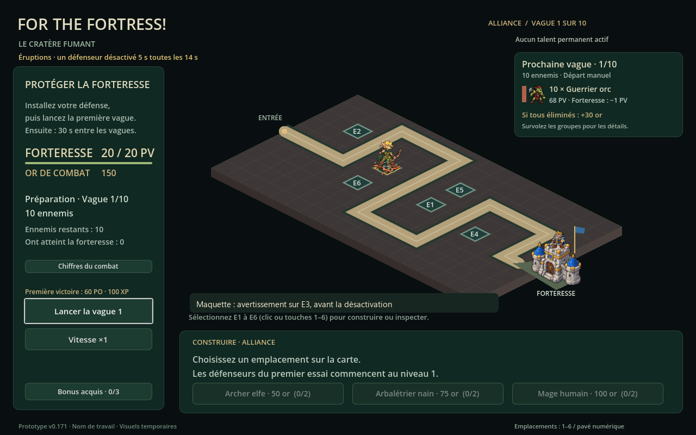

# Avertissement des Éruptions — proposition du 11 novembre 2026

Sur le Cratère Fumant, trois coins chauds signalent l’emplacement dès le début de l’avertissement. Des fissures se prolongent entre les coins et des braises montent bas autour des bottes. La lueur augmente à l’approche de l’éruption. La pose et l’arme du défenseur restent lisibles. C’est une proposition à essayer avant de choisir l’habillage final entre lave et cendres.

La planche [Avertissement_fissures.png](essais/avertissement_eruptions/Avertissement_fissures.png) contient 24 images transparentes de 80 × 60 px, en bande horizontale de 1 920 × 60 px. Ancre à `(40, 40)` sur le centre de l’emplacement. Les 24 images sont distinctes et leurs marges restent transparentes. La maquette a été examinée sur les six emplacements du Cratère Fumant avec la silhouette de l’archer. La vidéo est un montage sur capture du plateau, à ×1 puis ×2. [Contrôle des six emplacements](essais/avertissement_eruptions/Controle_six_emplacements.png) · [Vidéo](essais/avertissement_eruptions/Avertissement_x1_x2.mp4)

Pour le branchement par Claude Code, utiliser la planche uniquement lorsque `eruption_status().state == "warning"`, au sol avant le dessin des unités. Lire la progression de l’avertissement avec `1 - remaining / warning_duration`, bornée entre 0 et 1. À 3 secondes de jeu, cela donne 8 poses/s à ×1 et 16 poses/s à ×2. Retirer la planche au passage à `active` pour laisser la place à la désactivation. Ce rendu reprend l’emplacement et le temps déjà fournis par l’affixe. L’essai à faire en jeu porte sur la transition vers les cendres, la lisibilité avec les deux factions, les vitesses de combat et la pause.

La planche est livrée hors ressources d’exécution. Le branchement, l’essai en jeu et l’habillage commun de la désactivation sont à faire séparément.

**Retour du porteur, 11 novembre 2026** — la maquette lui paraît « plutôt propre ». Ce retour porte sur l’aperçu des fissures et des braises. Le rendu et sa transition vers la désactivation seront à juger en jeu.

## Désactivation par les cendres

Proposition sur les sources de la v0.180, le 12 novembre 2026. Le bord de la case s’allume plus nettement pendant l’annonce, même si les fissures sont sous les bottes. À l’éruption, le sol s’assombrit et deux volutes de cendres montent autour des pieds. L’arme et le visage restent dégagés. Les cendres se dissipent vers la fin de l’état, puis le plateau retrouve son rendu normal.

`effect.eruption/disabled` utilise 60 images de 80 × 60 px sur 5 s en mode `event`. L’ancre reste en (40, 40). La planche est dessinée au-dessus du bas de l’unité pour éviter que l’effet soit couvert. L’âge est calculé avec le temps de combat à partir de `duration - remaining`. L’avertissement conserve son mode `progress` et son dessin sous l’unité.

Contrôle en situation de combat sur la mission 71, avec les six emplacements, les trois défenseurs de base par faction et les vitesses ×1 et ×2, soit 24 passages. L’essai charge une vue isolée qui dessine la planche de cendres pendant l’état `active`. L’avertissement, la désactivation puis sa fin sont vérifiés contre l’état du jeu. La vérification du rendu compare aussi l’état du combat avant et après chaque capture. Le validateur signale zéro problème et les trois suites ciblées passent (4 173 contrôles Godot, 17 tests Python).

La v0.182 affiche la planche pendant l’état `active`. Le rendu intégré a été contrôlé sur la mission 71, dans les deux factions, sur E1–E6 à ×1 et ×2 (24 passages).

- [Les quatre étapes à ×2](essais/eruption_cendres/Eruptions_etapes_x2.jpg)
- [Sapeur gobelin en combat, ×1](essais/eruption_cendres/Eruption_en_combat.gif)
