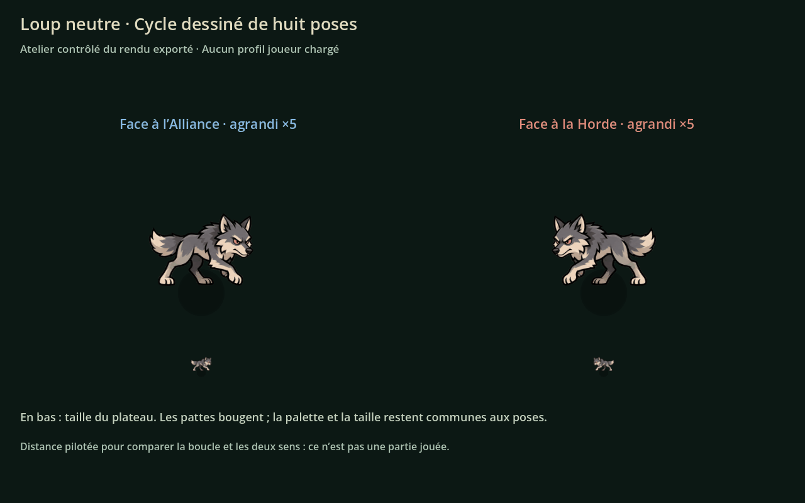

# Premier cycle de marche du loup

Prototype v0.105 — 1 novembre 2026. Première réalisation du chantier d’animation des attaquants. Le loup neutre dispose de huit poses dessinées, communes aux deux factions. Les autres attaquants conservent leur présentation actuelle ; ce lot ne termine pas le chantier d’animation de toutes les unités.

## Rendu

Le cycle suit la distance réellement parcourue, avec une boucle pour 0,9 unité logique et un décalage déterministe entre membres de la meute. Ces valeurs sont des réglages visuels H. Une position qui ne change pas conserve sa pose ; les vitesses de combat accélèrent naturellement le cycle. Aucun compteur d’animation ne modifie le modèle de combat.

Les huit poses partagent la même échelle, calculée sur la hauteur de référence de 278 pixels pour 34 pixels de dessin avant le coefficient de taille du loup. Chaque cadre conserve ses proportions. Le miroir suit la direction du trajet. Le balancement ancien de l’illustration entière est retiré pour le loup, afin de ne pas ajouter un saut artificiel au cycle dessiné. Les réactions aux dégâts et l’éclaircissement restent appliqués au corps animé. Le survol emploie une enveloppe fixe couvrant toutes les poses ; il ne rétrécit pas lorsque les pattes se replient.

Les autres illustrations, les dégâts, portées, vitesses logiques, identités adverses et neutres, rencontres, talents, économie et sauvegardes sont conservés. La mort conserve les effets de dissipation existants ; aucune nouvelle animation de mort n’est annoncée.

## Ressource originale

PNG transparent : [loup_marche_v001.png](../prototype/assets/enemies/animations/loup_marche_v001.png). ImageGen intégré a produit la planche à partir du loup de la planche neutre existante ; le PNG original est copié sans retouche. Les cadres sont sélectionnés dans le moteur, avec quatre pixels de marge. Les mipmaps sont activées pour la lecture à petite taille. [Prompt final et référence](concepts/Loup_marche_v001_prompt.json).

L’apparence et le rythme restent des propositions de prototype à affiner après retour du porteur du projet. Le cycle est latéral, retourné selon le trajet ; il ne constitue pas un ensemble de directions dessinées séparément.

## Vérification

89 suites et 37 962 contrôles Godot passent, ainsi que 17 tests Python. La nouvelle suite compte 1 190 contrôles : transparence, cadres distincts, échelle commune, boucle et enveloppe de survol sur vingt missions et deux factions. Les sources de simulation, talents, boutique et persistance sont inchangées.

Le programme Windows exporté passe dix cas ciblés sur 255, avec 71 sources comparées : démarrage, Gardienne et réactions aux dégâts dans chaque faction, rapports, protection de progression et réaction royale. Ce contrôle natif n’est pas exhaustif.

Un atelier graphique charge les ressources du programme exporté via Godot standard et `--main-pack`, sur l’écran de droite. Il produit 96 échantillons à 30 images par seconde, montrant huit poses dans deux sens et les deux contextes de faction, à taille normale et agrandie. Les distances sont pilotées pour observer la boucle ; ce n’est pas une partie jouée. Le GIF encode ces échantillons en 33 images avec durées regroupées. Le lancement direct de l’exécutable de distribution avec `--script` n’a pas exécuté cet atelier ; ses fenêtres ont été fermées et cette tentative n’est pas retenue comme preuve d’animation.

[Régression complète](essais/v0105_regression.json) · [Contrôle du programme Windows](Distribution_Windows_v0105.json).

## Suite du chantier

Étendre progressivement les cycles aux autres attaquants après vérification du style et du rythme. Produire les gestes détaillés des défenseurs en accord avec leur arme et le projectile, puis enrichir les réactions et animations de mort. Le GDD 0.17 conserve la référence consolidée du jeu 0.104 ; cette fiche décrit le complément 0.105.
