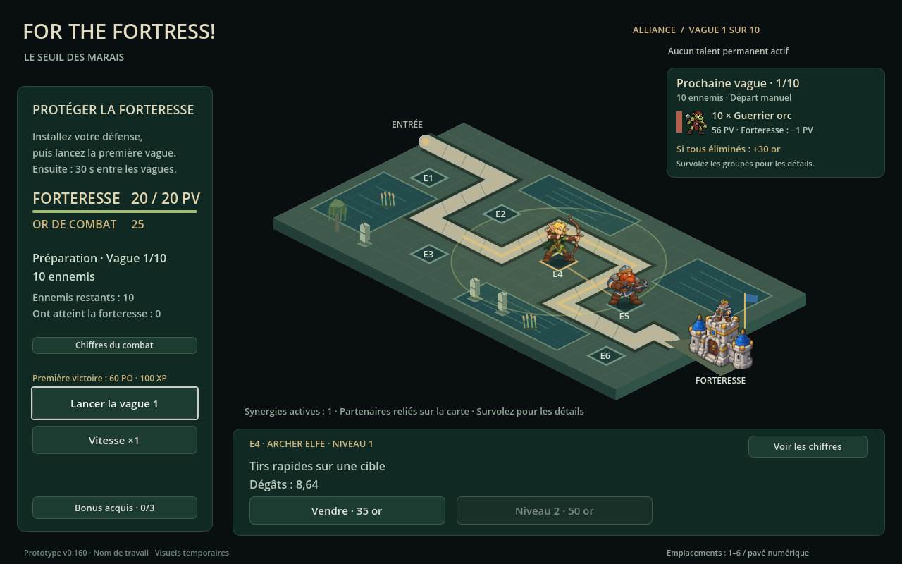

# Mission 41 — Le Seuil des Marais

## Décision et proposition de prototype

Le porteur a retenu les **marais et les ruines englouties** comme ambiance des chapitres 5 et 6, aux missions 41–60. La v0.160 en livre une première réalisation avec la mission 41. Le nom de la carte, le tracé, les emplacements, la palette et les formes décoratives sont des propositions de prototype à affiner.

Cette première mission du chapitre 5 conserve les rencontres et les règles de combat de référence. Elle n'applique pas Vents contraires. La nouveauté de gameplay du chapitre 6 reste à concevoir et à proposer séparément.

## Carte et progression

| Élément | Réglage d'essai |
| --- | --- |
| Carte | Le Seuil des Marais |
| Chemin | Une entrée vers une forteresse, 29 unités de longueur logique |
| Défense | Six emplacements fixes |
| Vagues | Dix vagues de référence |
| PV ennemis | 140 % de la référence |
| Points accessibles avant la première tentative | 20 |
| Première victoire | 60 PO et 100 XP, une seule fois par faction |

La mission 40 doit être réussie dans la faction concernée. Chaque tentative repart avec la forteresse intacte, 150 or de combat, aucun défenseur et aucun bonus temporaire. Les acquisitions persistantes et les talents sont conservés. Après quarante et une premières victoires, la faction a obtenu 2 460 PO avant dépenses, 4 100 XP et 20 points de talents selon la courbe d'essai.

## Habillage

Le plateau utilise une palette de terre humide et d'eau sombre. Une chaussée de pierre traverse le terrain. Des roseaux, des arbres et des piliers brisés évoquent un ancien site englouti. L'aperçu du parcours reprend la palette et les bassins de la carte jouée.

Les bassins restent en dehors du chemin et des emplacements. La végétation et les ruines réservent des marges autour des routes, des défenseurs, des entrées et de la forteresse. Leur placement est déterministe et indépendant du générateur de combat.

Cet habillage est purement visuel. Il ne modifie ni la vitesse, ni les dégâts, ni la portée, ni l'économie. Les silhouettes et les couleurs des unités et des forteresses restent celles de leur faction.

## Comparaisons

Deux panels de 216 simulations utilisent trois graines, trois placements, quatre compositions de trois unités et trois arbres de talents, avec les vingt points acquis avant la mission. Le premier panel répartit les talents par ordre d'accès. Le second prépare prioritairement les prérequis des talents majeurs. Les autres paramètres sont identiques et le premier bonus proposé est choisi.

| Répartition | Alliance | Horde |
| --- | --- | --- |
| Ordre d'accès | 25 victoires sur 108 | 3 sur 108 |
| Chemin majeur | 31 victoires sur 108 | 18 sur 108 |

Le relevé local est `dist/marsh-mission41-survey.json`. Ces résultats décrivent les politiques automatiques essayées. La sensibilité aux talents reste particulièrement marquée côté Horde. Ils ne mesurent pas la réussite d'un joueur et ne valident pas l'équilibrage en découverte.

## Vérification

Le contrôle d'intégration lance et remporte la mission 41 depuis le parcours normal dans chaque faction, avec les vingt points légalement acquis et les revenus du combat. Les rapports contenant la nouvelle décoration sont sérialisés puis rejoués. Le crédit unique de la première victoire et l'indépendance de l'autre faction sont vérifiés.

Les contrôles vérifient aussi les marges du décor et son absence d'effet sur le générateur, l'économie et l'historique de combat. Les anciennes cartes et les rapports restent pris en charge. Le passage du chapitre 4 terminé vers les marais est couvert par les contrôles existants de fin de chapitre.

15 685 contrôles Godot ciblés et dix essais Windows réussissent. Les 84 empreintes de sources du paquet exporté correspondent au projet local. Les aperçus et les plateaux ont été inspectés visuellement, avec et sans défenseurs installés, dans les deux factions.

## Suite

Quarante et une missions sont jouables. Les missions 42–50 doivent prolonger la découverte du biome par d'autres configurations de terrain. La nouvelle mécanique des missions 51–60 reste ouverte. Le premier habillage visuel et la difficulté restent à évaluer par le porteur.
