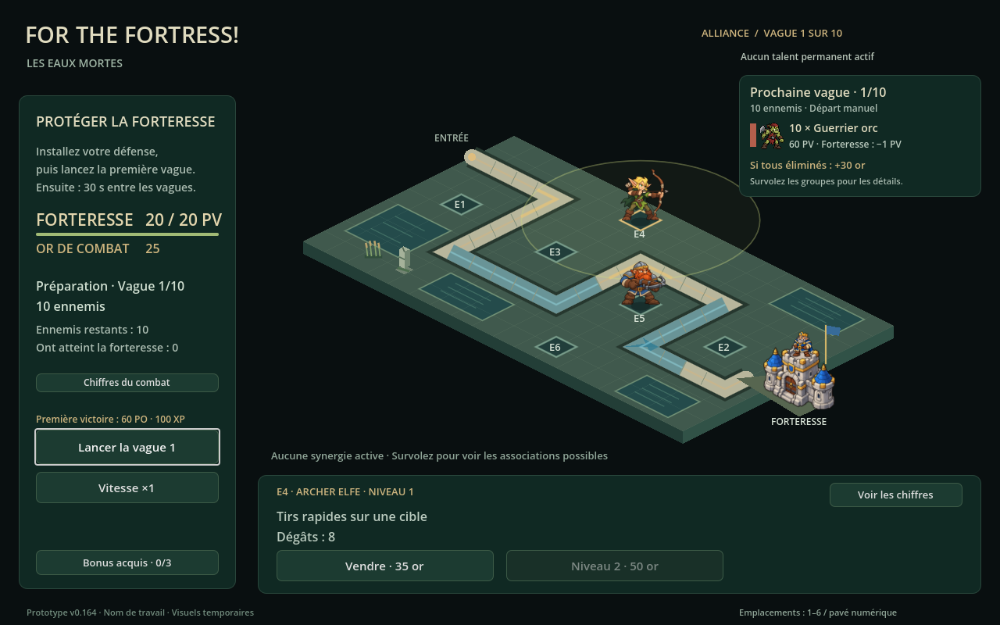

# Mission 51 — Les Eaux Mortes et le Noyé

## Décision du porteur et statut de conception

Pour la nouveauté du chapitre 6 des marais, le porteur retient **le Noyé, une créature des marais qui régénère ses PV dans l'eau** (option « nouvel attaquant lié au biome » de CAMP-017). Le principe est validé ; tout le reste (statistiques, vitesse de régénération, forme de l'eau, composition des vagues, carte) est une proposition de prototype de Claude Code, à confirmer en jeu.

La v0.164 livre l'introduction : la mission 51, premier niveau du chapitre 6. Les missions 52–60 restent à développer.

## Règles du Noyé

| Élément | Valeur d'essai |
| --- | --- |
| Identité | Noyé, faune neutre (commune aux deux factions, comme le loup ou la tortue) |
| PV de base | 150 (225 à 150 % de PV ennemis) |
| Vitesse | 0,85 |
| Dégâts à la forteresse | 2 |
| Récompense | 8 or |
| Régénération | 5 % de ses PV maximum par seconde, tant qu'il traverse un tronçon inondé |

La régénération ne dépasse jamais ses PV maximum. Elle ne dépend que de la position : elle s'applique à chaque trajet d'une carte à plusieurs entrées, par tronçon. Elle est calculée exactement sur la portion d'eau parcourue, donc le résultat est identique quel que soit le pas de temps de la simulation (grand pas, 50 ms ou pas irréguliers). Les autres ennemis ne régénèrent pas. Dégâts, malédictions, protection de la tortue et récompenses restent inchangés.

## Tronçons inondés

Une carte peut déclarer des tronçons inondés : champ facultatif `flooded` de sa définition, liste de `{route, from, to}` en distance parcourue sur un trajet (`route` vide pour une carte à une seule entrée). Les tronçons ne se superposent pas, restent dans le trajet (huit au plus) et sont réservés aux marais. Les anciens rapports et cartes, sans ce champ, restent valides. Le champ est enregistré dans les rapports rejouables : un rapport dont l'eau a été retirée n'est plus rejouable à l'identique.

Les tronçons sont distincts des bassins décoratifs, qui ne croisent jamais le chemin. Un repère bleu provisoire est tracé sur le chemin ; son habillage revient à Codex (`TODO_VISUELS.md`).

## Carte

| Mission | Carte | Configuration | PV ennemis | Points accessibles avant la mission |
| --- | --- | --- | --- | --- |
| 51 | Les Eaux Mortes | Une entrée, parcours de 31 unités en U, deux tronçons inondés (distances 9–16 et 22–28) | 150 % | 25 |

La carte garde six emplacements et dix vagues. La mission précédente (49 ou 50) doit être réussie dans la faction concernée. La première victoire rapporte 60 PO et 100 XP une seule fois par faction ; chaque tentative repart avec 150 or de combat, une forteresse intacte, aucun défenseur et aucun bonus temporaire. Aucun affixe de combat.

Le premier tronçon inondé suit l'approche de la poche centrale ; le second longe la fin du parcours. L'emplacement central, entouré de trois côtés de chemin, couvre les deux zones d'eau : le joueur choisit s'il frappe le Noyé avant l'eau, dans l'eau ou après.

## Rencontres

Les dix vagues reprennent le rythme des rencontres du chapitre 2, où le Noyé remplace la tortue : un Noyé seul à la vague 2 (présentation), deux aux vagues 4 à 6, trois à la vague 8, deux à la vague 9, un avec le boss à la vague 10. L'éclaireur de mission et la prévision des vagues annoncent le Noyé et sa régénération.

## Ajustements pendant la conception

- Première version : Noyé à 150 PV de base et 3 % par seconde. La stratégie de référence de la Horde perdait (vague 8), avec toutes les compositions essayées. Sans régénération, la Horde gagnait de justesse (1 PV restant) : la carte elle-même était trop exigeante.
- Les emplacements ont été replacés vers les poches du parcours (balayage de 336 triplets) : la référence gagne alors dans les deux factions.
- Régénération retenue à 5 % par seconde : à 3 %, le résultat de la stratégie de référence variait à peine ; de 0 % à 10 %, les PV restants de la Horde passent de 19 à 2, donc l'effet est mesurable.

## Comparaisons automatiques

Le relevé local `dist/marsh-mission51-survey.json` contient 216 essais : trois graines (7, 42 et 2026), trois placements, quatre compositions et trois orientations de talents dans chaque faction, avec la méthode des missions 42–50. Tous utilisent les points acquis auparavant, les revenus normaux, une priorité de prérequis de talents majeurs, les spécialisations A et le premier bonus proposé. Les empreintes des scripts enregistrées dans le relevé correspondent aux sources de la version.

| Mission 51 | Alliance | Horde |
| --- | --- | --- |
| Avec la régénération du Noyé (5 % par seconde) | 42 victoires sur 108 | 14 sur 108 |
| Témoin : mêmes parties sans régénération (`dist/marsh-mission51-control-noregen.json`) | 70 sur 108 | 32 sur 108 |

La régénération coûte donc environ 28 victoires à l'Alliance et 18 à la Horde sur ces stratégies. Ces résultats décrivent les stratégies automatiques essayées. Ils ne constituent ni un taux de réussite des joueurs ni une validation humaine de l'équilibrage. La Horde est en bas de la fourchette des missions 46–50 (16 à 42 victoires) ; l'écart entre factions observé depuis la mission 42 persiste.

## Vérifications

La régression complète réussit : 100 suites, 54 048 contrôles Godot et 17 tests Python. La nouvelle suite du Noyé (267 contrôles) couvre : identité et catalogue, calcul de l'eau par tronçon, validation et sérialisation des cartes, régénération identique avec des pas de 10 ms, irréguliers ou d'un seul bloc, chronologie d'une vague de Noyés identique avec un grand pas, 50 ms et 0,731 s, parcours complet de la mission 51 dans chaque faction avec rapport rejouable, rapport sans eau refusé, récompenses uniques et indépendance des factions.

Les 48 essais Windows réussissent : menus et lancements des missions 41–51 dans les deux factions, chapitre 5 terminé avec rejeu sans nouveau gain, et spécialisations à trois entrées. Les 85 empreintes des sources exportées correspondent au projet. La vérification du ZIP a détecté un fichier oublié dans la liste d'export (`drowned_encounters.gd`), que les tests depuis les sources ne pouvaient pas voir ; il est corrigé. Les captures avec défenseurs de la mission 51 ont été inspectées dans les deux factions : les tronçons inondés sont lisibles. Le Noyé en combat n'a pas été inspecté visuellement, puisqu'il utilise la silhouette provisoire de la tortue.

## Suite

51 missions sont jouables. Les missions 52–60 doivent exploiter le Noyé sur d'autres tracés (plusieurs entrées, eau sur les parties communes) ; aucun autre attaquant ni affixe n'est prévu à ce stade. Visuel du Noyé, habillage de l'eau et équilibrage humain restent à faire.
