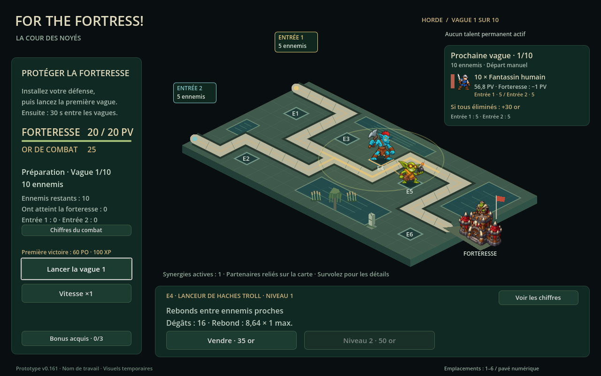

# Missions 42 et 43 — Bassins et Cour

## Statut de conception

La v0.161 poursuit le biome **marais et ruines englouties**, retenu pour les chapitres 5 et 6. Les noms, tracés, emplacements et valeurs ci-dessous sont des propositions de prototype. Les bassins restent décoratifs ; la nouvelle mécanique des missions 51–60 reste à proposer séparément.

## Cartes

| Mission | Carte | Configuration | PV ennemis | Points accessibles avant la mission |
| --- | --- | --- | --- | --- |
| 42 | Les Bassins Engloutis | Une entrée, parcours de 34 unités logiques | 141 % | 20 |
| 43 | La Cour des Noyés | Deux entrées, deux routes de 28 unités, dont 17 communes | 142 % | 21 |

Chaque carte propose six emplacements et dix vagues. La mission précédente doit être réussie dans la faction concernée. Les tentatives repartent avec 150 or de combat, une forteresse intacte, aucun défenseur et aucun bonus temporaire. La première victoire rapporte 60 PO et 100 XP une seule fois par faction. Vents contraires reste réservé aux missions 31–40.

Dans la Cour, la pression entre les deux entrées alterne selon les règles déjà utilisées sur les cartes à jonction. Les annonces distinguent leurs groupes et le ciblage privilégie l'ennemi dont l'arrivée est la plus proche dans le temps.

## Habillage et compatibilité

Chaque nouvelle carte dispose de ses propres bassins, en dehors des routes et des emplacements. Les roseaux et ruines réservent des marges autour des zones de jeu. Le placement reste déterministe et ne consomme pas le générateur du combat.

Les zones d'eau sont enregistrées dans la définition de carte des rapports rejouables. Ce champ est facultatif : les anciens rapports et la mission 41 conservent leur habillage de référence lorsqu'il est absent. Les données invalides sont rejetées.

## Comparaisons automatiques

Le relevé local `dist/marsh-missions42-43-final.json` contient 432 essais : trois graines (7, 42 et 2026), trois placements, quatre compositions et trois orientations de talents dans chaque faction et sur chaque carte. Tous utilisent les points acquis auparavant, les revenus normaux, une priorité de prérequis de talents majeurs, les spécialisations A et le premier bonus proposé.

| Mission | Alliance | Horde |
| --- | --- | --- |
| 42 | 57 victoires sur 108 | 35 sur 108 |
| 43 | 55 victoires sur 108 | 17 sur 108 |

Ces résultats décrivent les stratégies automatiques essayées. Ils ne constituent ni un taux de réussite des joueurs ni une validation humaine de l'équilibrage. La Cour reste particulièrement sensible à la composition et aux talents côté Horde.

## Vérifications

16 528 contrôles Godot ciblés réussissent, dont 1 165 pour les marais : géométrie, bassins, marges, sérialisation, six parcours complets faction/carte sur les missions 41–43, rapports rejouables, récompenses uniques et indépendance des factions. Les contrôles existants couvrent aussi la progression, les aperçus et Vents contraires.

Les quatorze essais Windows sélectionnés réussissent et les 84 empreintes des sources exportées correspondent au projet. Les captures avec défenseurs ont été inspectées dans les deux factions sur les deux nouvelles cartes. Le contrôle natif porte sur ces scénarios ciblés, pas sur tous les écrans du jeu.

## Suite

43 missions sont jouables. Les missions 44–50 doivent varier la découverte des marais ; les missions 51–60 introduiront une nouveauté à définir avec le porteur. Le rendu et la difficulté restent à évaluer en jeu.
