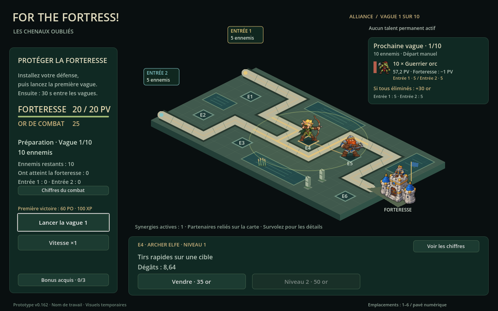

# Missions 44 et 45 — Chenaux et Cloître

## Statut de conception

La v0.162 poursuit le biome **marais et ruines englouties**, retenu pour les chapitres 5 et 6. Les noms, tracés, emplacements et valeurs ci-dessous sont des propositions de prototype. Bassins, roseaux et ruines restent décoratifs ; la nouvelle mécanique des missions 51–60 reste à proposer séparément.

## Cartes

| Mission | Carte | Configuration | PV ennemis | Points accessibles avant la mission |
| --- | --- | --- | --- | --- |
| 44 | Les Chenaux Oubliés | Deux entrées, routes de 30 et 28 unités logiques, dont 17 communes | 143 % | 21 |
| 45 | Le Cloître Submergé | Une entrée, parcours en lacets de 38 unités | 144 % | 22 |

Chaque carte propose six emplacements et dix vagues. La mission précédente doit être réussie dans la faction concernée. Les tentatives repartent avec 150 or de combat, une forteresse intacte, aucun défenseur et aucun bonus temporaire. La première victoire rapporte 60 PO et 100 XP une seule fois par faction. Vents contraires reste réservé aux missions 31–40.

Aux Chenaux, la pression entre les deux entrées alterne selon les règles déjà utilisées sur les cartes à jonction ; la route du haut est la plus longue. Le Cloître alterne au contraire avec une carte à une seule entrée, au parcours le plus long des marais à ce stade.

## Habillage

Chaque carte a ses propres bassins, en dehors des routes et des emplacements. Sur le Cloître, les marges réservées autour des zones de jeu écartaient toutes les ruines : quand aucune ruine ne trouve de place, une ruine plus compacte remplace désormais un saule déjà dégagé. Ses limites restent incluses dans celles de l'arbre, donc les marges sont conservées. Le placement reste déterministe et ne consomme pas le générateur du combat.

## Comparaisons automatiques

Le relevé local `dist/marsh-missions44-45-survey.json` contient 432 essais : trois graines (7, 42 et 2026), trois placements, quatre compositions et trois orientations de talents dans chaque faction et sur chaque carte. Tous utilisent les points acquis auparavant, les revenus normaux, une priorité de prérequis de talents majeurs, les spécialisations A et le premier bonus proposé. Les empreintes des 33 scripts enregistrées dans le relevé correspondent aux sources de la version.

| Mission | Alliance | Horde |
| --- | --- | --- |
| 44 | 68 victoires sur 108 | 31 sur 108 |
| 45 | 80 victoires sur 108 | 31 sur 108 |

Ces résultats décrivent les stratégies automatiques essayées. Ils ne constituent ni un taux de réussite des joueurs ni une validation humaine de l'équilibrage. L'écart entre factions observé depuis la mission 42 persiste : les stratégies automatiques Horde gagnent moins souvent, surtout sans l'orientation Entraînement ou Explosifs.

## Vérifications

La régression complète réussit : 99 suites, 51 106 contrôles Godot et 17 tests Python. Le ZIP Windows est vérifié contre les sources du projet et ses captures natives couvrent les missions 41–45 dans les deux factions. Les captures avec défenseurs des missions 44 et 45 ont été inspectées dans les deux factions.

## Suite

45 missions sont jouables. Les missions 46–50 doivent terminer la découverte des marais ; les missions 51–60 introduiront une nouveauté à définir avec le porteur. Le rendu et la difficulté restent à évaluer en jeu, en particulier côté Horde.
