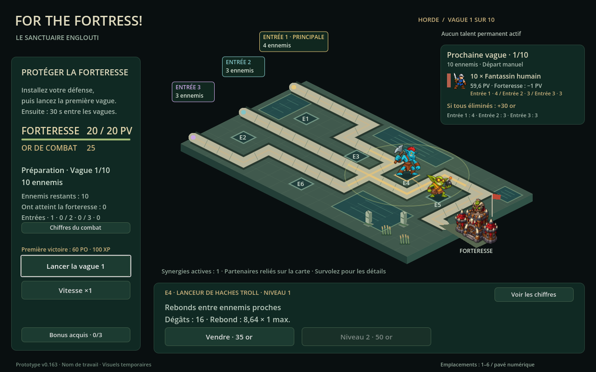

# Missions 46 à 50 — Fin du chapitre 5

## Statut de conception

La v0.163 termine le chapitre 5, premier chapitre du biome **marais et ruines englouties** retenu par le porteur pour les missions 41–60. Les noms, tracés, emplacements et valeurs ci-dessous sont des propositions de prototype de Claude Code, à confirmer en jeu. Les bassins sont des emplacements neutres en attente d'habillage par Codex (voir `TODO_VISUELS.md`). La nouveauté des missions 51–60 reste à proposer et à valider séparément.

## Cartes

| Mission | Carte | Configuration | Longueur des trajets | PV ennemis | Points accessibles avant la mission |
| --- | --- | --- | --- | --- | --- |
| 46 | La Chaussée des Roseaux | Une entrée, longues lignes droites | 28 | 145 % | 22 |
| 47 | Les Trois Gués Noyés | Trois entrées, jonction au centre | 28 / 24 / 28, dont 16 communes | 146 % | 23 |
| 48 | Les Îlots du Chœur | Deux entrées, jonction tardive, pression alternée | 34 / 32, dont 12 communes | 147 % | 23 |
| 49 | La Nef Effondrée | Une entrée, lacets verticaux | 37 | 148 % | 24 |
| 50 | Le Sanctuaire Englouti | Trois entrées, jonction tardive, finale du chapitre | 28 / 24 / 28, dont 14 communes | 149 % | 24 |

Chaque carte propose six emplacements et dix vagues. La mission précédente doit être réussie dans la faction concernée. Les tentatives repartent avec 150 or de combat, une forteresse intacte, aucun défenseur et aucun bonus temporaire. La première victoire rapporte 60 PO et 100 XP une seule fois par faction. Aucune mission n'applique Vents contraires.

Intention de progression : après le Cloître (45), la Chaussée raccourcit le parcours ; les Gués introduisent trois entrées dans les marais, comme les Trois Passages dans les Ardoises ; les Îlots obligent à défendre deux branches séparées plus longtemps ; la Nef offre une respiration avant le Sanctuaire, qui combine trois entrées et une jonction plus tardive.

Une fois la mission 50 réussie, le chapitre 5 est complet ; le chapitre 6 reste « à venir » et la dernière mission jouable reste proposée.

## Ajustements pendant la conception

- **Chaussée (46)** : la stratégie de référence des tests perdait côté Horde, son premier défenseur ne couvrant qu'une ligne droite. Les emplacements ont été replacés vers les virages.
- **Îlots (48)** : avec une portion commune de 5 unités, la Horde ne gagnait que 2 parties automatiques sur 108. La jonction a été avancée (12 unités communes) et deux emplacements couvrent désormais les deux branches à la fois.
- **Nef (49)** : la première version, aux colonnes régulières, ne laissait de place qu'à une ruine. Les colonnes ont été resserrées, à longueur égale, pour libérer une zone à droite.

## Comparaisons automatiques

Le relevé local `dist/marsh-missions46-50-survey.json` contient 1 080 essais : trois graines (7, 42 et 2026), trois placements, quatre compositions et trois orientations de talents dans chaque faction et sur chaque carte, avec la méthode des missions 42–45. Tous utilisent les points acquis auparavant, les revenus normaux, une priorité de prérequis de talents majeurs, les spécialisations A et le premier bonus proposé. Les empreintes des scripts enregistrées dans le relevé correspondent aux sources de la version.

| Mission | Alliance | Horde |
| --- | --- | --- |
| 46 | 34 victoires sur 108 | 18 sur 108 |
| 47 | 55 sur 108 | 21 sur 108 |
| 48 | 76 sur 108 | 20 sur 108 |
| 49 | 80 sur 108 | 42 sur 108 |
| 50 | 49 sur 108 | 16 sur 108 |

Ces résultats décrivent les stratégies automatiques essayées. Ils ne constituent ni un taux de réussite des joueurs ni une validation humaine de l'équilibrage. L'écart entre factions observé depuis la mission 42 persiste. La Chaussée est la plus exigeante pour l'Alliance ; la Nef est nettement plus clémente que ses voisines.

## Vérifications

La régression complète réussit : 99 suites, 53 647 contrôles Godot et 17 tests Python, dont 4 306 pour les marais (géométrie, bassins, marges, sérialisation, vingt parcours complets faction/carte sur les missions 41–50, rapports rejouables, récompenses uniques et indépendance des factions).

Les 44 essais Windows réussissent : menus et lancements des missions 41–50 dans les deux factions, chapitre 5 terminé avec rejeu sans nouveau gain, et spécialisations à trois entrées. Les 84 empreintes des sources exportées correspondent au projet. Les captures avec défenseurs des cinq nouvelles cartes ont été inspectées dans les deux factions.

## Suite

50 missions sont jouables et le chapitre 5 est complet. Les missions 51–60 doivent introduire la nouveauté du biome, à définir avec le porteur. Le rendu des marais reste à affiner par Codex ; la difficulté reste à évaluer en jeu, en particulier côté Horde.
