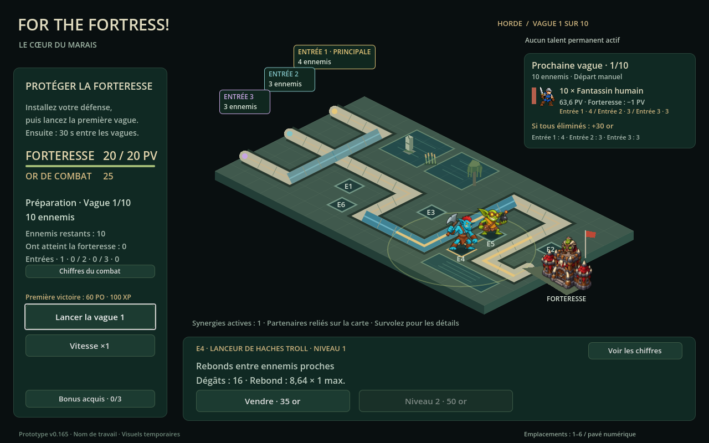

# Missions 52 à 60 — Fin du chapitre 6, le Noyé sur neuf tracés

## Décision et statut de conception

Le porteur a retenu le Noyé, créature des marais qui régénère ses PV dans l'eau, comme nouveauté du chapitre 6 (voir [la mission 51](Mission_051_Eaux_Mortes_Noye.md)). La v0.165 termine le chapitre : les missions 52 à 60 exploitent le Noyé sur d'autres tracés, avec une ou plusieurs entrées et de l'eau sur des branches, sur la partie commune ou sur les deux. Les tracés, la position et la longueur des tronçons inondés, les emplacements, les bassins et les valeurs sont des propositions de prototype de Claude Code, à confirmer en jeu. Aucun autre attaquant ni affixe n'est ajouté. Les règles du Noyé (150 PV de base, vitesse 0,85, régénération de 5 % de ses PV maximum par seconde dans l'eau) sont celles de la v0.164.

## Cartes

PV ennemis : 99 % + 1 % par mission, soit 151 % à 159 %. Les longueurs sont celles des trajets en unités logiques ; « eau » donne la longueur inondée par trajet.

| Mission | Carte | Entrées | Trajets | Eau | Points de talent accessibles |
| --- | --- | --- | --- | --- | --- |
| 52 | Les Berges Noyées | 1 | 35 | 9, en début de parcours | 26 |
| 53 | Les Gués du Double Courant | 2, pression alternée | 35 / 35 (29 communs) | 10 sur la partie commune | 26 |
| 54 | La Mare Sans Fond | 1 | 40 | 16 d'un seul tenant au milieu | 27 |
| 55 | Le Delta des Noyés | 3 | 28 / 24 / 28 (15 communs) | 6 sur la partie commune | 27 |
| 56 | La Crue | 2, pression alternée | 32 / 32 (20 communs) | 8 avant la forteresse | 28 |
| 57 | Les Piliers Engloutis | 1 | 37 | 7 + 7, deux colonnes | 28 |
| 58 | Le Carrefour des Eaux | 3 | 28 / 24 / 28 (18 communs) | 4 sur les branches haute et basse, aucune au centre | 29 |
| 59 | La Cathédrale Noyée | 2, pression alternée | 36 / 32 | 8 sur la partie commune | 29 |
| 60 | Le Cœur du Marais | 3 | 35 / 32 / 35 (29 communs) | 3 sur les accès haut et bas, 10 sur la partie commune | 30 |

Chaque carte garde six emplacements et dix vagues, avec les rencontres du Noyé de la mission 51. La mission précédente doit être réussie dans la faction concernée. La première victoire rapporte 60 PO et 100 XP une seule fois par faction ; chaque tentative repart avec 150 or de combat, une forteresse intacte, aucun défenseur et aucun bonus temporaire. Aucune mission n'applique d'affixe de combat.

Progression de découverte : la Mare et les Piliers testent des eaux longues ou répétées sur une seule route ; le Delta et le Carrefour ouvrent trois entrées, avec de l'eau commune dans l'un et de l'eau sur deux entrées seulement dans l'autre (la voie du centre reste sèche) ; les Gués, la Crue et la Cathédrale placent l'eau sur une partie commune après la jonction de deux entrées ; le Cœur du Marais, finale du chapitre, combine trois entrées, de l'eau sur deux accès et une longue eau commune.

## Prise en compte des talents accumulés

À ce stade, le joueur a accumulé 26 à 30 points de talents (51 au maximum à la mission 100), et la puissance dépend de leur répartition. Le choix des emplacements a donc été vérifié avec les talents réellement acquis à chaque mission, répartis comme dans les tests de campagne (arbre principal de la faction et chemin des talents majeurs), et non avec un profil figé. Un premier réglage fondé sur un profil unique de 25 points avait rejeté à tort certaines cartes, notamment le Cœur du Marais, alors trop difficile ; il a été refait avec les rangs réels. Les essais automatiques ci-dessous combinent trois orientations de talents et dépensent tous les points acquis.

## Ajustements pendant la conception

- **Gués du Double Courant et Cœur du Marais** : aucun jeu d'emplacements ne permettait à la Horde de gagner avec des branches longues. Les branches ont été raccourcies et la partie commune allongée.
- **Crue** : première version aux branches longues et à l'eau en milieu de parcours, perdue par la Horde ; l'eau a été reportée avant la forteresse et la partie commune allongée. Son identifiant est `marsh_overflow` : le placement du décor dépend de l'identifiant, et le premier nom ne laissait aucune place aux roseaux.
- **Emplacements** : choisis par couverture du trajet puis par simulation de 16 jeux d'emplacements par carte et trois ordres d'achat, en retenant le jeu qui maximise les PV restants du camp le plus faible. Les emplacements secondaires ont été ajustés pour laisser de la place au décor sans modifier les résultats.

## Comparaisons automatiques

Le relevé local `dist/marsh-missions52-60-survey.json` contient 1 944 essais : trois graines (7, 42 et 2026), trois placements, quatre compositions et trois orientations de talents dans chaque faction et sur chaque carte. Tous dépensent tous les points acquis auparavant (26 à 30 selon la mission), avec les revenus normaux, une priorité de prérequis de talents majeurs, les spécialisations A et le premier bonus proposé. Les empreintes des scripts enregistrées dans le relevé correspondent aux sources de la version.

| Mission | Carte | Alliance | Horde |
| --- | --- | --- | --- |
| 52 | Les Berges Noyées | 47 victoires sur 108 | 21 sur 108 |
| 53 | Les Gués du Double Courant | 46 | 16 |
| 54 | La Mare Sans Fond | 51 | 24 |
| 55 | Le Delta des Noyés | 20 | 6 |
| 56 | La Crue | 53 | 16 |
| 57 | Les Piliers Engloutis | 68 | 27 |
| 58 | Le Carrefour des Eaux | 32 | 16 |
| 59 | La Cathédrale Noyée | 51 | 15 |
| 60 | Le Cœur du Marais | 74 | 33 |

**Effet des talents.** L'orientation choisie pèse davantage que la carte. Sur les neuf missions, chaque cellule ci-dessous compte 36 parties par mission, soit 324 :

| Faction | Orientation de talents | Victoires sur 324 |
| --- | --- | --- |
| Alliance | Entraînement | 288 |
| Alliance | Remparts renforcés | 114 |
| Alliance | Étude des arcanes | 40 |
| Horde | Entraînement | 88 |
| Horde | Explosifs | 70 |
| Horde | Rituels | 16 |

Les stratégies automatiques ne choisissent pas leur arbre : elles montrent seulement que, à puissance égale de points, un arbre mal adapté au Noyé et aux trajets multiples rend ces missions presque impossibles, et qu'un arbre adapté les rend nettement plus faciles. Les totaux par mission mélangent donc des builds très différents. Ces résultats décrivent les stratégies automatiques essayées. Ils ne constituent ni un taux de réussite des joueurs ni une validation humaine de l'équilibrage.

**Points à retenir.**
- Le Delta des Noyés (55) est la mission la plus dure des deux factions : trois entrées et une eau courte sur la partie commune.
- Le Cœur du Marais (60), finale du chapitre, est l'une des plus faciles pour l'Alliance (74 victoires) et la meilleure pour la Horde (33). La courbe de difficulté du chapitre n'est donc pas croissante ; la finale mériterait d'être durcie, par exemple par une eau plus longue sur la partie commune, après décision du porteur.
- La Horde reste nettement en dessous de l'Alliance partout, comme depuis la mission 42, et son arbre Rituels ne gagne presque jamais.

## Vérifications

La régression complète réussit : 101 suites, 58 725 contrôles Godot et 17 tests Python. La suite dédiée aux neuf missions (4 632 contrôles) couvre, pour chaque carte : validité, longueur mesurée, entrées, tronçons inondés dans leur trajet, sérialisation, emplacements et bassins à distance des chemins, décor déterministe avec ruines et roseaux, tracé de l'eau ; puis, pour chaque faction et chaque mission, un parcours complet depuis le menu de campagne avec les talents réellement acquis, une victoire de la composition de référence, un rapport rejouable à l'identique et des récompenses créditées une seule fois.

Les 86 essais Windows réussissent : menus et lancements des missions 41 à 60 dans les deux factions, chapitres 5 et 6 terminés avec rejeu sans nouveau gain, et spécialisations à trois entrées. Les 86 empreintes des sources exportées correspondent au projet. Les captures avec défenseurs des neuf nouvelles cartes ont été inspectées dans les deux factions : tronçons inondés, entrées et décor sont lisibles. Le Noyé en combat n'a pas été inspecté visuellement (silhouette provisoire de la tortue).

## Suite

60 missions sont jouables : les chapitres 1 à 6 sont complets. Le chapitre 7 ouvrira un nouveau biome, dont l'ambiance et la nouveauté restent à choisir avec le porteur. Le visuel du Noyé, l'habillage de l'eau et des bassins, et l'équilibrage humain restent à faire.
