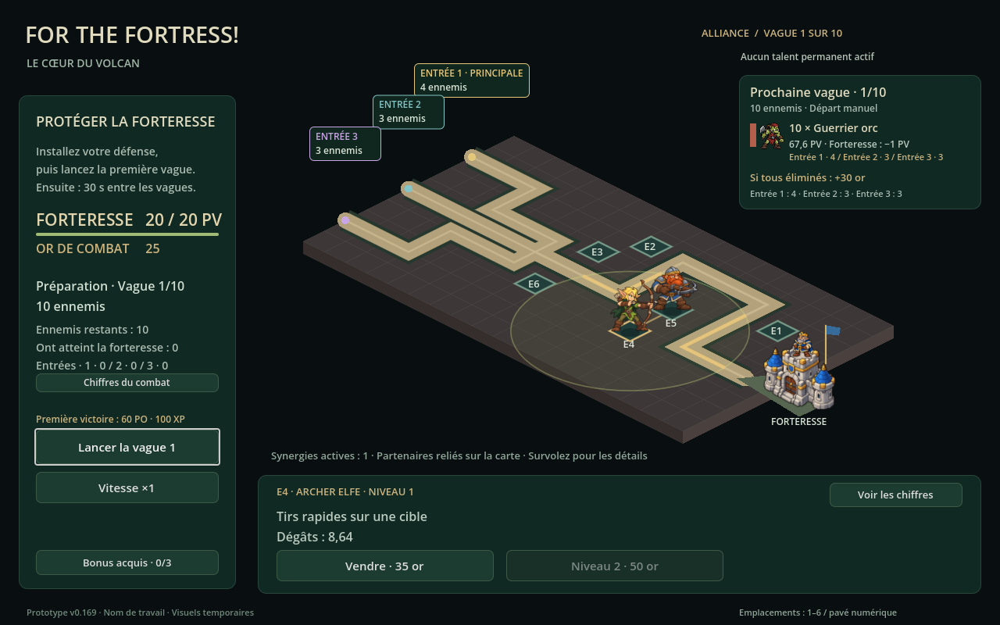

# Missions 61 à 70 — Chapitre 7, terres volcaniques

## Décision du porteur et statut de conception

Le 10 novembre 2026, le porteur retient **les terres volcaniques et les cendres** comme ambiance des chapitres 7 et 8, aux missions 61–80 (troisième biome après le Gué et les Ardoises, et les marais). Cette décision porte sur l'ambiance. Selon CAMP-017, le chapitre 7 présente le biome par ses terrains et ses configurations de chemins, sans nouveauté de règle ; la nouveauté du biome arrivera au chapitre 8. Les pistes évoquées à la proposition (tronçons de lave, attaquant de feu) ne sont pas décidées.

La v0.167 livre le chapitre 7 entier ; la v0.168 le durcit à la demande du porteur (voir plus bas). Les noms, tracés, emplacements et valeurs ci-dessous sont des propositions de prototype de Claude Code, à confirmer en jeu. L'habillage volcanique (palette, sol, décor) est un repère de couleur neutre en attendant Codex (`TODO_VISUELS.md`) : le plateau est gris cendre, sans décor automatique ni bassin.

## Règles

Aucune règle propre : rencontres standard (les dix vagues de base, sans tortue ni Noyé), pas d'affixe, mêmes gains que partout (60 PO et 100 XP à la première victoire, une seule fois par faction). Chaque tentative repart avec 150 or de combat, une forteresse intacte, aucun défenseur et aucun bonus temporaire. PV ennemis : 99 % + 1 % par mission, soit 160 % à 169 % ; la borne acceptée par le jeu passe à 169 %. La mission précédente doit être réussie dans la faction concernée.

## Cartes

| Mission | Carte | Entrées | Trajets | Points de talent accessibles |
| --- | --- | --- | --- | --- |
| 61 | Le Seuil des Cendres | 1 | 34 | 30 |
| 62 | Les Coulées Figées | 1 | 36 | 31 |
| 63 | La Caldeira | 2, pression alternée | 29 / 29 | 31 |
| 64 | Les Fumerolles | 1 | 33 | 32 |
| 65 | Les Forges Noires | 3 | 28 / 24 / 28 | 32 |
| 66 | Le Pont d'Obsidienne | 2, pression alternée | 27 / 27 | 33 |
| 67 | Les Orgues de Basalte | 1 | 31 | 33 |
| 68 | Le Cratère Jumeau | 2, pression alternée | 29 / 29 | 34 |
| 69 | La Route des Cendres | 3 | 28 / 24 / 28 | 34 |
| 70 | Le Cœur du Volcan | 3 | 27 / 24 / 27 | 35 |

Chaque carte garde six emplacements et dix vagues. Le chapitre propose une variété comparable à celle du chapitre 5 : quatre cartes à une entrée, trois à deux entrées et trois à trois entrées. Les trajets sont de plus en plus courts au fil du chapitre (de 34 à 27 unités) pour compenser l'absence de règle particulière ; le Cœur du Volcan, finale du chapitre, est le plus court. Les longueurs de cette table sont celles de la v0.168.

## Prise en compte des talents accumulés

Comme pour les marais, les emplacements ont été choisis avec les points de talents réellement acquis à chaque mission (30 à 35, répartis comme dans les tests de campagne), par couverture du trajet puis simulation de 16 jeux d'emplacements et trois ordres d'achat par carte (480 parties), en retenant le jeu qui maximise les PV restants du camp le plus faible. Les essais d'équilibrage dépensent tous les points avec trois orientations de talents.

## Ajustements pendant la conception

Première version des tracés (v0.167) : l'ouverture (61, trajet de 30) était la carte la plus difficile, la Horde ne gagnant que 6 parties de référence sur 48, tandis que les Fumerolles, les Orgues et la finale, aux trajets longs, étaient presque gagnées d'avance (de 39 à 46 sur 48 côté Horde). L'ouverture a été allongée (30 → 36) et les trois autres raccourcis (Fumerolles 39 → 35, Orgues 40 → 34, Cœur du Volcan 35 → 29), ce qui donne une progression plus régulière.

## Durcissement du chapitre (v0.168)

Le porteur a demandé de durcir le chapitre 7 : dans la v0.167, il était nettement plus facile que le chapitre 6 et sa finale était dans la moyenne. Le levier retenu est la longueur des trajets, sans toucher aux PV ennemis (courbe fixée à +1 % par mission) ni aux rencontres : une carte plus courte laisse moins de temps aux défenseurs pour tirer. À neuf cartes sur dix, les trajets sont raccourcis, avec une difficulté croissante jusqu'à la finale :

| Mission | Trajet avant | Trajet après |
| --- | --- | --- |
| 61 | 36 | 34 |
| 62 | 40 | 36 |
| 63 | 29 / 29 | inchangé |
| 64 | 35 | 33 |
| 65 | 30 / 26 / 30 | 28 / 24 / 28 |
| 66 | 33 / 33 | 27 / 27 |
| 67 | 34 | 31 |
| 68 | 33 / 33 | 29 / 29 |
| 69 | 32 / 28 / 32 | 28 / 24 / 28 |
| 70 | 29 / 26 / 29 | 25 / 22 / 25 (27 / 24 / 27 depuis la v0.169) |

Les emplacements ont été recalculés pour chaque carte par la même méthode (480 parties de référence avec les talents réels). Parties de référence gagnées sur 48 par carte (16 jeux d'emplacements × 3 ordres d'achat), avant puis après :

| Faction | Moyenne avant | Moyenne après | Finale (70) avant | Finale (70) après |
| --- | --- | --- | --- | --- |
| Alliance | 39,6 | 29,3 | 40 | 28 |
| Horde | 25,8 | 14,9 | 28 | 7 |

La finale est maintenant au niveau de celle du chapitre 6 (23 et 6 sur 48). La stratégie de référence des tests gagne encore dans les deux factions sur les dix cartes.

## Comparaisons automatiques

Le relevé local `dist/volcano-missions61-70-survey.json` contient 2 160 essais : trois graines (7, 42 et 2026), trois placements, quatre compositions et trois orientations de talents dans chaque faction et sur chaque carte. Tous dépensent tous les points acquis auparavant (30 à 35 selon la mission), avec les revenus normaux, une priorité de prérequis de talents majeurs, les spécialisations A et le premier bonus proposé. Les empreintes des scripts enregistrées dans le relevé correspondent aux sources de la version.

Pour mesurer l'effet des seules cartes, on compare les arbres de référence (ceux que les cartes ont servi à régler : Maîtrise du tir pour l'Alliance, Fureur de guerre pour la Horde), victoires sur 36 parties par mission, avant et après le durcissement de la v0.168 :

| Mission | 61 | 62 | 63 | 64 | 65 | 66 | 67 | 68 | 69 | 70 | Total sur 360 |
| --- | --- | --- | --- | --- | --- | --- | --- | --- | --- | --- | --- |
| Alliance avant | 36 | 35 | 34 | 36 | 36 | 36 | 36 | 36 | 36 | 36 | 357 |
| Alliance après | 36 | 36 | 34 | 28 | 36 | 29 | 36 | 30 | 30 | 34 | 329 |
| Horde avant | 26 | 9 | 7 | 12 | 15 | 22 | 35 | 19 | 9 | 22 | 176 |
| Horde après | 35 | 35 | 7 | 8 | 12 | 3 | 30 | 6 | 7 | 4 | 147 |

Le durcissement réduisait les victoires de 8 % (Alliance) et de 16 % (Horde) sur l'arbre de référence.

**Alignement des factions (v0.169).** La v0.169 abaisse les talents de l'Alliance pour les aligner sur ceux de la Horde (voir `Equilibrage_arbres_talents_v0168.md`) et rallonge le finale de deux unités. Victoires sur 108 parties par mission avec les armées de chaque arbre (`dist/volcano-missions61-70-natural.json`) : l'unité améliorée par l'arbre est achetée à l'ouverture, parfois en deux exemplaires ; les compositions fixes des essais habituels favorisent certains arbres.

| Série | Faction | Missions 61 à 70 | Total sur 1 080 |
| --- | --- | --- | --- |
| Armées de chaque arbre, v0.168 | Alliance | 108, 108, 108, 85, 108, 106, 108, 104, 103, 105 | 1 043 (97 %) |
| Armées de chaque arbre, v0.168 | Horde | 108, 107, 48, 51, 62, 12, 102, 13, 27, 28 | 558 (52 %) |
| Armées de chaque arbre, v0.169 | Alliance | 108, 108, 70, 45, 94, 7, 107, 30, 30, 94 | 693 (64 %) |
| Armées de chaque arbre, v0.169 | Horde | 108, 107, 48, 51, 62, 12, 102, 13, 27, 84 | 614 (57 %) |
| Compositions fixes, v0.169 | Alliance | 92, 97, 42, 15, 54, 5, 77, 13, 16, 60 | 471 (44 %) |
| Compositions fixes, v0.169 | Horde | 79, 71, 17, 17, 21, 10, 55, 15, 16, 37 | 338 (31 %) |

L'écart entre factions passe de 45 points (97 % contre 52 %) à 7 points (64 % contre 57 %) avec les armées de chaque arbre. Les résultats de la Horde ne changent qu'à la mission 70 (28 → 84 victoires) à cause du rallongement du finale. Victoires sur 360 par orientation de talents, armées de chaque arbre : Alliance Bastion 223, Maîtrise du tir 235, Arts arcaniques 235 ; Horde Fureur de guerre 209, Voie des maléfices 187, Démolition 218. Les six arbres se situent entre 187 et 235.

Ces résultats décrivent les stratégies automatiques essayées. Ils ne constituent ni un taux de réussite des joueurs ni une validation humaine de l'équilibrage.

**Points à retenir.**
- Les deux factions ont maintenant une difficulté comparable : la Horde ne retarde plus et l'Alliance n'écrase plus les cartes.
- Missions les plus difficiles dans les deux factions : le Pont d'Obsidienne (66, 7 et 12 victoires sur 108), le Cratère Jumeau (68) et la Route des Cendres (69). Le Seuil des Cendres, les Coulées Figées et le Cœur du Volcan, côté Horde, sont gagnés presque à tous coups.
- La courbe de difficulté du chapitre n'est pas croissante : le Pont d'Obsidienne, au milieu, est la carte la plus dure. Ajuster ces cartes reste possible après décision du porteur.

## Vérifications

La régression complète réussit : 103 suites, 62 495 contrôles Godot et 17 tests Python, dont `test_talent_balance.gd` (426 contrôles : échelle de chaque arbre, trois jeux de règles par version, parité à 51 points). Les 52 essais Windows ciblés réussissent (menus et lancements des missions 61 à 70 dans les deux factions, chapitre 7 terminé avec rejeu sans nouveau gain, mission 60 comme témoin, écrans de talents, spécialisations à trois entrées) et les 87 empreintes de sources du paquet correspondent au projet. Les rapports de référence du grenadier (v0.100) et le relevé historique de la boutique se rejouent à l'identique avec les valeurs de talents d'origine.

## Suite

70 missions sont jouables : les chapitres 1 à 7 sont complets. Le chapitre 8 (missions 71–80) doit apporter la nouveauté du biome volcanique ; sa nature (attaquant de feu, terrain de lave, affixe de combat, etc.) reste à choisir avec le porteur. L'habillage volcanique, entièrement provisoire, et l'équilibrage humain restent à faire.
