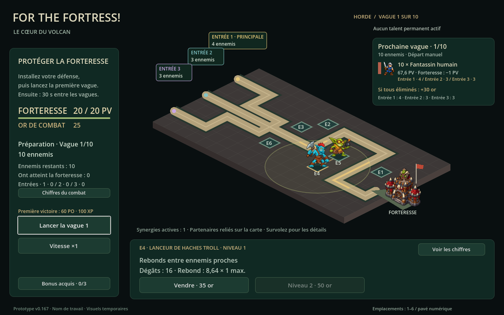

# Missions 61 à 70 — Chapitre 7, terres volcaniques

## Décision du porteur et statut de conception

Le 10 novembre 2026, le porteur retient **les terres volcaniques et les cendres** comme ambiance des chapitres 7 et 8, aux missions 61–80 (troisième biome après le Gué et les Ardoises, et les marais). Cette décision porte sur l'ambiance. Selon CAMP-017, le chapitre 7 présente le biome par ses terrains et ses configurations de chemins, sans nouveauté de règle ; la nouveauté du biome arrivera au chapitre 8. Les pistes évoquées à la proposition (tronçons de lave, attaquant de feu) ne sont pas décidées.

La v0.167 livre le chapitre 7 entier. Les noms, tracés, emplacements et valeurs ci-dessous sont des propositions de prototype de Claude Code, à confirmer en jeu. L'habillage volcanique (palette, sol, décor) est un repère de couleur neutre en attendant Codex (`TODO_VISUELS.md`) : le plateau est gris cendre, sans décor automatique ni bassin.

## Règles

Aucune règle propre : rencontres standard (les dix vagues de base, sans tortue ni Noyé), pas d'affixe, mêmes gains que partout (60 PO et 100 XP à la première victoire, une seule fois par faction). Chaque tentative repart avec 150 or de combat, une forteresse intacte, aucun défenseur et aucun bonus temporaire. PV ennemis : 99 % + 1 % par mission, soit 160 % à 169 % ; la borne acceptée par le jeu passe à 169 %. La mission précédente doit être réussie dans la faction concernée.

## Cartes

| Mission | Carte | Entrées | Trajets | Points de talent accessibles |
| --- | --- | --- | --- | --- |
| 61 | Le Seuil des Cendres | 1 | 36 | 30 |
| 62 | Les Coulées Figées | 1 | 40 | 31 |
| 63 | La Caldeira | 2, pression alternée | 29 / 29 | 31 |
| 64 | Les Fumerolles | 1 | 35 | 32 |
| 65 | Les Forges Noires | 3 | 30 / 26 / 30 | 32 |
| 66 | Le Pont d'Obsidienne | 2, pression alternée | 33 / 33 | 33 |
| 67 | Les Orgues de Basalte | 1 | 34 | 33 |
| 68 | Le Cratère Jumeau | 2, pression alternée | 33 / 33 | 34 |
| 69 | La Route des Cendres | 3 | 32 / 28 / 32 | 34 |
| 70 | Le Cœur du Volcan | 3 | 29 / 26 / 29 | 35 |

Chaque carte garde six emplacements et dix vagues. Le chapitre propose une variété comparable à celle du chapitre 5 : quatre cartes à une entrée, trois à deux entrées et trois à trois entrées. Le Cœur du Volcan, finale du chapitre, a des trajets plus courts pour compenser un terrain sans règle particulière.

## Prise en compte des talents accumulés

Comme pour les marais, les emplacements ont été choisis avec les points de talents réellement acquis à chaque mission (30 à 35, répartis comme dans les tests de campagne), par couverture du trajet puis simulation de 16 jeux d'emplacements et trois ordres d'achat par carte (480 parties), en retenant le jeu qui maximise les PV restants du camp le plus faible. Les essais d'équilibrage dépensent tous les points avec trois orientations de talents.

## Ajustements pendant la conception

Première version des tracés : l'ouverture (61, trajet de 30) était la carte la plus difficile, la Horde ne gagnant que 6 parties de référence sur 48, tandis que les Fumerolles, les Orgues et la finale, aux trajets longs, étaient presque gagnées d'avance (de 39 à 46 sur 48 côté Horde). L'ouverture a été allongée (30 → 36) et les trois autres raccourcis (Fumerolles 39 → 35, Orgues 40 → 34, Cœur du Volcan 35 → 29), ce qui donne une progression plus régulière.

## Comparaisons automatiques

Le relevé local `dist/volcano-missions61-70-survey.json` contient 2 160 essais : trois graines (7, 42 et 2026), trois placements, quatre compositions et trois orientations de talents dans chaque faction et sur chaque carte. Tous dépensent tous les points acquis auparavant (30 à 35 selon la mission), avec les revenus normaux, une priorité de prérequis de talents majeurs, les spécialisations A et le premier bonus proposé. Les empreintes des scripts enregistrées dans le relevé correspondent aux sources de la version.

| Mission | Carte | Alliance | Horde |
| --- | --- | --- | --- |
| 61 | Le Seuil des Cendres | 69 victoires sur 108 | 47 sur 108 |
| 62 | Les Coulées Figées | 67 | 23 |
| 63 | La Caldeira | 41 | 15 |
| 64 | Les Fumerolles | 61 | 24 |
| 65 | Les Forges Noires | 79 | 33 |
| 66 | Le Pont d'Obsidienne | 90 | 48 |
| 67 | Les Orgues de Basalte | 85 | 62 |
| 68 | Le Cratère Jumeau | 80 | 39 |
| 69 | La Route des Cendres | 61 | 22 |
| 70 | Le Cœur du Volcan | 76 | 46 |

**Effet des talents.** Sur les dix missions, chaque cellule compte 360 parties :

| Faction | Orientation de talents | Victoires sur 360 |
| --- | --- | --- |
| Alliance | Entraînement | 357 |
| Alliance | Remparts renforcés | 262 |
| Alliance | Étude des arcanes | 90 |
| Horde | Entraînement | 176 |
| Horde | Explosifs | 133 |
| Horde | Rituels | 50 |

Ces résultats décrivent les stratégies automatiques essayées. Ils ne constituent ni un taux de réussite des joueurs ni une validation humaine de l'équilibrage.

**Points à retenir.**
- Le chapitre est nettement plus facile que le chapitre 6 des marais (Alliance de 41 à 90 victoires sur 108 contre 20 à 68 ; Horde de 15 à 62 contre 6 à 33). C'est attendu : le Noyé ajoutait une règle contraignante, alors que le chapitre 7 présente seulement des terrains, avec les mêmes PV ennemis à +1 % par mission.
- Les missions les plus dures sont la Caldeira (63) et la Route des Cendres (69). Les plus faciles sont le Pont d'Obsidienne (66) et les Orgues de Basalte (67).
- La finale, le Cœur du Volcan (70), est dans la moyenne (76 victoires pour l'Alliance, 46 pour la Horde) : la courbe n'est pas croissante. Comme pour la finale du chapitre 6, un durcissement (trajets plus courts, ou emplacements plus contraints) est possible après décision du porteur.
- L'arbre Entraînement gagne presque tout (357 victoires sur 360 côté Alliance), ce qui relève des talents et non des cartes, comme au chapitre 6.

## Vérifications

La régression complète réussit : 102 suites, 62 195 contrôles Godot et 17 tests Python. La suite dédiée aux dix missions (3 442 contrôles) couvre, pour chaque carte : validité, décor volcanique, longueur mesurée, entrées, pression alternée limitée aux cartes à deux entrées, trajets rejoignant la forteresse, sérialisation, refus de l'eau réservée aux marais, emplacements à distance des chemins, dessin sans effet sur le combat ; puis, pour chaque faction et chaque mission, un parcours complet depuis le menu de campagne avec les talents réellement acquis, une victoire de la composition de référence, un rapport rejouable à l'identique et des récompenses créditées une seule fois.

Les 68 essais Windows réussissent : menus et lancements des missions 61 à 70 dans les deux factions, chapitre 7 terminé avec rejeu sans nouveau gain, missions de marais 41, 50, 51, 59 et 60 comme témoins, et spécialisations à trois entrées. Les 87 empreintes des sources exportées correspondent au projet. Les captures avec défenseurs des dix cartes ont été inspectées dans les deux factions : tracés, entrées multiples et emplacements sont lisibles sur le sol gris cendre provisoire.

## Suite

70 missions sont jouables : les chapitres 1 à 7 sont complets. Le chapitre 8 (missions 71–80) doit apporter la nouveauté du biome volcanique ; sa nature (attaquant de feu, terrain de lave, affixe de combat, etc.) reste à choisir avec le porteur. L'habillage volcanique, entièrement provisoire, et l'équilibrage humain restent à faire.
