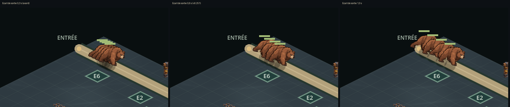

# Sorties après l'Éboulement sur les mines à une entrée (v0.251)

**Statut.** Décision du porteur du 24 novembre 2026 (« Espacer les ours ») : les ennemis retenus par un Éboulement ressortent à 0,6 s d'écart au lieu de 0,3 s. Signalement de Codex du 24 novembre 2026 : sur les missions 121, 122, 125 et 128, les deux premiers ours ressortaient presque ensemble et se lisaient comme un seul. Réglage de prototype à confirmer en partie réelle.

## Ce qui change

- `ValleyModel.ROCKFALL_HOLD_GAP` passe de 0,3 à 0,6 s. Il ne concerne que les cartes à une seule entrée, où l'Éboulement retient les apparitions : missions 121, 122, 125 et 128.
- Les rapports de partie d'avant la v0.251 se rejouent avec l'ancien écart (`Replay.rockfall_hold_gap_for`).
- Un ours avance de 0,7 case par seconde : deux ours retenus sont désormais décalés d'environ 13 px à l'écran au lieu de 6 px. Les jauges se séparent et on compte les ours. Les corps se chevauchent encore en partie. Un écart de 1 s les séparerait davantage, au prix d'une sortie plus étalée.

## Difficulté

Meilleure marge des 30 compositions, tirages 7, 8 et 9 :

| Mission | Alliance avant → après | Horde avant → après |
| --- | --- | --- |
| 121 | 63 → 63 % | 55 → 71 %, puis 68 % avec +1 % de PV |
| 122 | 57 → 61 % | 51 → 66 % |
| 125 | 54 → 77 %, puis 65 % avec +1 % de PV | 51 → 53 % |
| 128 | 52 → 58 % | 61 → 56 % |

Les deux réglages sortis de la cible ont été recalés : Horde 121 (coefficient 162 → 163) et Alliance 125 (125 → 126). L'armée de référence gagne toujours. Les huit réglages sont dans la cible de 40 à 70 % ; sur toute la campagne, 374 réglages sur 398 y restent.

Scripts et mesures : `design/essais/equilibre_bonus/v251/`.
