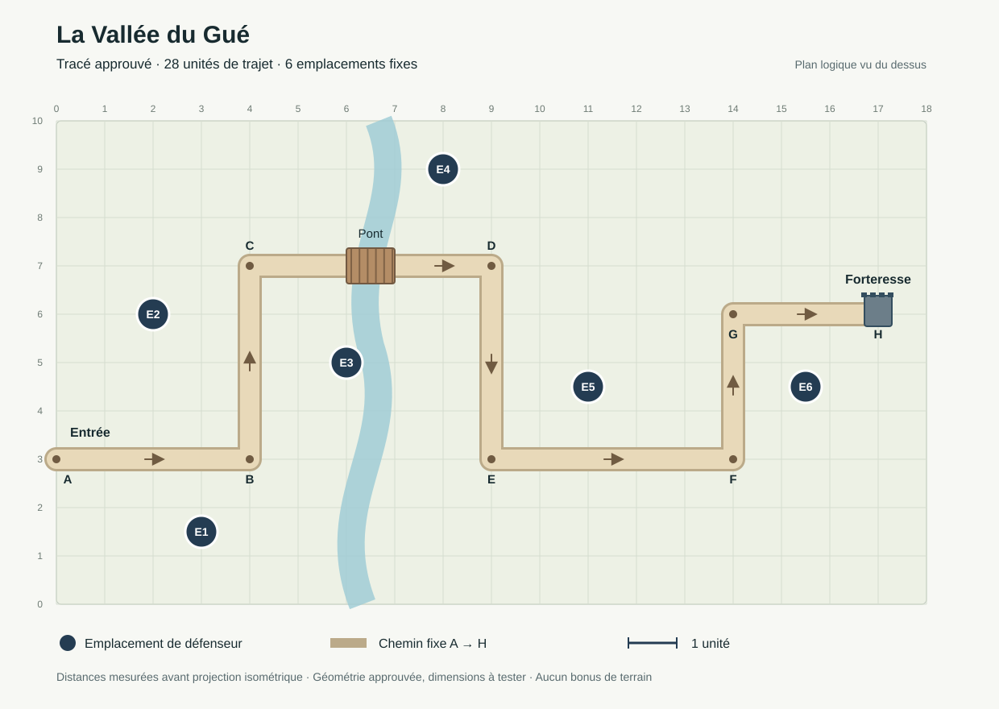

# For the Fortress! — Proposition de La Vallée du Gué

Proposition du 20 octobre 2026, fondée sur le GDD v0.8.

**Statut P — géométrie et conventions à valider ; dimensions H à tester.** La carte initiale, le chemin fixe, le pont, les six emplacements et la vue isométrique proviennent du socle. Cette fiche propose leur disposition mesurable. Le GDD approuvé reste en v0.8.

Le schéma est un plan de conception vu du dessus. Il ne remplace pas la vue isométrique prévue ni la direction artistique ; le convertir en perspective ne doit pas déformer les distances de jeu.

## 1. Conventions proposées

- Un seul trajet continu A → B → C → D → E → F → G → H, identique pour tous les archétypes et les deux factions. Une entrée, une arrivée à la forteresse, aucune bifurcation.
- Terrain logique de 18 × 10 unités. Origine (0 ; 0) en bas à gauche ; x vers la droite et y vers le haut. Cette convention ne prescrit pas les axes du moteur.
- Déplacement à vitesse constante en unités par seconde le long de la ligne centrale du chemin, sans arrêt aux virages. Les vitesses sont celles du GDD.
- Distances de portée et de zone mesurées dans le plan logique par distance euclidienne, avant projection isométrique.
- Pour le premier essai, acquisition d’une cible principale si la distance de son centre au centre du défenseur est inférieure ou égale à la portée. Les règles existantes de rayon strictement inférieur et de rebond restent inchangées.
- Pour le premier essai, ennemis sans blocage mutuel ni ralentissement dû à la circulation ; aucun emplacement ne bloque la route. Les tailles graphiques ne modifient pas les calculs de distance.
- Le pont est une partie ordinaire du trajet : aucun bonus, péage, ralentissement, obstacle de tir ou destruction de pont n’est ajouté.
- Tous les six emplacements sont disponibles dès le départ et acceptent chacun un défenseur de la faction choisie. Aucune position n’est réservée à une classe. Le recrutement de copies reste ouvert.
- Les frontières du terrain servent au cadrage ; les portées peuvent les dépasser sans créer de nouvelles zones de déplacement.

Les décors ne bloquent pas les attaques dans ce premier essai proposé. La largeur visuelle du chemin, l’empreinte des unités et les collisions des projectiles restent à traiter séparément. La règle de portée à l’impact et le maintien des malédictions après sortie de portée restent ouverts.

## 2. Tracé et progression

| Point | Coordonnées (x ; y) | Distance depuis l’entrée |
| --- | --- | --- |
| A | 0 ; 3 | 0 u |
| B | 4 ; 3 | 4 u |
| C | 4 ; 7 | 8 u |
| D | 9 ; 7 | 13 u |
| E | 9 ; 3 | 17 u |
| F | 14 ; 3 | 22 u |
| G | 14 ; 6 | 25 u |
| H | 17 ; 6 | 28 u |

Le trajet mesure **28 unités**. Il comporte sept segments de longueurs 4, 4, 5, 4, 5, 3 et 3 unités. Ces virages orthogonaux sont une base de mesure ; un arrondi ultérieur devra recalculer la longueur et les couvertures.

Le pont se situe sur C → D, de (6 ; 7) à (7 ; 7), soit de 10 à 11 unités parcourues depuis l’entrée. La rivière, suggérée au plan, est un décor ; son tracé n’ajoute pas de règle de combat.

La priorité de ciblage sur l’ennemi le plus avancé se mesure par la distance parcourue de A vers H, et non par la distance à vol d’oiseau vers la forteresse. Les égalités de progression restent à trancher avec les règles générales.

## 3. Six emplacements fixes

| Repère | Coordonnées (x ; y) | Intention de positionnement |
| --- | --- | --- |
| E1 | 3 ; 1,5 | Entrée et premier virage |
| E2 | 2 ; 6 | Premier lacet et accès au pont |
| E3 | 6 ; 5 | Pont et cœur du premier lacet |
| E4 | 8 ; 9 | Sortie du pont et virage central |
| E5 | 11 ; 4,5 | Second lacet et approche finale |
| E6 | 15,5 ; 4,5 | Dernier virage et porte de la forteresse |

Ces intentions ne sont pas des bonus d’emplacement. Les six centres restent hors de la ligne de trajet. Leur distance minimale au chemin est d’au moins 1,5 unité, ce qui laisse de la place à une représentation lisible.

E1 sollicite le choix d’une couverture précoce ; E3 et E5 peuvent suivre plusieurs segments du chemin ; E6 offre une dernière fenêtre de tir. Les emplacements centraux pourraient devenir trop avantageux : c’est un risque à mesurer, pas un équilibre déjà obtenu.

## 4. Longueur du trajet à portée

Le tableau additionne les portions de chemin situées dans un cercle centré sur chaque emplacement. Il compte des unités de trajet, pas le nombre d’ennemis, les secondes d’attaque ni les dégâts réellement infligés. Les valeurs sont calculées puis affichées à deux décimales au maximum ; le calcul interne n’est pas arrondi par segment.

| Emplacement | Portée 3 | Portée 3,5 | Portée 4 | Portée 5 | Portée 6,5 |
| --- | --- | --- | --- | --- | --- |
| E1 | 4,93 u | 5,85 u | 6,37 u | 7,4 u | 11,79 u |
| E2 | 4,06 u | 8,83 u | 9,87 u | 10,9 u | 12,42 u |
| E3 | 8,47 u | 13,35 u | 14,93 u | 17,17 u | 20,18 u |
| E4 | 4,06 u | 5,23 u | 6,34 u | 8,9 u | 13,62 u |
| E5 | 8,33 u | 12,61 u | 13,83 u | 16,1 u | 19 u |
| E6 | 7,1 u | 7,66 u | 8,21 u | 9,27 u | 10,82 u |

Portées de référence : sapeur 3 ; troll et mage 3,5 ; archer 4 ; chaman 4,5 ; arbalétrier 5. Les branches modifiant la portée utilisent 3,5 pour Tireur de volée, 5 pour Veilleur et 6,5 pour Sentinelle. Le tableau ne présente pas toutes les portées, mais les mêmes conventions permettent de calculer 4,5.

Pour un ennemi se déplaçant à vitesse constante v et jamais éliminé, la durée cumulée à portée vaut longueur couverte ÷ v. Elle peut comprendre plusieurs fenêtres séparées. Une unité ne peut donc pas nécessairement utiliser tous ses tirs : cadence, premier tir, changement de cible et victimes concurrentes comptent.

## 5. Temps de traversée sans combat

| Archétype | Vitesse du GDD | 28 ÷ vitesse |
| --- | --- | --- |
| Grouillant | 1,15 u/s | 24,35 s |
| Pillard | 1 u/s | 28 s |
| Sprinter | 1,65 u/s | 16,97 s |
| Brute | 0,7 u/s | 40 s |
| Maraudeur | 1,2 u/s | 23,33 s |
| Colosse | 0,5 u/s | 56 s |
| Élite | 0,75 u/s | 37,33 s |
| Seigneur de siège | 0,45 u/s | 62,22 s |

Exemple : un Pillard apparu à t = 0 atteindrait la forteresse à t = 28 s, et le dernier Pillard de la vague 1, apparu à t = 22,5 s, à t = 50,5 s, sans élimination ni blocage. Ce calcul ne prédit pas la durée réelle de la vague.

Le boss parcourt le chemin en environ 62,22 s sans combat. Les temps d’apparition du GDD sont conservés ; les 273,1 s de fenêtres d’émission ne représentent toujours pas la durée totale de la partie. La cible de 8 à 12 minutes devra être mesurée avec les combats, préparations et choix.

## 6. Protocole de vérification proposé

1. Parcourir A à H avec chaque vitesse et contrôler le temps total, sans attaque.
2. Afficher temporairement les cercles de portée et vérifier les entrées/sorties sur les sept segments.
3. Comparer E1 à E6 avec le même défenseur, niveau, branche et vague ; mesurer temps de tir utile, éliminations et fuites.
4. Tester les positions proches du pont avec mage et sapeur, puis la chaîne du troll, sans modifier les intervalles des vagues.
5. Comparer Veilleur, Tireur de volée et Sentinelle pour vérifier que leur portée crée un choix réel.
6. Jouer les deux factions avec le scénario de dépenses du GDD, noter les PV restants, la durée et les choix effectués.
7. Réviser la géométrie ou les valeurs H en consignant la modification ; ne pas ajuster carte, ennemis et défenseurs simultanément sans conserver un point de comparaison.

## 7. Décisions et suites

À examiner : le trajet de 28 unités, les coordonnées des six emplacements, l’échelle commune des portées et vitesses, la convention de ciblage par centres et l’absence de blocage mutuel pour l’essai initial.

Les égalités, le premier délai de tir, les projectiles et l’effet d’une sortie de portée doivent ensuite être précisés. Les bonus roguelite et synergies ne sont pas définis par la carte. Aucun nouvel effet de terrain ou mode de jeu n’est approuvé par cette proposition.

Après validation, intégrer la géométrie au GDD et utiliser ces mesures pour préparer le premier prototype jouable.
