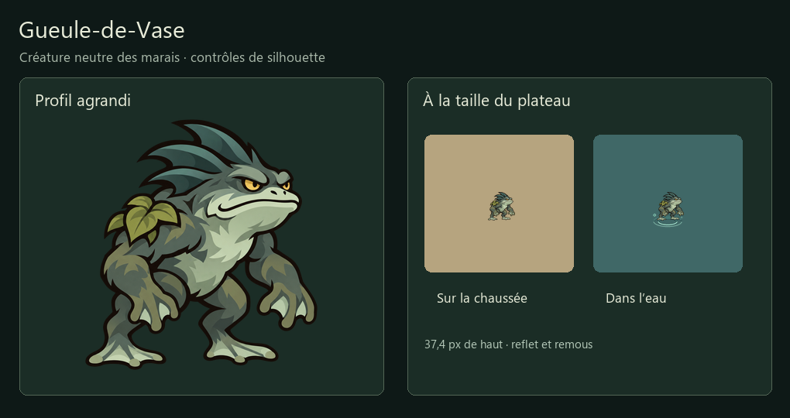

# Gueule-de-Vase — silhouette et régénération

**Décision du porteur, 11 novembre 2026.** Le porteur aime la silhouette de batracien et retient le nom **Gueule-de-Vase** pour la créature appelée Noyé jusqu’ici. Le principe validé reste celui d’une créature neutre des marais qui régénère dans l’eau. Le nom affiché reste à mettre à jour dans le jeu. Les règles d’origine sont décrites dans [la fiche des Eaux Mortes](Mission_051_Eaux_Mortes_Noye.md).

Le sprite reprend les contours marqués et les aplats du bestiaire neutre. Consigne artistique : batracien trapu, branchies larges, mâchoire vert pâle, pieds palmés et feuilles des marais sur l’épaule. La mâchoire et les yeux se détachent sur la chaussée inondée. Les deux factions voient la même créature.

| Ressource | Dimensions et point d’ancrage |
| --- | --- |
| [Sprite PNG](essais/gueule_de_vase/gueule_de_vase_v001.png) | Cadre complet 1 000 × 1 081 px, pied `(415, 1076)`, profil droit. Hauteur actuelle en jeu 34 × 1,1 = 37,4 px. |
| [Remous de régénération](essais/gueule_de_vase/Remous_regeneration.png) | Bande transparente 896 × 42 px, 16 images de 56 × 42 px, ancre `(28, 28)`, boucle proposée de 0,96 s simulée. |

Les remous et les bulles sont une proposition d’effet pendant la régénération. Pour l’essai intégré, les dessiner au pied de l’unité quand `model.enemy_in_water(enemy)` est vrai et que `hp < max_hp`. L’effet disparaît au retour sur la chaussée ou quand la vie est pleine. Sa phase suit le temps de combat. La barre de vie reste distincte.

## Contrôle visuel

Le sprite et l’effet ont été composés sur des captures Godot isolées de la mission 51 dans les deux factions, prises sur l’écran de droite. Les remous restent au niveau des pieds. La planche contient 16 poses distinctes et ses bords restent transparents. La vidéo montre une maquette du passage de la chaussée au premier tronçon inondé, avec l’effet à ×1 et ×2. Le sprite reste fixe pendant ce déplacement de démonstration. La marche et le rendu en combat restent à essayer. [Vue Alliance](essais/gueule_de_vase/Eaux_Mortes_alliance.png) · [Vue Horde](essais/gueule_de_vase/Eaux_Mortes_horde.png) · [Vidéo](essais/gueule_de_vase/Regeneration_x1_x2.mp4)

Pour le branchement, conserver `enemy.neutral.drowned` et changer le nom visible dans le catalogue. Associer le nouveau PNG au portrait et au plateau, puis vérifier la prévision de vague et l’éclaireur dans les deux factions. Les fichiers de ce lot restent hors ressources d’exécution jusqu’à l’intégration par Claude Code. [Repères d’intégration](essais/gueule_de_vase/Reperes.json)
