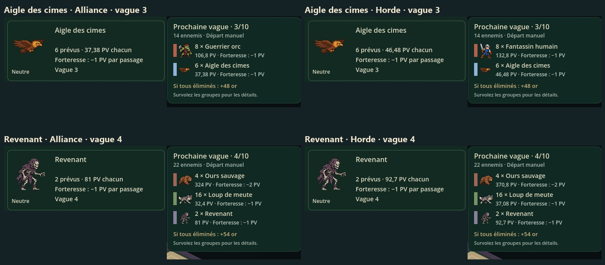
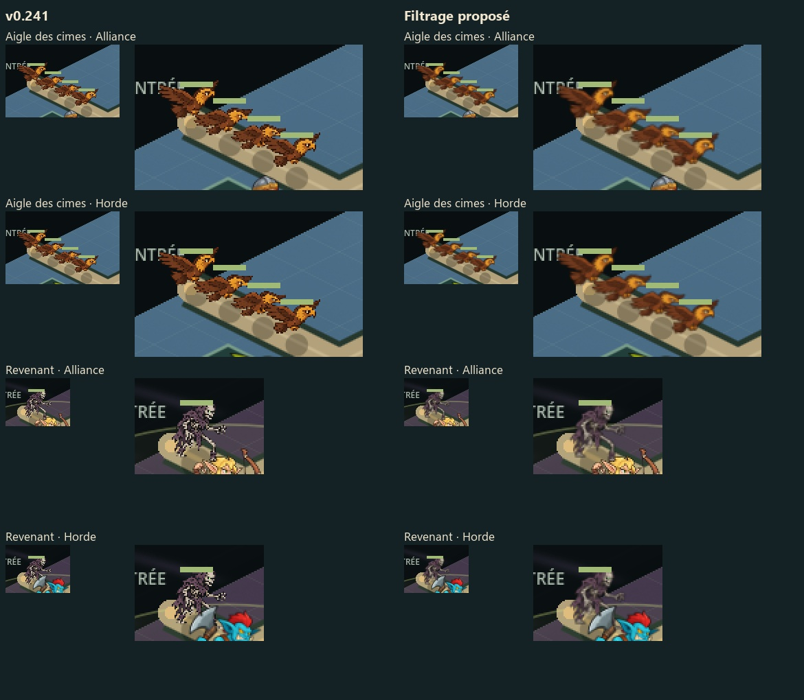

# Aigle des cimes et Revenant · Vérification v0.241

Les portraits de l’Aigle des cimes et du Revenant sont bien affichés dans les prévisions de vague et dans le panneau Rencontres des missions 151 et 191, pour les deux factions. L’aigle orange en vol et le squelette au manteau violet restent distincts des autres attaquants à taille de jeu.

## Filtrage testé sur le plateau

Le rendu actuel crénelle les contours en mouvement, surtout les os et les lambeaux du Revenant. Activer les mipmaps sur les planches atténue le crénelage des deux unités. Le visage et les mains du Revenant perdent aussi du contraste. Les réglages actuellement publiés restent en place pendant la comparaison.

## Relève

Un coup fatal demandé par l’atelier a déclenché la vraie règle de relève de la mission 191, dans chaque faction. Le même Revenant retrouve la moitié de ses PV. Il reprend ensuite sa marche après les 0,72 s de la planche. Son point d’appui projeté avance de 19,6 px pendant la relève, y compris dans les premières poses basses. Le glissement est visible dans la boucle. Ce point est transmis à Claude Code pour le rendu à l’intégration.

- [Relève Alliance](essais/aigle_revenant_v0241/Releve_alliance.gif)
- [Relève Horde](essais/aigle_revenant_v0241/Releve_horde.gif)

## Contrôles

Copie v0.241. Quatre écrans Rencontres, quatre prévisions ciblées, quatre paires d’images à taille native et deux séquences de relève avant et après essai de filtrage. Les six suites ciblées passent, avec 213 contrôles des portraits d’ennemis, 1 278 de marche, 28 de relève, 204 du chargeur d’animations, 911 des portraits de prévision et 6 150 du panneau Rencontres.
