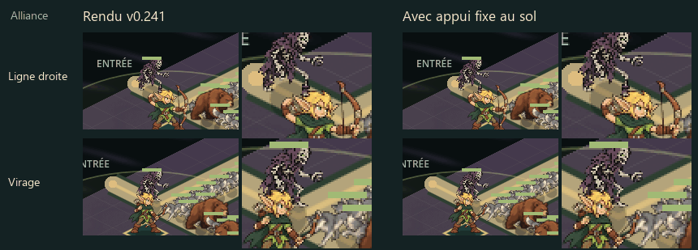

# Appui au sol pendant la relève du Revenant

Essai du 23 novembre 2026 sur une copie de la v0.241. Le Revenant utilise les mêmes dessins et les mêmes 24 poses de relève, pendant 0,72 s. Sur les 0,15 premières secondes, ses appuis restent à la position exacte où il encaisse le coup fatal. Le rendu rejoint progressivement sa position de combat au moment où la marche reprend.

## Comparaison en combat

Mission 191, vague 4. L’atelier déclenche le coup fatal à 25,40 s sur une ligne droite et à 26,55 s juste avant le premier virage. Les captures côte à côte montrent le plateau à taille native et avec un agrandissement ×2. Chaque boucle comporte 31 images.

[Voir la même comparaison face à la Horde](essais/releve_appuis_v0241/Releve_horde.gif).

## Mesures et intégration

- À 0,15 s, le rendu publié a avancé de 4,08 px et l’appui essayé reste à sa position de départ. Au terme des 0,72 s, le dessin et le modèle sont à nouveau superposés. Le décalage maximal observé pendant le raccord est de 6,85 px en ligne droite et de 6,31 px dans le virage.
- Pour la reproduction, conserver la distance exacte au déclenchement de la relève. Reporter sur la route la distance interpolée entre l’ancre et la distance courante, avec le poids `smoothstep(0.15, 0.72, âge_de_la_relève)`. Utiliser ce même point pour le dessin, l’ombre, la barre et le tri en profondeur. L’angle de marche suit la distance affichée. Dans l’essai, le point d’appui traverse le coude en suivant les deux segments.
- Les déplacements de combat et les PV observés sont identiques image par image. La première relève redonne exactement 50 % des PV maximum. Les tirs restent calculés sur la position de combat. Le raccord du survol et des effets d’impact avec le point affiché reste à vérifier lors d’une éventuelle intégration.
- 248 captures réussies sur la copie, et trois suites ciblées au vert. `test_revenant.gd` (28), `test_enemy_walk.gd` (1 278), `test_animation_library.gd` (205).

L’essai attend la validation du porteur. Les changements de rendu de l’atelier restent dans la copie locale.
