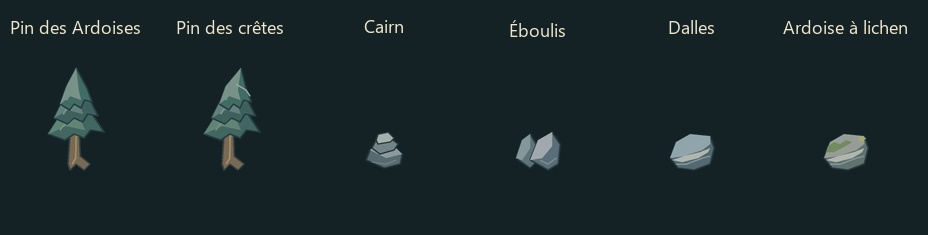
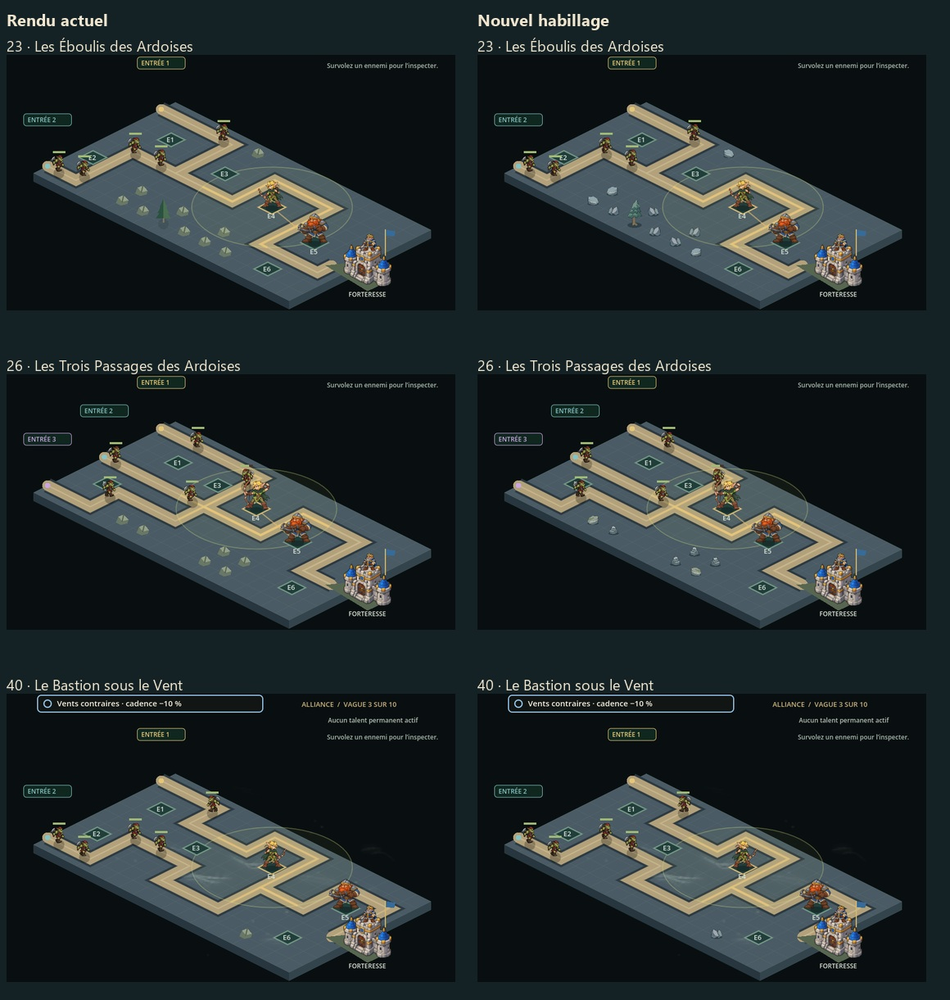

# Pins et ardoises · Missions 21 à 40

Proposition du 22 novembre 2026. Les rochers et conifères des Ardoises prennent six formes. Les crêtes accueillent un pin incliné. Les cairns marquent notamment les portes et les passages. Les éboulis ont des arêtes plus verticales, et les dalles basses portent parfois du lichen.

Les deux chapitres partagent neuf plateaux. Onze cartes reçoivent un choix de pièces propre, réparties dans les emplacements existants. Chaque pièce peut être légèrement réduite ou tournée en miroir selon son emplacement. Le Bastion sous le Vent garde sa seule pièce au sol, dans la zone réservée au décor. Le choix artistique conserve la couleur du plateau, les dimensions des routes et les emplacements de défense.

## Branchement après validation

Les six PNG sont dans `prototype/assets/decor/ardoises/`. Le [fichier d’implantation](essais/ardoises_21_40/Implantation.json) donne les cadres et les trois choix par carte, deux rochers et un pin. Réutiliser `scenery_for`. En essai, le rocher varie selon la parité de `item.order`. L’échelle alterne entre 1, 0,89 et 0,95 selon `order % 3`. Le miroir est appliqué si `order % 5 < 2`. Ces variantes restent dans les cadres de `scenery_bounds`. Déclarer les six PNG aux listes d’export.

## Contrôles

48 captures à la troisième vague sur une copie de la v0.241. Quarante vues couvrent les vingt missions dans les deux factions, dont les dix missions avec Vents contraires. Les huit captures de référence couvrent 21, 23, 26 et 40. Les six textures restent dans leurs cadres. Les 2 021 vérifications ciblées de géométrie confirment que le décor dégage les routes, entrées, emplacements et forteresses des onze cartes.

Les quatre suites de campagne des Ardoises (1 110), de Vents contraires (2 669), de décor (4 348) et de bandeau (4 249) passent. Avis du porteur attendu.

- [Missions 21 à 25](essais/ardoises_21_40/Ardoises_21_25.jpg)
- [Missions 26 à 30](essais/ardoises_21_40/Ardoises_26_30.jpg)
- [Missions 31 à 35](essais/ardoises_21_40/Ardoises_31_35.jpg)
- [Missions 36 à 40](essais/ardoises_21_40/Ardoises_36_40.jpg)
