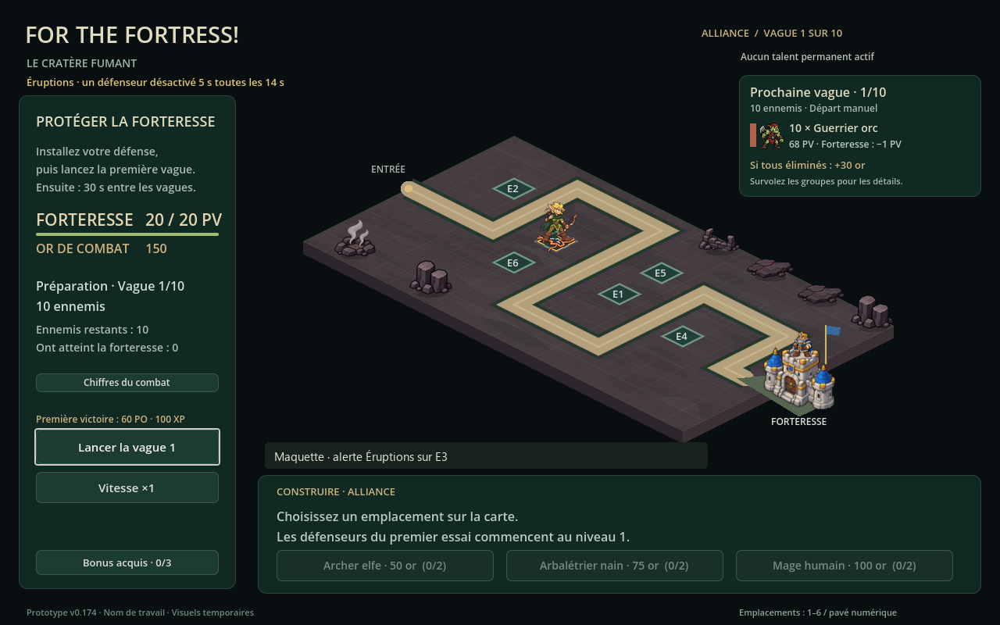

# Terres volcaniques — proposition d’habillage du 11 novembre 2026

Le plateau prend une teinte de cendre froide, avec des dépôts irréguliers et des pierres plus sombres sur la tranche. Quatre pièces ponctuent les espaces libres : colonnes de basalte, ruine noircie, fumerolle et dalle de lave figée. Les fissures de la lave décorative restent ternes pour que les braises d’une Éruption ressortent sous l’emplacement visé.

La chaussée claire garde sa couleur et son tracé. Palette proposée pour le sol `#443C41`, avec faces `#3B3034` et `#2C252B`. Le [calque des cendres](essais/volcan/Texture_cendres.png) est transparent. Les quatre pièces PNG sont dans `design/essais/volcan/`. Consignes artistiques : basalte facetté, ruine basse sans ouverture, vapeur grise en deux volutes et croûte de lave à fissures rouge brique. Les contours et la perspective reprennent le style des forteresses du jeu. [Pièces agrandies](essais/volcan/Pieces_volcaniques.png)

Le [fichier de repères](essais/volcan/Reperes.json) donne les ancrages, les dimensions et les positions logiques proposées pour les **20 cartes des missions 61 à 80**. Six éléments par carte, soit 120 placements, ont été vérifiés contre les marges des routes, des six emplacements, des entrées et de la forteresse. Le contrôle tient compte de l’ombre des pièces et du support au sol. Les placements sont communs aux deux factions.

| Carte | Ce que la maquette vérifie |
| --- | --- |
| [61 — Le Seuil des Cendres](essais/volcan/Mission_61_alliance.png) | Le décor situe le biome dès la première mission. |
| [66 — Le Pont d’Obsidienne](essais/volcan/Mission_66_alliance.png) | Les deux entrées et leur jonction restent visibles. |
| [71 — Le Cratère Fumant](essais/volcan/Mission_71_alliance.png) | L’alerte orange ressort au pied du défenseur. [Vue Horde](essais/volcan/Mission_71_horde.png) |
| [80 — Le Cœur en Éruption](essais/volcan/Mission_80_alliance.png) | Le décor laisse dégagée la carte à trois entrées. |

Les huit maquettes ont été examinées sur des captures Godot de la v0.174, dans les deux factions, prises sur l’écran de droite avec profil isolé. L’alerte sur la mission 71 est une composition de contrôle avec la planche de fissures déjà proposée. L’ensemble reste hors ressources d’exécution. Le sol et la lave figée sont purement décoratifs.

**Retour du porteur, 11 novembre 2026.** Cette direction lui convient pour une première version. Pour la suite, il demande des variantes de pièces et des rotations de placement du décor existant entre les cartes, afin de réduire la répétition visuelle. À chaque nouvelle composition, vérifier les marges des routes et des emplacements ainsi que la lisibilité de l’alerte des Éruptions.

Pour un premier essai en jeu, utiliser les missions 61 et 71. Poser les cendres après la couleur du sol et avant la chaussée. Dessiner les pièces au point de pose prévu, sous les unités et l’interface. Contrôler l’alerte des Éruptions à ×1 et ×2 dans les deux factions, puis vérifier les marges à partir des données de la carte avant d’étendre l’habillage. Le jeu peut utiliser la même palette de sol dans l’aperçu de mission.
