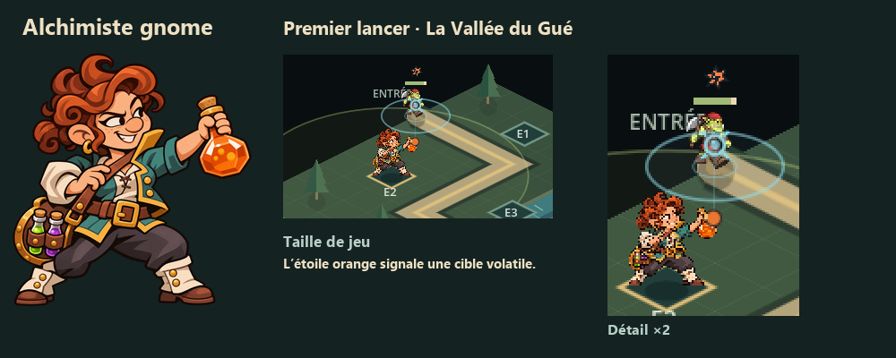

# Boutique · Alchimiste

Proposition du 14 novembre 2026 pour le type 39 (`alliance.alchemist`). Le porteur a préféré la troisième version, avec des boucles cuivrées, un sourire en coin, une pose de lancer et un porte-fioles visible. Dessin réalisé avec le générateur intégré, en prenant le servant gnome de la Balliste royale comme référence de style et de race.

| PNG | Cadre | Pied | Hauteur | Origine du lancer d’essai |
| --- | --- | --- | ---: | --- |
| `alchimiste_gnome_v001.png` | `Rect2(0,0,1188,1257)` | `(511,1257)` | 53 px | `(26,-32)` |

Sur la copie v0.200, une fiole ambrée touche un ennemi. L’étoile orange `volatile.png` apparaît au-dessus des PV pendant `volatile_until`. Si la cible est éliminée dans les 4 s, elle inflige 80 dégâts autour d’elle dans un rayon de 1,4 case. Portrait, déblocage sur profil d’essai, recrutement et première application de la volatilité vérifiés en combat. Les 141 contrôles d’illustrations et les 49 contrôles du lot 4 passent, dont le déclenchement unique des explosions en chaîne. Le visuel de l’explosion à la mort reste à relier et à vérifier en jeu. L’anneau bleu d’impact hérité du mage est encore visible sur la copie.

Pour l’animation, retirer la fiole du sprite au lâcher, suivre le mouvement du poignet et reprendre une fiole au porte-fioles. La fiche de combat doit indiquer la fenêtre de 4 s et le déclenchement de l’explosion à l’élimination.

## Lancer de la fiole

L’Alchimiste arme le bras près de la tempe, tend l’avant-bras vers la cible et ouvre les doigts à 0,40 s. La main revient vide, puis remonte avec une nouvelle fiole. Onze dessins distincts sur 36 images et 0,96 s. La première pose à main ouverte est l’image 15 à partir de zéro. La garde mesure 58 px. Les poses conservent la même hauteur du corps et un écartement des semelles à moins d’un pixel de la garde.

[Essai en jeu](essais/gestes_combat/alchimiste_gnome/Alchimiste_gnome_en_jeu.gif) · [Planche des onze poses](essais/gestes_combat/alchimiste_gnome/Planche_alchimiste_gnome.png)

L’essai utilise la fiole ambrée dessinée, avec un tour sur l’arc existant de 10 px. Le repère de lacher.json est mesuré au niveau des doigts et suit le retournement. Six tirs vérifiés en mission 94 sur copie v0.235, à ×1 et ×2 dans les deux sens, avec pause. La volatilité et le badge sont confirmés sur la cible. Le badge reste affiché dès la résolution du tir dans cet essai. Validateur à zéro problème sur 49 dossiers, 190 contrôles d’animation, 77 des effets d’unités et 28 de boutique réussis. L’essai attend l’avis du porteur.

Consignes au générateur intégré. Reprendre la gnome d’origine et ses boucles cuivrées, son veston bleu-vert et les deux fioles du porte-fioles. Une main garde la sangle. L’autre arme, lâche le flacon et revient vers la ceinture. Dessiner quatre intermédiaires pour le lever, l’avancée et la recharge en gardant les mêmes chaussures et la même silhouette.
