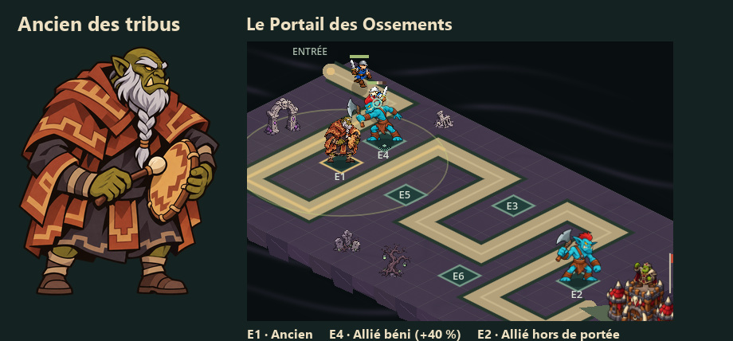

# Boutique · Ancien des tribus

Visuel fixe du type 35 (`horde.elder`) validé par le porteur le 14 novembre 2026. Le manteau terracotta, la barbe blanche tressée et le tambour à main distinguent l’Ancien des chamans. Dessin réalisé avec le générateur intégré, d’après les aplats et les contours des défenseurs de la Horde.

| PNG | Cadre | Pied | Hauteur | Origine du tir d’essai |
| --- | --- | --- | ---: | --- |
| `ancien_tribus_v001.png` | `Rect2(0,0,952,1175)` | `(447,1175)` | 58 px | `(15,-29)` |

Sur la copie v0.199, une courte onde cuivrée part du tambour vers la cible. Le chevron de bénédiction `aura.png` apparaît sous les défenseurs bénéficiant de `guardian_aura(slot) > 0`. Au Portail des Ossements, l’Ancien en E1 donne +40 % de dégâts au Lanceur de haches en E4. L’Ancien et le Lanceur éloigné en E2 ne reçoivent pas ce bonus. Portrait, déblocage sur profil d’essai, recrutement et premier tir vérifiés. Les 126 contrôles d’illustrations et les 41 contrôles de la boutique passent.

Pour l’animation, garder le tambour calé dans une main et faire coïncider le contact de la mailloche avec le départ de l’onde. Le repère au sol signale la bénédiction passive. Le libellé de famille sur les rebonds doit laisser place à une description du tir et de la bénédiction.

## Frappe du tambour

L’Ancien arme sa mailloche et l’amène sur la membrane tout en gardant le tambour contre la hanche. À 0,36 s, l’onde cuivrée part au contact. La mailloche rebondit puis revient en garde. Huit dessins distincts sur 22 images et 0,88 s. Appuis au sol et hauteur de jeu de 64 px comme le sprite fixe.

[Essai en jeu](essais/gestes_combat/ancien_tribus/Ancien_tribus_en_jeu.gif) · [Planche des huit poses](essais/gestes_combat/ancien_tribus/Planche_ancien_tribus.png)

Le fichier lacher.json donne le repère sur la membrane. La copie instrumentée fait partir l’onde cuivrée existante en ligne droite depuis ce point. Six tirs contrôlés en mission 94 v0.235, à gauche et à droite, à ×1 et ×2 avec pause. Le Lanceur de haches voisin bénéficie du chevron au sol et de +40 % de dégâts durant l’essai. 49 dossiers valides, 190 contrôles d’animation et 77 des effets réussis. La même planche est utilisée dans les deux sens. Le porteur l’a validée le 21 novembre 2026.

Consignes au générateur intégré. Reprendre le vieil orc, sa barbe tressée, le poncho terracotta et le tambour à main. Garder le tambour à la hanche, les bottes au sol et la mailloche dans la même main. Dessiner l’armé, l’approche, le contact de la tête rembourrée avec la membrane, le rebond et le retour en garde.
