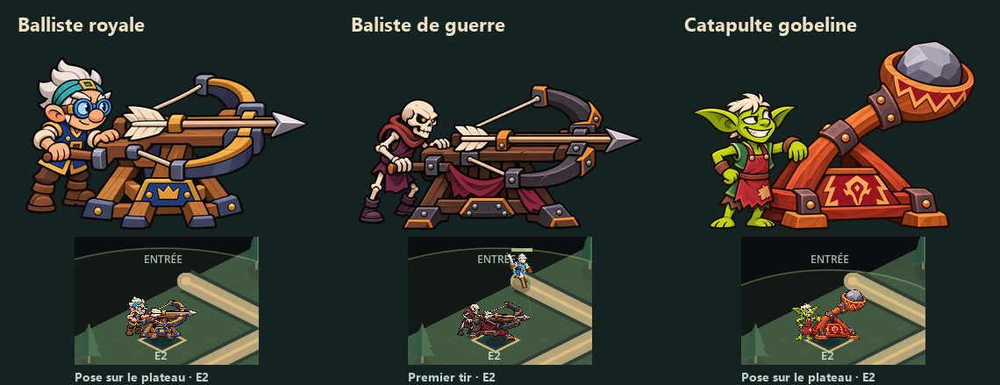

# Boutique · Baliste de guerre

Proposition du type 43 (`horde.warballista`) bien accueillie par le porteur le 14 novembre 2026. Le servant squelette reprend le crâne d’ivoire, les yeux ambrés et les tons prune de l’infanterie morte-vivante. Le bâti bas en bois sombre et la toile bordeaux distinguent la pièce de la Balliste royale et de la Catapulte. Dessin réalisé avec le générateur intégré à partir du Garde noir pour le servant et de la Balliste royale pour les aplats et le cadrage.

| PNG | Cadre | Pied | Hauteur | Origine du carreau d’essai |
| --- | --- | --- | ---: | --- |
| `baliste_guerre_v001.png` | `Rect2(0,0,1583,820)` | `(791,820)` | 44 px | `(41.25,-27.5)` |

Copie v0.201 : portrait, déblocage sur profil d’essai, recrutement et premier tir vérifiés. 171 contrôles d’illustrations et 49 contrôles du quatrième lot passent. L’essai représente un carreau de siège sur une seule cible. Le catalogue applique ×1,8 au dernier tiers du trajet et ×0,4 au premier tiers.

Pour l’animation, prévoir un recul bref, une pose vide après le départ et un rechargement par le servant. Le carreau reste visible dans le sprite fixe.
