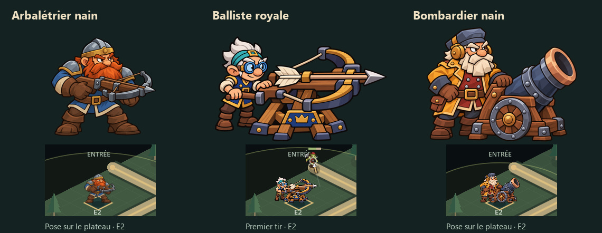

# Boutique · Balliste royale

Visuel fixe du type 38 (`alliance.ballista`) validé par le porteur le 14 novembre 2026. Un ingénieur gnome en lunettes rondes actionne la balliste. La machine repose sur un bâti fixe, porte une plaque bleue à couronne et se reconnaît à son large arc horizontal. Dessin réalisé avec le générateur intégré à partir du comparatif de l’Arbalète lourde pour les contours et les aplats.

| PNG | Cadre | Pied | Hauteur | Origine du tir d’essai |
| --- | --- | --- | ---: | --- |
| `balliste_royale_v001.png` | `Rect2(0,0,1429,875)` | `(729,875)` | 51 px | `(40,-31)` |

La Balliste touche une cible. Ses dégâts sont multipliés par 1,8 au dernier tiers du trajet et par 0,4 au premier tiers. Sur copie v0.200, un carreau de siège a été testé à la place du carreau de famille. Le portrait, le déblocage sur profil d’essai, le recrutement et le premier tir ont été vérifiés. Les 136 contrôles d’illustrations et les 49 contrôles du quatrième lot passent.

Prévoir un mouvement bref de l’arc et de la corde au départ du carreau, puis une pose vide et un rechargement par le servant. Le carreau reste visible en permanence dans le sprite fixe. Le projectile d’essai et le sprite sont à associer lors de l’intégration.
