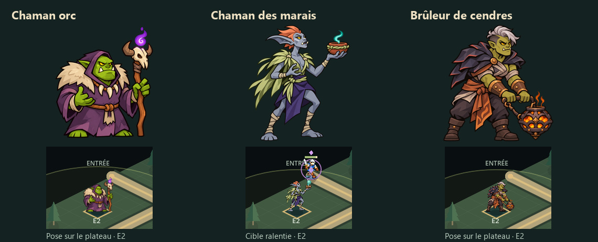

# Boutique · Chaman des marais

Visuel fixe du type 33 (`horde.swampshaman`) validé par le porteur le 14 novembre 2026. La chamane trolle porte un mantelet de roseaux et canalise sa malédiction dans un bol de terre cuite. Le bol levé et la silhouette élancée la distinguent du Chaman orc et du Brûleur de cendres au même emplacement.

| PNG | Cadre | Pied | Hauteur | Origine du tir d’essai |
| --- | --- | --- | ---: | --- |
| `chaman_marais_v001.png` | `Rect2(0,0,1096,1246)` | `(482,1246)` | 58 px | `(23,-52.5)` |

Sur la copie v0.199, l’attaque vise un ennemi, le maudit et le ralentit de 40 % pendant 3 s. Le tir d’essai ajoute un feu follet turquoise au départ du bol. Le repère `slow.png` est dessiné au sol pendant le ralentissement, en complément de l’anneau violet de la malédiction. Portrait, déblocage, recrutement et premier ralentissement vérifiés. Les 116 contrôles d’illustrations et les 41 contrôles du troisième lot de la boutique passent.

Pour l’animation, le bol reste soutenu par la paume tandis que l’autre main canalise le feu follet. La volute du sprite fixe reste visible pendant le tir. Prévoir son départ à l’image de lâcher et son retour après le geste.

Dessin réalisé avec le générateur intégré. Le Chaman orc a servi de référence pour les contours et les aplats. La silhouette proposée associe une trolle élancée, un mantelet de roseaux, une crête corail et un bol en terre cuite.

## Rituel du feu follet

Une main soutient le bol. L’autre guide le feu follet au-dessus du rebord, puis le libère à 0,40 s. L’animation reprend la volute turquoise du portrait et la conserve pour le projectile. Le bol revient en garde, avec un léger mouvement du mantelet. Le porteur a validé le geste, avec davantage d’intermédiaires pour la fluidité. Six dessins s’ajoutent entre les huit poses d’origine, pour 14 dessins distincts sur 33 images et 0,88 s. Le lâcher reste à 0,40 s. Pieds calés et hauteur de 64 px comme le sprite fixe actuel.

[Essai en jeu](essais/gestes_combat/chaman_marais/Chaman_marais_14_poses_en_jeu.gif) · [Planche des 14 poses](essais/gestes_combat/chaman_marais/Quatorze_poses_chaman_marais.png)

Le fichier lacher.json donne le repère depuis le pied, le pivot et l’échelle du feu follet. Dans l’essai, la volute file en ligne droite depuis sa dernière position dans la planche. La malédiction et le ralentissement conservent les repères de combat existants. Dix tirs vérifiés sur la mission 94 v0.235, gauche et droite, ×1 et ×2 avec pause. 49 dossiers valides, 190 contrôles d’animation et 77 des effets réussis. Une seule planche testée dans les deux sens. Le porteur a validé la version à 14 poses. Lot 577f582 prêt à intégrer.

Consignes au générateur intégré. Garder le bol en terre cuite sur la même main, la silhouette trolle et le mantelet de roseaux. Animer l’autre main autour du bol puis vers la cible, avec les pieds ancrés, la crête corail et la palette constantes. La volute turquoise est assemblée à part sur les images qui précèdent le lâcher.

Consignes au générateur intégré pour les intermédiaires. Même Chamane avec les pieds calés et la paume au contact du bol. Ajouter les positions entre garde et recueil, recueil et formation, formation et feu follet formé, lâcher et accompagnement, accompagnement et abaissement, abaissement et retour. Les cases sont rééchantillonnées à 246 × 252 px pour garder la planche sous 8 192 px de large. Même taille sur le plateau et même repère de lâcher.
