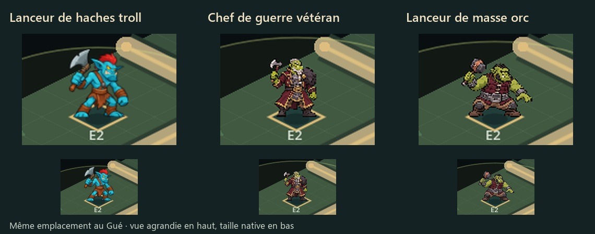

# Boutique · Chef de guerre vétéran

Visuel fixe du type 45 (`horde.warveteran`), accueilli favorablement par le porteur le 14 novembre 2026. La barbe blanche tressée, le manteau bordeaux et la fourrure asymétrique dessinent une silhouette de vétéran. L’illustration a été générée à partir du comparatif du Lanceur de masse, utilisé comme référence pour les contours, les aplats et les proportions. La hache courte et la posture droite distinguent les deux orcs.

| PNG | Cadre | Pied | Hauteur | Départ du lancer |
| --- | --- | --- | ---: | --- |
| `chef_guerre_veteran_v001.png` | `Rect2(0, 0, 925, 1149)` | `(520, 1149)` | 57 px | `(-22, -40)` |

L’unité lance une hache sur une cible. Elle gagne 16 % de dégâts par vague survécue depuis son achat, jusqu’à 90 %. Sur une copie v0.202, essai du déblocage après 180 missions, de l’achat, de la sélection, du recrutement et du premier tir avec la hache de famille. Le bonus au recrutement est nul. Les 186 contrôles d’illustrations et les 49 contrôles du quatrième lot passent.

Le sprite est fixe. Au prochain passage sur l’animation, faire accompagner le lancer par l’épaule et ouvrir la main au départ de la hache. Le panneau de combat de la copie d’essai affiche « Rebond : 0 × 0 max. ». Préférer une indication du bonus acquis au fil des vagues.

## Lancer de la hache

Le Chef de guerre arme au-dessus de l’épaule, projette la hache et ouvre la main à 0,40 s, à l’image 25 à partir de zéro. Il ramène la main vide jusqu’à la ceinture et reprend une hache. Vingt poses distinctes sur 60 images et 0,96 s, dont des intermédiaires au passage de l’épaule et pendant le repli. Les appuis sont calés et la garde mesure 66 px.

[Essai en jeu](essais/gestes_combat/chef_guerre_veteran/Chef_guerre_veteran_en_jeu.gif) · [Planche des vingt poses](essais/gestes_combat/chef_guerre_veteran/Planche_chef_guerre_veteran.png)

La hache courte à manche bordeaux commence tournée selon la pose de lâcher, puis fait un tour sur un segment rectiligne. Le repère et la texture suivent le retournement. Les réglages correspondent à lacher.json. À bout portant, jouer l’impact seul si la cible est derrière la main. Six tirs en mission 94 sur copie v0.237, dans les deux sens à ×1 et ×2 avec pause. Pour le bonus des vagues, le contrôle vérifie le départ à zéro, le premier palier et le plafond de +90 %. Validateur à zéro problème sur 58 dossiers, 199 contrôles d’animation, 77 des effets d’unités et 113 de boutique réussis. Le jeu de test se ferme avec son marqueur de réussite et un signalement de ressource encore chargée. L’essai attend l’avis du porteur.

Consignes au générateur intégré. Reprendre le visage, la barbe blanche, le manteau bordeaux, la fourrure et le placement des bottes. Dessiner le bras au-dessus de l’épaule, le lancer, le suivi à main ouverte et le repli vers la ceinture. Garder la main et l’avant-bras raccordés. La hache en vol reprend la lame et le manche de la pose tenue.
