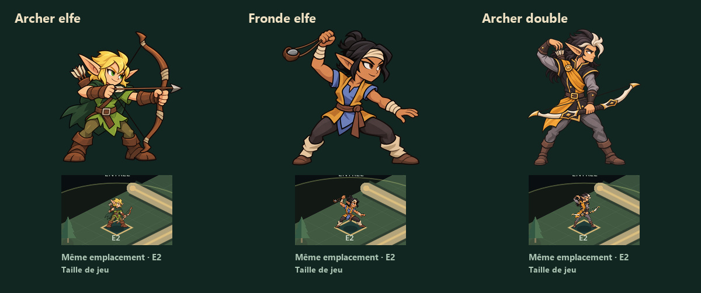

# Boutique · Fronde elfe

Visuel validé par le porteur le 14 novembre 2026 pour le type 25 (`alliance.sling`). La frondeuse porte une veste courte ocre sur une tunique bleue. Elle adopte une posture large, un bras levé pour armer la fronde et une main libre pour s’équilibrer. La poche de cuir et le galet donnent à l’arme un contour distinct de celui des arcs.

| Portrait et plateau | Cadre | Pied | Hauteur | Départ du tir d’essai |
| --- | --- | --- | ---: | --- |
| `fronde_elfe_v001.png` | `Rect2(0,0,1092,1085)` | `(586,1085)` | 56 px | `(-12,-51)` |

Le portrait, le déblocage sur un profil d’essai, le recrutement et le premier tir ont été vérifiés sur une copie v0.197. Les trois unités ont été comparées au même emplacement E2. Les 100 contrôles d’illustrations passent sur cette copie. Le projectile d’essai est un petit galet gris. L’illustration est fixe et conserve un galet dans la poche pendant le premier tir. Ce raccord reste à traiter avec l’animation.

Animation proposée : départ sur une pose armée, transfert d’appui bref, ouverture d’un seul brin et départ visible du galet. La poche vide accompagne le geste puis revient vers la main libre pour recharger. L’origine du tir devra suivre la poche à l’image de lâcher. Le galet vise une seule cible, conformément au rôle de chasseuse de rapides. Les règles de combat restent celles du catalogue.

Dessin créé avec le générateur intégré à partir de l’Archer elfe comme référence de style. Consigne artistique : contours nets, aplats ombrés, posture basse sans cape ni carquois, fronde à deux cordons et main libre dégagée.

## Rotation et lâcher du galet

La frondeuse engage l’épaule au-dessus de ses appuis. Les deux brins tendus entraînent la poche chargée dans un arc au-dessus de la tête. Au lâcher, un brin se libère. La poche vide poursuit l’arc devant le corps, puis l’unité reprend sa pose armée.

[Capture en jeu à taille réelle, mission 94 refondue](essais/gestes_combat/fronde_elfe/Fronde_elfe_en_jeu.gif)

Type 25, `defender.alliance.sling`. La garde et les cinq planches de tir (−12°, 0°, +12°, +24°, +36°) sont dans `essais/gestes_combat/fronde_elfe/`. Chaque planche contient 21 poses sur 0,84 s. Dernier galet dans la poche à 0,36 s. Début du vol à 0,40 s, sur la première pose à poche vide. `lachers.json` donne le centre du galet relevé sur la dernière pose chargée, en pixels depuis le pied dans la scène. Le même retournement s’applique à la pose et au repère. Choisir l’inclinaison qui suit le mieux la droite vers l’impact. Garder le petit galet du jeu, la trajectoire rectiligne et l’impact unique.

Essai sur la copie v0.226, nouveau tracé de la mission 94. Dix tirs, dont deux par côté à ×1 et trois par côté à ×2. Premier départ contrôlé à +36° en E2 et +24° en E4. Les autres inclinaisons ont été examinées sur planche. Pose figée en pause et 17 points contrôlés par trajet. Les 105 poses restent cadrées avec les mêmes semelles et une reprise de garde identique. Le validateur relève 41 dossiers et zéro problème. Les 182 contrôles de la bibliothèque passent. Avis visuel du porteur attendu.
