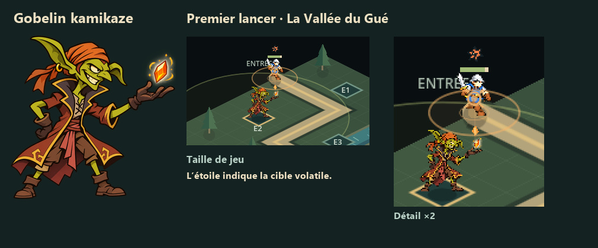

# Boutique · Gobelin des braises

Nom proposé pour le type 44, actuellement « Gobelin kamikaze » dans le catalogue (`horde.kamikaze`). Le gobelin projette une braise magique qui rend l’ennemi touché volatil pendant quatre secondes. Si l’ennemi meurt pendant ce délai, il explose et blesse les ennemis voisins. Le gobelin reste à son poste.

Le manteau rouille, la coiffe cuivrée et la main ouverte distinguent cette proposition du Sapeur, du Pillard et du Poseur de mines. Le porteur a validé le visuel fixe le 14 novembre 2026. « Gobelin des braises » reste le nom proposé.

| PNG | Cadre | Pied | Hauteur | Départ du lancer d’essai |
| --- | --- | --- | ---: | --- |
| `gobelin_kamikaze_v001.png` | `Rect2(0, 0, 1115, 1113)` | `(401, 1113)` | 53 px | `(28, -40)` |

Sur une copie de la v0.202, le projectile d’essai prend la forme d’une braise facettée. Le repère `volatile.png` est partagé avec l’Alchimiste. Portrait, déblocage, recrutement et première application en combat ont été vérifiés. Le comparatif montre le repère à ×1 et ×2. Les 181 contrôles d’illustration et les 49 contrôles du quatrième lot passent.

La braise du sprite fixe reste visible dans la main pendant le vol du projectile. L’animation devra synchroniser son départ avec la poussée de la paume. Le visuel de l’explosion et l’enchaînement restent à brancher et à vérifier. Le repère d’étude `volatile_burst.png` peut servir aux deux factions si le jeu expose le lieu et l’instant du déclenchement.
