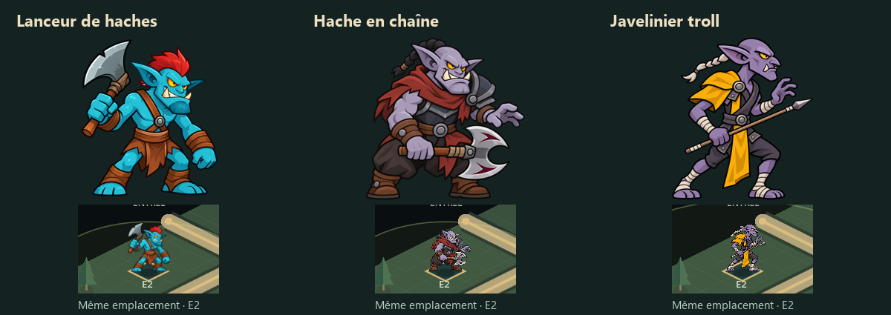

# Boutique · Hache en chaîne

Visuel fixe du type 26 (`horde.chainaxe`) accueilli favorablement par le porteur le 14 novembre 2026. Le troll a une silhouette compacte, une épaulière haute, une écharpe rouge et une hache à deux lobes portée bas. Comparé au Lanceur de haches et au Javelinier sur le même emplacement, il se distingue par son armure et le contour de son arme.

| Ressource | Cadre | Pied | Hauteur | Origine d’essai |
| --- | --- | --- | ---: | --- |
| `hache_en_chaine_v001.png` | `Rect2(0,0,1182,1205)` | `(462,1205)` | 58 px | `(21,-18)` |

Le portrait en boutique, le déblocage, le recrutement et le premier tir ont été contrôlés sur une copie v0.198 avec un profil d’essai. Les 101 contrôles d’illustrations passent sur cette copie. Elle utilise la hache de la famille en vol. Le dessin fixe conserve l’arme en main.

Pour le futur geste, partir de la hache basse, pivoter le buste puis prolonger l’arc du bras jusqu’au lâcher. Le projectile de la planche devra reprendre les deux lobes du dessin et suivre les cibles enregistrées par le jeu pour visualiser les rebonds. Le nom « en chaîne » désigne les ricochets du catalogue. L’essai actuel couvre le premier tir. Le raccord au lâcher et le rendu des rebonds successifs restent à produire et à vérifier.

Dessin créé avec le générateur intégré en prenant le Lanceur de haches comme référence de style. Consigne artistique : troll en armure sombre, hache courte à lame argentée tenue à la hanche, contours nets, aplats ombrés et silhouette lisible à 58 px.
