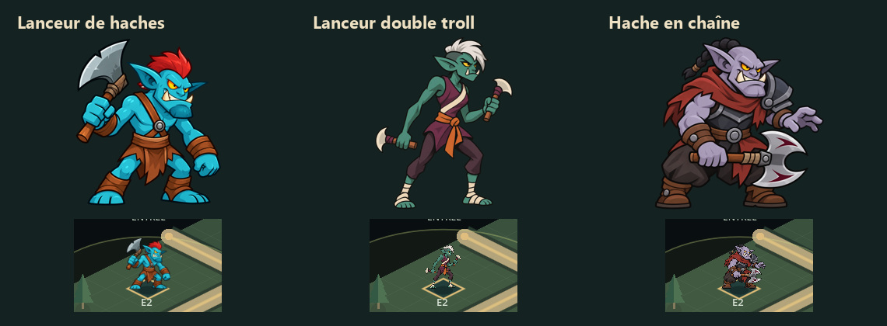

# Boutique · Lanceur double troll

Visuel fixe du type 27 (`horde.doublethrower`) validé par le porteur le 14 novembre 2026. La lanceuse se distingue par sa silhouette élancée, sa mèche blanche et ses deux petites haches à hauteur différente. Le comparatif place les trois trolls au même emplacement E2.

| PNG | Cadre | Pied | Hauteur | Origine du tir d’essai |
| --- | --- | --- | ---: | --- |
| `lanceur_double_troll_v001.png` | `Rect2(0,0,905,1128)` | `(462,1128)` | 57 px | `(18,-37)` |

Sur une copie v0.198, le portrait, le déblocage sur profil d’essai, le recrutement et le premier tir ont été vérifiés. Les 106 contrôles d’illustrations passent. Le projectile actuel reprend la hache de famille.

Pour l’animation, alterner les bras d’un tir au suivant. L’autre hache reste en main pendant le geste. Le jeu enregistre un seul tir par attaque, avec un bonus de dégâts sur un ennemi blessé. Les origines alternées et le raccord de chaque lâcher restent à produire.

Dessin réalisé avec le générateur intégré. Direction artistique : troll adulte élancée, deux petites haches en croissant, aplats ombrés aux contours nets et silhouette lisible à 57 px.
