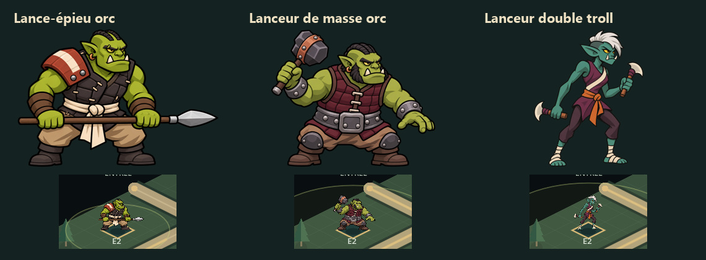

# Boutique · Lanceur de masse orc

Visuel fixe du type 28 (`horde.maceman`) validé par le porteur le 14 novembre 2026. L’orc prend des appuis larges et tient une masse courte à grosse tête facettée. La ceinture en acier et le gilet bordeaux renforcent sa silhouette ramassée. Le comparatif le montre face au Lance-épieu et au Lanceur double, au même emplacement E2.

| PNG | Cadre | Pied | Hauteur | Origine du tir d’essai |
| --- | --- | --- | ---: | --- |
| `lanceur_masse_orc_v001.png` | `Rect2(0,0,1233,1030)` | `(580,1030)` | 57 px | `(-16,-49)` |

Le portrait, le déblocage sur profil d’essai, le recrutement et le premier tir ont été vérifiés sur copie v0.198. Les 111 contrôles d’illustrations passent. Le rendu d’essai utilise le projectile de famille pour le premier tir.

Pour l’animation, faire sentir le poids de la masse par un transfert d’appui et une rotation du buste. Garder la masse dessinée dans la main jusqu’au lâcher, puis reprendre sa silhouette facettée dans le projectile. Le rendu doit rester lisible comme un impact sur une seule cible, avec la cadence et les multiplicateurs du catalogue.

Dessin réalisé avec le générateur intégré et le Lance-épieu orc comme référence de style. Consignes de dessin retenues pour ce lot : contours nets, aplats ombrés, posture ramassée et masse courte à tête facettée.

## Armé et projection de la masse

L’orc fléchit sur l’appui arrière et remonte la masse avec le buste. Le manche passe au centre de la prise et pivote avec le poing autour du poignet. Les doigts restent fermés jusqu’au départ. Après le lâcher, le bras descend brièvement puis revient par le même côté. Le coude fléchit pendant que l’avant-bras change de sens. Le retour utilise les volumes du dessin d’origine et conserve les longueurs du bras et de l’avant-bras sur toutes les poses.

[Prise et ouverture de la main, image par image](essais/gestes_combat/lanceur_masse_orc/Prise_de_la_masse.png) · [Capture à taille réelle sur la mission 94](essais/gestes_combat/lanceur_masse_orc/Lanceur_masse_orc_en_jeu.gif)

Type 28, `defender.horde.maceman`. Garde et cinq inclinaisons (−12°, 0°, +12°, +24° et +36°), à 26 poses sur 1,04 s par planche. Dernière pose avec la masse à 0,52 s. Départ à 0,56 s sur la première pose à main ouverte. `lachers.json` donne le centre et l’angle de la masse tenue depuis le pied, ainsi que le pivot et l’échelle de `masse.png`. Choisir l’inclinaison la plus proche du trajet depuis son propre repère. Retourner ensemble la pose et le point de départ. La masse tourne pendant le vol rectiligne jusqu’à l’impact unique. Quand le point d’impact est déjà derrière le point de départ à l’écran, jouer l’impact seul. Conserver les multiplicateurs contre les lourds et les petits.

Sur une copie v0.233, six tirs sur la mission 94 à ×1 et ×2, avec pause et vérification de 17 points par trajet. La capture montre +24° vers la droite depuis E4 sur la route haute et +12° vers la gauche depuis E2 sur la route centrale. Les autres angles ont été vérifiés image par image. Les 130 poses gardent leur cadrage et le même ancrage des bottes. Zéro problème sur 45 dossiers d’animation. Les 186 contrôles de la bibliothèque et les 77 contrôles des effets passent. Le porteur a approuvé la prise et demandé de reprendre le mouvement du bras après le lâcher. La reprise du 21 novembre conserve les 14 premières poses de chaque inclinaison à l’identique, avec les mêmes repères dans `lachers.json`. À la demande du porteur, le retour abandonne la rotation longue et reprend le bras et le bracelet de l’illustration d’origine. Le coude se replie en sens inverse après la descente. Avis visuel du porteur attendu.

## Essai en poses entières

Le porteur a demandé de reprendre l’animation après avoir relevé le retournement du bras et le poing fermé après le lâcher. Cet essai utilise six dessins complets du même personnage. La paume s’ouvre dès le lâcher, le bras prolonge le geste, puis la main descend et revient du côté du lancer. Les appuis sont calés entre les dessins.

[Planche des six poses](essais/gestes_combat/lanceur_masse_orc/poses_entieres/Planche_de_poses.png) · [Essai à taille réelle sur la mission 94](essais/gestes_combat/lanceur_masse_orc/poses_entieres/Essai_poses_entieres_en_jeu.gif)

La vue d’essai a été jouée dans les deux sens sur une copie de la v0.233. Six lancers à ×1 et ×2, départ à 0,56 s et pause vérifiés. 45 dossiers valides et 186 contrôles réussis. Le porteur a retenu les poses clés et demandé davantage d’intermédiaires. [Planche des douze poses](essais/gestes_combat/lanceur_masse_orc/poses_entieres/Douze_poses.png). Les six dessins d’origine sont repris à l’identique. Six dessins entiers complètent l’armé, l’élan, l’extension de la main ouverte et le retour en garde. Ils reprennent les mêmes références visuelles et sont alignés sur les bottes. La planche comporte 26 images sur 1,04 s, avec douze dessins distincts. Après le retour du porteur sur l’arrêt avant le lâcher, les deux répétitions de la dernière pose où la masse est tenue ont été déplacées vers l’armé. Cette pose dure désormais 40 ms au lieu de 120 ms à ×1. Le lâcher à 0,56 s et les poses qui suivent restent identiques. La vue d’essai utilise une seule inclinaison.

La planche a été créée avec le générateur d’images intégré à partir du sprite de base comme référence. Consigne donnée au générateur. Six poses entières à la même échelle, avec les bottes ancrées, le bras lanceur du même côté, une main ouverte dès la disparition de la masse et un retour en garde en pliant le coude. Garder le costume, le bracelet, la palette et le cadrage de trois quarts.
