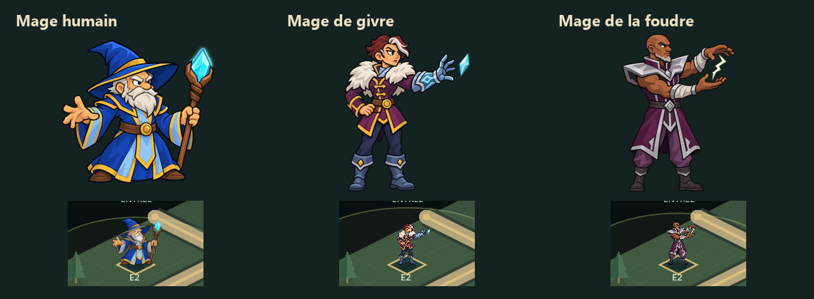

# Boutique · Mage de givre

Proposition du 14 novembre 2026 pour le type 30 (`alliance.frostmage`), bien accueillie par le porteur. La mage porte un manteau court à col de fourrure et canalise le givre d’une seule main avec un gantelet runique. La fourrure, la posture et l’éclat détaché dessinent sa silhouette au même emplacement E2 que le Mage humain et le Mage de la foudre.

| PNG | Cadre | Pied | Hauteur | Origine du tir d’essai |
| --- | --- | --- | ---: | --- |
| `mage_givre_v001.png` | `Rect2(0,0,957,1197)` | `(287,1197)` | 58 px | `(30,-46.5)` |

Portrait, déblocage sur un profil d’essai, recrutement et premier tir contrôlés sur une copie v0.198. Les 121 contrôles d’illustrations réussissent après réglage de l’origine du projectile. La copie dessine un éclat cyan direct vers la cible. Sur le sprite fixe, l’éclat près du gantelet reste visible pendant le tir.

Pour l’animation, fermer puis ouvrir les doigts pour matérialiser un éclat. Faire coïncider son départ avec le mouvement du poignet, maintenir la paume vide juste après et reformer l’éclat au retour. Le cristal vise un seul ennemi. Le repère `effect.slow` pourra signaler le ralentissement en suivant la cible au sol une fois branché.

Dessin réalisé avec le générateur intégré. Consigne artistique : mage humaine adulte, contours francs, aplats ombrés, manteau court à fourrure, gantelet à rune et cristal unique, silhouette lisible à 58 px.

## Formation et projection du cristal

Le gantelet se ferme près du col, la main avance et s’ouvre. Un éclat paraît devant les doigts. À 0,36 s, la paume passe vide et le même cristal démarre depuis sa dernière position dessinée. Le retour fléchit le coude et ramène la main devant le col. Huit dessins entiers, 18 images sur 0,72 s. Pieds alignés et hauteur rendue de 64 px, comme le sprite fixe actuellement utilisé. La main libre reste à la ceinture.

[Capture à taille du jeu](essais/gestes_combat/mage_givre/Mage_de_givre_en_jeu.gif) · [Planche des huit poses](essais/gestes_combat/mage_givre/Planche_mage_givre.png)

Le fichier lacher.json précise le délai, le centre de l’éclat depuis le pied et les paramètres du PNG. L’essai tourne sur une copie instrumentée de la v0.233 avec un trajet rectiligne. Dix tirs vérifiés sur la mission 94, gauche et droite à ×1 et ×2 avec pause. Le contrôle confirme l’application du ralentissement existant sur la cible. 47 dossiers valides, 188 contrôles de la bibliothèque et 77 des effets réussis. Le porteur a validé le geste de référence et demandé la déclinaison vers le haut et vers le bas.

Consignes au générateur intégré. Reprendre la mage humaine au manteau bordeaux, col de fourrure, cheveux courts à mèche blanche et gantelet runique. Garder les mêmes appuis, la main libre à la ceinture et les ombres cohérentes. Fermer les doigts pour préparer, ouvrir vers la cible pour former et projeter un seul cristal, puis revenir en garde sans objet en main. Ajouter deux dessins de transition et conserver la forme du cristal dessiné pour le projectile.

## Trois inclinaisons de tir

La planche de référence vise à −16° à l’écran. Deux variantes à −32° et +22° modifient le bras et le poignet pendant la formation, la projection et l’accompagnement. Elles conservent les appuis, l’armé initial, le retour en garde et les 18 images sur 0,72 s. À 0,36 s, le même cristal quitte sa dernière position dessinée et file en ligne droite. Le fichier lachers.json définit l’angle et le repère depuis le pied pour chaque vue, avec les mêmes paramètres de texture pour les trois tirs.

[Visées en jeu à ×1](essais/gestes_combat/mage_givre/Mage_de_givre_angles_x1.gif) · [Visées en jeu à ×2](essais/gestes_combat/mage_givre/Mage_de_givre_angles_x2.gif) · [Poses inclinées](essais/gestes_combat/mage_givre/Mage_givre_poses_inclinees.png)

Contrôle sur 18 tirs avec la copie instrumentée de la v0.233, aux deux vitesses et dans les deux sens. La mission 93 fournit le tir haut vers la gauche, la 94 les autres situations. Pause, trajectoire et application du ralentissement existant vérifiées. 47 dossiers valides, 188 contrôles d’animation et 77 des effets réussis. Le porteur a donné le feu vert pour poursuivre après présentation des trois visées. Lot 43b95a7 prêt à intégrer.

Consignes au générateur intégré. Reprendre la mage et la silhouette validées. Dessiner le bras en montée et en descente, à l’approche de l’extension, à paume ouverte et à l’accompagnement, avec le buste droit, la main libre à la ceinture et les bottes alignées. Le cristal de référence est ensuite placé et orienté devant les doigts dans la dernière pose qui le montre.
