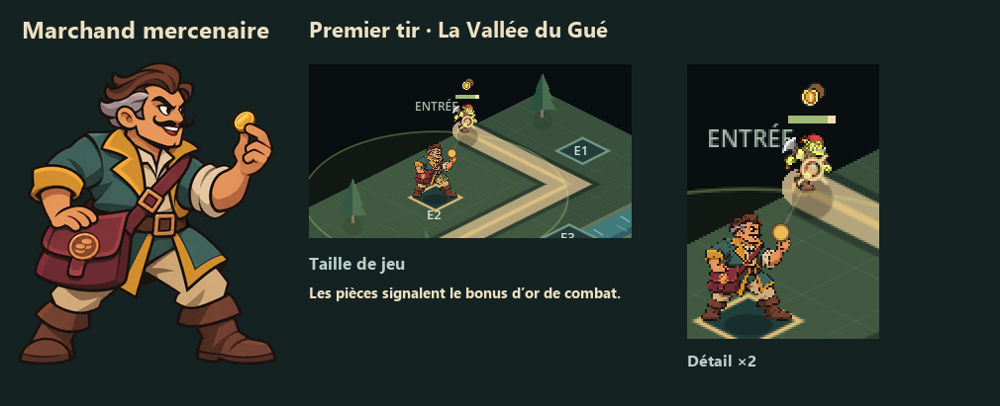

# Boutique · Marchand mercenaire

Visuel fixe validé par le porteur le 14 novembre 2026 pour le type 36 (`alliance.mercenary`). La grande sacoche bordeaux, le manteau à revers ocre et la pièce levée distinguent sa silhouette des archers de sa famille. Dessin réalisé avec le générateur intégré en prenant les contours et les aplats de l’Alliance comme référence.

| PNG | Cadre | Pied | Hauteur | Origine du tir d’essai |
| --- | --- | --- | ---: | --- |
| `marchand_mercenaire_v001.png` | `Rect2(0,0,857,1006)` | `(446,1006)` | 55 px | `(16,-44)` |

L’attaque touche une cible et le pillage lui fait rapporter +120 % d’or de combat si elle est éliminée dans les 4 s. Sur la copie v0.199, une pièce tourne en vol et l’icône `loot.png` apparaît au-dessus des PV de la cible pendant `loot_until`. Le premier tir et le repère sur la cible ont été vus en combat. Portrait, déblocage sur profil d’essai et recrutement vérifiés. Les 131 contrôles d’illustrations et les 49 contrôles du quatrième lot passent. La coexistence de la marque et du pillage sur un même ennemi reste à vérifier en jeu.

Le sprite fixe conserve sa pièce en main pendant le tir. Pour l’animation, ouvrir les doigts au départ, laisser la main vide pendant le retour du poignet, puis reprendre une pièce à la sacoche. Prévoir une mention du pillage dans la fiche de combat, qui affiche encore « Tirs rapides sur une cible ».
