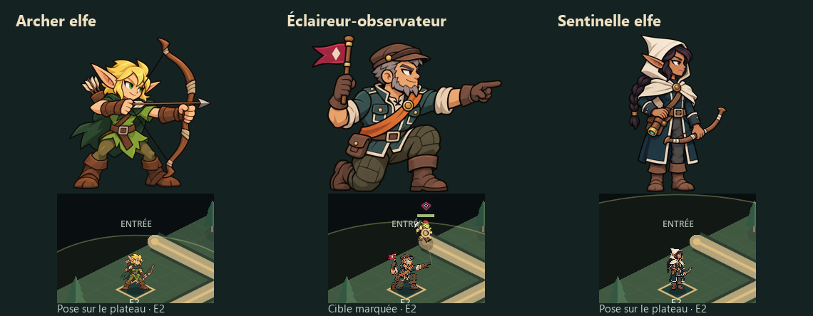

# Boutique · Éclaireur-observateur

Visuel fixe du type 31 (`alliance.observer`) validé par le porteur le 14 novembre 2026. À genou, le personnage désigne la cible d’une main et lève un fanion cerise de l’autre. Le losange du fanion reprend la forme du repère qui apparaît au-dessus des PV de la cible.

| PNG | Cadre | Pied | Hauteur |
| --- | --- | --- | ---: |
| `eclaireur_observateur_v001.png` | `Rect2(0,0,1293,1072)` | `(556,1072)` | 53 px |

Son action inflige 3 dégâts de base et marque l’ennemi pendant 4 s. Les autres défenseurs infligent +55 % de dégâts à cette cible pendant le marquage. Dans la copie v0.199, le dessin de la flèche du type 31 est masqué. Le losange `mark.png` s’affiche au-dessus des PV selon `marked_until`. La première application réelle de la marque a été contrôlée pendant le combat. Le portrait, le déblocage et le recrutement ont également été vérifiés. Les 106 contrôles d’illustrations passent sur cette copie.

Le sprite fixe présente déjà le signal. Pour l’animer, partir du fanion abaissé et faire apparaître le losange au moment où l’observateur lève le fanion et désigne la cible. L’intégration du losange et la pose de repos restent à faire.

Dessin réalisé avec le générateur intégré. La Sentinelle a servi de référence pour les contours et aplats, avec une nouvelle silhouette humaine à genou et un fanion à losange.
