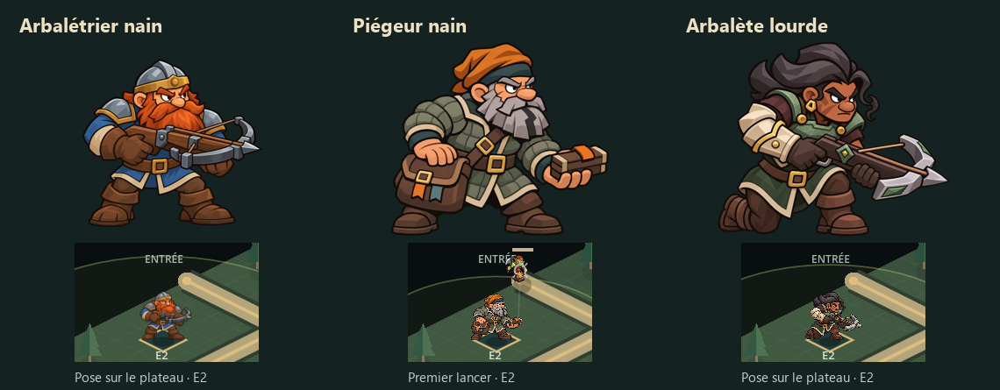

# Boutique · Piégeur nain

Visuel fixe du type 37 (`alliance.trapper`) validé par le porteur le 14 novembre 2026. Bonnet ocre, barbe grise carrée, manteau matelassé et cartouche en bois différencient le Piégeur des arbalétriers. Dessin mis au point avec le générateur intégré à partir du comparatif des nains, pour les aplats et les contours.

| PNG | Cadre | Pied | Hauteur | Origine du lancer d’essai |
| --- | --- | --- | ---: | --- |
| `piegeur_nain_v001.png` | `Rect2(0,0,1051,936)` | `(452,936)` | 53 px | `(25,-22)` |

Le type 37 touche une cible, avec des dégâts ×1,8 au premier tiers du trajet et ×0,4 au dernier tiers. L’essai v0.200 représente le tir par une cartouche en cloche qui disparaît à l’impact. Cette représentation ne pose aucun piège persistant sur la route. Portrait, déblocage sur profil d’essai, recrutement et premier lancer vérifiés. Les 131 contrôles d’illustrations et les 49 contrôles du quatrième lot passent.

Pour l’animation, accompagner le lancer par un déplacement de l’avant-bras, puis reprendre une cartouche à la sacoche. La cartouche du sprite fixe reste visible pendant le tir. La description de combat doit expliquer l’importance du premier tiers du trajet.

## Lancer de la cartouche

Le Piégeur abaisse la cartouche, la projette par un geste de bas en haut puis ramène la main vers la sacoche. À 0,36 s, les doigts s’ouvrent et la cartouche au bois brun et à la sangle orange quitte la paume. Le lancer comporte huit poses distinctes sur 22 images, pour un cycle de 0,88 s. La silhouette garde la hauteur du sprite fixe actuel, 58 px.

[Essai en jeu](essais/gestes_combat/piegeur_nain/Piegeur_nain_en_jeu.gif) · [Planche des huit poses](essais/gestes_combat/piegeur_nain/Planche_piegeur_nain.png)

La cartouche illustrée tourne sur un arc visuel de 16 px et touche une cible. Le fichier lacher.json donne le centre de départ depuis le pied et les réglages du sprite en vol. La copie instrumentée v0.235 sert à contrôler le raccord dans les deux sens, avec un seul jeu de poses retourné. Six tirs en mission 94 à ×1 et ×2, pause vérifiée. Le modèle conserve le tir et les multiplicateurs du début, du milieu et de la fin de trajet. Validateur à zéro problème sur 49 dossiers, 190 contrôles d’animation, 77 des effets et 28 de la boutique réussis. Le banc d’essai réussit et Godot signale des ressources encore chargées à sa fermeture. Le porteur a validé l’essai le 21 novembre 2026.

Consignes au générateur intégré. Garder le bonnet ocre, la barbe grise carrée, le manteau matelassé et la grande sacoche. Une main tient la sacoche durant tout le cycle. L’autre porte la cartouche, la projette et revient en garde, avec des semelles calées et une stature naine compacte.
