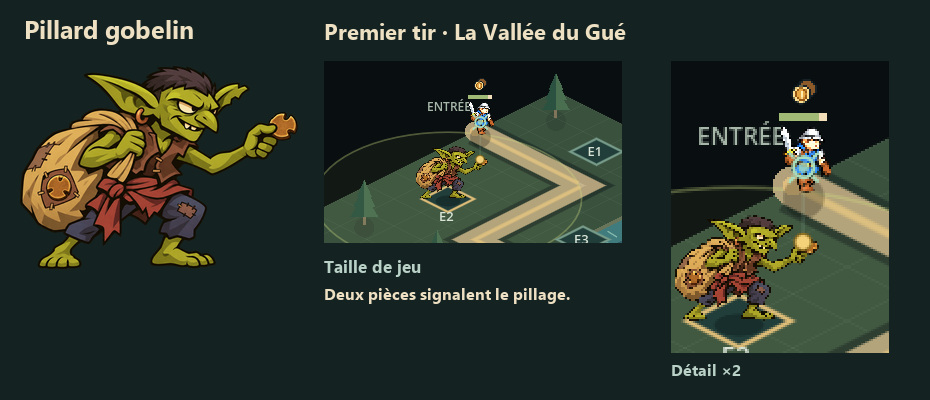

# Boutique · Pillard gobelin

Proposition du type 41 (`horde.pillager`) bien accueillie par le porteur le 14 novembre 2026. La posture penchée, le grand sac rapiécé et le jeton de bronze ébréché distinguent le Pillard des autres gobelins. Dessin réalisé avec le générateur intégré, à partir des contours et des aplats des gobelins de la Horde.

| PNG | Cadre | Pied | Hauteur | Origine du lancer d’essai |
| --- | --- | --- | ---: | --- |
| `pillard_gobelin_v001.png` | `Rect2(0,0,1256,919)` | `(565,919)` | 53 px | `(32,-38)` |

Le Pillard lance un jeton sur une cible. Si cet ennemi est éliminé dans les 4 s, il rapporte +120 % d’or de combat. Sur la copie v0.201, le jeton réutilise le rendu de la pièce du Marchand mercenaire et l’icône `loot.png` se place au-dessus des PV pendant `loot_until`. Portrait, déblocage sur profil d’essai, recrutement et premier pillage vérifiés. Les 166 contrôles d’illustrations et les 49 du lot 4 passent. Le lâcher reste à animer et le jeton en vol peut reprendre les encoches du dessin.

## Lancer du jeton

Le Pillard serre le sac contre son épaule et prépare le jeton à hauteur de hanche. L’avant-bras avance et les doigts s’ouvrent à 0,36 s, image 18 à partir de zéro. La main revient vide avant de lever un autre jeton. Douze dessins distincts sur 48 images et 0,96 s. La silhouette se maintient à 58 px, avec semelles calées et le même écartement des pieds.

[Essai en jeu](essais/gestes_combat/pillard_gobelin/Pillard_gobelin_en_jeu.gif) · [Planche des douze poses](essais/gestes_combat/pillard_gobelin/Planche_pillard_gobelin.png)

Le jeton de bronze reprend les trois encoches de la pièce tenue en main. Dans l’essai, il fait un tour sur l’arc de 8 px existant, depuis le repère de lacher.json retourné avec la pose. Six tirs en mission 94 sur copie v0.235, à gauche et à droite, à ×1 et ×2 avec pause. Le badge et le bonus de +120 % sont vérifiés. À la demande du porteur, la capture mise à jour montre le premier badge à l’impact, généralement à 0,48 s (lâcher à 0,36 s puis vol de 0,12 s). À bout portant, si le jeton est masqué en vol, le badge apparaît au lâcher. Un badge visible reste affiché pendant un renouvellement. Le contrôle sur la copie locale couvre les trois cas ainsi que le bonus de +120 % et la fenêtre de 4 s dans le modèle. 28 contrôles de boutique et 77 contrôles des effets réussis après cette retouche. L’intégration du rendu reste à faire par Claude Code. Validateur à zéro problème sur 49 dossiers, 190 contrôles d’animation, 77 des effets d’unités et 28 de boutique réussis. Le porteur a validé l’animation le 22 novembre 2026.

Consignes au générateur intégré. Conserver la posture penchée, le sac rapiécé et les appuis. Une main garde la sangle. L’autre baisse le jeton, le lance par un geste court, revient vide et lève un autre jeton. L’emblème du sac reste en place.
