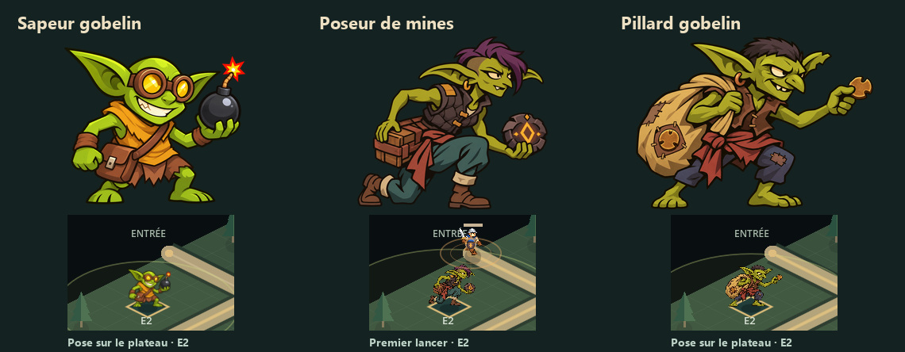

# Boutique · Poseur de mines

Visuel fixe du type 42 validé par le porteur (`horde.minelayer`). La gobeline s’appuie sur un genou, retient sa caisse sur la hanche et tient un disque de pierre runique. La posture basse, la caisse et le disque la distinguent du Sapeur et du Pillard au même emplacement. Dessin réalisé avec le générateur intégré à partir du comparatif du Pillard pour les contours et les aplats.

| PNG | Cadre | Pied | Hauteur | Origine du lancer d’essai |
| --- | --- | --- | ---: | --- |
| `poseur_mines_v001.png` | `Rect2(0,0,1101,1001)` | `(473,1001)` | 53 px | `(27,-23.5)` |

Le type 42 touche une cible. Ses dégâts sont multipliés par 1,8 au premier tiers du trajet et par 0,4 au dernier tiers. Sur la copie v0.202, le disque reprend la forme et la rune du sprite. Le disque sert de projectile visuel puis disparaît à l’impact. Portrait, déblocage sur profil d’essai, recrutement et premier lancer vérifiés au Gué. Les 176 contrôles d’illustrations et les 49 contrôles du quatrième lot passent.

Pour l’animation, préparer le lancer à hauteur de hanche, ouvrir la main au départ du disque et reprendre un disque dans la caisse. L’essai conserve le disque dans la main du sprite fixe pendant le tir.
