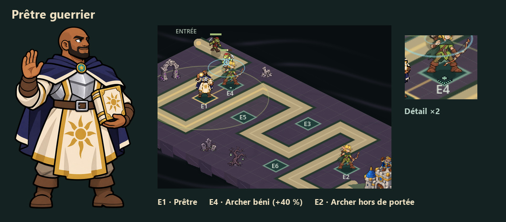

# Boutique · Prêtre guerrier

Visuel fixe du type 32 (`alliance.priest`) validé par le porteur le 14 novembre 2026. Le livre, le tabard ivoire au soleil et la paume levée identifient le Prêtre. Son portrait et son sprite proviennent du générateur d’images intégré, avec le Piquier comme référence de contours et d’aplats.

| PNG | Cadre | Pied | Hauteur | Origine du tir d’essai |
| --- | --- | --- | ---: | --- |
| `pretre_guerrier_v001.png` | `Rect2(0,0,965,1452)` | `(492,1452)` | 58 px | `(-14,-46)` |

Sur la copie v0.199, le Prêtre lance un éclat doré vers une seule cible. Le repère `aura.png` apparaît au pied des défenseurs dont `guardian_aura(slot) > 0`. Au Portail des Ossements, le Prêtre en E1 donne +40 % de dégâts à l’Archer en E4, à portée de son aura de 3,6 cases. Aucun bonus du Prêtre n’est appliqué à l’Archer éloigné en E2 ni au Prêtre lui-même. Portrait, déblocage, recrutement et premier tir vérifiés. Les 111 contrôles d’illustrations et les 41 contrôles du troisième lot de la boutique passent.

Pour l’animation, préparer l’éclat dans la paume et l’expédier d’un mouvement bref de l’avant-bras. Le livre reste calé contre la hanche. Le repère au sol signale la bénédiction passive entre les tirs. La fiche de combat affiche encore « Explosion autour de la cible » avec zéro cible secondaire. Préférer une mention explicite du tir et de la bénédiction de proximité lors de l’intégration.

## Projection de l’éclat doré

Le Prêtre relève la main libre, forme un éclat devant les doigts et étend l’avant-bras droit vers la cible. À 0,32 s, la paume est vide et le projectile doré existant part depuis le repère de la main. Le livre reste tenu à la hanche pendant les neuf poses distinctes. La planche dure 0,80 s sur 20 images. Les semelles restent calées et le corps mesure 64 px comme le visuel fixe actuel.

[Essai en jeu](essais/gestes_combat/pretre_guerrier/Pretre_guerrier_en_jeu.gif) · [Planche des neuf poses](essais/gestes_combat/pretre_guerrier/Planche_pretre_guerrier.png)

Six tirs contrôlés en mission 94 sur copie instrumentée de la v0.234, dans les deux sens à ×1 et ×2 et en pause. Le repère de la main dans lacher.json suit le retournement de la planche. Le projectile existant suit un segment direct à partir de ce point. Le repère passif reste au pied de l’archer voisin, dont le modèle confirme le bonus de +40 % durant l’essai. Validateur à zéro problème sur 48 dossiers, 189 contrôles d’animation et 77 des effets réussis. Une seule inclinaison testée, avis du porteur attendu avant déclinaison.

Consignes au générateur intégré. Conserver le Prêtre chauve et barbu, la cape marine, la cuirasse, le livre et le tabard au soleil. Dessiner la levée de la main libre, l’ouverture de la paume et le retour en garde par étapes, avec les mêmes appuis et le livre tenu à la même hanche. Un dessin supplémentaire raccorde l’extension à la paume ouverte. Les éclats de charge sont assemblés sur les poses avant le lâcher.
