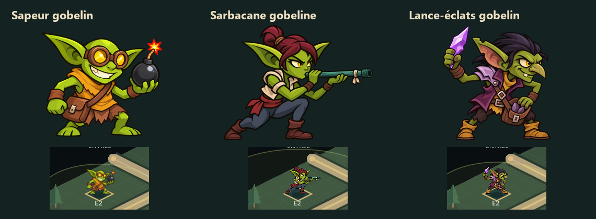

# Boutique · Sarbacane gobeline

Visuel fixe du type 29 validé par le porteur le 14 novembre 2026 (`horde.blowgun`). La gobeline prend une posture basse et tient sa sarbacane turquoise à deux mains, à hauteur de bouche. Sa coiffure bordeaux, ses appuis et la ligne horizontale du tube la distinguent du Sapeur et du Lance-éclats au même emplacement E2.

| PNG | Cadre | Pied | Hauteur | Origine du tir d’essai |
| --- | --- | --- | ---: | --- |
| `sarbacane_gobeline_v001.png` | `Rect2(0,0,1303,1014)` | `(480,1014)` | 53 px | `(42.5,-31)` |

Portrait, déblocage, recrutement et premier tir contrôlés sur une copie v0.198, avec 116 contrôles d’illustrations réussis. La copie dessine un petit dard dans l’axe du tir. Le tube reste horizontal sur la pose fixe et suit le côté de la cible.

Pour l’animation, privilégier une courte impulsion du souffle et du buste, puis une reprise de visée. Garder les deux mains au contact du tube. Le rendu doit évoquer un projectile direct et le rôle de chasseuse de rapides.

Dessin réalisé avec le générateur intégré. Le Sapeur a servi de référence pour les contours, les aplats ombrés et les traits gobelins. La pose basse et le tube ont guidé la nouvelle silhouette.

## Inspiration et tir

Six dessins entiers pour la garde, l’inspiration, les joues gonflées, le souffle et la reprise de visée. Les deux mains gardent la sarbacane en bouche, avec les bottes ancrées. Quatorze images sur 0,56 s. Le dard existant part à 0,24 s, pendant le premier souffle, depuis le centre de l’ouverture du tube. Le fichier lacher.json donne son repère depuis le pied. Le repère suit l’orientation de la planche. La copie d’essai dessine le dard sur un trajet rectiligne jusqu’à la cible. Le tir et les dégâts de combat suivent les règles existantes.

[Planche des six poses](essais/gestes_combat/sarbacane_gobeline/Planche_sarbacane.png) · [Sarbacane en jeu](essais/gestes_combat/sarbacane_gobeline/Sarbacane_gobeline_en_jeu.gif)

Une inclinaison presque horizontale, testée sur 16 tirs de la mission 94 v0.233 dans les deux sens, à ×1 et ×2 avec pause. Les départs et trajets ont été vérifiés sur la copie instrumentée. Zéro problème sur 46 dossiers, 187 contrôles d’animation et 77 des effets réussis. Aucun changement de code dans le dépôt pour cet essai. Le porteur a retenu ce geste pour décliner les tirs en montée et en descente.

Consignes au générateur d’images intégré. Reprendre la gobeline et sa sarbacane turquoise de référence. Garder le même ancrage, les mains sur le tube, la palette du costume et des ombres nettes. À l’inspiration, soulever un peu le buste et gonfler les joues. Au souffle, projeter le buste de quelques pixels et plisser les yeux. Rouvrir les yeux et reprendre l’appui initial. Aucun dard dessiné sur la planche, afin de synchroniser le projectile depuis le tube.

## Trois inclinaisons de tir

Le geste presque horizontal reste la référence. Les vues vers le haut et vers le bas utilisent chacune un dessin intermédiaire à l’aller et au retour, entre la garde commune et l’angle de tir. Les deux mains gardent le tube en bouche. La hauteur, les appuis, les 14 images sur 0,56 s et le souffle à 0,24 s sont communs. Les angles dessinés sont d’environ −22°, −2° et +16°. Le fichier lachers.json indique pour chaque vue le nom de la planche, l’angle du tube et le repère de son ouverture depuis le pied.

[Visées en jeu à ×1](essais/gestes_combat/sarbacane_gobeline/Sarbacane_gobeline_angles_x1.gif) · [Visées en jeu à ×2](essais/gestes_combat/sarbacane_gobeline/Sarbacane_gobeline_angles_x2.gif) · [Dessins des deux inclinaisons](essais/gestes_combat/sarbacane_gobeline/Sarbacane_poses_inclinees.png)

La copie instrumentée de la v0.233 choisit la pose dont le tube est le plus proche de l’axe ouverture-vers-impact. Elle retourne ensemble le repère et la pose, puis dessine le dard en ligne droite. 18 tirs observés sur la mission 94, pour les trois inclinaisons, vers la droite et la gauche, à ×1 et ×2. Pause et trajectoire vérifiées, avec un écart au tube de 5,5° au maximum sur les premiers tirs de l’essai. Validateur à zéro problème sur 46 dossiers, 187 contrôles d’animation et 77 des effets réussis. Le porteur a donné le feu vert pour poursuivre après présentation des trois visées. Lot 112ffcd prêt à intégrer.

Consignes au générateur d’images intégré. Reprendre les poses validées avec les mêmes bottes, les mains au contact et la sarbacane droite. Incliner le tube avec les avant-bras et le regard en gardant les genoux et les pieds en place. Dessiner l’inspiration, le souffle et la reprise de visée pour les deux angles, plus une pose à mi-course dans chaque sens.
