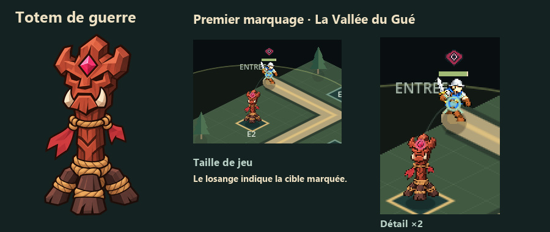

# Boutique · Totem de guerre

Visuel fixe du type 34 (`horde.wartotem`) validé par le porteur le 14 novembre 2026. Le Totem est un défenseur fixe en bois sculpté, sur trois appuis. La gemme rose reprend la forme du losange qui signale la cible marquée. Dessin réalisé avec le générateur intégré à partir du Chaman orc comme référence de contours et d’aplats.

| PNG | Cadre | Pied | Hauteur | Origine de l’impulsion d’essai |
| --- | --- | --- | ---: | --- |
| `totem_guerre_v001.png` | `Rect2(0,0,675,1282)` | `(317,1282)` | 56 px | `(0,-46.5)` |

Sur la copie v0.199, une impulsion rose part de la gemme et le repère `mark.png` apparaît au-dessus des PV de la cible. L’action inflige 3 dégâts de base et la marque dure 4 s. Les autres défenseurs infligent +55 % de dégâts à la cible marquée. Portrait, déblocage, recrutement et premier marquage vérifiés. Les 121 contrôles d’illustrations et les 41 contrôles du troisième lot de la boutique passent.

Le texte de combat hérite encore de « Rebonds entre ennemis proches ». Remplacer ce libellé par une description du marquage. Animer la gemme au déclenchement en gardant la structure posée sur ses appuis.
