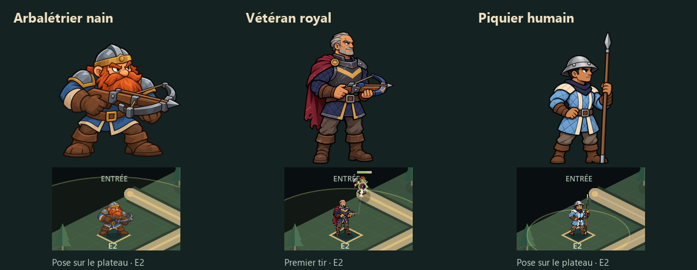

# Boutique · Vétéran royal

Proposition masculine retenue pour le type 40 (`alliance.veteran`) après retour favorable du porteur le 14 novembre 2026. Les cheveux gris, l’armure rayée, le chevron doré et la cape de campagne marquent son expérience. Sa posture droite et son arbalète courte se distinguent du Piquier et de l’Arbalétrier nain au même emplacement. Dessin réalisé avec le générateur intégré, avec le Piquier comme référence pour les aplats et les contours.

| PNG | Cadre | Pied | Hauteur | Origine du carreau d’essai |
| --- | --- | --- | ---: | --- |
| `veteran_royal_v001.png` | `Rect2(0,0,1022,1496)` | `(460,1496)` | 59 px | `(20.5,-34.75)` |

Sur une copie v0.201, le portrait, le déblocage sur profil d’essai, le recrutement et le premier tir ont été vérifiés. Le carreau de famille part de l’arbalète courte. Les 161 contrôles d’illustrations et les 49 contrôles du quatrième lot passent. Le rôle existant lui donne +16 % de dégâts par vague survivée depuis son achat, jusqu’à +90 %.

Pour l’animation, le Vétéran relève l’arbalète, stabilise son appui avant et laisse la corde partir. Faire disparaître le carreau du sprite à cet instant. L’animation du tir et du rechargement reste à réaliser.
