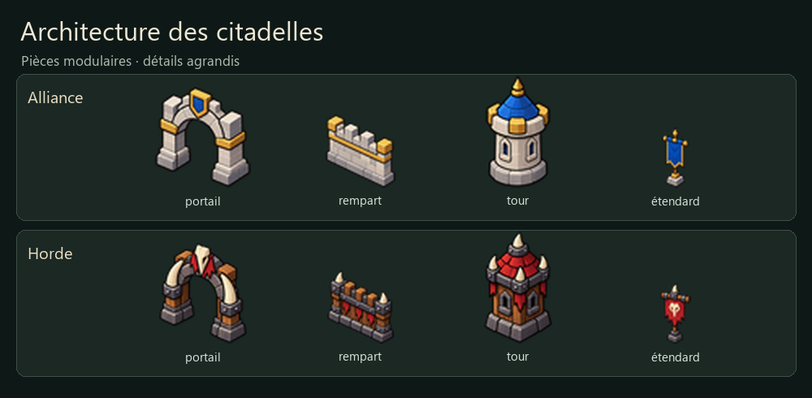

# Habillage des citadelles — proposition du 11 novembre 2026

Les chapitres 9 et 10 se déroulent dans la citadelle de la faction adverse. La maquette reprend la pierre claire, le bleu et l’or de l’Alliance. La Horde emploie le bois, le fer sombre, le rouge et quelques défenses d’ivoire. La forteresse à protéger conserve l’identité de la faction jouée.

Les quatre pièces sont un portail ouvert, un rempart court, une tour de guet et un étendard. Les PNG transparents sont dans `design/essais/citadelles/`. Ils ont été dessinés à partir des forteresses existantes comme références de palette, de contours et de perspective. Le portail est un élément d’architecture posé en bordure. Les vrais points d’entrée restent repérés par la route et les annonces existantes.

| Faction de la citadelle | Faction jouée | Sol proposé | Faces du plateau |
| --- | --- | --- | --- |
| Alliance | Horde | `#4F5964` | `#424B57`, `#303843` |
| Horde | Alliance | `#524847` | `#443A39`, `#322C2D` |

Le fichier [Reperes.json](essais/citadelles/Reperes.json) donne les dimensions, les points d’ancrage, les hauteurs proposées et les placements d’essai. Les maquettes utilisent 62 px pour le portail, 45 px pour le rempart, 69 px pour la tour et 37 px pour l’étendard à la taille de jeu.

## Contrôle sur le plateau

Les décors ont été montés sur quatre captures Godot de la v0.174, prises sur l’écran de droite avec profil isolé. Les Glacis, mission 81, testent une entrée. Les Portes Jumelles, mission 87, testent trois entrées. Les positions sont communes aux deux factions sur chaque carte. Les pixels visibles des pièces ont été contrôlés contre les zones réservées autour des routes, des entrées, des six emplacements et de la forteresse. Les maquettes sont des compositions sur captures. Le décor n’est pas branché en jeu.

| Carte | Citadelle de l’Alliance | Citadelle de la Horde |
| --- | --- | --- |
| Les Glacis | [Maquette Alliance](essais/citadelles/Mission_81_citadelle_alliance.png) | [Maquette Horde](essais/citadelles/Mission_81_citadelle_horde.png) |
| Les Portes Jumelles | [Maquette Alliance](essais/citadelles/Mission_87_citadelle_alliance.png) | [Maquette Horde](essais/citadelles/Mission_87_citadelle_horde.png) |

**Retour du porteur, 11 novembre 2026.** Les maquettes lui paraissent « propres ». Le prochain contrôle porte sur la lisibilité du décor en combat.

Si cette direction convient, intégrer les pièces côté décor et commencer par les deux cartes d’essai. Sélectionner l’architecture par faction adverse et garder le même placement logique pour les deux versions. Pour les autres cartes, vérifier les marges à partir de leur géométrie avant de choisir les emplacements. En combat, contrôler les silhouettes, les portées au survol, les annonces d’entrée et le tri des objets en profondeur. L’aperçu de mission peut reprendre la palette de sol. Les règles de combat, les routes, les emplacements de recrutement et l’architecture de la forteresse du joueur ne nécessitent aucun changement.
