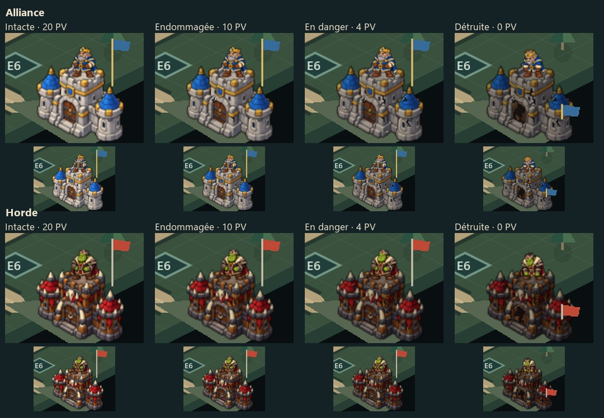

# Dégâts des forteresses

Proposition du 22 novembre 2026. Les premiers dégâts apparaissent autour de la porte. Les fissures de l’Alliance suivent les joints de pierre. Les fentes de la Horde suivent les montants en bois. En danger, un éclat apparaît dans la toiture et les dégâts s’étendent aux tours. À zéro PV, la porte cède et la silhouette du bâtiment reste reconnaissable. Les premiers dégâts sont volontairement discrets à taille native.

## Intégration

Les six calques RGBA ont une largeur de 368 px. Ceux de l’Alliance mesurent 348 px de haut et ceux de la Horde 342 px. Le cadre suit la région de l’illustration affichée par `FortressArt.SOURCES`. Utiliser le calque `degats_<faction>_<condition>.png` pour les conditions 1 à 3, sur le rectangle `body` de `_draw_fortress`, avec la même modulation que le bâtiment. Le calque remplace le trait de fissure générique. Le bâtiment, le roi, la fumée, la bannière et les seuils de PV conservent leur rendu actuel. Les six PNG sont à déclarer dans les trois listes d’export après validation.

## Contrôles

Vingt captures sur une copie locale de la v0.240. Seize couvrent les quatre états dans les deux factions, avec et sans calques, aux PV imposés de 20, 10, 4 et 0. Les quatre autres partent d’arrivées ennemies réellement calculées par le modèle et montrent le roi qui réagit à la perte de dix PV puis la pose de défaite à zéro PV, sur un profil isolé. Les suites des états et des événements royaux passent, avec respectivement 36 et 438 contrôles. Les calques attendent l’avis du porteur avant intégration.

[Voir la réaction du roi dans les deux factions](essais/degats_forteresses/Le_roi_lors_des_arrivees.jpg)
