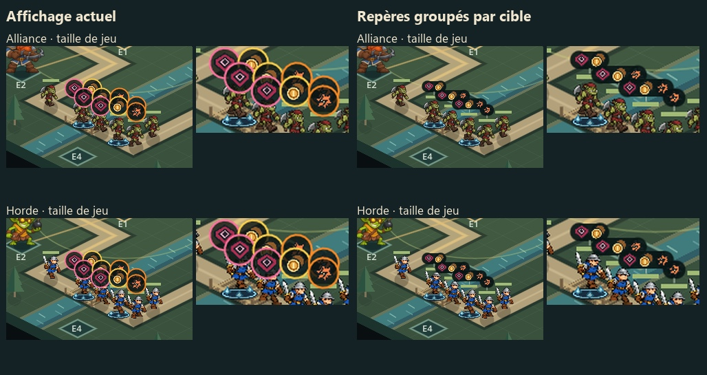

# Boutique · Repères d’effets en combat

Proposition visuelle du 14 novembre 2026. Les cinq états utilisent chacun une forme et une position reconnaissables. L’aperçu superpose les repères à une capture de La Vallée du Gué en v0.197. Il montre le rendu à taille de jeu et un agrandissement ×2, avec trois états simultanés sur la même cible.

| Identifiant proposé | Ressource | Lecture sur le plateau | Source côté jeu | Dimensions d’affichage proposées |
| --- | --- | --- | --- | --- |
| `effect.slow` | `slow.png` | Cristaux bleus aux pieds de l’ennemi | Ralentissement actif selon le modèle de combat | 29 × 14 px |
| `effect.mark` | `mark.png` | Losange rose au-dessus de la barre de PV | `marked_until` | 16 × 16 px |
| `effect.loot` | `loot.png` | Deux pièces d’or au-dessus de la barre de PV | `loot_until` | 16 × 16 px |
| `effect.volatile` | `volatile.png` | Étoile orange anguleuse au-dessus de la barre de PV | `volatile_until` | 16 × 16 px |
| `effect.aura` | `aura.png` | Double chevron vert au pied du défenseur bénéficiaire | `guardian_aura(slot) > 0` | 19 × 13 px |
| Explosion de volatilité | `volatile_burst.png` | Anneau bref et éclats à l’endroit de l’explosion | Position de l’explosion déclenchée par la mort | 41 × 27 px pour l’aperçu |

Pour les états en hauteur, centrer une rangée à 18 px d’entraxe au-dessus de la barre de PV. L’ordre proposé est marque, pillage, volatilité. Les états au sol sont placés sous les unités. L’aura n’est indiquée que sur les bénéficiaires de façon à limiter l’encombrement du plateau. Si plusieurs cibles proches portent des badges, vérifier ce groupement en combat sur une vague dense. La maquette place l’explosion sur un tronçon libre pour l’isoler des autres repères.

Les six PNG sont transparents, exportés à quatre fois leur taille nominale. Ce sont des repères d’étude fixes. Le branchement et la durée visuelle de l’explosion restent à définir avec Claude Code. Vérifications faites sur l’aperçu statique et les six fichiers PNG. Les transitions, l’expiration et les superpositions en mouvement restent à vérifier dans le jeu après branchement.

## Contrôle v0.241 · Ennemis proches

Les six visuels d’effets sont chargés par la version actuelle. Sept captures sont déclenchées par un tir résolu dans le moteur, avec ralentissement, marque, pillage et volatilité. Deux mises en place contrôlent le chevron d’aura auprès de son bénéficiaire. Deux autres déclenchent des explosions en chaîne calculées par le modèle. [Captures](essais/effets_boutique/Effets_sur_le_plateau.jpg)

Les cercles individuels permettent de distinguer facilement les effets sur un ennemi isolé. Quand plusieurs cibles proches cumulent des états, les cercles se recouvrent et masquent certaines icônes ou jauges. Le comparatif est une mise en scène contrôlée sur la Vallée du Gué, avec six ennemis placés au même endroit d’une version à l’autre dans chacune des deux factions. Les états du comparatif sont imposés pour exercer le rendu.

La proposition conserve les grandes pastilles pour les ennemis isolés. En groupe, chaque cible porte une seule rangée de symboles sur fond sombre reliée à sa jauge. L’ordre reste marque, pillage, volatilité. Une rangée de trois occupe 50 px dans l’essai, contre environ 79 px pour les trois cercles actuels. Le seuil d’essai est de 48 px entre deux ennemis porteurs d’un état. Les signes sont plus petits à taille native. Après avis du porteur, faire vérifier la transition de taille pendant le mouvement, en particulier quand deux groupes se rejoignent puis se séparent.

Les 157 contrôles des états et projectiles de boutique passent sur les sources de la v0.241. La rangée compacte a été essayée uniquement dans une copie locale.

## Bandeaux d’affixe

Contrôle complémentaire du jeu Windows v0.241. Pendant le combat des missions 36, 39 et 180, le bandeau reste dans son emplacement en haut, séparé du plateau et des repères d’entrée. Les 4 249 contrôles du bandeau passent sur les sources. [Captures de l’export](essais/effets_boutique/Bandeaux_export_v0241.jpg)
