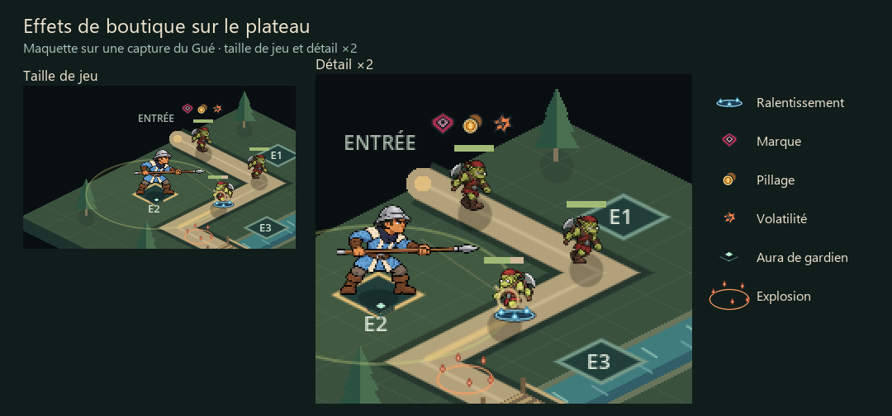

# Boutique · Repères d’effets en combat

Proposition visuelle du 14 novembre 2026. Les cinq états utilisent chacun une forme et une position reconnaissables. L’aperçu superpose les repères à une capture de La Vallée du Gué en v0.197. Il montre le rendu à taille de jeu et un agrandissement ×2, avec trois états simultanés sur la même cible.

| Identifiant proposé | Ressource | Lecture sur le plateau | Source côté jeu | Dimensions d’affichage proposées |
| --- | --- | --- | --- | --- |
| `effect.slow` | `slow.png` | Cristaux bleus aux pieds de l’ennemi | Ralentissement actif selon le modèle de combat | 29 × 14 px |
| `effect.mark` | `mark.png` | Losange rose au-dessus de la barre de PV | `marked_until` | 16 × 16 px |
| `effect.loot` | `loot.png` | Deux pièces d’or au-dessus de la barre de PV | `loot_until` | 16 × 16 px |
| `effect.volatile` | `volatile.png` | Étoile orange anguleuse au-dessus de la barre de PV | `volatile_until` | 16 × 16 px |
| `effect.aura` | `aura.png` | Double chevron vert au pied du défenseur bénéficiaire | `guardian_aura(slot) > 0` | 19 × 13 px |
| Explosion de volatilité | `volatile_burst.png` | Anneau bref et éclats à l’endroit de l’explosion | Position de l’explosion déclenchée par la mort | 41 × 27 px pour l’aperçu |

Pour les états en hauteur, centrer une rangée à 18 px d’entraxe au-dessus de la barre de PV. L’ordre proposé est marque, pillage, volatilité. Les états au sol sont placés sous les unités. L’aura n’est indiquée que sur les bénéficiaires de façon à limiter l’encombrement du plateau. Si plusieurs cibles proches portent des badges, vérifier ce groupement en combat sur une vague dense. La maquette place l’explosion sur un tronçon libre pour l’isoler des autres repères.

Les six PNG sont transparents, exportés à quatre fois leur taille nominale. Ce sont des repères d’étude fixes. Le branchement et la durée visuelle de l’explosion restent à définir avec Claude Code. Vérifications faites sur l’aperçu statique et les six fichiers PNG. Les transitions, l’expiration et les superpositions en mouvement restent à vérifier dans le jeu après branchement.
