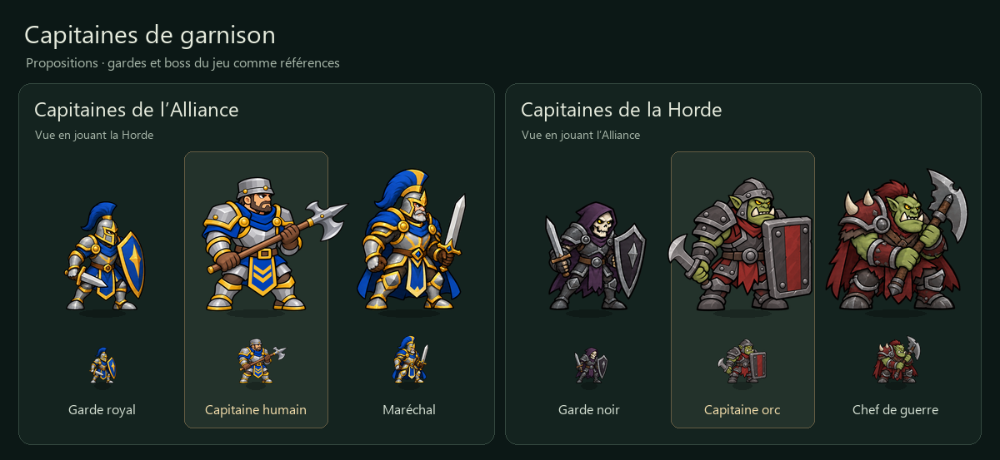

# Capitaines de garnison — propositions du 11 novembre 2026

Le capitaine humain de l’Alliance se reconnaît à son casque bas sans plumet, à sa hallebarde et aux deux chevrons de son tabard. Le capitaine orc de la Horde porte un bouclier rectangulaire à bande rouge et une lame courte. Les formes distinctives sont visibles à l’échelle du plateau. Les noms de prototype sont conservés dans cette fiche.

Le porteur a demandé un manche parfaitement droit, puis a signalé des trous apparents et des raccords incomplets dans le premier montage. Le guide droit a servi de base à une retouche continue des gants, du manche et de la tête. Le contrôle sur fond clair permet de lire les contacts entre le bois et les gants, ainsi que la continuité de la douille et du fer. Les neuf points relevés sur les trois sections de bois s’écartent d’environ un pixel au maximum de leur droite d’ajustement, à la définition du dessin. [Contrôle des raccords](essais/garnison/Controle_raccords_hallebarde.png) · [Contrôle de l’axe](essais/garnison/Controle_axe_hallebarde.png)

Les dessins de départ ont été produits avec les atlas des factions comme références. Consignes artistiques : humain trapu en acier et cobalt, hallebarde à deux mains, casque bas et chevrons dorés. Orc trapu en fer sombre et rouge brique, bouclier rectangulaire à bande rouge et lame courte. Les deux profils regardent à droite. Le miroir est montré sur la maquette pour vérification.

| Identité du jeu | Vue par le joueur | Sprite PNG transparent | Cadre complet | Pied dans le cadre |
| --- | --- | --- | --- | --- |
| `enemy.alliance.garrison` | Horde | [Capitaine humain](essais/garnison/capitaine_humain_v001.png) | 1 295 × 1 179 px | `(478, 1173)` |
| `enemy.horde.garrison` | Alliance | [Capitaine orc](essais/garnison/capitaine_orc_v001.png) | 1 084 × 1 005 px | `(559, 999)` |

Contrôle de lisibilité sur des captures de La Brèche (mission 91), avec les tailles de référence du jeu : garde 44,2 px, capitaine 54,4 px et boss 57,8 px. Le matériel du capitaine peut dépasser la largeur du boss. La différence à lire est la forme de l’arme ou du bouclier, la silhouette moins haute et l’absence du grand plumet ou des cornes du boss. Le montage permet de comparer ces formes dans les deux factions. [Maquette sur le plateau](essais/garnison/Garnisons_sur_la_Breche.png)

**Retour du porteur, 11 novembre 2026.** Il juge la version corrigée du capitaine humain « propre ». Ce retour concerne son illustration fixe. L’orc reste une proposition à examiner.

Pour un essai intégré, Claude Code peut associer les PNG aux deux identités ci-dessus avec la hauteur de base de 34 px et le facteur de taille 1,6 déjà utilisé par la Garnison. Les portraits, la prévision de vague et l’affichage sur le plateau sont à contrôler dans les deux factions. La marche et la mort feront l’objet d’un lot après validation des silhouettes.

## Lisibilité du capitaine humain sur le plateau

Le capitaine apparaissait crénelé à environ 54 px de haut sur le plateau. Les images réduites générées à l’import (mipmaps) permettent au filtre déjà utilisé par le plateau d’échantillonner le dessin à une définition proche de celle affichée. Le réglage s’applique à `capitaine_humain_v001.png.import`. Le PNG approuvé, le cadre et l’ancre du pied restent identiques.

La comparaison couvre les missions 91, 94, 98 et 100, côté Horde, en vague 5. Douze paires de captures ont les mêmes positions, PV et temps de simulation avant et après réimport. Godot charge bien une texture avec mipmaps. La hallebarde et le bord de l’armure paraissent plus continus à taille de jeu. Le filtrage adoucit aussi certains petits détails du visage. [Comparatif en jeu](essais/capitaine_rendu/Capitaine_avant_apres.png)

Le validateur d’animations et les suites ciblées des visuels ennemis et de la Garnison passent, avec 4 741 contrôles Godot et 17 tests Python. La comparaison porte sur le rendu en combat. La marche et la mort restent des lots séparés.
