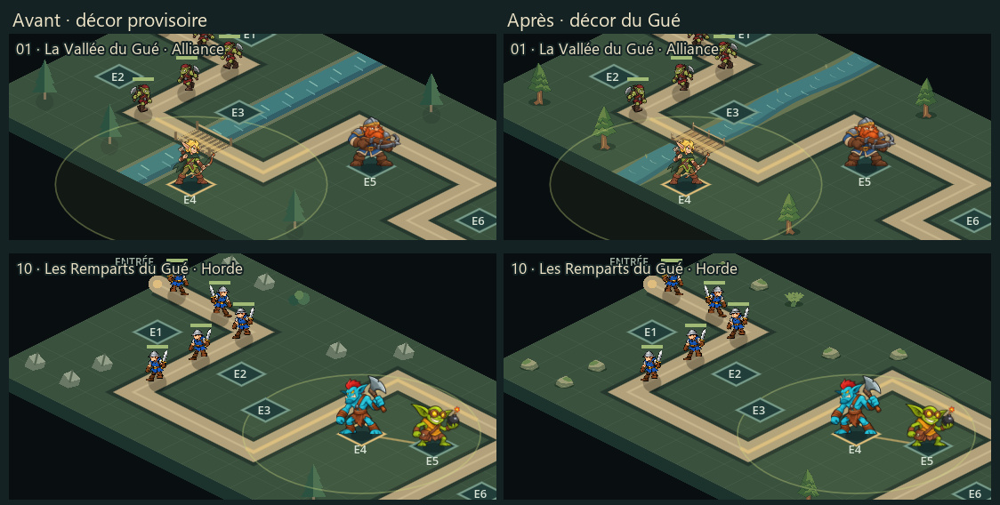

# Décor du Gué · Missions 1 à 20

Proposition présentée le 23 novembre 2026. Le rendu a été essayé sur une copie de la v0.241. Le porteur a validé cet habillage le 23 novembre 2026 (lot 3feb9b09). Claude Code peut l’intégrer.

## Pièces et emplacements

Deux silhouettes de pin, une roche moussue, un buisson fleuri et des fougères complètent le décor. Les cinq pièces reprennent les ancrages déjà définis sur les dix plateaux des chapitres 1 et 2. La rivière et le pont habillent uniquement la carte d’ouverture (`valley_ford`, missions 1 et 11). Le tracé des routes et les règles de combat sont ceux de la v0.241.

| Cartes | Identifiants |
| --- | --- |
| Missions 1 et 11 | `valley_ford` |
| Missions 2 à 10 puis 12 à 20 | `ford_woods`, `ford_heights`, `ford_turns`, `ford_glade`, `ford_pass`, `ford_switchbacks`, `ford_trail`, `ford_approach`, `ford_ramparts` |

Les sept images sont dans `prototype/assets/decor/gue/`. Les rectangles sont donnés dans [Implantation.json](essais/gue_01_20/Implantation.json). Pour les cinq pièces, les coordonnées sont relatives à l’ancrage projeté et les textures sont à ×4. Pour les deux calques, les coordonnées sont celles de la vue de référence avec une origine de projection à (658, 174) et les textures sont à ×2.

- Réutiliser `definition.trees` et les placements de `scenery_for`. Dans l’essai, les pins et les deux petits végétaux alternent. Les pièces prennent un facteur de taille de 0,91, 0,955 ou 1 selon leur indice, avec miroir sur les indices dont le reste modulo 5 vaut 0 ou 1.
- Sur `valley_ford`, dessiner la rivière sous la route et le pont au-dessus de la route, avant les unités. Les emplacements sont ceux du franchissement existant.

## Contrôles

48 captures à 1280 × 800 sur la copie v0.241. Les deux factions ont été vérifiées sur les 20 missions, avec huit vues supplémentaires du décor provisoire. Les prises de vue sont toutes en combat, à la vague 3 après huit secondes. Les sept PNG ont une marge transparente sur les quatre bords.

| Suite | Contrôles réussis |
| --- | ---: |
| `test_terrain_scenery.gd` | 4 348 |
| `test_campaign_preview.gd` | 854 |
| `test_campaign_navigation.gd` | 914 |

- [Missions 1 à 5](essais/gue_01_20/Missions_01_05.jpg)
- [Missions 6 à 10](essais/gue_01_20/Missions_06_10.jpg)
- [Missions 11 à 15](essais/gue_01_20/Missions_11_15.jpg)
- [Missions 16 à 20](essais/gue_01_20/Missions_16_20.jpg)
