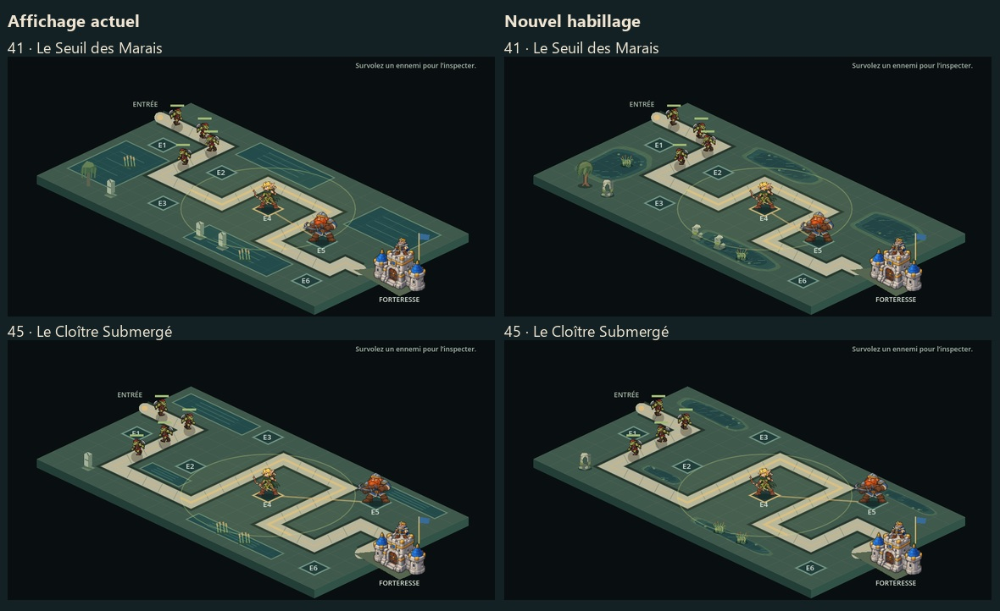

# Bassins et ruines des marais · Missions 41 à 45

Proposition du 22 novembre 2026. Les vingt bassins décoratifs reçoivent des berges irrégulières, une eau plus profonde au centre, de petites rides et des feuilles flottantes. Les saules et les roseaux remplacent les formes géométriques. Une petite arche et un pan de mur effondré reprennent la pierre moussue du biome. Au Cloître submergé, l’arche tient dans le cadre de la ruine compacte existante.

Les tracés, emplacements et positions des éléments restent ceux de la campagne. Les couleurs du terrain et de la chaussée suivent le réglage actuel. La proposition se limite à l’affichage du plateau des missions 41 à 45.

## Branchement après validation

Les neuf PNG sont dans `prototype/assets/decor/marais/`. [Implantation](essais/marais_41_45/Implantation.json) donne, pour chaque carte, le rectangle à dessiner dans les coordonnées projetées du plateau ainsi que les quatre rectangles d’eau d’origine. Pour le Seuil, la référence est `MarshArt.POOLS`. La première passe de dessin peut utiliser `bassins_<carte>.png` à la place des bassins vectoriels avant le tracé des routes. Les trois cadres d’objets couvrent les emprises existantes de `MarshArt.bounds`. Dans la copie d’essai, la variante effondrée est sélectionnée parmi les ruines par la parité de leur ordre de placement, sauf sur `marsh_cloister`, réservé à l’arche.

Les neuf PNG sont à déclarer dans les listes d’export. Les bassins de ce lot sont décoratifs. Les calques des tronçons inondés des missions 51 à 60 ont leur propre passe et leur propre géométrie.

## Vérification

Vingt captures sur une copie locale de la v0.240, à la vague 3 avec des attaquants et des défenseurs, avec et sans nouvel habillage, dans les deux factions. Le contrôle des pixels confirme que les quatre sprites tiennent dans leurs cadres et que les vingt bassins restent dans les rectangles autorisés. Un détail de roseau en bord de cadre et quelques pixels de berge hors emprise ont été corrigés avant les captures finales. Les suites du chapitre des marais (4 448 contrôles) et des décors (13 580) passent. Avis du porteur attendu.

- [Missions 41 à 43 en combat](essais/marais_41_45/Marais_41_43.jpg)
- [Missions 44 et 45 en combat](essais/marais_41_45/Marais_44_45.jpg)
