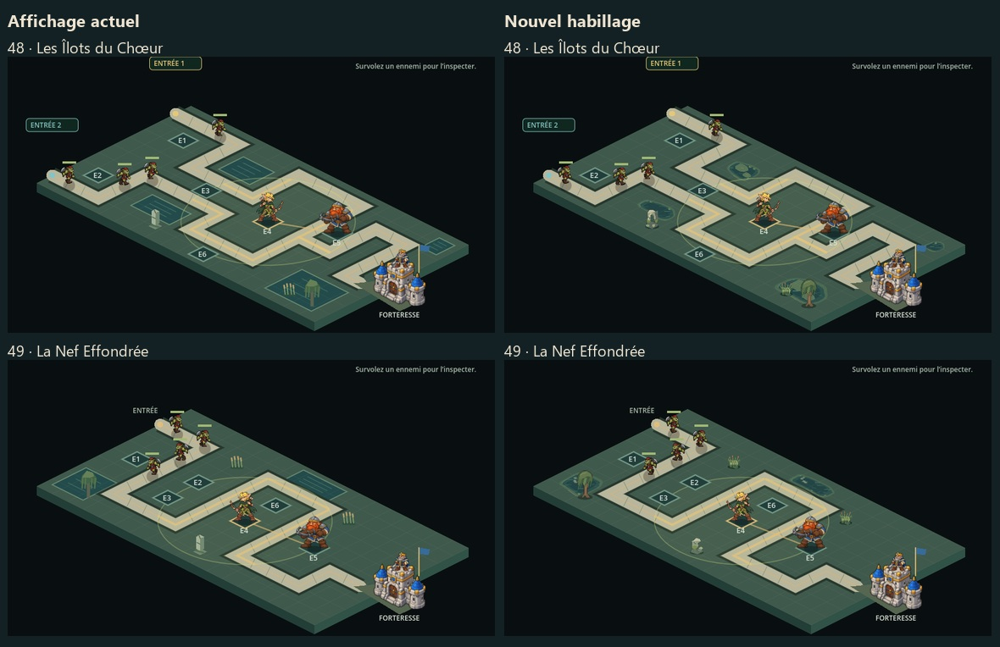

# Bassins et ruines des marais · Missions 46 à 50

Habillage validé par le porteur le 22 novembre 2026 (lot 65638f3), dans la continuité de l’habillage validé pour les missions 41 à 45. Les dix-huit bassins gardent leurs positions. Les formes, les berges et les motifs changent selon la carte. Des roseaux ponctuent la Chaussée, des îlots bas émergent sur la mission 48 et des pierres affleurent dans l’eau de la Nef et du Sanctuaire. La Nef garde ses deux bassins et ses quatre objets de décor. La ruine au sol y prend la forme du pan de mur effondré. Les routes et les emplacements de défense gardent leurs dimensions.

## Branchement

Les cinq nouveaux PNG sont dans `prototype/assets/decor/marais/`. [Implantation](essais/marais_46_50/Implantation.json) donne les positions, les dimensions et les rectangles d’eau pour chaque carte. Utiliser les calques de bassins à la place de `MarshArt.draw_ground` avant la chaussée. Réutiliser les quatre sprites du lot 41–45. Dans l’essai, le mur effondré est sélectionné suivant la parité de l’ordre du décor ainsi que pour toute ruine de la Nef. Ajouter les cinq PNG aux listes d’export. Le branchement des cinq cartes peut suivre celui du lot 41–45.

## Vérification

Vingt-quatre captures en combat sur une copie v0.240. Les comparatifs avec et sans l’habillage couvrent cinq missions et deux factions à la vague 3 à 6,50 s. Les quatre vues supplémentaires à 13 s montrent la circulation aux jonctions et les trois entrées des missions 47 et 50. Aucun pixel des bassins ne sort de son emprise autorisée. Les suites du chapitre des marais (4 448 contrôles) et des décors (13 580) passent. Le lot est prêt à intégrer.

- [Missions 46 à 48, Alliance et Horde](essais/marais_46_50/Marais_46_48.jpg)
- [Missions 49 et 50, Alliance et Horde](essais/marais_46_50/Marais_49_50.jpg)
- [Les deux cartes à trois entrées en combat](essais/marais_46_50/Cartes_a_trois_entrees.jpg)
