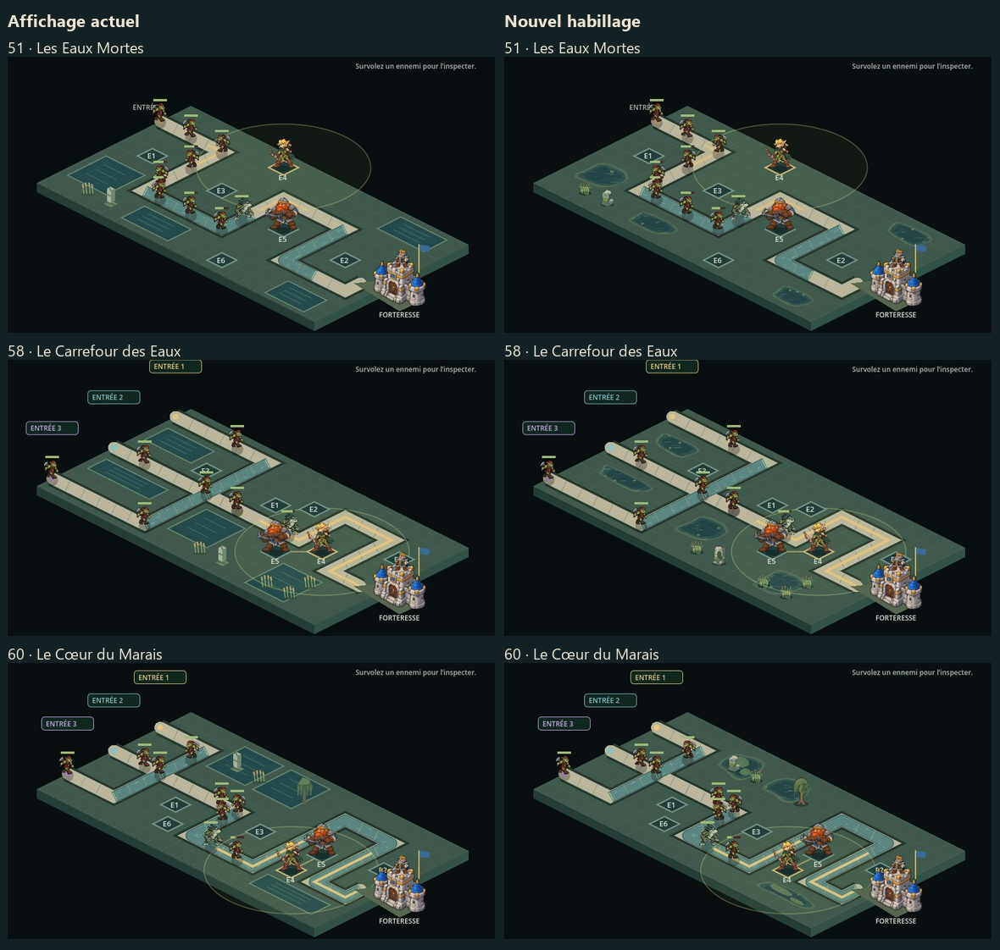

# Bassins et ruines des marais · Missions 51 à 60

Habillage validé par le porteur le 22 novembre 2026 (lot 933da20). Trente-neuf bassins décoratifs occupent les zones existantes. L’eau des bassins est plus sombre que la chaussée inondée, pour que les zones où Gueule-de-Vase peut se régénérer restent identifiables. La Mare Sans Fond se distingue par une eau plus sombre, le Delta et le Cœur du Marais par leurs îlots, les Piliers et la Cathédrale par leurs pierres affleurantes.

Les cartes réutilisent le saule, les roseaux et les deux ruines validés des missions 41 à 50. Les bassins restent décoratifs. Les tronçons inondés conservent les calques de la v0.178, dont le surlignage reste au-dessus de l’eau.

## Branchement

Les dix PNG sont dans `prototype/assets/decor/marais/`. Le [fichier d’implantation](essais/marais_51_60/Implantation.json) donne la position et la taille projetées des calques, ainsi que les rectangles d’eau décorative à vérifier pour chaque carte. Dessiner à la place de `MarshArt.draw_ground` avant la chaussée, selon le branchement des lots 41 à 50. Réutiliser les quatre sprites de ces lots dans leurs cadres existants. Ajouter les dix PNG aux listes d’export.

## Vérifications

58 captures sur une copie v0.240. Quarante comparent les dix cartes avec et sans l’habillage en combat, dans les deux factions. Dix-huit vérifient les transitions de la mission 51 à la vague 2 et les branches de la mission 58 à la vague 8. En 51, le même Gueule-de-Vase entre dans l’eau, récupère des PV avec les remous, puis retrouve la chaussée sèche. En 58, les branches haute et basse sont inondées et le Gueule-de-Vase du trajet central reste sec au croisement dans les deux factions. Toutes les zones peintes restent dans leurs emprises décoratives.

Le décor (13 580 contrôles), Gueule-de-Vase (267) et le chapitre 6 (4 632, dont une simulation gagnante de référence par faction et par mission de 52 à 60) passent. Le lot est prêt à intégrer.

- [Missions 51 à 55, Alliance et Horde](essais/marais_51_60/Marais_51_55.jpg)
- [Missions 56 à 60, Alliance et Horde](essais/marais_51_60/Marais_56_60.jpg)
- [Régénération et retour au sec en 51](essais/marais_51_60/Eaux_Mortes_entree_et_sortie.jpg)
- [Branches inondées et centre sec en 58](essais/marais_51_60/Carrefour_branches_inondees.jpg)
