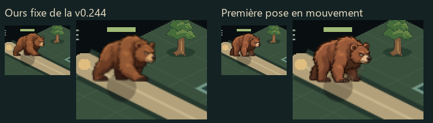

# Ours sauvage · Marche

Proposition du 23 novembre 2026. L’ours reprend la silhouette du sprite fixe, avec des épaules hautes, un poitrail large et des pattes épaisses. Il avance en alternant ses appuis. L’avant du corps accompagne la patte qui se pose. La planche combine douze poses complètes et quatre intermédiaires par transition, pour 60 images par foulée.

Les douze poses ont été générées avec le sprite fixe comme référence. La consigne demandait une marche de l’ours brun adulte en trois quarts droit, avec quatre appuis décalés, une silhouette entière et le même gabarit dans les douze dessins. Les positions au sol ont été alignées lors de l’assemblage et la fermeture de la boucle reçoit le même traitement que les onze autres transitions.

## Essai de la Vallée du Gué

Mission 1, vague 4 sur copie v0.244. Les vidéos montrent la taille du plateau et un agrandissement de la même capture. La marche suit la distance parcourue. Le premier virage emploie le changement de sens horizontal du jeu.

- Alliance [×1](essais/ours_marche_v0244/Ours_alliance_x1.mp4) · [×2](essais/ours_marche_v0244/Ours_alliance_x2.mp4)
- Horde [×1](essais/ours_marche_v0244/Ours_horde_x1.mp4) · [×2](essais/ours_marche_v0244/Ours_horde_x2.mp4)
- [Douze poses clés](essais/ours_marche_v0244/Pose_ours.jpg)

412 captures, dont quatre avec l’illustration fixe. Les 60 images sont visibles sur la portion droite à ×1. Les positions et phases sont identiques à temps de combat égal à ×1 et ×2. Vérification d’emprise et de continuité de silhouette sur la planche. Validateur à zéro problème sur 65 dossiers et quatre suites ciblées réussies, soit 5 015 contrôles.

## Fichiers

[Planche](essais/ours_marche_v0244/walk.png) et [description](essais/ours_marche_v0244/animation.json) pour `enemy.neutral.bear`. Cadre 112 × 88, ancre (55, 81), hauteur 47 et foulée de 19 px à l’échelle du cadre. La planche attend l’avis du porteur avant intégration.
