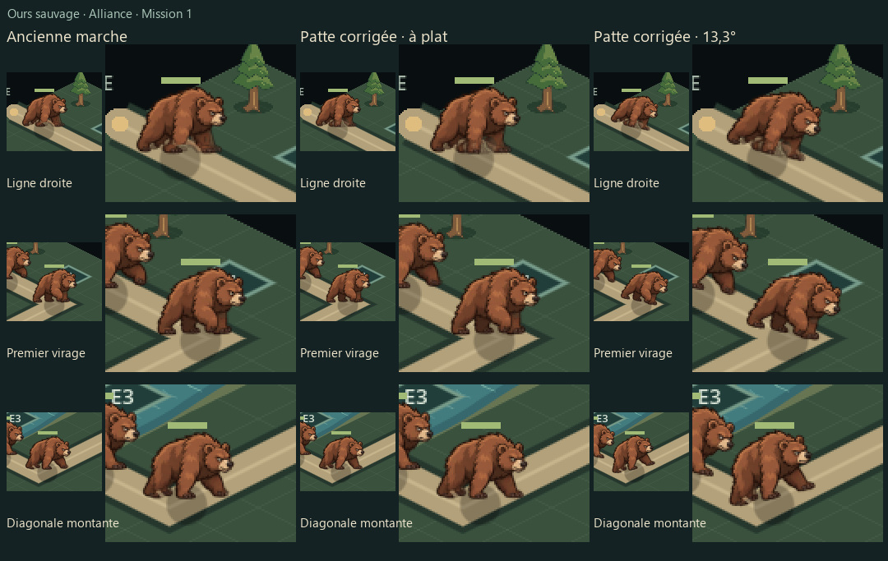
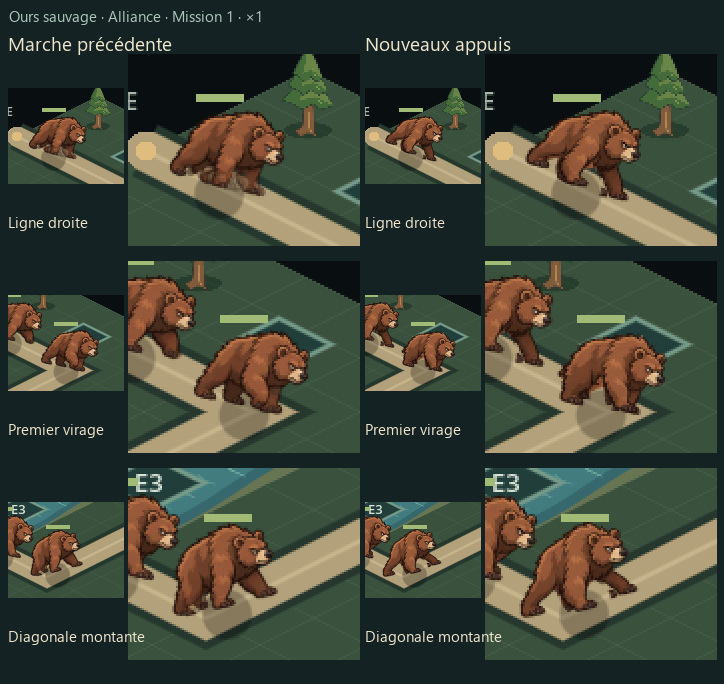

# Ours sauvage · Marche

Proposition du 23 novembre 2026. L’ours reprend la silhouette du sprite fixe, avec des épaules hautes, un poitrail large et des pattes épaisses. Il avance en alternant ses appuis. L’avant du corps accompagne la patte qui se pose. La planche combine douze poses complètes et quatre intermédiaires par transition, pour 60 images par foulée.

Les douze poses ont été générées avec le sprite fixe comme référence. La consigne demandait une marche de l’ours brun adulte en trois quarts droit, avec quatre appuis décalés, une silhouette entière et le même gabarit dans les douze dessins. Les positions au sol ont été alignées lors de l’assemblage et la fermeture de la boucle reçoit le même traitement que les onze autres transitions.

## Essai de la Vallée du Gué

Mission 1, vague 4 sur copie v0.244. Les vidéos montrent la taille du plateau et un agrandissement de la même capture. La marche suit la distance parcourue. Le premier virage emploie le changement de sens horizontal du jeu.

- Alliance [×1](essais/ours_marche_v0244/Ours_alliance_x1.mp4) · [×2](essais/ours_marche_v0244/Ours_alliance_x2.mp4)
- Horde [×1](essais/ours_marche_v0244/Ours_horde_x1.mp4) · [×2](essais/ours_marche_v0244/Ours_horde_x2.mp4)
- [Douze poses clés](essais/ours_marche_v0244/Pose_ours.jpg)

412 captures, dont quatre avec l’illustration fixe. Les 60 images sont visibles sur la portion droite à ×1. Les positions et phases sont identiques à temps de combat égal à ×1 et ×2. Vérification d’emprise et de continuité de silhouette sur la planche. Validateur à zéro problème sur 65 dossiers et quatre suites ciblées réussies, soit 5 015 contrôles.

## Fichiers

[Planche](essais/ours_marche_v0244/walk.png) et [description](essais/ours_marche_v0244/animation.json) pour `enemy.neutral.bear`. Cadre 112 × 88, ancre (55, 81), hauteur 47 et foulée de 19 px à l’échelle du cadre. La planche attend l’avis du porteur avant intégration.

## Correction de la patte avant et essai d’inclinaison

Le porteur a repéré un à-coup sur une patte avant. Il se manifeste quand les deux pattes avant se recouvrent et que l’une quitte rapidement le champ. La correction répartit le passage sur davantage d’images à l’intérieur du même cycle. Elle touche une zone locale sur 19 images. Le haut du corps est identique au pixel près. Les contours des pattes restent continus sur les 60 images.

- [Vidéo côté Alliance](essais/ours_patte_angle_v0244/Ours_alliance_patte_et_angle.mp4)
- [Vidéo côté Horde](essais/ours_patte_angle_v0244/Ours_horde_patte_et_angle.mp4)

Les trois vues utilisent la même simulation sur la mission 1, vague 4, avec un profil isolé sans défenseurs pour dégager les appuis. La première montre l’ancienne marche. La deuxième montre la correction à plat. La troisième ajoute la rotation rigide de la silhouette autour de son ancre, avec le réglage de la tortue de 13,3° signé selon la pente et le sens du trajet. Le comparatif couvre la descente, le premier virage et la montée. Le changement de sens reste instantané.

864 captures sur copie v0.244. Positions, PV et indices d’animation identiques entre variantes. Validateur à zéro problème sur 65 dossiers, avec l’avertissement de la planche archivée dans la copie. Quatre suites ciblées passent, soit 5 015 contrôles. Les essais de correction et d’inclinaison ont été échantillonnés à ×1.

[Planche corrigée](essais/ours_patte_angle_v0244/walk.png) et [description](essais/ours_patte_angle_v0244/animation.json). Foulée 19 px, cadre 112 × 88, ancre (55, 81) et hauteur 47. Le code d’inclinaison sert à l’essai local. Le porteur a retenu l’angle de 13,3° le 23 novembre 2026 et a demandé de reprendre la marche des quatre pattes.

## Marche reprise à partir des quatre appuis

Le porteur jugeait le mouvement des pattes encore irrégulier et a confirmé l’inclinaison de 13,3°. La nouvelle marche part d’une seule pose cohérente de l’ours déjà dessiné. Chaque patte a son propre appui et son propre retour. Une patte arrière se pose, puis la patte avant du même côté, puis le mouvement se répète de l’autre côté. Cet ordre s’inspire de la marche lente observée chez le grizzly. [Étude de Shine et al.](https://doi.org/10.1242/jeb.121806)

Le cycle conserve au moins deux appuis. La position prévue d’un coussinet reste fixe sur le chemin pendant son contact, puis la patte se replie et avance avant le contact suivant. Les pattes éloignées sont dessinées derrière le poitrail et les pattes proches. La tête, les épaules et le bassin accompagnent le cycle. La variante montante compense la pente apparente dans le sens opposé. L’inclinaison validée de 13,3° est appliquée aux deux versions comparées.

- Alliance [×1](essais/ours_appuis_v0244/Ours_alliance_x1_appuis.mp4) · [×2](essais/ours_appuis_v0244/Ours_alliance_x2_appuis.mp4)
- Horde [×1](essais/ours_appuis_v0244/Ours_horde_x1_appuis.mp4) · [×2](essais/ours_appuis_v0244/Ours_horde_x2_appuis.mp4)

1 188 captures sur la mission 1, vague 4, en descente, au premier virage et en montée. Les positions, la phase de marche et les PV correspondent entre variantes. La vérification de silhouette couvre les 120 images sans rognage ni fragment séparé de plus de trois pixels. Le validateur donne zéro problème sur 65 dossiers, les anciennes planches présentes dans l’atelier étant signalées comme non référencées. Quatre suites ciblées passent, soit 5 015 contrôles. Le pivot demeure instantané.

Deux planches de 60 images pour `enemy.neutral.bear`. Cadre 120 × 92, ancre (58, 85), hauteur 49 et foulée 19 px. [Description](essais/ours_appuis_v0244/animation.json) · [Marche](essais/ours_appuis_v0244/walk.png) · [Montée](essais/ours_appuis_v0244/walk_up.png). La marche attend l’avis du porteur. L’inclinaison de 13,3° est validée.
